# Superlite: the fleet 'panes are gone' notice asks the worker's own machine and skips reported workers (#996)

**Goal:** `backlog wait`'s notice "the Herdr panes of your fleet workers Wn are gone (a crash?)" names only a worker that still holds an unreported task and whose agent is missing on the machine it runs on: a remote worker is listed by its own Herdr machine (unreachable: never gone), and a worker that already reported, is ready, or was left blocked by a failed spawn is never named (#996).
**Architecture:** `backlog_run._gone` filters the lead's worker records through a new pure predicate `backlog_run._holds_task(w)`, checks a local worker against main's local `states` and a remote worker (record with `machine`) against `fleet_remote_worker.states(lsd, sync=False)`, called once per `_gone` call and only when a remote candidate exists; `fleet_remote_worker.states` gains a `sync=True` keyword so main's wait lists a lead's remote workers without syncing that lead's mirrors.
**Tech stack:** Python 3.10+ stdlib; pytest through `sl run_tests`.
**Spec:** this file, section Design.
**Detail:** contracts
**Target-min:** 11
**Wave0:** none
**Coverage:** off

Global constraints:
- Every line of a Python script under `skills/**/scripts/` keeps the repo's `# O(...)` complexity comment; stdlib only; LF endings. Files under `tests/` carry no such comments.
- This repository is public: no host names, user names, home paths, other project or repository names in code, tests, docs or commit messages.
- The verdict is `sl run_tests` (never raw pytest); every new test sees a red run before the code it tests.
- Fleet modules stay imported inside the functions of backlog_run.py, so tests swap them through `sys.modules`.
- Builds: the verdict is `sl run_tests` (the project's test command; a project with `.maxapp` runs `maxapp test`, which a build pool may place on another Mac, and a full run whose tree a green maxapp test stamp covers returns that result without a run); task trees build in <tree>/.build/DerivedData and any build of your own goes under .build/ of the worktree, never -derivedDataPath outside the worktree (your session scratchpad included; backlog cleanup removes scratchpad build folders when the worktree goes); a product, simulator or device build stays on this machine and runs only when an issue's acceptance asks for a running-app check; copy this sentence into every worker brief.
- Simulators: append the UDID of each simulator you or a worker creates (`xcrun simctl create` or `clone`; a checker's `Simulators:` line marks its created ones) as one line to the worktree's `.superlite/simulators.txt`; never list one you did not create; ship cleanup shuts down and deletes each listed one; copy this sentence into every worker brief.

## Design

Issue #996: the notice fired for every remote worker of a batch while `herdr --machine <label> pane list` showed their panes alive and two of them reported normally; acting on it stopped two live workers. Seen again: it fired for W2 and W6 after both had already reported (W6, a remote write worker, left no snapshot, so its record stayed `busy` with its report taken).

Cause (read in the code): `_round` passes `_gone` main's local `hc.agent_states()`; `_gone` names every lead worker that is not `stopped`, `starting` or `layer` and whose agent name is missing from that local listing. A remote worker's agent lives in its machine's Herdr, so it is always missing locally. A worker whose report fleet wait already took (`collected == sent`), a `ready` worker and a spawn that ended `blocked` (no task, pane closed) hold no task that could still report, yet they are named too.

1. **Candidates.** `_holds_task(w)` is True only for a record with a truthy `task`, `state` in (`busy`, `blocked`) and not reported: `sent` truthy and `int(collected) == int(sent)` means reported. `_gone` keeps a worker when `_holds_task(w)`, its role is not `layer` and it is not in `gone_workers`.
2. **Liveness by machine.** A candidate without `machine` is gone when its name (`fleet_state.name_of`) is missing from `states` (today's check). A candidate with `machine` is gone only when its name is missing from `fleet_remote_worker.states(lsd, sync=False)`; that call lists each machine once and maps a worker of an unreachable machine to `None`, so it is present (unknown, never gone). The call runs at most once per `_gone` call and only when a candidate has `machine`.
3. **No sync from main.** `fleet_remote_worker.states(sd, sync=True)`: with `sync=False` it never calls `fr.sync`; `sync=True` (every existing caller, `fleet_io.wait`) is unchanged.
4. Unchanged: GONE_MS, the GONE text, the wait line `B worker panes gone: W2 W7; lead W1 told`, `gone_seen` and `gone_workers` handling, `start` resets.

### Rulings

- Ruling: main's wait asks the worker's own machine through `fleet_remote_worker.states` rather than a second per-machine loop in backlog_run.py (because duplicate listing logic is a defect and that function already treats an unreachable machine as unknown); fleet_remote_worker.py is listed by no open batch, so this batch edits it and names it in notes.md.
- Ruling: main's wait calls it with `sync=False` (because syncing a lead's remote stop records from main every 10 s poll would race the lead's own fleet wait and add ssh traffic; presence needs no sync).
- Ruling: the notice names only workers holding an unreported task; a `ready` worker and a spawn left `blocked` without a task are no longer named (because the notice says "their tasks will never report", and #996's second sighting fired for workers that had reported; a crashed idle worker surfaces at the lead's next send).
- Ruling: the issue names fleet.py or fleet_io.py for the check, but the notice and its check live in backlog_run.py, this batch's file; fleet_io.py and fleet.py stay untouched.
- Ruling: lint's MISSED TARGET, if printed, is accepted: one task (because the two edits share one contract and one test file).

## Task graph

```mermaid
%% schedule
gantt
  title Predicted schedule (mm:ss)
  dateFormat X
  axisFormat %M:%S
  section lane 1
  T1 gone notice asks the worker's machine :t1, 0, 404s
```

critical path: T1 (6.7 min) · peak width 1 · predicted build 6.7 min · predicted total ≈ 19.2 min (target ✗ 11.0)

## Package: backlog runner

App type: CLI (backlog wait's poll). Categories: protocol (wait line and lead message unchanged), state (`gone_seen`, `gone_workers`, worker record states), error handling (unreachable machine).
**Probe entry:** none (the check runs inside `backlog wait` against Herdr; the named tests fake both listings)

### T1 gone notice asks the worker's machine · Complexity 3 · Est. context 40k
**Owns:** skills/subagent-driven-development/scripts/backlog_run.py, skills/subagent-driven-development/scripts/fleet_remote_worker.py, tests/scripts/test_backlog_gone_996.py, tests/scripts/test_backlog_run.py
**Components:** 2
**LOC owned:** 120
**Tests:** fast
**Model:** sonnet
**Covers:** Design
**Produces:** backlog_run._holds_task(w: dict) -> bool · fleet_remote_worker.states(sd, sync: bool = True) -> dict
  e.g. _holds_task({"state": "busy", "task": "T3", "sent": 7, "collected": 0}) -> True
  e.g. _holds_task({"state": "busy", "task": "T3", "sent": 7, "collected": 7}) -> False
  e.g. _holds_task({"state": "blocked", "task": None}) -> False · _holds_task({"state": "ready", "task": None, "last_task": "T2"}) -> False
**Review Focus:** state: `test_holds_task_examples`, `test_reported_worker_is_never_named`, `test_ready_and_spawn_blocked_workers_are_never_named`, `test_blocked_worker_with_a_task_is_named`; protocol: `test_live_remote_worker_is_not_named`, `test_remote_worker_missing_on_its_machine_is_named`, `test_states_without_sync_lists_and_never_syncs`; error handling: `test_unreachable_machine_never_names_its_worker`, `test_no_remote_listing_without_a_remote_candidate`
**Test code (contracts):** in tests/scripts/test_backlog_gone_996.py, reusing `bk`, `running`, `fleet_of`, `get`, `run` from tests/scripts/test_backlog_run.py (import them; `bk.states["sl-m-W1"] = "working"` keeps the lead alive) and, for the last test, the `world`, `started`, `record` helpers of tests/scripts/test_fleet_remote_worker.py. Remote listings are faked with `monkeypatch.setitem(sys.modules, "fleet_remote_worker", types.SimpleNamespace(states=fake))`, `fake(sd, sync=True)` recording `(Path(sd), sync)`.
- `test_holds_task_examples`: the four e.g. results exactly; `{"state": "busy", "task": "T3"}` (no `sent`) -> True; `{"state": "blocked", "task": "T4", "sent": 9, "collected": 3}` -> True; `{"state": "stopped", "task": "T5", "sent": 1}` -> False.
- `test_live_remote_worker_is_not_named`: lead fleet W2 `{"name": "sl-r-w2", "state": "busy", "task": "T1", "sent": 3, "machine": "m1"}`, absent from `bk.states`; fake returns `{"sl-r-w2": "working"}`: two waits (`_now_ms` 5000, then 5000 + GONE_MS) print `TIMEOUT\n`, `gone_seen` stays `{}`, no `text` call; the fake saw `(<worktree>/.superlite, False)`.
- `test_remote_worker_missing_on_its_machine_is_named`: the same W2, fake returns `{}`, and `bk.states["sl-r-w2"] = "working"` (a same-named local agent does not count): first wait `gone_seen == {"W2": 5000}`; at 5000 + GONE_MS the wait prints `B1 worker panes gone: W2; lead W1 told\n`.
- `test_unreachable_machine_never_names_its_worker`: fake returns `{"sl-r-w2": None}`: at 5000 + GONE_MS with `gone_seen={"W2": 0}` stored, the wait prints `TIMEOUT\n` and `gone_seen == {}`.
- `test_reported_worker_is_never_named`: local W2 `{"name": "sl-l-w2", "state": "busy", "task": "T1", "sent": 4, "collected": 4}` and remote W6 `{"name": "sl-r-w6", "state": "busy", "task": "T6", "sent": 5, "collected": 5, "machine": "m1"}`, both unlisted, `gone_seen={"W2": 0, "W6": 0}` stored, `_now_ms` 5000 + GONE_MS: `TIMEOUT\n`, `gone_seen == {}`, the fake was never called.
- `test_ready_and_spawn_blocked_workers_are_never_named`: unlisted W7 `{"name": "sl-l-w7", "state": "ready", "last_task": "T2"}` and W8 `{"name": "sl-l-w8", "state": "blocked"}`: two waits as above print `TIMEOUT\n`, `gone_seen == {}`.
- `test_blocked_worker_with_a_task_is_named`: unlisted local W3 `{"name": "sl-l-w3", "state": "blocked", "task": "T3", "sent": 2}`: first wait `gone_seen == {"W3": 5000}`, at 5000 + GONE_MS `B1 worker panes gone: W3; lead W1 told\n`.
- `test_no_remote_listing_without_a_remote_candidate`: fake raises AssertionError when called; local busy unlisted W2 plus remote W6 in state `stopped`: the first wait prints `TIMEOUT\n` with `gone_seen == {"W2": 5000}`.
- `test_states_without_sync_lists_and_never_syncs`: `world` with a started remote worker set `busy` in fleet.json and `fr.sync` monkeypatched to record: `rw.states(world.sd, sync=False) == {name: "done"}` (agent_map `{name: "done"}`) and nothing recorded; `rw.states(world.sd)` records `["W1"]`.
- In tests/scripts/test_backlog_run.py, `test_wait_flags_vanished_worker_panes_of_a_live_lead_once`: W2 gets `"task": "T2", "sent": 1` and W7 becomes `{"name": "sl-l-w7", "state": "blocked", "task": "T7", "sent": 1}`, so its expected lines (W2 W7) stay; the busy W2 records of the other gone tests get `"task": "T2"`.
**Steps:** 1 write the tests, 2 run: FAIL, 3 implement Design 1-3 (`_holds_task` next to `_gone`; `_gone` imports `fleet_remote_worker` inside the function only when a candidate has `machine`; `states` gains `sync=True` and guards its `fr.sync` loop with it; update backlog_run.py's module docstring line on `wait` to say a worker counts only while it holds an unreported task and a remote worker is listed by its own machine, unreachable never gone (#996), and fleet_remote_worker.states' first line comment), 4 run: PASS
**Notes:** `fleet_remote_worker.states` returns names of every non-stopped remote worker of the run, keyed by `fs.name_of`; look a remote candidate up there, a local one in `states`. Verify with `sl run_tests --fast tests/scripts/test_backlog_gone_996.py tests/scripts/test_backlog_run.py tests/scripts/test_fleet_remote_worker.py tests/scripts/test_fleet_io.py --task T1`.

## Review Focus

- T1 state: a worker with `collected == sent`, a `ready` worker and a task-less `blocked` worker are never named; `gone_seen` drops them.
- T1 protocol: the wait line, GONE text and `gone_workers` keys are unchanged; `fleet_io.wait` still syncs (default `sync=True`).
- T1 error handling: an unreachable machine maps to `None` and never names its worker; no remote call when no candidate is remote.

## Self-review

#996 maps to T1 (remote liveness: Design 2-3; reported workers: Design 1); one task, no edges; contracts name exact records and lines.
