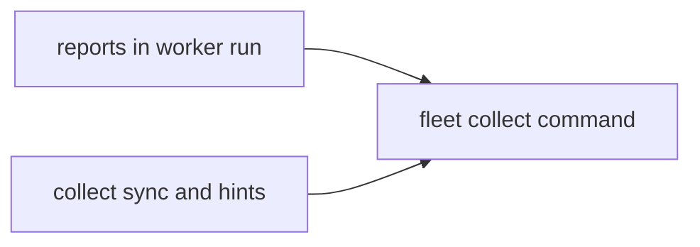

# Superlite: fleet reports go to the worker's run; `sl fleet collect Wn` brings a late remote snapshot home (#986, #984)

**Goal:** `fleet wait` files each worker's report in the run that spawned the worker (its record's `state_dir`), so a session waiting from run A on a worker of run B finds and leaves the report in B (#986); a remote write worker whose collect ended BLOCKED can be collected again with `sl fleet collect Wn` (sync, then `fleet_remote_collect.collect` on its saved report) once its late stop record or snapshot lands, without redoing the task (#984).
**Architecture:** `fleet_io.report_dir(sd, w)` names the report folder from the record; `_finish`, `_finish_layer`, `_collected` and `fleet._report` use it. `fleet_remote_collect.collect` gains `sync=False` (one `fr.sync` before it reads the stop record) and its recoverable BLOCKED concerns name `sl fleet collect Wn`. `fleet_io.recollect(sd, wid)` re-parses the worker's saved `.md` report, runs the same parse-collect-json step `_finish` runs (shared helper) with `sync=True`, rewrites the `.json`, prints the wait line and stops the worker once collected; `fleet.py` adds the `collect` subcommand.
**Tech stack:** Python 3.10+ stdlib; pytest through `sl run_tests`.
**Spec:** this file, section Design.
**Detail:** contracts
**Target-min:** 11
**Wave0:** none
**Coverage:** off

Global constraints:
- Every line of a Python script under `skills/**/scripts/` keeps the repo's `# O(...)` complexity comment; stdlib only; LF endings. Files under `tests/` carry no such comments.
- This repository is public: no host names, user names, home paths, other project or repository names in code, tests, docs or commit messages.
- The verdict is `sl run_tests` (never raw pytest); every new test sees a red run before the code it tests.
- Never edit files other open batches own: docs/hooks.md, hooks/hooks.json, skills/subagent-driven-development/scripts/fleet_roles.py, skills/subagent-driven-development/scripts/sl, skills/subagent-driven-development/scripts/worktree.py, docs/testing.md. Never edit skills/subagent-driven-development/fleet.md or any SKILL.md (lead's ruling: no headless or evals layer for this batch).
- An existing test under tests/scripts/ that pins a changed text or path may be updated in this task; name each such file in your report.
- Builds: the verdict is `sl run_tests` (the project's test command; a project with `.maxapp` runs `maxapp test`, which a build pool may place on another Mac, and a full run whose tree a green maxapp test stamp covers returns that result without a run); task trees build in <tree>/.build/DerivedData and any build of your own goes under .build/ of the worktree, never -derivedDataPath outside the worktree (your session scratchpad included; backlog cleanup removes scratchpad build folders when the worktree goes); a product, simulator or device build stays on this machine and runs only when an issue's acceptance asks for a running-app check; copy this sentence into every worker brief.
- Simulators: append the UDID of each simulator you or a worker creates (`xcrun simctl create` or `clone`; a checker's `Simulators:` line marks its created ones) as one line to the worktree's `.superlite/simulators.txt`; never list one you did not create; ship cleanup shuts down and deletes each listed one; copy this sentence into every worker brief.

## Design

#986 (follow-up of B252/#786, Max's decision there: reports go to the brief's ROOT): `fleet_io._finish` writes `<sd>/fleet/reports/<id>.{md,json}` with `sd` the waiting run. Since B252 one session fleet file serves several runs, and each worker record keeps `state_dir`: the spawning run's resolved `.superlite` for a local worker (fleet_state.py), `<run>/remote/<wid>` for a remote one (fleet_remote_worker.py). Stop records are already read from `state_dir` (`latest_stop`).

#984 (follow-up of B250/#953): a remote write worker whose collect ended BLOCKED (no stop record mirrored within 45 s, fetch failed, conflict) is left ready with `last_task`, `sent` and its `remote` block intact, not stopped, its host tree kept; the `.json` holds BLOCKED plus the concern; the `.md` holds the worker's own reply, so re-parsing it gives the worker's own status. No command collects it again.

1. **Report folder.** `report_dir(sd, w)`: `run = Path(w["state_dir"])`, for a remote record (`machine` set) whose `run.parent.name == "remote"` the run is `run.parent.parent`; when that run folder is not a directory, or there is no `state_dir`, or it resolves to `sd`, the result is `Path(sd) / "fleet" / "reports"` (byte-identical to today's paths); else `run / "fleet" / "reports"`. `_finish`, `_finish_layer` and `_collected` use it; `fleet._report` uses it for a worker id (a bare report label keeps reading the waiting run's folder).
2. **Collect sync and hints.** `collect(sd, wid, report, sync=False)`: with `sync=True` it calls `_sync(sd, wid)` once before `_await_stop`. The no-stop-record concern gains `; sl fleet collect <wid> brings it home once its stop record lands`, the fetch concern `; sl fleet collect <wid> retries`, the conflict concern `; sl fleet collect <wid> retries once those local edits are resolved`; the hook-took-none and sha-mismatch concerns stay as they are.
3. **Re-collect.** `recollect(sd, wid) -> int`, exit 0 collected or already collected, 2 refused, 3 still BLOCKED; details in T3.
4. **Docs.** docs/fleet.md (subcommand list, a `fleet collect` bullet, the report folder sentence, the Remote machines concern texts); the docs/tools.md fleet row is a follow-up (B262 owns docs/tools.md).

### Rulings

- Ruling: [scope] #986's "findings.py then read it there" needs no findings.py change: `findings route` reads the REPORT.json paths it is given, which `fleet wait` prints absolute; red_gap, commit_task, batch_grade and backlog_run read their own run's folder, where that run's workers' reports now land (lead's ruling).
- Ruling: a record's run folder that no longer exists, or a record without `state_dir`, keeps the report in the waiting run (because a removed worktree must not lose a report) (lead's ruling).
- Ruling: `fleet collect` writes no second `agent_stop` telemetry line and changes no pane label (because telemetry is one line per send, keyed on `tel_stop`) (lead's ruling).
- Ruling: no lock around `recollect` beyond collect's own once-check (because a second apply of the same snapshot copies only paths that already equal the result) (lead's ruling).
- Ruling: skills/subagent-driven-development/fleet.md stays unchanged; the BLOCKED concern itself names `sl fleet collect Wn`, and docs/fleet.md documents it (because a skills/** edit needs the headless layer) (lead's ruling).
- Ruling: T3 lists fleet_io.py and fleet.py as Also-touches although T1 owns them (lint ALSO-TOUCHES warning): T3 runs after T1's commit, so its tree holds T1's edits (lead's ruling).
- Ruling: lint's MISSED TARGET is accepted (because T3 edits the two files T1 edits and runs T2's collect) (lead's ruling).

## Task graph

```mermaid
%% schedule
gantt
  title Predicted schedule (mm:ss)
  dateFormat X
  axisFormat %M:%S
  section lane 1
  T1 reports in worker run :t1, 0, 587s
  T3 fleet collect command :t3, 587, 592s
  section lane 2
  T2 collect sync and hints :t2, 0, 555s
```

critical path: T1 → T3 (19.7 min) · peak width 2 · predicted build 19.7 min · predicted total ≈ 36.2 min (target ✗ 11.0)

## Package: fleet

App type: library (fleet CLI and its report files). Categories: state (worker record, report files), protocol (exact lines, exit codes, concern texts), error handling (missing folders, refusals).
**Probe entry:** none (the tests drive `fleet_io` and `fleet.main` on temporary run folders with Herdr and the remote calls faked)

### T1 reports in worker run · Complexity 3 · Est. context 55k
**Owns:** skills/subagent-driven-development/scripts/fleet_io.py, skills/subagent-driven-development/scripts/fleet.py, tests/scripts/test_fleet_report_home_986.py
**Components:** 2
**LOC owned:** 150
**Tests:** fast
**Model:** sonnet
**Covers:** Design
**Produces:** fleet_io.report_dir(sd: str | Path, w: dict) -> Path
  e.g. report_dir("/a/.superlite", {"state_dir": "/b/.superlite"}) -> Path("/b/.superlite/fleet/reports") (when /b/.superlite is a directory)
  e.g. report_dir("/a/.superlite", {"machine": "m1", "state_dir": "/b/.superlite/remote/W3"}) -> Path("/b/.superlite/fleet/reports")
  e.g. report_dir(".superlite", {"state_dir": "/gone/.superlite"}) -> Path(".superlite/fleet/reports") · report_dir(".superlite", {}) -> Path(".superlite/fleet/reports")
**Review Focus:** state: `test_finish_files_report_in_worker_run`, `test_layer_report_in_worker_run`, `test_fleet_report_reads_worker_run`; protocol: `test_report_dir_examples`, `test_same_run_paths_unchanged`, `test_collected_line_names_worker_run`; error handling: `test_gone_run_falls_back`
**Test code (contracts):**
- `test_report_dir_examples`: the e.g. lines with tmp folders A and B (B existing, B/remote/W3 existing for the remote case).
- `test_same_run_paths_unchanged`: cwd = a tmp project, `sd = ".superlite"` (relative), record `state_dir` = its resolved path: `report_dir` == `Path(".superlite/fleet/reports")` exactly.
- `test_finish_files_report_in_worker_run`: runs A and B; `fio._finish(A, "W1", {"task": "T1", "state_dir": str(B), "role": "implementer"}, "Status: DONE\n", "transcript")` with `pane_label`, `pane_title`, `_tel_finish`, `_ready` and `_stop_worker` patched to no-ops: B/fleet/reports/T1.md and T1.json exist, A/fleet/reports has no T1 file, the stdout line ends with `B/fleet/reports/T1.json` and the returned `report` is that path.
- `test_layer_report_in_worker_run`: `fio._finish_layer(A, "W2", {"task": "L1", "state_dir": str(B)}, {"status": "PASS", "exit": 0, "log": "x.log", "last": "ok"})` (`_ready`, `_stop_worker` patched) writes B/fleet/reports/L1.json.
- `test_collected_line_names_worker_run`: `fio._collected(A, "W1", {"state": "ready", "last_task": "T1", "state_dir": str(B)})` is True and prints `W1 T1 already collected: <B>/fleet/reports/T1.json`.
- `test_fleet_report_reads_worker_run`: A's fleet.json holds W1 (state ready, last_task T1, state_dir B); B/fleet/reports/T1.md holds `hello`: `fleet._report(Path(A), ["W1"])` prints `hello`, returns 0; `fleet._report(Path(A), ["T1"])` (a label) returns 1 with `error: unknown worker or report label T1` on stderr.
- `test_gone_run_falls_back`: record `state_dir` = a path that does not exist: `_finish` writes A/fleet/reports/T1.json.
**Steps:** 1 write the tests, 2 run: FAIL, 3 implement Design 1 (`report_dir` next to `_finish`; `_finish`, `_finish_layer`, `_collected` call it; `fleet._report` takes the folder from `fio.report_dir(sd, w)` for a worker id, else `sd / "fleet" / "reports"`; one module-docstring sentence in fleet_io.py), 4 run: PASS
**Notes:** reuse the fleet.json helpers of tests/scripts/test_fleet_session_folder_786.py or test_fleet_plan_folder_707.py for two runs. Verify with `sl run_tests --fast tests/scripts/test_fleet_report_home_986.py tests/scripts/test_fleet_io.py tests/scripts/test_fleet_cli_b54.py tests/scripts/test_fleet_follow_580.py tests/scripts/test_fleet_io_roles.py tests/scripts/test_fleet_wait_once_578.py tests/scripts/test_fleet_session_folder_786.py tests/scripts/test_fleet_plan_folder_707.py tests/scripts/test_fleet_wait_report_b91.py --task T1`.

### T2 collect sync and hints · Complexity 2 · Est. context 35k
**Owns:** skills/subagent-driven-development/scripts/fleet_remote_collect.py, tests/scripts/test_fleet_remote_collect_984.py
**Components:** 1
**LOC owned:** 90
**Tests:** fast
**Model:** sonnet
**Covers:** Design
**Produces:** fleet_remote_collect.collect(sd: str | Path, wid: str, report: dict, sync: bool = False) -> dict
  e.g. collect(sd, "W1", {"status": "DONE", "findings": []}, sync=True) -> {"status": "DONE", "findings": [], "collected": {"applied": ["src/a.py"], "skipped": [], "sha": "abc123"}} (the first fr.sync mirrors the task turn's stop record with snapshot abc123)
  e.g. collect(sd, "W1", {"status": "DONE", "findings": []}) -> {"status": "BLOCKED", "findings": [], "concerns": ["remote worker W1 left no snapshot: no stop record of its task reached this machine within 45 s; its tree T stays on L (snapshot ref R); sl fleet collect W1 brings it home once its stop record lands"]} (no stop record within WAIT_S)
**Review Focus:** protocol: `test_no_record_concern_names_fleet_collect`, `test_fetch_and_conflict_concerns_name_fleet_collect`, `test_hook_took_none_unchanged`; state: `test_sync_first_reads_late_record`
**Test code (contracts):**
- `test_sync_first_reads_late_record`: the fixtures of tests/scripts/test_fleet_remote_collect.py and _953.py (`env`, `worker`, `host_snapshot`, `clock`); fake `frc.fr.sync` appends the task turn's stop record (with the snapshot) on its first call only; a clock that passes WAIT_S at its second reading: `collect(..., sync=True)` returns the report with `collected.sha` == the snapshot; the same setup with `sync=False` returns BLOCKED with the no-record concern.
- `test_no_record_concern_names_fleet_collect`: the second e.g. line's concern text exactly (tree, label and ref from the fixture record).
- `test_fetch_and_conflict_concerns_name_fleet_collect`: `fr.fetch` raising `fr.RemoteError("down")` gives the concern `cannot fetch W1's work: down; sl fleet collect W1 retries`; `remote_apply.apply` returning `{"conflicts": ["a.py"], "applied": [], "skipped": []}` gives `remote changes conflict with local edits: a.py (kept at <kept ref>); sl fleet collect W1 retries once those local edits are resolved`.
- `test_hook_took_none_unchanged`: a stop record without `snapshot` gives the concern without `sl fleet collect`.
**Steps:** 1 write the tests, 2 run: FAIL, 3 implement Design 2 (module docstring names `sync` and the hint), 4 run: PASS
**Notes:** update docs-free pins only: tests/scripts/test_fleet_remote_collect_953.py and test_fleet_remote_collect.py if they assert the old concern texts exactly. Verify with `sl run_tests --fast tests/scripts/test_fleet_remote_collect_984.py tests/scripts/test_fleet_remote_collect.py tests/scripts/test_fleet_remote_collect_953.py tests/scripts/test_fleet_remote_worker.py --task T2`.

### T3 fleet collect command · Complexity 4 · Est. context 60k
**Owns:** tests/scripts/test_fleet_collect_984.py, docs/fleet.md, tests/scripts/test_fleet_docs_b54.py
**Also-touches:** skills/subagent-driven-development/scripts/fleet_io.py, skills/subagent-driven-development/scripts/fleet.py
**Components:** 2
**LOC owned:** 200
**Tests:** fast
**Model:** sonnet
**Covers:** Design
**Consumes:** fleet_io.report_dir(sd: str | Path, w: dict) -> Path (T1) · fleet_remote_collect.collect(sd: str | Path, wid: str, report: dict, sync: bool = False) -> dict (T2)
**Produces:** fleet_io.recollect(sd: str | Path, wid: str) -> int
  e.g. recollect(sd, "W1") -> 0, stdout `W1 T1 DONE findings=0 <report_dir>/T1.json` (late snapshot applied; the json holds `collected`)
  e.g. recollect(sd, "W1") -> 3, stdout `W1 T1 BLOCKED findings=0 concerns=1 <report_dir>/T1.json` (still no stop record)
  e.g. recollect(sd, "W9") -> 2, stderr `error: unknown worker W9`
**Review Focus:** state: `test_collect_brings_late_snapshot_home`, `test_collect_one_turn_worker_stopped`, `test_collect_already_collected`; protocol: `test_collect_still_blocked_exit_3`, `test_fleet_cli_collect`, `test_docs_name_fleet_collect`; error handling: `test_collect_refusals`
**Test code (contracts):**
- Fixture: a run with W1 a remote write worker (record as in tests/scripts/test_fleet_remote_collect.py: `machine`, `remote` with write, tree, label, name, project, start, owns, snapshot_ref; `sent`), state ready, `task` None, `last_task` T1, one_turn False; `report_dir/T1.md` = a DONE reply (`Status: DONE` and a json block, source transcript); `T1.json` = BLOCKED with the no-record concern; `fio._remote().stop` and `fio._stop_worker` patched to record calls.
- `test_collect_brings_late_snapshot_home`: fake `fr.sync` mirrors the stop record with a snapshot, fetch and apply faked as in the T2 fixtures: exit 0; stdout is the first e.g. line; T1.json status DONE, no `concerns`, `collected.sha` == the snapshot; the record's `remote.collected` == the snapshot; `_remote().stop(sd, "W1")` called once; T1.md unchanged.
- `test_collect_still_blocked_exit_3`: no stop record, clock past WAIT_S: exit 3; stdout the second e.g. line; T1.json has exactly one concern (the fresh no-record concern); no stop call.
- `test_collect_already_collected`: T1.json with `collected`: exit 0, stdout `W1 T1 already collected: <report_dir>/T1.json`, fr.sync never called.
- `test_collect_one_turn_worker_stopped`: one_turn True, late snapshot: exit 0, `_stop_worker(sd, "W1")` called once.
- `test_collect_refusals` (exit 2, stderr line, nothing written): unknown W9 `error: unknown worker W9`; a local worker `error: W1 is not a remote write worker: nothing to collect`; state busy on T1 `error: W1 is busy on T1; run sl fleet wait W1 first`; state stopped `error: W1 is stopped: its remote tree is gone`; no last_task `error: W1 has no collected report; run sl fleet wait W1 first`; no T1.md `error: W1 T1: no report file in <report_dir>`; T1.md a NEEDS_CONTEXT reply `error: W1 T1 is NEEDS_CONTEXT: nothing to collect`.
- `test_fleet_cli_collect`: `fleet.main(["collect", "W1", "--plan", <sd>])` returns recollect's code (patched to return 3); `fleet.main(["--help"])` output names `collect`.
- `test_docs_name_fleet_collect`: docs/fleet.md holds `` `fleet collect Wn [--plan P]` `` and the subcommand list `(on, off, status, spawn, placement, stop, name, report, collect, send, keys, wait, run, restore, resume)`; docs/tools.md is not edited (B262 owns it).
**Steps:** 1 write the tests, 2 run: FAIL, 3 implement: split `_finish` after its `.md` write into `_result(sd, wid, w, text, source, label, jp, mp, sync=False)` (parse, collect when `_write_remote(w)` and the status is FINAL, not_run, `.json` write; returns rep, unrun, part) and `_release(sd, wid, w, rep)` (its two stop branches), so `_finish`'s output stays byte-identical; `recollect` checks the refusals in the listed order, reads T1.json (already collected), re-parses T1.md with `allow_json` from the json's `source`, refuses a status outside FINAL, calls `_result(..., sync=True)`, prints the wait line (`Wn <label> <STATUS> findings=N [concerns=N] [not_run=N] <jp>`), calls `_release`, returns 0 when `rep` has `collected` else 3; `fleet.py` adds subparser `collect` (`id`, `--plan`) and the branch `importlib.import_module("fleet_io").recollect(sd, a.id)`, plus one module-docstring line; docs/fleet.md: `collect` in the subcommand list, a bullet after `fleet report` (`fleet collect Wn [--plan P]` syncs the remote write worker's mirror and collects its saved report again: exit 0 collected, 3 still BLOCKED, 2 refused (#984)), the report folder sentence (`fleet wait` saves each report in the worker's own run, its record's `state_dir`, a remote worker's run two levels above its `remote/<wid>` folder; a run folder that is gone keeps it in the waiting run (#986)) and the Remote machines concern texts with their hints; update the pinned list in test_fleet_docs_b54.py; 4 run: PASS
**Notes:** `_result` reads the record's `one_turn` and `remote` from the `w` it is given; `recollect` passes the record as loaded (task None, `last_task` the label). Verify with `sl run_tests --fast tests/scripts/test_fleet_collect_984.py tests/scripts/test_fleet_report_home_986.py tests/scripts/test_fleet_remote_collect_984.py tests/scripts/test_fleet_io.py tests/scripts/test_fleet_docs_b54.py tests/scripts/test_fleet_docs_578_579.py tests/scripts/test_fleet_remote_collect.py tests/scripts/test_fleet_remote_collect_953.py tests/scripts/test_fleet_cli_b54.py --task T3`.

## Review Focus

- T1 state: a wait from run A on a worker of run B writes only into B; same-run paths stay byte-identical (relative `sd` stays relative).
- T2 protocol: concern texts exact; `sync=False` behaves exactly as before.
- T3 state: `_finish` output and json byte-identical after the split; `recollect` rewrites the json from the `.md`, never stacks concerns, stops the worker only once collected.

## Self-review

#986 maps to T1 (and the docs sentence in T3); #984 maps to T2 and T3. T1 and T2 share no file; T3 waits for both (it edits T1's two files and runs T2's collect). Contracts name exact texts and exit codes.
