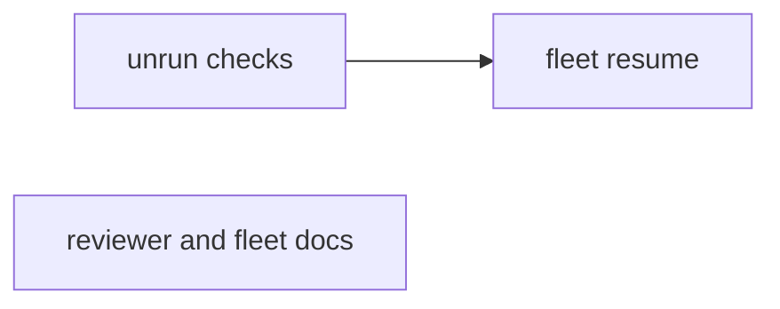

# Superlite: unrun checks on the wait line, resume a stopped reviewer (#807, #808, #968)

**Goal:** a package reviewer that did not run a check its brief names says so in a fixed line, and `fleet wait` shows it (`DONE_WITH_CONCERNS ... not_run=N`, or ` partial` for an APPROVED) (#807); a one-turn worker that `fleet wait` stopped can be continued in its own session with a follow-up text (#808, Max: `fleet resume Wn --text`). #968 needs no change: B243 shipped it (`fleet_io.wave_failure` skips research and writer findings; `tests/scripts/test_fleet_wave_research_903.py::test_wave_waits_for_both_research_workers`).
**Architecture:** `fleet_report` gets the `NOT_RUN` rule text and the `not_run(text)` line parser; `fleet_report.brief_message` and `fleet_io.report_contract` append the rule for a package reviewer; `fleet_io._finish` reads the lines, downgrades the status and prints ` not_run=N`. A new tool `fleet_resume.py` relaunches a stopped one-turn worker with `fleet_restore`'s helpers (`_new_pane`, `_start`, `_argv`, `_stem`) and sends the text with `fleet_io.send_text`; `fleet_io._refusal` names it for such a worker.
**Tech stack:** Python 3.10+ stdlib; pytest through `sl run_tests`.
**Spec:** this file, section Design.
**Detail:** tests
**Target-min:** 11
**Wave0:** none
**Coverage:** off (bounded change to existing fleet flows; every open choice is a Ruling below)

Global constraints:
- Every line of a Python script under `skills/**/scripts/` keeps the repo's `# O(...)` complexity comment; stdlib only; LF endings. Files under `tests/` carry no such comments.
- This repository is public: no host names, user names, home paths, other project or repository names in code, tests, docs or commit messages.
- The verdict is `sl run_tests` (never raw pytest); every new test sees a red run before the code it tests.
- An existing test that pins a changed text or output is updated in the same task only when it is in the task's Owns. Any other test your change turns red: leave it, and name the file and the failing assertion in your report (the coordinator rules it).
- Never edit `skills/subagent-driven-development/scripts/fleet.py` (another batch owns it).
- Builds: the verdict is `sl run_tests` (the project's test command; a project with `.maxapp` runs `maxapp test`, which a build pool may place on another Mac, and a full run whose tree a green maxapp test stamp covers returns that result without a run); task trees build in <tree>/.build/DerivedData and any build of your own goes under .build/ of the worktree, never -derivedDataPath outside the worktree (your session scratchpad included; backlog cleanup removes scratchpad build folders when the worktree goes); a product, simulator or device build stays on this machine and runs only when an issue's acceptance asks for a running-app check; copy this sentence into every worker brief.
- Simulators: append the UDID of each simulator you or a worker creates (`xcrun simctl create` or `clone`; a checker's `Simulators:` line marks its created ones) as one line to the worktree's `.superlite/simulators.txt`; never list one you did not create; ship cleanup shuts down and deletes each listed one; copy this sentence into every worker brief.

## Design

### 1. Unrun checks (#807)

- `fleet_report.NOT_RUN` (exact, between the quotes): "Run every check your brief names (a running-app check on a simulator or the Mac, a launch, a named command). For each one you did not run, write one line `Not run: <check> - <why>` before the Status line, and end DONE_WITH_CONCERNS, never DONE."
- `fleet_report.not_run(text) -> list[str]`: the checks a reply names as not run, in order. A line `Not run: X` (case-insensitive label; optional leading `- `, `* ` or `1. `; label may be wrapped in `**` or backticks) gives `X` with its outer `*`/backticks stripped; a value `none`, `nothing`, `n/a`, `no` or `-` (case-insensitive, trailing `.` ignored) gives nothing. A label line with an empty value takes the bullet items (`- x`, `* x`, `1. x`) right below it, up to the first other line. Lines inside ``` fences are skipped. A non-str text gives `[]`.
- `fleet_report.brief_message("package-reviewer", path)` = `f"Read {path} and do what it says. {WORK} {NOT_RUN}"` (the remote send path calls it too); other roles unchanged.
- `fleet_io.report_contract` for role `package-reviewer` = `fleet_report.WORK + " " + fleet_report.NOT_RUN` (send --text, the ask, restore's continue).
- `fleet_io._finish`: `unrun = fleet_report.not_run(text)` unless the role is `research` or `writer` (then `[]`). With `unrun`: a `DONE` becomes `DONE_WITH_CONCERNS` (report JSON, wait line, returned result); an `APPROVED` gets ` partial` (`"partial": true`, so a wave ends); every status gets ` not_run=N` on the wait line right after ` concerns=N`; the JSON gains `"not_run": [...]` and, when the status changed, `"status_reported": "<the reply's status>"`. Without `unrun` every output stays byte-identical.

### 2. Resume a stopped worker (#808)

- New tool `skills/subagent-driven-development/scripts/fleet_resume.py`: `sl fleet_resume WID --text T [--plan P]`; `CMD = "sl fleet_resume"` is the spelling every hint prints.
- `fleet_resume.resume(sd, wid, text) -> int`, checks in this order, stderr and exit 2, no Herdr call: empty text `error: resume needs a non-empty --text`; unknown `error: unknown worker W9`; state not `stopped` `error: W1 is ready, not stopped; answer it with: sl fleet send W1 --text "..." --plan <sd>`; not `one_turn`, or role `lead` or `layer`: `error: W1 (implementer) is no one-turn worker; start a fresh one: <respawn_hint>`; `machine` set `error: W1 ran on mx; resume continues local workers only; start a fresh one: <hint>`; no `launch` `error: W1 has no launch record; start a fresh one: <hint>`.
- Session: the record's `session`, else `fleet_restore._stem(sd, wid)`; none: stdout `BLOCKED: W1 not resumed (no session id); start a fresh one: <hint>`, exit 3.
- Relaunch with `c = fleet_io.hc` (looked up at call time): `pane = fleet_restore._new_pane(c, sd, None, launch)` (error: `BLOCKED: W1 not resumed (no pane: <msg>)`); `screen = fleet_restore._start(c, name, pane, fleet_restore._argv(launch, sid))`. A start error whose screen (`c.read_screen(name, fleet.SCREEN_ROWS)`) or a returned screen that `accounts.sign_in_screen` matches: `fleet.mark_signed_out(sd, account)`, close the pane, `BLOCKED: W1 not resumed (account claude1 signed out: Claude Code sign-in screen); start a fresh one: <hint>`; another start error: close the pane, `BLOCKED: W1 not resumed (startup: <msg>)`. Every BLOCKED exits 3 and leaves the record stopped.
- Success: under `fs.locked`, the record gets `state: ready`, `pane_id`, `session`, and loses `dead` and `was`; stdout `W1 resumed pane=<pane> session=<sid[:8]> (<role>, last task <last_task>)`; then `fleet_io.send_text(sd, wid, text)` (contract appended, busy on its last task, `W1 text sent`); a `HerdrError` there: `BLOCKED: W1 resumed, text not sent (<msg>); send it: sl fleet send W1 --text "..." --plan <sd>`, exit 3. `one_turn` stays, so the next `fleet wait` report stops it again.
- `fleet_io._refusal` for a stopped (or dead) worker with `one_turn`, a `launch` record and no `machine`: `error: W1 is stopped (package-reviewer, last task rev-T3); continue its session: sl fleet_resume W1 --text "..." --plan <sd>; or start a fresh one: <hint>`; every other refusal keeps its text.

### 3. Docs

`agents/package-reviewer.md` gets the rule as a Rules bullet; `skills/subagent-driven-development/fleet.md` names ` not_run=N` and `fleet_resume`.

### 4. Rulings

- Ruling: [scope] #808 ships as `sl fleet_resume Wn --text T` (its own tool, like `fleet_restore`), not yet as `sl fleet resume`: routing the subcommand needs `fleet.py`, which B252 owns; a Follow-up asks for `resume` in fleet.py's delegation and help list and `fleet_resume.CMD = "sl fleet resume"` (because the batch may not touch fleet.py; cost if wrong: one more spelling to learn until the follow-up lands).
- Ruling: resume continues local one-turn workers only (refuses implementers in the pool, leads, layers and remote workers) and passes no machine gate, as `fleet restore` (because a pool implementer needs pool registration and a remote session lives on another machine; cost if wrong: a remote reviewer still needs a fresh spawn).
- Ruling: unrun checks come from `Not run:` lines the contract asks for, not from free prose (because "did not run" in prose also describes red runs and old behaviour; cost if wrong: a reviewer that ignores the rule stays silent).
- Ruling: ` not_run=N` never ends a wave by itself; only the APPROVED-to-partial case does (because DONE_WITH_CONCERNS is a wave-OK status the coordinator reads after the wave).
- Ruling: the parser and rule live in `fleet_report.py` (no open batch lists it), so `fleet_remote_worker.send_brief` gets the rule unedited.
- Ruling: sequential [T1 then T2] - both edit fleet_io.py.
- Ruling: MISSED TARGET accepted (because the critical path T1 → T2 is forced by the shared fleet_io.py; the forecast comes from contention and history).

## Task graph

```mermaid
%% schedule
gantt
  title Predicted schedule (mm:ss)
  dateFormat X
  axisFormat %M:%S
  section lane 1
  T1 unrun checks :t1, 0, 492s
  T2 fleet resume :t2, 492, 502s
  section lane 2
  T3 reviewer and fleet docs :t3, 0, 457s
```





critical path: T1 → T2 (16.6 min) · peak width 2 · predicted build 16.6 min · predicted total ≈ 31.1 min (target ✗ 11.0)

## Package: report (library)

App type: library (report parser). Categories: encoding (labels, bullets, fences, CRLF), protocol (wait line and JSON shape).
**Probe entry:** call=fleet_report.not_run

### T1 unrun checks · Complexity 3 · Est. context 45k
**Owns:** skills/subagent-driven-development/scripts/fleet_report.py, skills/subagent-driven-development/scripts/fleet_io.py, tests/scripts/test_fleet_not_run_807.py
**Components:** 2
**LOC owned:** 130
**Tests:** fast
**Model:** sonnet
**Kind:** design
**Covers:** 1
**Produces:** fleet_report.not_run(text: str) -> list[str] · fleet_report.NOT_RUN: str
  e.g. fleet_report.not_run("Not run: Mac launch - no GUI\nStatus: DONE") -> ["Mac launch - no GUI"]
  e.g. fleet_report.not_run("Not run: none\nStatus: DONE") -> []
**Review Focus:** encoding: `test_not_run_lines` (bold label, bullet list under an empty label, fence, `none`, CRLF, prose); protocol: `test_done_with_unrun_check_becomes_done_with_concerns`, `test_approved_with_unrun_check_is_partial`, `test_report_without_not_run_lines_is_unchanged`
**Test code (verbatim):**
```python
# tests/scripts/test_fleet_not_run_807.py: a report naming checks it did not run shows on the wait line (#807)
import json
import pytest
from test_fleet_io import world, io  # noqa: F401
import fleet_report


def recs(world):
    return json.loads((world.sd / "fleet.json").read_text())["workers"]


def set_role(world, wid, role):
    p = world.sd / "fleet.json"
    d = json.loads(p.read_text())
    d["workers"][wid]["role"] = role
    p.write_text(json.dumps(d))


def finish(world, wid, label, text):
    w = recs(world)[wid]
    w["task"] = label
    return io._finish(world.sd, wid, w, text, "transcript")


@pytest.mark.parametrize("text,want", [
    ("Not run: iOS simulator check - no simulator\nStatus: DONE", ["iOS simulator check - no simulator"]),
    ("- **Not run:** Mac launch - app did not build\nStatus: DONE", ["Mac launch - app did not build"]),
    ("Not run:\n- simulator check\n- Mac launch\nStatus: DONE", ["simulator check", "Mac launch"]),
    ("not run: `sl run_tests --full` - out of scope\r\nStatus: DONE", ["sl run_tests --full - out of scope"]),
    ("Not run: none.\nStatus: DONE", []),
    ("```\nNot run: inside a fence\n```\nStatus: DONE", []),
    ("The test did not run before the fix.\nStatus: DONE", []),
    (None, []),
])
def test_not_run_lines(text, want):
    assert fleet_report.not_run(text) == want


def test_done_with_unrun_check_becomes_done_with_concerns(world, capsys):
    set_role(world, "W1", "package-reviewer")
    r = finish(world, "W1", "rev-T3", "Reviewed T3.\nNot run: iOS simulator check - no simulator booted\nStatus: DONE")
    out = capsys.readouterr().out
    assert r["status"] == "DONE_WITH_CONCERNS" and "W1 rev-T3 DONE_WITH_CONCERNS findings=0 not_run=1 " in out
    rep = json.loads((world.sd / "fleet" / "reports" / "rev-T3.json").read_text())
    assert rep["status"] == "DONE_WITH_CONCERNS" and rep["status_reported"] == "DONE"
    assert rep["not_run"] == ["iOS simulator check - no simulator booted"]
    assert not io.wave_failure(r)


def test_approved_with_unrun_check_is_partial(world, capsys):
    set_role(world, "W1", "final-reviewer")
    r = finish(world, "W1", "FR1", "Not run: packet section 4 - file missing\nVerdict: APPROVED")
    assert r["status"] == "APPROVED" and r.get("partial") is True
    assert " findings=0 not_run=1 partial " in capsys.readouterr().out
    assert io.wave_failure(r)


def test_other_statuses_keep_their_word(world, capsys):
    set_role(world, "W1", "package-reviewer")
    r = finish(world, "W1", "rev-T4", "Not run: Mac launch - no GUI session\nStatus: BLOCKED")
    assert r["status"] == "BLOCKED" and "W1 rev-T4 BLOCKED findings=0 not_run=1 " in capsys.readouterr().out
    assert "status_reported" not in json.loads((world.sd / "fleet" / "reports" / "rev-T4.json").read_text())


@pytest.mark.parametrize("role", ["research", "writer"])
def test_research_and_writer_ignore_not_run_lines(world, capsys, role):
    set_role(world, "W1", role)
    r = finish(world, "W1", "R1", "Not run: nothing I could run here - read only\nStatus: DONE")
    assert r["status"] == "DONE" and "not_run" not in capsys.readouterr().out


def test_report_without_not_run_lines_is_unchanged(world, capsys):
    r = finish(world, "W1", "T3", "Status: DONE")
    out = capsys.readouterr().out
    assert r["status"] == "DONE" and "not_run" not in out and "W1 T3 DONE findings=0 " in out
    rep = json.loads((world.sd / "fleet" / "reports" / "T3.json").read_text())
    assert "not_run" not in rep and "status_reported" not in rep


def test_package_reviewer_texts_carry_the_rule(world):
    set_role(world, "W1", "package-reviewer")
    assert io.report_contract(recs(world)["W1"]) == fleet_report.WORK + " " + fleet_report.NOT_RUN
    assert io.report_contract(recs(world)["W2"]) == fleet_report.WORK
    assert fleet_report.brief_message("package-reviewer", "/r/b.md") == f"Read /r/b.md and do what it says. {fleet_report.WORK} {fleet_report.NOT_RUN}"
    assert fleet_report.brief_message("fixer", "/r/b.md") == f"Read /r/b.md and do what it says. {fleet_report.WORK}"
    assert "`Not run: <check> - <why>`" in fleet_report.NOT_RUN and fleet_report.NOT_RUN.endswith("never DONE.")
```
**Steps:** 1 write the test file, 2 run: FAIL, 3 add `NOT_RUN`, a `NOT_RUN_LINE` regex and `not_run` next to `PARTIAL`/`partial` in fleet_report.py and the package-reviewer branch in `brief_message`; in fleet_io.py add the `report_contract` branch and the `_finish` changes from Design 1 (the role read once; the returned dict carries the changed status), 4 run: PASS
**Notes:** verify with `sl run_tests --fast tests/scripts/test_fleet_not_run_807.py --task T1`, then once `sl run_tests --fast tests/scripts/test_fleet_report.py tests/scripts/test_fleet_report_planned_716.py tests/scripts/test_fleet_io.py tests/scripts/test_fleet_wave_research_903.py tests/scripts/test_fleet_wait_wave_683.py tests/scripts/test_fleet_io_ask_470.py --task T1` and report any red test outside Owns by file and assertion. Update fleet_io.py's module docstring with one sentence on ` not_run=N`.

## Package: resume (CLI)

App type: CLI over Herdr and fleet.json. Categories: protocol (args, refusals, exit codes), state (record after each path).
**Probe entry:** none (every path drives Herdr; the named tests cover each case with a fake)

### T2 fleet resume · Complexity 4 · Est. context 55k
**Owns:** skills/subagent-driven-development/scripts/fleet_resume.py, skills/subagent-driven-development/scripts/fleet_io.py, tests/scripts/test_fleet_resume_808.py
**Components:** 2
**LOC owned:** 220
**Tests:** fast
**Model:** sonnet
**Kind:** design
**Detail:** contracts
**Covers:** 2
**Consumes:** fleet_report.NOT_RUN: str (T1)
**Produces:** fleet_resume.resume(sd: Path, wid: str, text: str) -> int · fleet_resume.main(argv: list[str] | None = None) -> int · fleet_resume.CMD: str
**Review Focus:** protocol: `test_resume_refusals` (each refusal text, exit 2, no start_agent or prompt call); state: `test_resume_startup_failure_closes_pane`, `test_resume_signed_out` (record stays stopped, pane closed)
**Test code (contracts):** in `tests/scripts/test_fleet_resume_808.py`, reuse `test_fleet_io.world` and replace `io.hc` with a fake that has `create_tab`, `split_pane`, `create_workspace`, `start_agent`, `read_screen`, `prompt`, `call`, `close_pane`, `send_keys`, `wait_state`, `agent_state` and `HerdrError` (copy the shapes from `test_fleet_restore_577.Fake` and `test_fleet_io.FakeHerdr`; `create_tab` returns `("t1", "w7:p1")`). Worker W1: `role` package-reviewer, `one_turn` true, `state` stopped, `last_task` rev-T3, `session` "sess-1234abcd", `account` claude1, `launch` {"argv": ["--agent", "superlite:package-reviewer", "--model", "sonnet"], "env": {"K": "v"}, "cwd": str(world.proj)}.
- `test_resume_relaunches_and_sends_text`: `fleet_resume.main(["W1", "--text", "run the simulator check", "--plan", str(world.sd)]) == 0`; one `start_agent` on pane `w7:p1` with argv `[... "--model", "sonnet", "--resume", "sess-1234abcd"]`; one prompt whose text starts with `run the simulator check` and ends with `fleet_report.WORK + " " + fleet_report.NOT_RUN`; W1 becomes `state` busy, `task` rev-T3, `pane_id` w7:p1, `one_turn` true; stdout lines `W1 resumed pane=w7:p1 session=sess-123 (package-reviewer, last task rev-T3)` and `W1 text sent`.
- `test_resume_takes_the_session_from_the_stop_record`: no `session`, `metrics.jsonl` line `{"ev": "stop", "t": 5, "agent_id": "W1", "transcript": "/t/abc-123.jsonl"}`: argv ends `["--resume", "abc-123"]`.
- `test_resume_refusals` (parametrized, exit 2, exact stderr line, no start_agent or prompt): text "  " gives `error: resume needs a non-empty --text`; W9 gives `error: unknown worker W9`; state ready gives `error: W1 is ready, not stopped; answer it with: sl fleet send W1 --text "..." --plan <world.sd>`; `one_turn` false and role implementer gives a line starting `error: W1 (implementer) is no one-turn worker; start a fresh one: sl fleet spawn`; `machine` "mx" starts `error: W1 ran on mx; resume continues local workers only; start a fresh one: sl fleet spawn`; no `launch` starts `error: W1 has no launch record; start a fresh one: sl fleet spawn`.
- `test_resume_without_session_is_blocked`: no session, no stop record: exit 3, stdout starts `BLOCKED: W1 not resumed (no session id); start a fresh one: sl fleet spawn --role package-reviewer`, W1 stays stopped.
- `test_resume_startup_failure_closes_pane`: `start_agent` raises `HerdrError("boom", "no shell")`, screen without a sign-in line: exit 3, stdout `BLOCKED: W1 not resumed (startup: no shell)`, `close_pane("w7:p1")` called, W1 stays stopped.
- `test_resume_signed_out`: `read_screen` returns `Select login method:\n`: exit 3, stdout starts `BLOCKED: W1 not resumed (account claude1 signed out: Claude Code sign-in screen); start a fresh one:`, `close_pane("w7:p1")` called, `fleet.json` `signed_out` holds claude1, W1 stays stopped, no prompt.
- `test_send_refusal_names_resume`: `io.main(["send", "W1", "--text", "hi", "--plan", str(world.sd)]) == 2`, stderr `error: W1 is stopped (package-reviewer, last task rev-T3); continue its session: sl fleet_resume W1 --text "..." --plan <sd>; or start a fresh one: sl fleet spawn --role package-reviewer --plan <sd>` with `<sd>` = `io.state.resolve(str(world.sd))`; the same worker with `machine` "mx" keeps the old text `error: W1 is stopped (package-reviewer, last task rev-T3); start a fresh one: ...`.
**Steps:** 1 write the tests, 2 run: FAIL, 3 write fleet_resume.py (module docstring, argparse `wid`, `--text`, `--plan`; `sd = state.resolve(plan)`; lazy `import fleet_restore`, `fleet`, `accounts` inside `resume`), then the `_refusal` branch in fleet_io.py importing `fleet_resume.CMD` lazily, 4 run: PASS
**Notes:** verify with `sl run_tests --fast tests/scripts/test_fleet_resume_808.py --task T2`, then once `sl run_tests --fast tests/scripts/test_fleet_dead_send_579.py tests/scripts/test_fleet_restore_577.py tests/scripts/test_fleet_io.py tests/scripts/test_doc_contract.py --task T2`. `fleet.mark_signed_out(sd, account)` writes fleet.json `signed_out`; read its shape in fleet.py, never edit fleet.py.

## Package: docs

App type: docs (agent and coordinator rules). Categories: protocol (exact sentences, pinned neighbours).
**Probe entry:** none (docs only)

### T3 reviewer and fleet docs · Complexity 1 · Est. context 30k
**Owns:** agents/package-reviewer.md, skills/subagent-driven-development/fleet.md, tests/scripts/test_docs_b251.py
**Components:** 1
**LOC owned:** 40
**Tests:** fast
**Model:** haiku
**Kind:** mechanical
**Covers:** 3
**Review Focus:** protocol: `test_reviewer_rule_is_last_rules_bullet`, `test_fleet_md_names_not_run_and_resume`
**Test code (verbatim):**
```python
# tests/scripts/test_docs_b251.py: the reviewer rule and fleet.md lines for unrun checks and resume (#807, #808)
from pathlib import Path

ROOT = Path(__file__).resolve().parents[2]
RULE = ("- Checks your brief names (a running-app check on a simulator or the Mac, a launch, a named command) are part of "
        "the review: run each one. A check you did not run (no simulator, not reachable, skipped) gets one line "
        "`Not run: <check> - <why>` in your report, and your status is then DONE_WITH_CONCERNS, never DONE; "
        "`fleet wait` shows such a report with ` not_run=N`.")
NOT_RUN = ("- ` not_run=N` (after `findings=` and ` concerns=`): the report names N checks it did not run "
           "(`Not run: <check> - <why>` lines); `fleet wait` turns its DONE into DONE_WITH_CONCERNS and its APPROVED "
           "into ` partial` (#807). Send the worker back with `\"$SL\" fleet_resume Wn --text \"run <check>\" --plan $PLAN`, "
           "or rule the check out.")
RESUME = (" A stopped one-turn worker (a reviewer, fixer, research, writer or checker on this machine) continues its own session instead: "
          "`\"$SL\" fleet_resume Wn --text \"...\" --plan $PLAN` opens a fresh pane, starts its agent with "
          "`--resume <session>` and sends the text with its report contract; wait for it as for a send, and "
          "`fleet wait` stops it again after its report (#808).")
SEND = "`fleet send` to a stopped or dead worker exits 2 with that spawn line."
RESEARCH = "- `findings=N` of a research or writer worker is its answer, not a failure: `--wave` keeps waiting (#903)."


def test_reviewer_rule_is_last_rules_bullet():
    lines = (ROOT / "agents" / "package-reviewer.md").read_text(encoding="utf-8").splitlines()
    i = lines.index(RULE)
    assert lines.count(RULE) == 1 and lines[i - 1].startswith("- If something spans tasks")
    assert lines[i + 1] == "" and lines[i + 2].startswith("Report in at most 300 words")


def test_fleet_md_names_not_run_and_resume():
    text = (ROOT / "skills" / "subagent-driven-development" / "fleet.md").read_text(encoding="utf-8")
    lines = text.splitlines()
    assert lines.count(NOT_RUN) == 1 and lines[lines.index(NOT_RUN) - 1] == RESEARCH
    assert text.count(SEND + RESUME) == 1
```
**Steps:** 1 write the test file, 2 run: FAIL, 3 add `RULE` as the line after the `- If something spans tasks` bullet in agents/package-reviewer.md; in fleet.md add `NOT_RUN` as the line after `RESEARCH` and insert `RESUME` right after the `SEND` sentence (same paragraph, the sentence after it unchanged), 4 run: PASS
**Notes:** the texts are the test constants, byte for byte. Verify with `sl run_tests --fast tests/scripts/test_docs_b251.py --task T3`, then once `sl run_tests --fast tests/scripts/test_reviewer_scope_b59.py tests/scripts/test_fleet_docs_578_579.py tests/scripts/test_docs_fleet_b243.py tests/scripts/test_worker_format_own_files_568.py --task T3`; report any red test outside Owns by file and assertion. `fleet_resume` exists once T2 lands; `test_doc_contract` checks the call then (the coordinator runs it after T2).

## Review Focus

- report (library): encoding and protocol. Risks: a `Not run:` label inside a fenced json or code block counted; `Not run: none` counted; a bullet list under an empty label running past its end; a DONE downgraded for a research or writer report; the wait line or JSON changing for a report without the lines.
- resume (CLI): protocol and state. Risks: a resumed worker left `ready` without the text; a failed start leaving the record `ready` or the new pane open; `--resume` given twice when the recorded argv already holds one (`fleet_restore._argv` drops it); the refusal hint offered for a remote or pool worker.

## Coordinator steps after the last task

1. Unit layer `sl run_tests --full`; headless layer and evals layer (agents/** and skills/** changed).
2. Package review of T1 and T2, final review, then ship: notes.md, pr-body.md, `sl backlog ship B251 lock`, `bump`, `merge`.

## Self-review

- Coverage: Design 1 is T1, Design 2 is T2, Design 3 is T3; #968 needs no task.
- Graph: T1 --> T2 only because both edit fleet_io.py; T3 names `fleet_resume` but runs no code of it.
- Names: `NOT_RUN`, `not_run`, `not_run=N`, `status_reported`, `fleet_resume.CMD`, `sl fleet_resume` are written the same everywhere.
