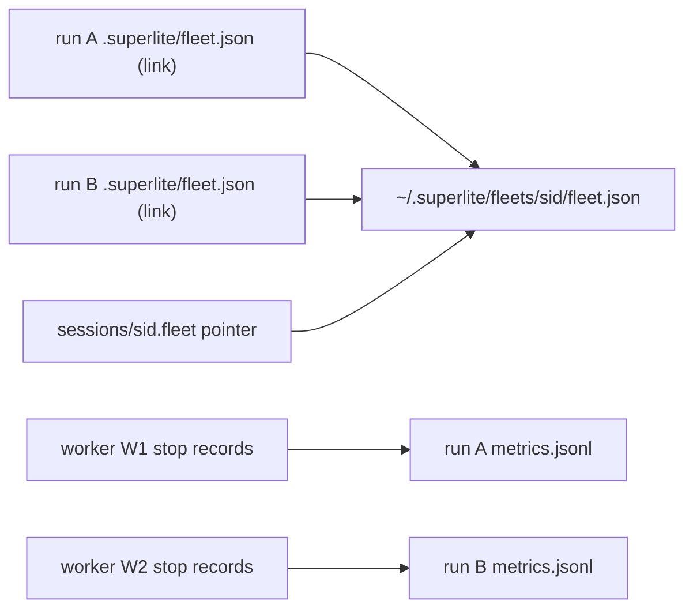
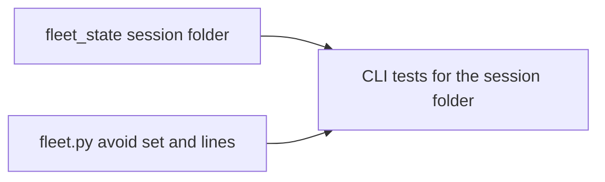

# Superlite: one fleet folder per session outside every worktree; avoid-set account choice

**Goal:** removing a worktree never orphans a session's fleet: the fleet file lives in a session folder under `~/.superlite/fleets/`, and every run the session's fleet serves holds `.superlite/fleet.json` as a symlink to it (#786, Max: "Session folder outside worktrees"). `fleet.choose_account(avoid=)` takes a set, `fleet_remote_account.pick` passes its signed-out pairs through it, and a sign-in placement skip names only the account (#966).
**Architecture:** `fleet_state.path(sd)` returns the file `<sd>/fleet.json` links to, so `load`, `save`, `locked` and every outside reader (hooks, backlog_run, trees, findings: all read through a link) see the session's one fleet. `set_on` puts a new fleet in the session folder and links the run; `follow` links a further run instead of moving the fleet, and first moves a fleet still kept as a plain file in a run folder into the session folder. Worker stop records keep going to the run the spawn named (its `state_dir`, `SUPERLITE_STATE_DIR`).
**Tech stack:** Python 3.10+ stdlib; pytest through `sl run_tests`.
**Spec:** this file, section Design.
**Detail:** tests
**Target-min:** 11
**Wave0:** none

Global constraints:
- Every line of a Python script under `skills/**/scripts/` keeps the repo's `# O(...)` complexity comment; stdlib only; LF endings. Files under `tests/` carry no such comments.
- This repository is public: no host names, user names, home paths, other project or repository names in code, tests, docs or commit messages.
- The verdict is `sl run_tests` (never raw pytest); every new test sees a red run before the code it tests.
- An existing test that pins a changed text or output is updated in the same task only when it is in the task's Owns. Any other test your change turns red: leave it, and name the file and the failing assertion in your report (the coordinator rules it).
- Session folder: `state.home() / "fleets" / <name>` holds `fleet.json` and `fleet.json.lock`; a run's link is an absolute symlink `<sd>/fleet.json -> <folder>/fleet.json`. No `moved_to` is written any more; `home(sd)` and the `fleet: off (moved to X)` texts stay for old runs.
- Never take the same lock file twice in one process (a second `flock` on a new descriptor blocks).
- Builds: the verdict is `sl run_tests` (the project's test command; a project with `.maxapp` runs `maxapp test`, which a build pool may place on another Mac, and a full run whose tree a green maxapp test stamp covers returns that result without a run); task trees build in <tree>/.build/DerivedData and any build of your own goes under .build/ of the worktree, never -derivedDataPath outside the worktree (your session scratchpad included; backlog cleanup removes scratchpad build folders when the worktree goes); a product, simulator or device build stays on this machine and runs only when an issue's acceptance asks for a running-app check; copy this sentence into every worker brief.
- Simulators: append the UDID of each simulator you or a worker creates (`xcrun simctl create` or `clone`; a checker's `Simulators:` line marks its created ones) as one line to the worktree's `.superlite/simulators.txt`; never list one you did not create; ship cleanup shuts down and deletes each listed one; copy this sentence into every worker brief.

## Design

Understood (#786): a session's fleet moved into worktree B when a fleet command named B (#580 follow); removing B lost fleet.json, so `fleet status` in A printed `fleet: off (moved to B/.superlite)` while W1-W6 still ran. Max chose "Session folder outside worktrees: one folder per session; survives worktree removal; reports go to the brief's ROOT".

- Session folder: `fleet_state.new_home(sid)` is `<home>/fleets/<sid>`, or `<sid>-2`, `<sid>-3`, ... while the earlier folder holds a fleet that is on. The session pointer `sessions/<sid>.fleet` now names that folder (the folder holding the fleet file).
- Link: `<sd>/fleet.json` is a symlink to `<folder>/fleet.json`. `path(sd)` returns the link target; `save` writes the target atomically (temp file in the session folder, then `os.replace`), so the link stays. `locked(sd)` re-reads `path(sd)` after it gets the lock and retries (at most 5 times) when the file became a link meanwhile.
- `set_on(sd)` with a session id: a run whose fleet.json is no link to an existing file gets its fleet in `new_home(sid)`: a plain file's data moves there (each worker keeps `state_dir`, default the run), none starts fresh; then the run links there, the on-update runs as today, `prune` runs, `remember` stores the folder. A run already linked to a live fleet updates that fleet (taking it over, as `fleet on` did before). Without a session id nothing changes (a plain file, as before).
- `set_off(sd)` removes the fleet file `path(sd)` and the run's link; other runs' links then dangle and read as fleet off.
- `follow(sd, sid, fallback, named)`: the source is the session's fleet (pointer, else an owned fallback). Unchanged gates: a session id, run state in the target unless named, no running lead in the source. A source that is still a plain file in a run folder is adopted first (moved into `new_home(sid)`, the run linked). Then the target is linked, unless it already links to that fleet or holds its own fleet that is on. Result `{"from", "to", "home", "workers", "line"}`; `line` is one or two stderr lines: `fleet: this session's fleet moved from <run> to <folder> (N workers)` (adoption) and `fleet: this session's fleet in <folder> now also serves <run> (N workers)` (link). Reports are never copied: each run keeps the reports its own `fleet wait` wrote.
- `prune()`: drops folders under `<home>/fleets/` whose newest file is older than `state.PRUNE_S` (14 days), never the one being used.
- #966: `choose_account(..., avoid=None)` takes a set of account names (a str counts as one name); `_retry_account` passes `{avoid}`; `fleet_remote_account.pick` calls `choose_account(sd, model, env, avoid=fleet_placement.signed_out_pairs(sd, label))` with no wrapper; `_unavailable` prints `placement: account A skipped on L (not signed in there); local` for a reason `fleet_remote_account.signed_out_account` reads, other reasons as before.
- Ruling: symlink, not a JSON pointer (because every reader outside fleet_state follows a link unchanged: hooks `[ -f ]`/`read`, backlog_run, trees, findings, batch_grade, pool; cost if wrong: one reader to switch to `fleet_state.load`).
- Ruling: [scope] `fleet wait` reports stay in the run whose wait wrote them; writing them to the worker's `state_dir` is fleet_io.py (B251's file), a follow-up (because stop records already land in the spawn's run).
- Ruling: a legacy plain fleet is adopted into the session folder on the session's next fleet command or binding (because a fleet left in a worktree is exactly what #786 loses).
- Ruling: docs (docs/fleet.md, docs/tools.md owned by B255; skills/subagent-driven-development/fleet.md) are a follow-up (because fleet.md under skills/ would add the headless layer for one sentence).
- Ruling: MISSED TARGET accepted (because the forecast's contention x3.5 sets the length of a two-task path, T1 then the tests-only T3).

## Coverage

| Category | State | Basis |
|---|---|---|
| Scope and success criteria | settled | #786 body and Max's choice; #966 body; success: status in A lists W1 and W2 after B is removed (T3 test) |
| Domain and data model | settled | fleet.json keys unchanged; `moved_to` no longer written (Design) |
| Persistence and migration | ruled | Ruling: legacy plain fleet adopted on the next fleet command or binding |
| Interfaces and contracts | settled | `path`, `follow` result keys, `choose_account(avoid=set)` (Design) |
| UI states | n/a | CLI only; stderr lines named in Design |
| Concurrency and state ownership | ruled | `locked` re-check after flock; adoption and link under the old and the new lock, never one file twice |
| Error handling and recovery | ruled | failed adoption removes its session file; a failed follow warns as today (`fleet: warning: fleet not moved`) |
| Security and privacy | n/a | local files under the user's home only |
| Performance and limits | ruled | prune after 14 days (state.PRUNE_S); at most 5 lock retries |
| Observability | settled | the two stderr lines; `fleet status` unchanged |
| Testing strategy | settled | unit tests per task; CLI scenario in T3; full suite once |
| Compatibility | ruled | no session id: plain file as before; old `moved_to` stubs still read |
| Rollout | ruled | ships with the patch bump; live sessions migrate on their next fleet command |
| Research unknowns | n/a | R1, R2 answered (worker stop records, fleet.json readers, /clear) |

## Main diagram



## File structure

- skills/subagent-driven-development/scripts/fleet_state.py: session folder, link-aware path/lock/save, set_on, set_off, follow, prune (T1).
- skills/subagent-driven-development/scripts/state.py: `bind` prints follow's `line` (T1).
- skills/subagent-driven-development/scripts/fleet.py: `_follow` prints `line`; choose_account avoid set; `_unavailable` text (T2).
- skills/subagent-driven-development/scripts/fleet_remote_account.py: pick passes avoid (T2).
- tests: T1 test_fleet_session_folder_786.py (new), test_fleet_follow_580.py; T2 test_fleet_b252.py (new), test_fleet_placement_signed_out_932.py; T3 test_fleet_worktree_removed_786.py (new), test_fleet_follow_cli_580.py, test_fleet_plan_folder_707.py, test_docs_580_fleet.py.

## Task graph

```mermaid
%% schedule
gantt
  title Predicted schedule (mm:ss)
  dateFormat X
  axisFormat %M:%S
  section lane 1
  T1 fleet_state session folder :t1, 0, 650s
  T3 CLI tests for the session folder :t3, 650, 642s
  section lane 2
  T2 fleet.py avoid set and lines :t2, 0, 642s
```





critical path: T1 → T3 (21.5 min) · peak width 2 · predicted build 21.5 min · predicted total ≈ 40.0 min (target ✗ 11.0)

## fleet_state

### T1 fleet_state session folder · Complexity 5 (O-1) · Est. context 45k
**Owns:** skills/subagent-driven-development/scripts/fleet_state.py, skills/subagent-driven-development/scripts/state.py, tests/scripts/test_fleet_session_folder_786.py, tests/scripts/test_fleet_follow_580.py
**Components:** 1
**LOC owned:** 140
**Tests:** fast
**Model:** sonnet
**Kind:** design
**Produces:** fleet_state.new_home(sid: str) -> Path
e.g. new_home("s1") -> <home>/fleets/s1 (no fleet on there)
e.g. new_home("s1") -> <home>/fleets/s1-2 (fleets/s1/fleet.json is on)
**Produces:** fleet_state.link(sd, home) -> None
**Produces:** fleet_state.prune(keep=()) -> None
**Produces:** fleet_state.follow(sd, sid=None, fallback=None, named=False) -> dict | None
e.g. follow(B, "s1") -> {"from": "<home>/fleets/s1", "to": "/r/B/.superlite", "home": "<home>/fleets/s1", "workers": 1, "line": "fleet: this session's fleet in <home>/fleets/s1 now also serves /r/B/.superlite (1 workers)"}
e.g. follow(B, "s1") with A plain -> {"from": "/r/A/.superlite", "to": "/r/B/.superlite", "home": "<home>/fleets/s1", "workers": 1, "line": "fleet: this session's fleet moved from /r/A/.superlite to <home>/fleets/s1 (1 workers)\nfleet: this session's fleet in <home>/fleets/s1 now also serves /r/B/.superlite (1 workers)"}
e.g. follow(B, "s1") when B already links there -> None
**Review Focus:** `test_lock_retries_when_the_file_became_a_link`: a link made between the first `path` and the flock moves the lock to the session folder; `test_failed_adoption_leaves_the_run_file`: `link` raising OSError leaves A plain and on and no `fleets/s1/fleet.json`
**Test code (verbatim):**
```python
"""#786: a session's fleet lives in one folder outside every worktree; each run it serves links to it."""
import os, shutil, sys
from pathlib import Path

import pytest

from test_plan_tools import SCRIPTS
sys.path.insert(0, str(SCRIPTS))
import fleet_state as fs  # noqa: E402
import state  # noqa: E402


@pytest.fixture(autouse=True)
def _sid(monkeypatch):
    monkeypatch.setenv("SUPERLITE_SESSION_ID", "s1")
    monkeypatch.delenv("CLAUDE_CODE_SESSION_ID", raising=False)
    monkeypatch.delenv("SUPERLITE_STATE_DIR", raising=False)


def run(tmp_path, name):
    d = tmp_path / name / ".superlite"; d.mkdir(parents=True); (d / "stable.json").write_text("{}"); return d


def home(name="s1"):
    return (state.home() / "fleets" / name).resolve()


def same(a, b):
    return Path(a).resolve() == Path(b).resolve()


def test_set_on_puts_the_fleet_in_the_session_folder(tmp_path):
    A = run(tmp_path, "A")
    fs.set_on(A, "x", ["claude1"])
    assert (A / "fleet.json").is_symlink() and same(fs.path(A), home() / "fleet.json")
    assert fs.is_on(A) and fs.load(A)["owner_session"] == "s1"
    assert fs.pointer_path("s1").read_text() == str(home()) + "\n"


def test_writes_go_through_the_link(tmp_path):
    A = run(tmp_path, "A"); fs.set_on(A, "x", [])
    fs.add_worker(A, "W1", "p1", "claude1", "implementer", "sonnet")
    assert (A / "fleet.json").is_symlink()
    assert "W1" in fs.load(home())["workers"]
    assert fs.workers(A)["W1"]["state_dir"] == str(A.resolve())


def test_removed_worktree_keeps_the_fleet(tmp_path):
    A = run(tmp_path, "A"); B = run(tmp_path, "B")
    fs.set_on(A, "x", []); fs.add_worker(A, "W1", "p1", "a", "g", "t")
    r = fs.follow(B, "s1")
    assert r["to"] == str(B.resolve()) and r["home"] == str(home())
    assert r["line"] == f"fleet: this session's fleet in {home()} now also serves {B.resolve()} (1 workers)"
    fs.add_worker(B, "W2", "p2", "a", "g", "t")
    shutil.rmtree(tmp_path / "B")
    assert fs.is_on(A) and set(fs.workers(A)) == {"W1", "W2"}
    assert fs.workers(A)["W2"]["state_dir"] == str(B.resolve())
    assert "moved_to" not in fs.load(A)


def test_follow_adopts_a_plain_fleet(tmp_path):
    A = run(tmp_path, "A"); B = run(tmp_path, "B")
    fs.save(A, {**fs.default(), "on": True, "owner_session": "s1", "workers": {"W1": {"state": "busy"}}})
    fs.remember(A, "s1")
    r = fs.follow(B, "s1")
    assert (A / "fleet.json").is_symlink() and (B / "fleet.json").is_symlink()
    assert same(fs.path(A), home() / "fleet.json") and same(fs.path(B), home() / "fleet.json")
    assert fs.load(B)["workers"]["W1"]["state_dir"] == str(A.resolve())
    assert r["from"] == str(A.resolve()) and r["line"].splitlines() == [
        f"fleet: this session's fleet moved from {A.resolve()} to {home()} (1 workers)",
        f"fleet: this session's fleet in {home()} now also serves {B.resolve()} (1 workers)"]
    assert same(fs.session_fleet("s1"), home())


def test_follow_in_its_own_run_adopts_only(tmp_path):
    A = run(tmp_path, "A")
    fs.save(A, {**fs.default(), "on": True, "owner_session": "s1"}); fs.remember(A, "s1")
    r = fs.follow(A, "s1")
    assert r["line"] == f"fleet: this session's fleet moved from {A.resolve()} to {home()} (0 workers)"
    assert fs.follow(A, "s1") is None


def test_follow_twice_is_a_no_op(tmp_path):
    A = run(tmp_path, "A"); B = run(tmp_path, "B"); fs.set_on(A, "x", [])
    assert fs.follow(B, "s1") is not None
    assert fs.follow(B, "s1") is None


def test_follow_never_takes_a_run_with_its_own_fleet_on(tmp_path):
    A = run(tmp_path, "A"); B = run(tmp_path, "B"); fs.set_on(A, "x", [])
    fs.save(B, {**fs.default(), "on": True, "owner_session": "s2"})
    assert fs.follow(B, "s1") is None and not (B / "fleet.json").is_symlink()


def test_follow_copies_no_reports(tmp_path):
    A = run(tmp_path, "A"); B = run(tmp_path, "B"); fs.set_on(A, "x", [])
    (A / "fleet" / "reports").mkdir(parents=True); (A / "fleet" / "reports" / "R1.md").write_text("a")
    assert fs.follow(B, "s1") is not None
    assert not (B / "fleet").exists()


def test_set_off_drops_the_fleet_and_the_link(tmp_path):
    A = run(tmp_path, "A"); B = run(tmp_path, "B"); fs.set_on(A, "x", []); fs.follow(B, "s1")
    fs.set_off(A)
    assert not os.path.lexists(A / "fleet.json") and not (home() / "fleet.json").exists()
    assert not fs.is_on(B)


def test_fleet_on_again_after_off_uses_the_session_folder(tmp_path):
    A = run(tmp_path, "A"); fs.set_on(A, "x", []); fs.set_off(A)
    fs.set_on(A, "y", [])
    assert fs.is_on(A) and same(fs.path(A), home() / "fleet.json") and fs.load(A)["label"] == "y"


def test_set_on_moves_a_plain_fleet_with_its_workers(tmp_path):
    A = run(tmp_path, "A")
    fs.save(A, {**fs.default(), "workers": {"W1": {"state": "busy"}}, "next": 2})
    fs.set_on(A, "x", [])
    assert (A / "fleet.json").is_symlink() and fs.load(A)["next"] == 2
    assert fs.load(A)["workers"]["W1"]["state_dir"] == str(A.resolve())


def test_second_fleet_of_a_session_gets_its_own_folder(tmp_path):
    A = run(tmp_path, "A"); B = run(tmp_path, "B")
    fs.set_on(A, "x", [])
    data = fs.load(A); data["workers"]["L"] = {"role": "lead", "state": "busy"}; fs.save(A, data)
    assert fs.follow(B, "s1") is None
    fs.set_on(B, "y", [])
    assert same(fs.path(B), home("s1-2") / "fleet.json") and same(fs.path(A), home() / "fleet.json")
    assert fs.load(A)["label"] == "x" and fs.load(B)["label"] == "y"


def test_no_session_id_keeps_the_plain_file(tmp_path, monkeypatch):
    monkeypatch.delenv("SUPERLITE_SESSION_ID")
    A = run(tmp_path, "A"); fs.set_on(A, "x", [])
    assert not (A / "fleet.json").is_symlink() and fs.is_on(A)
    assert not (state.home() / "fleets").exists()


def test_new_home():
    assert same(fs.new_home("s1"), state.home() / "fleets" / "s1")
    fs.save(state.home() / "fleets" / "s1", {**fs.default(), "on": True})
    assert same(fs.new_home("s1"), state.home() / "fleets" / "s1-2")


def test_prune_drops_old_fleet_folders(tmp_path):
    old = state.home() / "fleets" / "old"; old.mkdir(parents=True); (old / "fleet.json").write_text("{}")
    t = old.stat().st_mtime - state.PRUNE_S - 60
    os.utime(old / "fleet.json", (t, t)); os.utime(old, (t, t))
    A = run(tmp_path, "A"); fs.set_on(A, "x", [])
    assert not old.exists() and (state.home() / "fleets" / "s1").is_dir()


def test_lock_retries_when_the_file_became_a_link(tmp_path, monkeypatch):
    A = run(tmp_path, "A"); fs.save(A, {**fs.default(), "on": True})
    h = state.home() / "fleets" / "h"; fs.save(h, {**fs.default(), "on": True, "label": "home"})
    orig, calls = fs.path, []
    def path(sd):
        p = orig(sd)
        if not calls:
            calls.append(1); fs.link(A, h)
        return p
    monkeypatch.setattr(fs, "path", path)
    with fs.locked(A):
        label = fs.load(A)["label"]
    assert label == "home" and (h / "fleet.json.lock").exists()


def test_failed_adoption_leaves_the_run_file(tmp_path, monkeypatch):
    A = run(tmp_path, "A"); B = run(tmp_path, "B")
    fs.save(A, {**fs.default(), "on": True, "owner_session": "s1"}); fs.remember(A, "s1")
    def boom(sd, h):
        raise OSError("read-only")
    monkeypatch.setattr(fs, "link", boom)
    assert fs.follow(B, "s1") is None
    assert not (A / "fleet.json").is_symlink() and fs.is_on(A)
    assert not (state.home() / "fleets" / "s1" / "fleet.json").exists() and not fs.is_on(B)
```
**Steps:** 1 write the test file, 2 run: FAIL, 3 implement in fleet_state.py: `new_home`, `link` (symlink at a temp name in the run folder, then `os.replace`), `path` (the link target when `<sd>/fleet.json` is a symlink), `locked` (re-check `path` after flock, retry up to 5 times), `save` (mkdir the parent), `remember` (stores `path(sd).parent.resolve()`), `set_on`, `set_off`, `prune`, `follow` as in Design; drop `_copy_tree` and the `shutil` copy; the `moved from` line keeps its exact text, 4 in state.py `bind` print `r["line"]`, 5 update test_fleet_follow_580.py: `test_follow_moves_fleet`, `test_follow_fallback` check `(r["from"], r["to"], r["workers"])`, both links and the `state_dir`; `test_follow_never_overwrites_a_target_report` becomes a check that no report is copied; `test_set_on_remembers_and_drops_moved_to` expects the pointer `<home>/fleets/s1`; `test_follow_copy_failure_leaves_source_the_only_fleet` becomes a failed-`link` check like `test_failed_adoption_leaves_the_run_file`, 6 run: PASS (`sl run_tests --task T1`).
**Notes:** `follow` locks the target's current lock and the session folder's lock in path order, and only one of them when both are the same file. A failed adoption deletes the session file it wrote. `prune(keep=)` takes the folders in use. `_blocked` and the run-state gate run before any adoption.

## fleet.py

### T2 fleet.py avoid set and lines · Complexity 3 (O-1) · Est. context 40k
**Owns:** skills/subagent-driven-development/scripts/fleet.py, skills/subagent-driven-development/scripts/fleet_remote_account.py, tests/scripts/test_fleet_b252.py, tests/scripts/test_fleet_placement_signed_out_932.py
**Components:** 1
**LOC owned:** 70
**Tests:** fast
**Model:** sonnet
**Kind:** design
**Consumes:** fleet_state.follow(sd, sid=None, fallback=None, named=False) -> dict | None (T1)
**Produces:** fleet.choose_account(sd, model, env, avoid=None, lead=False) -> tuple
e.g. choose_account(sd, "sonnet", {}, avoid={"a1"}) -> ("a2", "/u/.claude-a2", "a2")
**Review Focus:** `test_choose_account_str_avoid_is_one_name`: avoid="a1" skips only a1 (never the characters of the name)
**Test code (verbatim):**
```python
"""B252 fleet.py: choose_account(avoid=) takes a set, pick passes its signed-out pairs, a sign-in skip names only the account (#966); _follow prints follow's line (#786)."""
import time
import pytest
from test_fleet import world, acc  # noqa: F401
from test_fleet_signed_out_782 import two  # noqa: F401
from test_fleet_placement_signed_out_932 import env, WHY  # noqa: F401
import fleet
import fleet_placement as fp
import fleet_remote_account as fra


def test_choose_account_avoids_a_set(two):
    assert fleet.choose_account(two.sd, "sonnet", {})[0] == "a1"
    assert fleet.choose_account(two.sd, "sonnet", {}, avoid={"a1"})[0] == "a2"
    assert fleet.choose_account(two.sd, "sonnet", {}, avoid=set())[0] == "a1"
    with pytest.raises(SystemExit) as e:
        fleet.choose_account(two.sd, "sonnet", {}, avoid={"a1", "a2"})
    assert e.value.code == 3


def test_choose_account_str_avoid_is_one_name(two):
    assert fleet.choose_account(two.sd, "sonnet", {}, avoid="a1")[0] == "a2"


def test_retry_account_avoids_the_first_try(two):
    assert fleet._retry_account(two.sd, "sonnet", {}, "a1")[0] == "a2"


def test_pick_passes_signed_out_pairs_as_avoid(env, monkeypatch):
    fp.skip(env.sd, "box", WHY, now=time.time())
    seen = []
    def choose(sd, model, e, avoid=None, lead=False):
        seen.append(set(avoid or ()))
        a = "claude1" if "claude2" in (avoid or ()) else "claude2"
        return a, "/Users/u/.claude-" + a, a
    monkeypatch.setattr(fleet, "choose_account", choose)
    orig = fleet.signed_out_accounts
    e = {"HOME": "/Users/u"}
    assert fra.pick(env.sd, "box", "sonnet", e, "/home/u", "/Users/u")[0] == "claude1@box"
    assert fra.pick(env.sd, "other", "sonnet", e, "/home/u", "/Users/u")[0] == "claude2@other"
    assert seen == [{"claude2"}, set()] and fleet.signed_out_accounts is orig


def test_unavailable_sign_in_names_only_the_account(env, capsys):
    fleet._unavailable(env.sd, "box", "BLOCKED: fleet spawn: machine box: W3 not sent: account claude2 is not signed in on box; run /login for it there")
    assert capsys.readouterr().out.strip() == "placement: account claude2 skipped on box (not signed in there); local"
    assert fp.signed_out_pairs(env.sd, "box") == {"claude2"}


def test_unavailable_other_reason_unchanged(env, capsys):
    fleet._unavailable(env.sd, "box", "unreachable: ssh refused")
    assert capsys.readouterr().out.strip() == "placement: box unavailable (unreachable: ssh refused); local"


def test_follow_prints_the_line_follow_returns(monkeypatch, tmp_path, capsys):
    sd = tmp_path / "r" / ".superlite"; sd.mkdir(parents=True)
    monkeypatch.setattr(fleet.fs, "follow", lambda d, named=False: {"from": "/a", "to": str(d), "home": "/h", "workers": 2, "line": "fleet: L1\nfleet: L2"})
    fleet._follow(str(sd))
    assert capsys.readouterr().err == "fleet: L1\nfleet: L2\n"
```
**Steps:** 1 write the test file, 2 run: FAIL, 3 `choose_account`: `avoid` a set of names (a str is one name, None none), filtered like today's single name; `_retry_account` passes `{avoid}`; `_unavailable`: when `fleet_remote_account.signed_out_account(why)` names A, print `placement: account A skipped on <machine> (not signed in there); local`, else the old line; `fp.skip` as before; `_follow` prints `r["line"]` to stderr, 4 `fleet_remote_account.pick`: `fleet.choose_account(sd, model, env, avoid=fleet_placement.signed_out_pairs(sd, label))`, no wrapper; module docstring says so, 5 in test_fleet_placement_signed_out_932.py `test_pick_skips_signed_out_pair`: the fake reads `avoid` instead of `fleet.signed_out_accounts`, 6 run: PASS (`sl run_tests --task T2`).
**Notes:** test_fleet_follow_cli_580.py turns red between T2 and T1 (old follow results have no `line`); T3 owns it. Leave it.

## CLI tests

### T3 CLI tests for the session folder · Complexity 2 (O-1) · Est. context 35k
**Owns:** tests/scripts/test_fleet_worktree_removed_786.py, tests/scripts/test_fleet_follow_cli_580.py, tests/scripts/test_fleet_plan_folder_707.py, tests/scripts/test_docs_580_fleet.py
**Components:** 1
**LOC owned:** 70
**Tests:** fast
**Model:** sonnet
**Kind:** design
**Consumes:** fleet_state.follow(sd, sid=None, fallback=None, named=False) -> dict | None (T1) · fleet.choose_account(sd, model, env, avoid=None, lead=False) -> tuple (T2)
**Review Focus:** `test_status_in_a_lists_workers_after_b_is_removed`: the #786 report's steps end in `fleet: on` with W1 and W2 listed
**Test code (verbatim):**
```python
"""#786: removing a worktree the session's fleet served leaves the fleet and its workers in the session folder."""
import shutil, sys
import pytest
from test_plan_tools import SCRIPTS
sys.path.insert(0, str(SCRIPTS))
import fleet  # noqa: E402
import fleet_state as fs  # noqa: E402
import state  # noqa: E402


@pytest.fixture(autouse=True)
def env(monkeypatch):
    for v in ("CLAUDE_CODE_SESSION_ID", "SUPERLITE_STATE_DIR"):
        monkeypatch.delenv(v, raising=False)
    monkeypatch.setenv("SUPERLITE_SESSION_ID", "s1")
    monkeypatch.setattr(fleet, "agent_gone", lambda *a, **k: False)


def run(tmp_path, name):
    d = tmp_path / name / ".superlite"; d.mkdir(parents=True); (d / "stable.json").write_text("{}"); return d


def worker(sd, wid, task):
    data = fs.load(sd)
    data["workers"][wid] = {"name": "sl-" + wid.lower(), "state": "busy", "task": task, "account": "x", "pane_id": "p", "state_dir": str(sd.resolve())}
    fs.save(sd, data)


def test_status_in_a_lists_workers_after_b_is_removed(tmp_path, capsys):
    A, B = run(tmp_path, "A"), run(tmp_path, "B")
    assert fleet.main(["on", "--plan", str(A)]) == 0
    worker(A, "W1", "T1")
    assert fleet.main(["status", "--plan", str(B)]) == 0
    worker(B, "W2", "T2")
    shutil.rmtree(tmp_path / "B")
    capsys.readouterr()
    assert fleet.main(["status", "--plan", str(A)]) == 0
    out = capsys.readouterr().out.splitlines()
    assert out[0] == "fleet: on"
    assert any(l.startswith("W1 busy") for l in out) and any(l.startswith("W2 busy") for l in out)


def test_fleet_file_lives_outside_the_runs(tmp_path):
    A = run(tmp_path, "A")
    assert fleet.main(["on", "--plan", str(A)]) == 0
    assert (A / "fleet.json").is_symlink()
    assert fs.path(A).resolve() == (state.home() / "fleets" / "s1" / "fleet.json").resolve()
```
**Steps:** 1 write the test file, 2 run: FAIL only if T1 or T2 is missing (both are committed first: then PASS), 3 test_fleet_follow_cli_580.py `test_wait_delegation_follows_first`: expect the two lines `fleet: this session's fleet moved from {S.resolve()} to {home} (1 workers)` and `fleet: this session's fleet in {home} now also serves {W.resolve()} (1 workers)` with `home = (state.home() / "fleets" / "s1").resolve()`, first-line comment says it links the fleet (#580, #786), 4 test_fleet_plan_folder_707.py `test_follow_into_a_run_moves`: check `(r["from"], r["to"], r["workers"]) == (str(S.resolve()), str(W.resolve()), 1)` and that `W / "fleet.json"` is a symlink, 5 test_docs_580_fleet.py reads the `fleet: this session's fleet moved from` text from `scripts/fleet_state.py`, 6 run: PASS (`sl run_tests --task T3`).
**Notes:** keep every other assertion of the three edited files; a red one there is reported, not rewritten.

## Review Focus

- Package fleet_state (library, state and file): links under concurrent writers (lock re-check), a dangling link reads as off, adoption failure, never one lock twice, prune keeps folders in use. **Probe entry:** none (file-system state; covered by named tests in T1).
- Package fleet CLI (CLI, protocol and state): `--plan` into a removed folder still exits 2 (#707), `fleet: off (moved to X)` for old stubs. **Probe entry:** none (needs herdr fakes; named tests in T2 and T3).

## Self-review

Coverage: #786 (T1, T3), #966 (T2). No placeholders. T1 and T2 share no file; T3 owns only tests and runs both. `follow` keys match between T1, T2's fake and T3.
