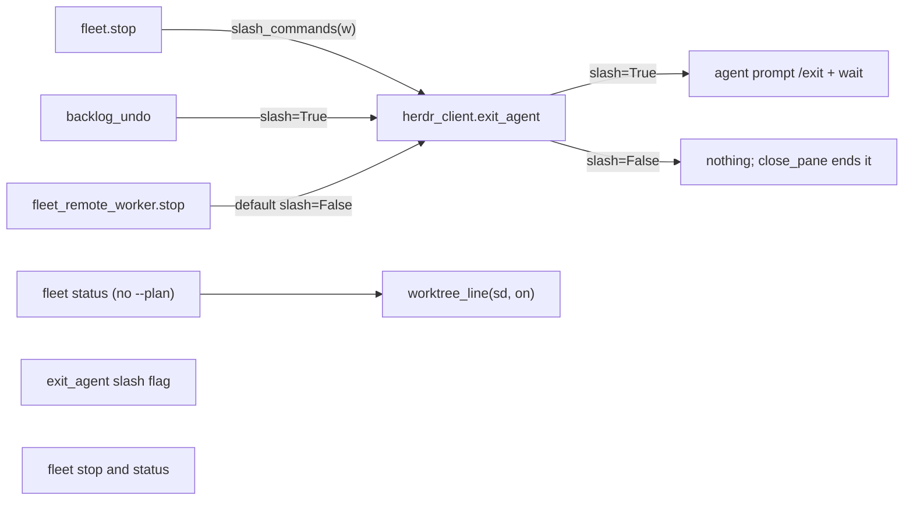

# Superlite: fleet stop sends no /exit to lean workers (#930); fleet status names the worktree's own fleet (#904)

**Goal:** `fleet stop` ends a lean worker (started with `--disable-slash-commands`) without sending `/exit` and without the 10 s wait, while a lead still gets `/exit`; a plain `fleet status` run inside a linked worktree names that worktree's own fleet when it read another folder and the two disagree on on/off, so status and `fleet spawn --plan <worktree>/.superlite` give one answer.
**Architecture:** `herdr_client.exit_agent(name, slash=False)` sends nothing for a lean agent (closing its pane, which every caller does next, ends it) and keeps `/exit` plus the 10 s wait for `slash=True`. `fleet.stop` passes `slash=fleet.slash_commands(w)`; `backlog_undo` passes `slash=True` for the lead it stops. `fleet.worktree_line(sd, on)` builds the extra status line; `fleet.main`'s status branch prints it right after `fleet: on` / `fleet: off`, only without `--plan`.
**Tech stack:** Python 3.10+ stdlib; pytest through `sl run_tests`.
**Spec:** issues #930 and #904 and this file, section Design.
**Detail:** tests
**Target-min:** 11
**Wave0:** none
**Coverage:** off (bounded: two existing CLI flows, no new state, file or field)

Global constraints:
- Builds: the verdict is `sl run_tests` (the project's test command; a project with `.maxapp` runs `maxapp test`, which a build pool may place on another Mac, and a full run whose tree a green maxapp test stamp covers returns that result without a run); task trees build in <tree>/.build/DerivedData and any build of your own goes under .build/ of the worktree, never -derivedDataPath outside the worktree (your session scratchpad included; backlog cleanup removes scratchpad build folders when the worktree goes); a product, simulator or device build stays on this machine and runs only when an issue's acceptance asks for a running-app check; copy this sentence into every worker brief.
- Simulators: append the UDID of each simulator you or a worker creates (`xcrun simctl create` or `clone`; a checker's `Simulators:` line marks its created ones) as one line to /Users/max/github/superlite/.claude/worktrees/superlite-b242-fleet-stop-wait-status/.superlite/simulators.txt; never list one you did not create; ship cleanup shuts down and deletes each listed one; copy this sentence into every worker brief.
- Every Python script line keeps the repo's `# O(...)` complexity comment; stdlib only; LF endings. This repository is public: no host names, user names or home paths in code, tests, docs or commit messages.
- Edit only the files your task owns. An existing test that pins a changed behaviour is updated only when it is in the task's Owns; any other failing test is reported, never edited. New tests see a red run before the code they test.

## Design

What #930 asks: every fleet worker starts lean (`LEAN_FLAGS` holds `--disable-slash-commands`), so the `/exit` that `herdr_client.exit_agent` sends answers `Unknown command: /exit` on the worker's screen and the following `wait_state(["unknown"], 10000)` always runs out; `close_pane` is what ends the worker. Done when a stop of a lean worker sends no prompt and waits for nothing, and a lead (whose argv keeps slash commands) still gets `/exit`.

What #904 asks: in a worktree run whose `.superlite` holds no run marker yet, a plain `fleet status` resolves the session's folder (fleet on) while `fleet spawn --plan <worktree>/.superlite` reads the worktree's own `fleet.json` (off) and refuses. Done when status names the worktree's folder, says off there and names the command that turns it on.

- `herdr_client.exit_agent(name, slash=False)`: `slash=False` returns at once, with no herdr call; `slash=True` is today's body (`agent prompt <name> /exit` plain, then `wait_state(name, ["unknown"], 10000)`, a wait `HerdrError` swallowed, a prompt error raised).
- `fleet.slash_commands(w) -> bool`: the worker record's `launch.argv` (a list) decides: True when `--disable-slash-commands` is not in it; a record without one (older records) is True only for `role == "lead"`.
- `fleet.stop`: `hc.exit_agent(fs.name_of(sd, wid, w), slash=slash_commands(w))`, nothing else changes (close_pane, state, telemetry, tree drop).
- `backlog_undo`: the still-live lead agent's exit becomes `exit_agent(agent, slash=True)`.
- `fleet.worktree_line(sd, on) -> str | None`: `top = state.worktree_top(".")`; None when `top` is None, when `top / ".superlite"` is not a folder, when it is `sd` (both resolved), or when `fs.is_on(wsd) == on`. Else, with `W = (top / ".superlite").resolve()` and `S = Path(sd).resolve()`:
  - worktree off: `worktree: fleet is off in {W}, the folder fleet spawn --plan {W} checks (this status read {S}); run sl fleet on --plan {W} first`
  - worktree on: `worktree: fleet is on in {W}, the folder fleet spawn --plan {W} uses (this status read {S}); sl fleet status --plan {W} shows its workers`
- Status branch of `fleet.main`: without `--plan`, the line (when not None) is printed directly after `fleet: off` / `fleet: off (moved to X)` and directly after `fleet: on`, before the machine line, the worker lines and the backlog hint.

Ruling: [scope] #903 not built: its fix (`fleet_io._finish` puts the worker's role in its result; `fleet_io.wave_failure` counts findings only for roles whose findings mean rework) lives in fleet_io.py, which B243 owns; #903 stays open (Refs #903) as a follow-up for the batch that owns fleet_io.py (lead's ruling).
Ruling: a lean worker gets no quit at all and its pane close ends it (because that is what ends it today, so no stop changes its end state; sending Claude Code's quit keys was rejected: herdr's Ctrl key names and the double-press timing are unverified and would leave a `Press Ctrl-C again` line).
Ruling: `exit_agent`'s default is `slash=False` (because fleet_remote_worker.stop, owned by B241, calls `exit_agent(name)` for remote workers, which are lean: the default fixes that path without editing its file).
Ruling: status keeps its first line byte-identical and adds the `worktree:` line only without `--plan` and only when the two folders disagree (because exact-output tests and readers pin `fleet: on` / `fleet: off`; with `--plan` status and spawn read the same folder); spawn's refusal (#355) and `fleet_state.follow`'s run-state rule (#707) stay as they are.
Ruling: the `worktree:` line never holds the text `fleet: ` (because existing tests assert `"fleet: off" not in out` on status output).

## File structure

- `skills/subagent-driven-development/scripts/herdr_client.py`: `exit_agent(name, slash=False)` (T1).
- `skills/subagent-driven-development/scripts/backlog_undo.py`: the lead exit passes `slash=True` (T1).
- `skills/subagent-driven-development/scripts/fleet.py`: `slash_commands`, `stop`'s call, `worktree_line`, the status branch (T2).
- `tests/scripts/test_herdr_client.py`, `tests/scripts/test_backlog_undo_586.py`: existing pins follow the new signature (T1).
- `tests/scripts/test_fleet.py`: `FakeHerdr.exit_agent` takes `slash` (T2).
- `tests/scripts/test_exit_agent_930.py` (T1), `tests/scripts/test_fleet_stop_slash_930.py` and `tests/scripts/test_fleet_status_worktree_904.py` (T2): the new tests.

```mermaid
%% schedule
gantt
  title Predicted schedule (mm:ss)
  dateFormat X
  axisFormat %M:%S
  section lane 1
  T2 fleet stop and status :t2, 0, 315s
  section lane 2
  T1 exit_agent slash flag :t1, 0, 281s
```





critical path: T2 (5.2 min) · peak width 2 · predicted build 5.2 min · predicted total ≈ 15.7 min (target ✗ 11.0)

## Sections

### Fleet stop and status

**Probe entry:** none (CLI branches over a fake herdr and tmp state folders; every case is a named test in T1 and T2)

### T1 exit_agent slash flag · Complexity 2 · Est. context 32k
**Owns:** skills/subagent-driven-development/scripts/herdr_client.py, skills/subagent-driven-development/scripts/backlog_undo.py, tests/scripts/test_herdr_client.py, tests/scripts/test_backlog_undo_586.py, tests/scripts/test_exit_agent_930.py
**Components:** 1
**LOC owned:** 45
**Tests:** fast
**Model:** sonnet
**Kind:** design
**Covers:** Design
**Produces:** herdr_client.exit_agent(name: str, slash: bool = False) -> None
**Review Focus:** protocol: `test_exit_lean_sends_nothing` (no herdr call at all); protocol: `test_exit_sends_no_bare_timeout` (slash=True keeps the exact /exit and wait argv); state: `test_backlog_undo_586` pin (the lead exit passes slash=True)
**Test code (verbatim):**
```python
# tests/scripts/test_exit_agent_930.py: a lean agent (--disable-slash-commands) gets no /exit and no wait; slash=True keeps both (#930)
import json, sys
import pytest
from _fixtures import FIXTURES
from test_plan_tools import SCRIPTS
sys.path.insert(0, str(SCRIPTS))
import herdr_client as hc  # noqa: E402
FAKE = FIXTURES / "fleet" / "herdr"


@pytest.fixture
def fake(tmp_path, monkeypatch):
    log = tmp_path / "herdr.log"
    monkeypatch.setenv("SUPERLITE_HERDR_BIN", str(FAKE)); monkeypatch.setenv("FAKE_HERDR_LOG", str(log))
    monkeypatch.delenv("FAKE_HERDR_REPLY", raising=False)
    return lambda: [json.loads(l) for l in log.read_text().splitlines()] if log.exists() else []


def test_exit_lean_sends_nothing(fake):
    assert hc.exit_agent("sl-x-w1") is None
    assert fake() == []


def test_exit_lean_explicit_sends_nothing(fake):
    hc.exit_agent("sl-x-w1", slash=False)
    assert fake() == []


def test_exit_lean_ignores_a_failing_herdr(fake, monkeypatch):
    monkeypatch.setenv("FAKE_HERDR_FAIL", "agent prompt")
    hc.exit_agent("sl-x-w1")
    assert fake() == []


def test_exit_slash_keeps_exit_and_wait(fake):
    hc.exit_agent("sl-x-w1", slash=True)
    assert [c[:4] for c in fake()] == [["agent", "prompt", "sl-x-w1", "/exit"], ["agent", "wait", "sl-x-w1", "--until"]]
```
**Steps:** 1 write the new test file, 2 run it: FAIL, 3 change `exit_agent` (signature, docstring comment naming #930 and both cases), then in `tests/scripts/test_herdr_client.py` pass `slash=True` in `test_exit_sends_no_bare_timeout`, `test_exit_wait_error_counts_as_gone` and `test_exit_prompt_error_raises` (their asserts stay), then `backlog_undo.py`'s lead exit passes `slash=True`, and `tests/scripts/test_backlog_undo_586.py` line 67 becomes `monkeypatch.setattr(fleet.hc, "exit_agent", lambda n, slash=False: e.calls.append(("exit", n) if slash else ("exit-lean", n)))` so the existing `("exit", "sl-m-W1")` count pins slash=True, 4 run the three test files: PASS.
**Notes:** in `backlog_undo.py` the `(call, arg)` loop keeps its shape: the first pair's callable becomes `lambda a: fleet.hc.exit_agent(a, slash=True)` (looked up at call time, so the test's monkeypatch applies). `exit_agent` with `slash=False` makes no `call` at all, so it can never raise.

### T2 fleet stop and status · Complexity 3 · Est. context 45k
**Owns:** skills/subagent-driven-development/scripts/fleet.py, tests/scripts/test_fleet.py, tests/scripts/test_fleet_stop_slash_930.py, tests/scripts/test_fleet_status_worktree_904.py
**Components:** 2
**LOC owned:** 150
**Tests:** fast
**Model:** sonnet
**Kind:** design
**Covers:** Design
**Consumes:** herdr_client.exit_agent(name: str, slash: bool = False) -> None (T1)
**Produces:** fleet.slash_commands(w: dict) -> bool · fleet.worktree_line(sd: Path, on: bool) -> str | None
**Review Focus:** state: `test_stop_spawned_worker_is_lean` (a real spawn's launch record reads lean); state: `test_status_on_names_worktree_off` (the #904 case, exact line); protocol: `test_status_with_plan_prints_no_worktree_line`; state: `test_status_both_off_is_unchanged` (exact old output)
**Test code (verbatim):**
```python
# tests/scripts/test_fleet_stop_slash_930.py: fleet stop tells exit_agent whether the agent takes slash commands (#930)
import sys
import pytest
from test_fleet import world, REAL  # noqa: F401
from test_plan_tools import SCRIPTS
sys.path.insert(0, str(SCRIPTS))
import fleet  # noqa: E402

pytestmark = pytest.mark.skipif(REAL, reason="call list is read from the in-process fake")


def rec(world):
    seen = []
    world.fh.exit_agent = lambda name, slash=False: seen.append((name, slash))
    return seen


def put(world, wid, **w):
    d = fleet.fs.load(world.sd); d["on"] = True
    d["workers"][wid] = {"name": f"sl-p-{wid.lower()}", "pane_id": f"w6:{wid}", "state": "ready", **w}
    fleet.fs.save(world.sd, d)


@pytest.mark.parametrize("w,slash", [
    ({"role": "implementer", "launch": {"argv": ["--model", "sonnet", "--disable-slash-commands"]}}, False),
    ({"role": "lead", "launch": {"argv": ["--model", "opus", "--permission-mode", "auto"]}}, True),
    ({"role": "lead", "launch": {"argv": ["--disable-slash-commands"]}}, False),
    ({"role": "research"}, False),
    ({"role": "lead"}, True),
    ({}, False),
])
def test_slash_commands(w, slash):
    assert fleet.slash_commands(w) is slash


def test_stop_spawned_worker_is_lean(world):
    fleet.main(["on"]); fleet.spawn(world.sd, world.plan, "sonnet", world.proj)
    seen = rec(world)
    assert fleet.stop(world.sd, ["W1"]) == ["W1"]
    assert seen == [(fleet.fs.agent_name(world.sd, "W1"), False)]
    assert any(c[0] == "close_pane" for c in world.fh.calls)


def test_stop_lead_keeps_slash(world):
    put(world, "W2", role="lead", launch={"argv": ["--model", "opus", "--permission-mode", "auto"]})
    seen = rec(world)
    assert fleet.stop(world.sd, ["W2"]) == ["W2"]
    assert seen == [("sl-p-w2", True)]
    assert ("close_pane", "w6:W2") in world.fh.calls
```
```python
# tests/scripts/test_fleet_status_worktree_904.py: a plain fleet status names the cwd worktree's own fleet when it read another folder and the two disagree (#904)
import sys
import pytest
from test_plan_tools import SCRIPTS
sys.path.insert(0, str(SCRIPTS))
import fleet  # noqa: E402
import fleet_lead  # noqa: E402
import fleet_state as fs  # noqa: E402
import state  # noqa: E402


@pytest.fixture
def two(tmp_path, monkeypatch):
    for v in ("SUPERLITE_SESSION_ID", "CLAUDE_CODE_SESSION_ID", "SUPERLITE_STATE_DIR"):
        monkeypatch.delenv(v, raising=False)
    monkeypatch.chdir(tmp_path)
    monkeypatch.setattr(fleet, "agent_gone", lambda *a, **k: False)
    monkeypatch.setattr(fleet, "_follow", lambda *a, **k: None)
    monkeypatch.setattr(fleet_lead, "backlog_hint", lambda sd, cwd: None)
    S = tmp_path / "session" / ".superlite"; S.mkdir(parents=True)
    top = tmp_path / "wt"; W = top / ".superlite"; W.mkdir(parents=True)
    monkeypatch.setattr(state, "worktree_top", lambda path=".": top)
    monkeypatch.setattr(fleet, "_sd", lambda a: S.resolve())
    return S.resolve(), W.resolve(), top


def wt_lines(out):
    return [l for l in out.splitlines() if l.startswith("worktree: ")]


def test_status_on_names_worktree_off(two, capsys):
    S, W, _ = two
    fs.save(S, {**fs.default(), "on": True})
    assert fleet.main(["status"]) == 0
    out = capsys.readouterr().out
    assert out.splitlines()[:2] == ["fleet: on", f"worktree: fleet is off in {W}, the folder fleet spawn --plan {W} checks (this status read {S}); run sl fleet on --plan {W} first"]


def test_status_off_names_worktree_on(two, capsys):
    S, W, _ = two
    fs.save(W, {**fs.default(), "on": True})
    assert fleet.main(["status"]) == 0
    out = capsys.readouterr().out
    assert out.splitlines()[:2] == ["fleet: off", f"worktree: fleet is on in {W}, the folder fleet spawn --plan {W} uses (this status read {S}); sl fleet status --plan {W} shows its workers"]


def test_status_both_on_prints_no_worktree_line(two, capsys):
    S, W, _ = two
    fs.save(S, {**fs.default(), "on": True}); fs.save(W, {**fs.default(), "on": True})
    assert fleet.main(["status"]) == 0
    assert wt_lines(capsys.readouterr().out) == []


def test_status_both_off_is_unchanged(two, capsys):
    assert fleet.main(["status"]) == 0
    assert capsys.readouterr().out == "fleet: off\n"


def test_status_reading_the_worktree_folder_prints_no_line(two, monkeypatch, capsys):
    S, W, _ = two
    fs.save(S, {**fs.default(), "on": True})
    monkeypatch.setattr(fleet, "_sd", lambda a: W)
    assert fleet.main(["status"]) == 0
    assert capsys.readouterr().out == "fleet: off\n"


def test_status_outside_a_worktree_prints_no_line(two, monkeypatch, capsys):
    S, W, _ = two
    fs.save(S, {**fs.default(), "on": True})
    monkeypatch.setattr(state, "worktree_top", lambda path=".": None)
    assert fleet.main(["status"]) == 0
    assert wt_lines(capsys.readouterr().out) == []


def test_status_worktree_without_superlite_prints_no_line(two, capsys):
    S, W, _ = two
    fs.save(S, {**fs.default(), "on": True})
    W.rmdir()
    assert fleet.main(["status"]) == 0
    assert wt_lines(capsys.readouterr().out) == []


def test_status_with_plan_prints_no_worktree_line(two, capsys):
    S, W, _ = two
    fs.save(S, {**fs.default(), "on": True})
    assert fleet.main(["status", "--plan", str(S)]) == 0
    assert wt_lines(capsys.readouterr().out) == []


def test_worktree_line_never_says_fleet_colon(two):
    S, W, _ = two
    for on in (True, False):
        line = fleet.worktree_line(S, on)
        assert line is not None and "fleet: " not in line
```
**Steps:** 1 write both test files, 2 run them: FAIL, 3 change `tests/scripts/test_fleet.py`'s `FakeHerdr.exit_agent` to `def exit_agent(self, name, slash=False): self.calls.append(("exit_agent", name))`, add `slash_commands` and pass it in `stop`, add `worktree_line` and print it in the status branch (both the off and the on path, only when `a.plan` is not set), 4 run the two new files, `tests/scripts/test_fleet.py`, `test_fleet_lead.py`, `test_fleet_follow_cli_580.py`, `test_fleet_status_backlog_487.py` and `test_fleet_dispatch_round.py`: PASS.
**Notes:** `worktree_line` reads `fs.is_on(top / ".superlite")`; a folder without `fleet.json` counts as off. It catches `OSError` from `state.worktree_top` and returns None (a status line must not fail the status). If fleet.py's module docstring describes the status output or `stop`, add one sentence each for the `worktree:` line and the lean stop.

## Review Focus

- protocol: a lean stop makes no herdr call before `close_pane` (`test_exit_lean_sends_nothing`, `test_stop_spawned_worker_is_lean`); a lead keeps `/exit` (`test_stop_lead_keeps_slash`, `test_exit_slash_keeps_exit_and_wait`).
- state: the #904 disagreement both ways prints one exact `worktree:` line; agreement, the worktree's own folder, no worktree, no `.superlite` and `--plan` print none (T2's status tests).

## Running-app checks

None: no UI, widget, extension or browser target.

## Self-review

Coverage: #930's two parts (stop and the remote default) map to T1 and T2; #904's status line maps to T2; #903 is a scope ruling. No placeholders. Two tasks, no shared file, no edge (T2 builds against T1's signature through the fake). Fields filled. Schedule and lint run after this write.
