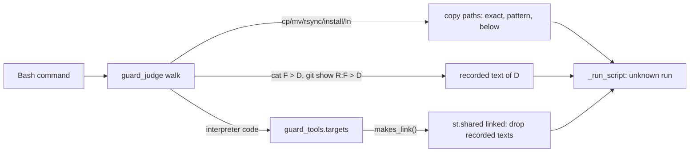
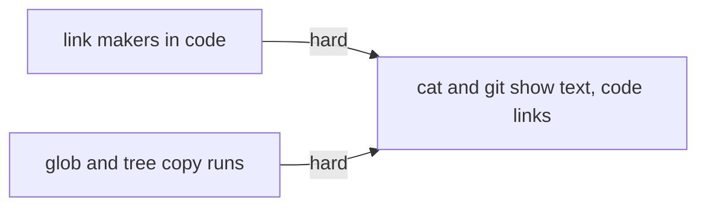

# Superlite: coordinator guard keeps no stale text after glob copies and code-made links, reads `cat F >` and `git show REV:F >` (B247, #883 #884)

**Goal:** a script run in the same Bash call is never judged by stale or missing text after a glob or tree copy, or after a link made from interpreter code (#883); `cat F > x.sh` and `git show REV:F > x.sh` followed by a run are judged by the copied text instead of blocking (#884). Measured before (in-process `guard_judge.judge`, temp project): the glob-copy run of a stale `evil.sh` and the run after a Python `os.symlink` write-through pass; all four `cat`/`git show` runs block, harmless text too; `Path(x).symlink_to/hardlink_to/link_to` into `src/` pass.
**Architecture:** `guard_tools` records whether the last `targets()` call read code or shell text that makes a link (`makes_link()`) and names the link a `Path.symlink_to`/`hardlink_to`/`link_to` call makes (T1). `guard_judge` counts every path a copy into a folder may give (glob, unknown name, folder tree) as written by the call, so running one is an unknown target, and treats `rsync --link-dest` as a link (T2). `guard_judge` records the text of `cat F... > DEST` and `git show REV:PATH > DEST` as DEST's script text and sets the call's link flag from `makes_link()` (T3).
**Tech stack:** Python 3.10+ stdlib, bash; pytest through `sl run_tests`.
**Spec:** this file, section Design; issues #883, #884.
**Detail:** tests
**Target-min:** 11
**Wave0:** none
**Worktree:** none
**Coverage:** off

Global constraints:
- Every script line keeps the repo's `# O(...)` complexity comment; stdlib only; LF endings.
- A test that spawns git in a temporary repository removes GIT_DIR, GIT_INDEX_FILE and GIT_WORK_TREE from the child env.
- This repository is public: no host names, user names, home paths, other project or repository names in code, tests, docs or commit messages.
- Your own session's coordinator guard is the installed (old) code: never run a script that needs the new guard from your shell; tests call the worktree's code in-process.
- A new pass path must judge or refuse every write it could hide: when in doubt, no text (the run is an unknown target).
- Builds: the verdict is `sl run_tests` (the project's test command; a project with `.maxapp` runs `maxapp test`, which a build pool may place on another Mac, and a full run whose tree a green maxapp test stamp covers returns that result without a run); task trees build in <tree>/.build/DerivedData and any build of your own goes under .build/ of the worktree, never -derivedDataPath outside the worktree (your session scratchpad included; backlog cleanup removes scratchpad build folders when the worktree goes); a product, simulator or device build stays on this machine and runs only when an issue's acceptance asks for a running-app check.
- Simulators: append the UDID of each simulator you or a worker creates (`xcrun simctl create` or `clone`; a checker's `Simulators:` line marks its created ones) as one line to /Users/max/github/superlite/.claude/worktrees/superlite-b247-guard-copy-and-link-text/.superlite/simulators.txt; never list one you did not create; ship cleanup shuts down and deletes each listed one.

## Design

Today (B210, 1.5.220): `_copy_text` records a cp/mv copy's text only for one literal source and returns early on a glob or expansion; `_check` adds to `st.shared["wrote"]` only the copy's folder and `<dest>/<first source name>` (a glob gives the placeholder `x.<ext>`); `_run_script` treats a script as written by the call only on an exact key match. So `cp .superlite/a/*.sh .superlite/scratch/; bash .superlite/scratch/evil.sh` judges the stale disk text, and a copied file not yet on disk runs as "missing". `st.shared["linked"]` is set only by the shell's `ln`, `link`, `cp`/`install` with a link option. Redirect writes record text only for `cat <<EOF > DEST`.

Ruling: #883 glob and tree copies: every path a `cp`, `mv`, `rsync`, `install` or `ln` copy may give counts as written by the call together with everything below it, and a run of such a path (`bash`, `sh`, an interpreter, `uv run`, any path `_run_script` reads) that B210's copy text did not give text is an unknown target, never judged by disk text or passed as missing. Paths: the destination itself for a copy onto a name; `<dest>/<name>` for a copy into a folder; for a source whose last component is a glob with no unread part, every `<dest>/<n>` whose name matches it (`fnmatch`, case-folded); for any other source whose name the guard cannot read (an unread expansion, `src/` contents of rsync or cp, a glob in a folder part) every path below `<dest>/`. When the call wrote `<dest>` or a folder above it earlier (other than `mkdir`), both readings, onto and into, count (lead's ruling).
Ruling: the unknown-run word names the cause: `<operand>: a copy in this call may have written it; copy it by its literal name to have its text judged` (lead's ruling).
Ruling: #883 links from code: `guard_tools.makes_link()` is True when the last `targets()` call read code that calls a link maker (Python `os.link`, `os.symlink`, `link`/`symlink` imported from os, `.symlink_to(`, `.hardlink_to(`, `.link_to(`, `shutil.copytree(` with a `symlinks=` argument other than a literal False; Node `link`/`symlink`(`Sync`) on fs, fs/promises or fs-extra, fs-extra `ensureLink`/`ensureSymlink`/`createLink`/`createSymlink`; Ruby `File.link`/`File.symlink`, `FileUtils.ln`, `ln_s`, `ln_sf`, `ln_sr`, `link`, `symlink`, `cp_lr`; PHP `link(`, `symlink(`; Perl `link`, `symlink`) or shell text it runs makes one (`ln`, `link`, `cp`/`install` with `-l`/`-s`/`--link`/`--symbolic-link`, `rsync --link-dest`). A call inside data the guard reads as data (a Python string or comment that cannot run) does not count. The judge then sets `st.shared["linked"]` and clears the recorded texts exactly as a shell `ln` does (lead's ruling).
Ruling: adjacent fix: `Path(x).symlink_to(y)` and `Path(x).hardlink_to(y)` write `x`, `Path(x).link_to(y)` writes `y`; today they name no target, so a link into `src/` passes (lead's ruling).
Ruling: `rsync` with `--link-dest DIR` or `--link-dest=DIR` in the judge's Bash walk sets the call's link flag like `ln` (lead's ruling).
Ruling: #884 `cat`: `cat [--] F... > DEST` (also `>|`; `>>` only onto text this call recorded for DEST, which gets the sources appended) records the sources' texts, concatenated, as DEST's text when: no other option, every operand a literal path (no glob, no unread expansion, not `-`), no heredoc or here-string on the segment, exactly one write redirect on it, the command text neither shadows `cat` nor sets PATH (`SHADOWED`, `"PATH" in c.cmdenv`), no link made in the call, no source equal to DEST (path or real path, case-folded), and each source gives text as a B210 copy source does (heredoc text this call recorded, else a regular single-link file of at most 1,000,000 bytes, UTF-8, no symlink, not written by the call and not below a folder it wrote) and DEST passes B210's sure-destination check. Otherwise DEST stays written without text (lead's ruling).
Ruling: #884 `git show`: `git show SPEC > DEST` (same redirect rules) records the text of `git cat-file blob SPEC` (run through `_git_run` in the segment's one known folder; exit 0, at most 1,000,000 bytes, UTF-8) when the words are exactly `git`, `show` and one literal SPEC holding `:` and not starting with `-`, with no NAME=value words before git, no `GIT_` in the command text, no git command earlier in the call, and no link made in the call. `git show REV:PATH` of a blob prints the raw blob (textconv only with `--textconv`), the same bytes as `cat-file blob` (lead's ruling).
Ruling: the shared source-text and destination-record code of `_copy_text` moves into two helpers that T2 and T3 both use, no behaviour change for B210's cases (lead's ruling).
Ruling: B247 edits guard_judge.py, docs/hooks.md and new tests besides its brief's guard_tools.py; no open batch lists them (lead's ruling).



## Task graph




critical path: T2 → T3 (19.6 min) · peak width 2 · predicted build 19.6 min · predicted total ≈ 36.1 min (target ✗ 11.0)

## Package: coordinator guard

App type: library (a hook's judge). Categories: state (writes earlier in one call), deep (nested code and shell strings), encoding (case-folded paths, UTF-8 text).
**Probe entry:** none (a hook judge; the named tests below cover each case)

### T1 Link makers in code, Path link targets · Complexity 3 · Est. context 45k
**Owns:** skills/subagent-driven-development/scripts/guard_tools.py, tests/scripts/test_guard_link_code_883.py
**Components:** 1
**LOC owned:** 140
**Tests:** fast
**Model:** sonnet
**Kind:** design
**Produces:** guard_tools.makes_link() -> bool (True when the last targets() call read code or shell text that makes a link; reset by every targets() call)
  e.g. targets(["python3", "-c", "import os; os.symlink('a', 'b')"]); makes_link() -> True
  e.g. targets(["python3", "-c", "print('os.symlink(a, b)')"]); makes_link() -> False
  e.g. targets(["ls"]); makes_link() -> False
**Review Focus:** deep: a link call inside a shell string of `os.system` or a subprocess list counts; state: the flag of one targets() call never leaks into the next; deep: `unlink`, `os.readlink`, `islink` never count.
**Test code (verbatim):**
```python
"""#883: guard_tools reports code that makes a link; Path link methods name their targets."""
import sys
from pathlib import Path

import pytest

sys.path.insert(0, str(Path(__file__).resolve().parents[2] / "skills" / "subagent-driven-development" / "scripts"))

import guard_tools  # noqa: E402

L = ".superlite/scratch/l"


@pytest.mark.parametrize("words", [
    ["python3", "-c", f"import os; os.symlink('a.sh', '{L}')"],
    ["python3", "-c", f"import os; os.link('a.sh', '{L}')"],
    ["python3", "-c", f"from os import symlink; symlink('a.sh', '{L}')"],
    ["python3", "-c", f"from pathlib import Path; Path('{L}').symlink_to('a.sh')"],
    ["python3", "-c", f"from pathlib import Path; Path('{L}').hardlink_to('a.sh')"],
    ["python3", "-c", f"from pathlib import Path; Path('a.sh').link_to('{L}')"],
    ["python3", "-c", "import shutil; shutil.copytree('.superlite/a', '.superlite/b', symlinks=True)"],
    ["python3", "-c", f"import os; os.system('ln -s a.sh {L}')"],
    ["python3", "-c", f"import subprocess; subprocess.run(['cp', '-l', 'a.sh', '{L}'])"],
    ["python3", "-c", "import subprocess; subprocess.run(['rsync', '-a', '--link-dest=../a', 'x/', 'y/'])"],
    ["node", "-e", f"require('fs').linkSync('a.sh', '{L}')"],
    ["node", "-e", f"const fs = require('fs'); fs.symlinkSync('a.sh', '{L}')"],
    ["node", "-e", f"const fs = require('fs-extra'); fs.ensureSymlinkSync('a.sh', '{L}')"],
    ["perl", "-e", f"link 'a.sh', '{L}'"],
    ["perl", "-e", f"symlink('a.sh', '{L}')"],
    ["ruby", "-e", f"File.symlink('a.sh', '{L}')"],
    ["ruby", "-e", f"require 'fileutils'; FileUtils.ln_s('a.sh', '{L}')"],
    ["php", "-r", f"symlink('a.sh', '{L}');"],
])
def test_code_that_makes_a_link_is_reported(words):
    guard_tools.targets(words)
    assert guard_tools.makes_link() is True


@pytest.mark.parametrize("words", [
    ["python3", "-c", f"import os; os.unlink('{L}')"],
    ["python3", "-c", f"import os; print(os.readlink('{L}'), os.path.islink('{L}'))"],
    ["python3", "-c", "print('os.symlink(a, b)')"],
    ["python3", "-c", "import shutil; shutil.copytree('.superlite/a', '.superlite/b')"],
    ["python3", "-c", "import shutil; shutil.copytree('.superlite/a', '.superlite/b', symlinks=False)"],
    ["python3", "-c", "import os; os.system('cp a.sh .superlite/scratch/b.sh')"],
    ["node", "-e", f"require('fs').unlinkSync('{L}')"],
    ["perl", "-e", f"unlink '{L}'"],
    ["ls", "-l"],
])
def test_code_without_a_link_is_not_reported(words):
    guard_tools.targets(words)
    assert guard_tools.makes_link() is False


def test_flag_resets_on_the_next_call():
    guard_tools.targets(["python3", "-c", f"import os; os.symlink('a.sh', '{L}')"])
    guard_tools.targets(["python3", "-c", "print(1)"])
    assert guard_tools.makes_link() is False


@pytest.mark.parametrize("code,want", [
    ("from pathlib import Path; Path('src/a.py').symlink_to('/tmp/x')", "src/a.py"),
    ("from pathlib import Path; Path('src/a.py').hardlink_to('/tmp/x')", "src/a.py"),
    ("from pathlib import Path; Path('/tmp/x').link_to('src/a.py')", "src/a.py"),
    ("from pathlib import Path\np = Path('src/b.py')\np.symlink_to('/tmp/x')", "src/b.py"),
])
def test_path_link_methods_name_the_link(code, want):
    assert any(t.endswith(want) for t in guard_tools.targets(["python3", "-c", code], text=code))
```
**Steps:** 1 failing tests, 2 run: FAIL, 3 implement (a module-level flag beside `_WHY`, cleared in `targets()`; set where the `_CALLS` table and `_py_methods` match a link maker and in `_argv` for a link-making command; add `symlink_to`/`hardlink_to` to the receiver-target group of `_py_methods` and `link_to` to the argument group), 4 run: PASS, 5 `sl run_tests --fast tests/scripts/test_guard_tools.py tests/scripts/test_guard_link_code_883.py tests/scripts/test_guard_subprocess_705.py` green.
**Notes:** the flag follows the reading the write scan already uses (a Python string that cannot run is data). `shutil.copytree` with `symlinks=` set to anything but a literal `False` counts.

### T2 Glob and tree copy runs are unknown, rsync --link-dest links · Complexity 5 · Est. context 55k
**Owns:** skills/subagent-driven-development/scripts/guard_judge.py, tests/scripts/test_guard_glob_copy_883.py
**Components:** 2
**LOC owned:** 170
**Tests:** fast
**Model:** sonnet
**Kind:** design
**Produces:** guard_judge._source_text(sa: str, st: object, old: set, heredocs: dict | None) -> str | None (the text a copy of source path sa gives: B210's rules, None when unsure) · guard_judge._record_text(full: str, text: str | None, st: object) -> None (B210's sure-destination check, then marks full written and records text when sure)
**Review Focus:** state: a copy into a folder the call wrote earlier counts both readings; state: B210's literal-copy text still wins over the new "below" rule; encoding: `EVIL.sh` matches `*.sh` case-folded; deep: the same run inside `bash -c '...'` after the copy blocks too.
**Test code (verbatim):**
```python
"""#883: a script a glob, unknown-name or tree copy of this Bash call may have written runs as an unknown target."""
import os
import subprocess
import sys
from pathlib import Path

import pytest

sys.path.insert(0, str(Path(__file__).resolve().parents[2] / "skills" / "subagent-driven-development" / "scripts"))

from guard_judge import judge  # noqa: E402

GIT_ENV = {k: v for k, v in os.environ.items() if k not in ("GIT_DIR", "GIT_INDEX_FILE", "GIT_WORK_TREE")}


@pytest.fixture
def proj(tmp_path):
    p = tmp_path / "p"
    for d in (".superlite/scratch", ".superlite/a", ".superlite/b", "tools"):
        (p / d).mkdir(parents=True)
    (p / "tools" / "defs.sh").write_text("A=1\n")
    subprocess.run(["git", "init", "-q", str(p)], check=True, env=GIT_ENV)
    subprocess.run(["git", "-C", str(p), "add", "tools"], check=True, env=GIT_ENV)
    subprocess.run(["git", "-C", str(p), "-c", "user.email=t@t", "-c", "user.name=t", "commit", "-qm", "init"],
                   check=True, env=GIT_ENV)
    (p / ".superlite" / "a" / "evil.sh").write_text("rm -rf src\n")
    (p / ".superlite" / "a" / "ok.sh").write_text("echo hi\n")
    (p / ".superlite" / "a" / "n.md").write_text("# n\n")
    (p / ".superlite" / "scratch" / "evil.sh").write_text("echo stale\n")
    (p / ".superlite" / "scratch" / "run.sh").write_text("echo hi\n")
    return str(p)


def _j(p, cmd):
    return judge(cmd, p, p, "active", (p + "/.superlite",))


@pytest.mark.parametrize("cmd,word", [
    ("cp .superlite/a/*.sh .superlite/scratch/; bash .superlite/scratch/evil.sh", "scratch/evil.sh"),
    ("cp .superlite/a/*.sh .superlite/scratch/; bash .superlite/scratch/new.sh", "scratch/new.sh"),
    ("cp .superlite/a/*.sh .superlite/scratch; sh .superlite/scratch/evil.sh", "scratch/evil.sh"),
    ("cp .superlite/a/*.sh .superlite/scratch/; bash .superlite/scratch/EVIL.sh", "scratch/EVIL.sh"),
    ("mv .superlite/a/*.sh .superlite/scratch/; bash .superlite/scratch/evil.sh", "scratch/evil.sh"),
    ("cp -f .superlite/a/* .superlite/scratch/; bash .superlite/scratch/evil.sh", "scratch/evil.sh"),
    ("cp .superlite/a/e?il.sh .superlite/scratch/; bash .superlite/scratch/evil.sh", "scratch/evil.sh"),
    ('cp "$S" .superlite/scratch/; bash .superlite/scratch/evil.sh', "scratch/evil.sh"),
    ("rsync -a .superlite/a/ .superlite/scratch/; bash .superlite/scratch/evil.sh", "scratch/evil.sh"),
    ("cp -r .superlite/a .superlite/scratch/; bash .superlite/scratch/a/evil.sh", "scratch/a/evil.sh"),
    ("cp -r .superlite/a .superlite/scratch/new; bash .superlite/scratch/new/evil.sh", "scratch/new/evil.sh"),
    ("install -m 755 .superlite/a/*.sh .superlite/scratch/; bash .superlite/scratch/evil.sh", "scratch/evil.sh"),
    ("cp .superlite/a/*.sh .superlite/scratch/ && bash -c 'bash .superlite/scratch/evil.sh'", "scratch/evil.sh"),
    ("rm -rf .superlite/b; cp -r .superlite/a .superlite/b; bash .superlite/b/evil.sh", "b/evil.sh"),
])
def test_run_after_a_copy_of_unread_names_is_unknown(proj, cmd, word):
    v = _j(proj, cmd)
    assert v is not None and v.kind == "code" and word in v.word


@pytest.mark.parametrize("cmd", [
    "cp .superlite/a/*.md .superlite/scratch/; bash .superlite/scratch/run.sh",
    "cp .superlite/a/ok.sh .superlite/scratch/; bash .superlite/scratch/ok.sh",
    "cp .superlite/a/*.sh .superlite/b/; bash .superlite/scratch/run.sh",
    "cp -r .superlite/a .superlite/scratch/; bash .superlite/scratch/run.sh",
    "cp .superlite/a/*.sh .superlite/scratch/; bash tools/defs.sh",
    "rsync -a .superlite/a/ .superlite/b/; bash .superlite/scratch/run.sh",
    "cat > .superlite/scratch/y.sh <<'E'\necho hi\nE\nrsync -a .superlite/a/ .superlite/b/; bash .superlite/scratch/y.sh",
])
def test_runs_the_copy_cannot_reach_keep_their_reading(proj, cmd):
    assert _j(proj, cmd) is None


@pytest.mark.parametrize("cmd", [
    "cat > .superlite/scratch/y.sh <<'E'\necho hi\nE\nrsync -a --link-dest=../a .superlite/a/ .superlite/b/; bash .superlite/scratch/y.sh",
    "cat > .superlite/scratch/y.sh <<'E'\necho hi\nE\nrsync -a --link-dest ../a .superlite/a/ .superlite/b/; bash .superlite/scratch/y.sh",
])
def test_rsync_link_dest_drops_recorded_text(proj, cmd):
    v = _j(proj, cmd)
    assert v is not None and v.kind == "code" and "scratch/y.sh" in v.word


def test_block_names_the_way_out(proj):
    v = _j(proj, "cp .superlite/a/*.sh .superlite/scratch/; bash .superlite/scratch/evil.sh")
    assert "copy it by its literal name" in v.word
```
**Steps:** 1 failing tests, 2 run: FAIL, 3 implement (extract `_source_text` and `_record_text` from `_copy_text` with no behaviour change; record the copy's paths with their "below" and pattern reading in the call's shared state; make `_run_script`, and every other script-run lookup of `st.shared["wrote"]`, treat a path matching one as written; add `rsync --link-dest` to the link condition in `_targets`), 4 run: PASS, 5 `sl run_tests --fast tests/scripts/test_guard_copy_run_780.py tests/scripts/test_guard_glob_copy_883.py tests/scripts/test_guard_cp_glob_554.py tests/scripts/test_guard_script_run_693.py tests/scripts/test_guard_judge.py` green.
**Notes:** the copy paths are compared case-folded (the walk's own keys are). The unknown-run word is `<operand>: a copy in this call may have written it; copy it by its literal name to have its text judged`. A plain exact write (redirect, `touch`) keeps today's exact-match lookup; only the copy paths get "below" and pattern matching, so `cp x.md .superlite/scratch/; bash .superlite/scratch/run.sh` still reads run.sh's disk text.

### T3 `cat F >` and `git show REV:F >` text, links made by code · Complexity 5 · Est. context 55k
**Owns:** skills/subagent-driven-development/scripts/guard_judge.py, tests/scripts/test_guard_cat_show_884.py
**Components:** 2
**LOC owned:** 190
**Tests:** fast
**Model:** sonnet
**Kind:** design
**Consumes:** guard_tools.makes_link() -> bool (True when the last targets() call read code or shell text that makes a link; reset by every targets() call) (T1) · guard_judge._source_text(sa: str, st: object, old: set, heredocs: dict | None) -> str | None (the text a copy of source path sa gives: B210's rules, None when unsure) (T2) · guard_judge._record_text(full: str, text: str | None, st: object) -> None (B210's sure-destination check, then marks full written and records text when sure) (T2)
**Produces:** guard_judge.judge(cmd, cwd, proj, mode, sds) -> Verdict | None (unchanged signature; records `cat`/`git show` redirect text, links from code drop texts)
**Review Focus:** state: a source the call wrote earlier gives only its recorded heredoc text; state: any later write of DEST drops the text; deep: a link made by a heredoc Python program or a scratch script's code drops recorded texts too; encoding: a non-UTF-8 or over-1,000,000-byte source or blob gives no text.
**Test code (verbatim):**
```python
"""#884: `cat F > x` and `git show REV:F > x` give x the copied text; #883: a link made by code drops recorded texts."""
import os
import subprocess
import sys
from pathlib import Path

import pytest

sys.path.insert(0, str(Path(__file__).resolve().parents[2] / "skills" / "subagent-driven-development" / "scripts"))

from guard_judge import judge  # noqa: E402

GIT_ENV = {k: v for k, v in os.environ.items() if k not in ("GIT_DIR", "GIT_INDEX_FILE", "GIT_WORK_TREE")}
LINK = "python3 -c 'import os; os.symlink(\"y.sh\", \".superlite/scratch/l\")'"
Y = "cat > .superlite/scratch/y.sh <<'E'\necho hi\nE\n"


@pytest.fixture
def proj(tmp_path):
    p = tmp_path / "p"
    (p / ".superlite" / "scratch").mkdir(parents=True)
    (p / "tools").mkdir()
    (p / "tools" / "ok.sh").write_text("echo hi\n")
    (p / "tools" / "bad.sh").write_text("rm -rf src\n")
    (p / "tools" / "defs.sh").write_text("A=1\n")
    subprocess.run(["git", "init", "-q", str(p)], check=True, env=GIT_ENV)
    subprocess.run(["git", "-C", str(p), "add", "tools"], check=True, env=GIT_ENV)
    subprocess.run(["git", "-C", str(p), "-c", "user.email=t@t", "-c", "user.name=t", "commit", "-qm", "init"],
                   check=True, env=GIT_ENV)
    (p / ".superlite" / "m.py").write_text("print(1)\n")
    (p / ".superlite" / "scratch" / "c0.sh").write_text("echo hi\n")
    return str(p)


def _j(p, cmd):
    return judge(cmd, p, p, "active", (p + "/.superlite",))


@pytest.mark.parametrize("cmd", [
    "cat tools/ok.sh > .superlite/scratch/c.sh; bash .superlite/scratch/c.sh",
    "cat tools/ok.sh tools/defs.sh > .superlite/scratch/c.sh && bash .superlite/scratch/c.sh",
    "cat -- tools/ok.sh >| .superlite/scratch/c.sh; sh .superlite/scratch/c.sh",
    "cat .superlite/m.py > .superlite/scratch/m.py; python3 .superlite/scratch/m.py",
    "cat > .superlite/scratch/h.sh <<'E'\necho a\nE\ncat tools/ok.sh >> .superlite/scratch/h.sh; bash .superlite/scratch/h.sh",
    "cat > .superlite/scratch/h.sh <<'E'\necho a\nE\ncat .superlite/scratch/h.sh > .superlite/scratch/k.sh; bash .superlite/scratch/k.sh",
    "git show HEAD:tools/ok.sh > .superlite/scratch/g.sh; bash .superlite/scratch/g.sh",
    "git show HEAD:./tools/ok.sh > .superlite/scratch/g.sh && sh .superlite/scratch/g.sh",
    Y + "python3 -c 'print(1)'; bash .superlite/scratch/y.sh",
])
def test_copied_text_is_judged(proj, cmd):
    assert _j(proj, cmd) is None


@pytest.mark.parametrize("cmd", [
    "cat tools/bad.sh > .superlite/scratch/c.sh; bash .superlite/scratch/c.sh",
    "git show HEAD:tools/bad.sh > .superlite/scratch/g.sh; bash .superlite/scratch/g.sh",
    "cat -n tools/ok.sh > .superlite/scratch/c.sh; bash .superlite/scratch/c.sh",
    "cat tools/ok.sh - > .superlite/scratch/c.sh; bash .superlite/scratch/c.sh",
    "cat tools/*.sh > .superlite/scratch/c.sh; bash .superlite/scratch/c.sh",
    'cat "$F" > .superlite/scratch/c.sh; bash .superlite/scratch/c.sh',
    "cat tools/ok.sh > .superlite/scratch/c.sh > .superlite/scratch/d.sh; bash .superlite/scratch/d.sh",
    "cat tools/ok.sh <<< 'x' > .superlite/scratch/c.sh; bash .superlite/scratch/c.sh",
    "cat tools/ok.sh > .superlite/scratch/c.sh; echo 'rm -rf src' >> .superlite/scratch/c.sh; bash .superlite/scratch/c.sh",
    "cat tools/ok.sh >> .superlite/scratch/new.sh; bash .superlite/scratch/new.sh",
    "cat() { echo 'rm -rf src'; }; cat tools/ok.sh > .superlite/scratch/c.sh; bash .superlite/scratch/c.sh",
    "cat .superlite/scratch/c0.sh > .superlite/scratch/c0.sh; bash .superlite/scratch/c0.sh",
    "git show --textconv HEAD:tools/ok.sh > .superlite/scratch/g.sh; bash .superlite/scratch/g.sh",
    "git status; git show HEAD:tools/ok.sh > .superlite/scratch/g.sh; bash .superlite/scratch/g.sh",
    "GIT_DIR=.git git show HEAD:tools/ok.sh > .superlite/scratch/g.sh; bash .superlite/scratch/g.sh",
    "git show HEAD:tools/nope.sh > .superlite/scratch/g.sh; bash .superlite/scratch/g.sh",
    "git show HEAD:tools > .superlite/scratch/g.sh; bash .superlite/scratch/g.sh",
    "git show HEAD > .superlite/scratch/g.sh; bash .superlite/scratch/g.sh",
    Y + LINK + "; echo 'rm -rf src' > .superlite/scratch/l; bash .superlite/scratch/y.sh",
    Y + "node -e \"require('fs').symlinkSync('y.sh', '.superlite/scratch/l')\"; bash .superlite/scratch/y.sh",
    LINK + "; " + Y + "bash .superlite/scratch/y.sh",
    Y + "python3 - <<'P'\nimport os\nos.symlink('y.sh', '.superlite/scratch/l')\nP\nbash .superlite/scratch/y.sh",
    LINK + "; cat tools/ok.sh > .superlite/scratch/c.sh; bash .superlite/scratch/c.sh",
])
def test_unsure_text_blocks(proj, cmd):
    v = _j(proj, cmd)
    assert v is not None and v.kind == "code"
```
**Steps:** 1 failing tests, 2 run: FAIL, 3 implement (in the redirect loop of the segment walk, after `_check` passes the redirect, record DEST's text with `_source_text` per source and `_record_text`; `git show` text from `_git_run(["cat-file", "blob", SPEC], folder, ctx)`; a call flag for "git ran earlier"; set `st.shared["linked"]` and clear `st.shared["scripts"]` after every `guard_tools.targets()` call of the walk for which `guard_tools.makes_link()` is True), 4 run: PASS, 5 `sl run_tests --fast tests/scripts/test_guard_cat_show_884.py tests/scripts/test_guard_copy_run_780.py tests/scripts/test_guard_glob_copy_883.py tests/scripts/test_guard_source_hints_781.py tests/scripts/test_guard_judge.py` green.
**Notes:** the rules are the two #884 rulings and the code-link ruling in Design, word for word. A function named `cat` defined in the command text counts as shadowing (`SHADOWED` does not cover it). The `git show` folder is the segment's one known folder (`c.inn` of length 1, not None); several or unknown folders: no text.

## Review Focus

- Package coordinator guard (library): state, deep, encoding; cases are in T1, T2 and T3. Specific risks: a new pass path that hides a write (judged text that differs from what runs), stale text after any link or later write, and B210's pinned copy cases changing verdict.

## Self-review

Coverage: #883 glob and tree copies (T2), links from code (T1 flag, T3 wiring), `rsync --link-dest` (T2); #884 `cat` and `git show` (T3); adjacent Path link targets (T1). Placeholders: none. Shared file guard_judge.py: T2 and T3 both own it; the T2 --> T3 edge runs them one after the other. docs/hooks.md gets one #883/#884 bullet from the lead after T3 commits (a doc of the built behaviour, no task).
