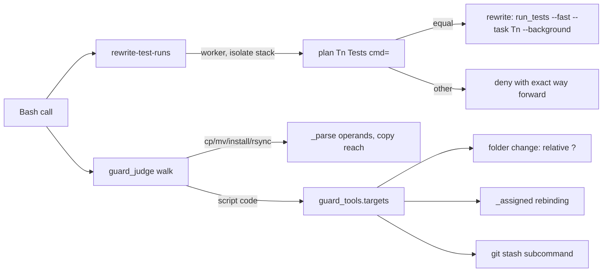
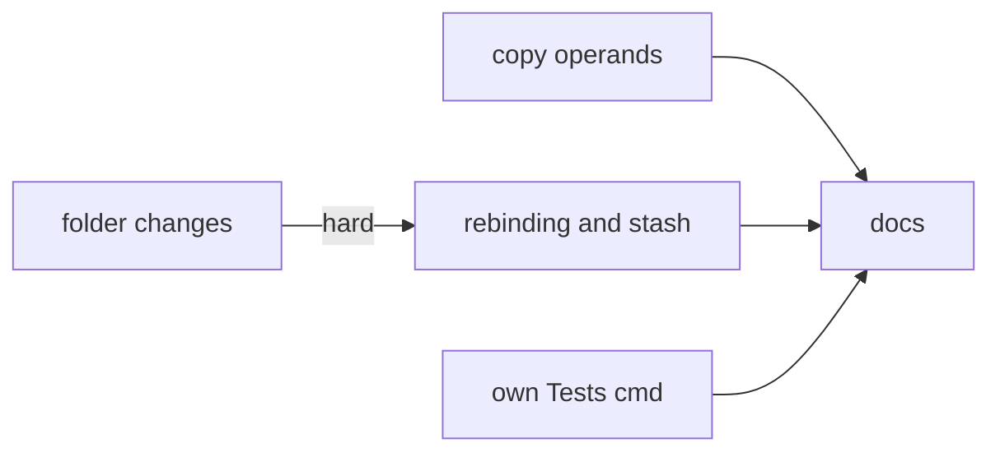

# Superlite: guard gaps, folder changes in scripts, option values after copy operands, own Tests cmd= for workers (B254, #750 #779 #975)

**Goal:** the coordinator guard reads a relative target as unknown after a folder change it cannot follow in script code, follows a walrus or attribute rebinding of a name, and reads an unknown `git stash` subcommand as one that may rewrite the tree (#750). Its copy reading never takes an option's value as the destination (#975). A worker's run of its own task's `**Tests:** cmd=` on an isolate stack runs in the task's tree instead of being blocked (#779).
**Architecture:** `guard_judge` copy readers (`_copy_text`, `_copy_reach`, `_link_copy`) split words with `guard_files._parse` (T1). `guard_tools` makes relative targets unknown after JS `cwd`, Ruby `chdir`, PHP `proc_open` cwd and `cd` in script shell text (T2), and handles walrus, attribute and import rebinding in `_assigned` and unknown stash subcommands in `_git_args` (T3). `hooks/rewrite-test-runs` reads the worker's task `**Tests:** cmd=` from the plan (T4). `docs/hooks.md` gets the bullets (T5).
**Tech stack:** Python 3.10+ stdlib, bash builtins (hook); pytest through `sl run_tests`.
**Spec:** this file, section Design; issues #750, #779, #975.
**Detail:** contracts
**Target-min:** 11
**Wave0:** none
**Worktree:** none
**Coverage:** off

Global constraints:
- Every script line keeps the repo's `# O(...)` complexity comment; stdlib only; LF endings; `hooks/rewrite-test-runs` stays bash builtins only (no new external process).
- A test that spawns git in a temporary repository removes GIT_DIR, GIT_INDEX_FILE and GIT_WORK_TREE from the child env.
- This repository is public: no host names, user names, home paths, other project or repository names in code, tests, docs or commit messages.
- Your own session's coordinator guard is the installed (old) code: never run a script that needs the new guard from your shell; tests call the worktree's code in-process or run the worktree's hook through subprocess inside pytest.
- A new pass path must judge or refuse every write it could hide: when in doubt, the target is unknown (`?`).
- Builds: the verdict is `sl run_tests` (the project's test command; a project with `.maxapp` runs `maxapp test`, which a build pool may place on another Mac, and a full run whose tree a green maxapp test stamp covers returns that result without a run); task trees build in <tree>/.build/DerivedData and any build of your own goes under .build/ of the worktree, never -derivedDataPath outside the worktree (your session scratchpad included; backlog cleanup removes scratchpad build folders when the worktree goes); a product, simulator or device build stays on this machine and runs only when an issue's acceptance asks for a running-app check.
- Simulators: append the UDID of each simulator you or a worker creates (`xcrun simctl create` or `clone`; a checker's `Simulators:` line marks its created ones) as one line to /Users/max/github/superlite/.claude/worktrees/superlite-b254-guard-gaps/.superlite/simulators.txt; never list one you did not create; ship cleanup shuts down and deletes each listed one.

## Design

Today (1.5.270): `_copy_text`/`_copy_reach`/`_link_copy` take every word not starting with `-` as an operand, so `rsync -a src/ dest/ --exclude zz` reads `zz` as the destination and `cp a/*.sh dest/ -S .bak` reads `.bak`. `guard_tools._call_dir` reads only Python `cwd=`; JS `{cwd}`, Ruby `chdir:` and PHP `proc_open` cwd are dropped, and `_shell` ignores `cd`, so `os.system("cd src && rm a.py")` names `a.py`. `_assigned` misses `s := "src"` and `__main__.s = "src"`. `_git_args` reads `git stash "$s"` as no write. The hook's `isolated-test-run` rule denies a worker's run of the project test command even when it is the task's own `**Tests:** cmd=`, which `sl run_tests --fast --task Tn` would run in the task's tree.

Ruling: #975: the three copy readers split cp, mv, install and rsync words with `guard_files._parse(w, base)` (permuting, `_SPEC` value options), so an option's value is never an operand and `-t`/`--target-directory` come from its options; when an option word (other than `--`) stands after the first operand, every operand also counts as a possible destination for `_copy_reach`, `_copy_text` records no text, and `_link_copy` reads every operand as a possible source (the issue's two rules; an option the table does not know may take the next word) (lead's ruling).
Ruling: #750 folder changes, Max's decision "make relative targets unknown": in script code, a JS subprocess call when the JS code names `cwd` other than as a call (`process.cwd()` stays harmless), a Ruby call when the code names `chdir`, a PHP `proc_open` with a 4th argument other than `null`, and shell text run from script code (os.system, subprocess strings and lists, backticks, `%x`, Perl `system`/`qx`) after a `cd`, `pushd` or `popd` command (also inside a body or subshell, then for every later target of that text) give `?` for every relative target; absolute, `~`, `$` and `?` targets stay. Causes: `subprocess folder option (cwd, chdir, proc_open cwd) is not followed` and `shell text changes folder (cd, pushd, popd)`. Python's literal `cwd=` joins (#728) and the judge's own Bash walk (`cd X &&`, `bash -c`, `eval` in the coordinator's command, B210) keep today's reading (lead's ruling).
Ruling: #750 rebinding: a Python walrus `NAME := VALUE` is an assignment event like `NAME = VALUE` (its value joins NAME's values, a non-literal one makes NAME unknown); an attribute store `X.NAME = ...` or `X.NAME op= ...`, an import that binds NAME (`from M import NAME`, `import M as NAME`, `from M import X as NAME`), and a string literal equal to NAME in code that calls `setattr`, `globals`, `vars` or `locals` or names `__dict__` or `sys.modules`, make NAME unknown (lead's ruling).
Ruling: #750 stash: after skipping options and the values of `-m`, `--message` and `--pathspec-from-file`, the first word left is the stash subcommand; an unknown word there (read as `guard_files._unknown`) counts as pop, apply or branch (the whole tree) with cause `stash subcommand X is not a literal`; literal subcommands keep today's reading, so `git stash -m "$msg"` and `git stash push -m "$m" -- "$f"` pass (lead's ruling).
Ruling: #750 self-naming option values (`cp "$F" a` with F=`--target-directory=src`, sed `w FILE` scripts): no change, per the coordinator's ruling in #750's comment (false blocks cost more than the rare miss) (main's ruling).
Ruling: #779: for a subagent or fleet worker on an isolate stack with a known current task Tn, a Bash segment that equals Tn's `**Tests:** cmd=` (plan from `stable.json` `plan`, else `.superlite/plan.md`; the segment without redirects and the cmd= without surrounding backticks, whitespace collapsed) is rewritten to `sl run_tests --fast --task Tn --background` instead of denied (run_tests runs that cmd= in the task's tree); separators and other segments stay, redirects on that segment drop, the call stays foreground, `additionalContext` says to collect it with `sl run_tests --wait`, and a `rule-rewrite` incident row with rule `own-tests-cmd` is written. Every other run stays denied; its message keeps its two lines and adds, when Tn has a cmd=, `Your task's own **Tests:** cmd= runs in its tree with: <sl> --fast --task Tn --background`, and always `Runner arguments go after --: <sl> --fast --task Tn --background -- <args>`. A Monitor call is never rewritten (lead's ruling).

## Task graph

```mermaid
%% schedule
gantt
  title Predicted schedule (mm:ss)
  dateFormat X
  axisFormat %M:%S
  section lane 1
  T2 Folder changes in script code make re :t2, 0, 738s
  T3 Walrus attribute and import rebinding :t3, 738, 760s
  T5 docs/hooks.md bullets for B254 :t5, 1498, 725s
  section lane 2
  T4 A worker's own Tests cmd= runs in its :t4, 0, 738s
  section lane 3
  T1 Copy readers skip option values after :t1, 0, 737s
```

critical path: T2 → T3 → T5 (37.0 min) · peak width 3 · predicted build 37.0 min · predicted total ≈ 57.5 min (target ✗ 11.0)

## Package: coordinator guard

App type: library (a hook's judge). Categories: deep (nested shell text in code), state (names bound twice), protocol (option grammar).
**Probe entry:** none (a hook judge; the named tests below cover each case)

### T1 Copy readers skip option values after operands · Complexity 3 · Est. context 45k
**Owns:** skills/subagent-driven-development/scripts/guard_judge.py, tests/scripts/test_guard_copy_opts_975.py
**Components:** 1
**LOC owned:** 110
**Tests:** fast
**Model:** sonnet
**Kind:** design
**Review Focus:** protocol: `-t DIR` after the operands still makes DIR the destination; state: B210/B247 copy-text cases stay green (test_guard_copy_run_780.py, test_guard_glob_copy_883.py); deep: `--` ends options.
**Test code:** in `tests/scripts/test_guard_copy_opts_975.py`, reuse the `proj` fixture and `_j` helper of `tests/scripts/test_guard_glob_copy_883.py` (copy them; `.superlite/a/evil.sh` holds `rm -rf src`, `.superlite/scratch/evil.sh` holds stale `echo stale`, `.superlite/b/` exists). Named tests:
- `test_value_after_operands_is_no_destination`: each of `rsync -a .superlite/a/ .superlite/scratch/ --exclude zz; bash .superlite/scratch/evil.sh`, `cp .superlite/a/*.sh .superlite/scratch/ -S .bak; bash .superlite/scratch/evil.sh`, `mv .superlite/a/*.sh .superlite/scratch/ --suffix .bak; bash .superlite/scratch/evil.sh`, `rsync .superlite/a/ .superlite/scratch/ -a --filter 'P x'; bash .superlite/scratch/evil.sh` gives a verdict with `kind == "code"` and `"scratch/evil.sh" in v.word`.
- `test_value_before_operands_still_read`: `cp -S .bak .superlite/a/*.sh .superlite/scratch/; bash .superlite/scratch/evil.sh` and `install -m 755 .superlite/a/evil.sh .superlite/scratch/; bash .superlite/scratch/evil.sh` block the same way.
- `test_option_after_operand_counts_every_operand`: `cp .superlite/a/ok.sh .superlite/scratch/evil.sh --unknown-flag zz; bash .superlite/scratch/evil.sh` blocks (`kind == "code"`).
- `test_reads_that_stay_passing`: `_j` is None for `cp .superlite/a/ok.sh .superlite/scratch/ok.sh; bash .superlite/scratch/ok.sh`, `cp -f .superlite/a/ok.sh .superlite/scratch/ok.sh; bash .superlite/scratch/ok.sh`, `rsync -a --exclude zz .superlite/a/ .superlite/b/; bash .superlite/scratch/run.sh`, `cp .superlite/a/ok.sh .superlite/b/ -t .superlite/b/; bash .superlite/scratch/run.sh`.
**Steps:** 1 failing tests, 2 run: FAIL, 3 implement (one helper that returns `(opts, ops with word index, option_after_operand)` from `guard_files._parse(w, base, slots=...)`, used by the three readers in place of their `startswith("-")` filters and `_copy_reach`'s `-t` loop), 4 run: PASS, 5 `sl run_tests --fast tests/scripts/test_guard_copy_opts_975.py tests/scripts/test_guard_copy_run_780.py tests/scripts/test_guard_glob_copy_883.py tests/scripts/test_guard_cat_show_884.py tests/scripts/test_guard_link_code_883.py tests/scripts/test_block_coordinator_edits.py` green.

### T2 Folder changes in script code make relative targets unknown · Complexity 3 · Est. context 45k
**Owns:** skills/subagent-driven-development/scripts/guard_tools.py, tests/scripts/test_guard_folder_change_750.py
**Components:** 1
**LOC owned:** 120
**Tests:** fast
**Model:** sonnet
**Kind:** design
**Review Focus:** deep: a `cd` inside `( ... )` or `{ ...; }` still makes later targets unknown; state: `_CALL_DIR` and the new flag never leak into the next `targets()` call; protocol: `process.cwd()` alone changes nothing.
**Test code:** in `tests/scripts/test_guard_folder_change_750.py` (import `guard_tools` as `tests/scripts/test_guard_tools_dyn_705.py` does). Named tests, `targets(words)` with `words = [interpreter, flag, code]`:
- `test_js_cwd_makes_relative_unknown`: node `-e` with `require('child_process').execSync('rm a.py', {cwd: 'src'})`, `const o = {cwd: 'src'}; require('child_process').execSync('rm a.py', o)`, `require('child_process').spawnSync('rm', ['a.py'], {cwd: 'src'})` each give `["?"]` and `guard_tools.unresolved() == "subprocess folder option (cwd, chdir, proc_open cwd) is not followed"`; `require('child_process').execSync('rm /abs/a.py', {cwd: 'src'})` gives `["/abs/a.py"]`.
- `test_js_process_cwd_call_changes_nothing`: `const d = process.cwd(); require('child_process').execSync('rm a.py')` gives `["a.py"]`.
- `test_ruby_chdir_makes_relative_unknown`: ruby `-e` with `system("rm a.py", chdir: "src")` and `require "open3"; Open3.capture2("rm a.py", chdir: "src")` give `["?"]`.
- `test_php_proc_open_cwd`: php `-r` with `proc_open("rm a.py", [], $p, "src");` gives `["?"]`; with `proc_open("rm a.py", [], $p, null);` and `proc_open("rm a.py", [], $p);` gives `["a.py"]`.
- `test_cd_in_shell_text`: python3 `-c` with `import os; os.system("cd src && rm a.py")`, `import subprocess; subprocess.run("cd src; rm a.py", shell=True)`, `import subprocess; subprocess.run(["sh", "-c", "pushd src; rm a.py"])`, `import os; os.system("(cd src && touch b) ; rm a.py")` each give `["?"]` (the last may also hold `"?"` only) and `unresolved() == "shell text changes folder (cd, pushd, popd)"`; `import os; os.system("rm a.py && cd src")` gives `["a.py"]`; `import os; os.system("cd src && rm /abs/a.py")` gives `["/abs/a.py"]`; ruby `` `cd src && rm a.py` `` and perl `system("cd src && rm a.py")` give `["?"]`.
- `test_python_cwd_literal_unchanged`: `import subprocess; subprocess.run(["rm", "a.py"], cwd="src")` gives `["src/a.py"]`.
- `test_bash_walk_keeps_cd_reading`: with the `proj` fixture of `tests/scripts/test_block_coordinator_edits.py`, the judge verdict of `bash -c 'cd .superlite && rm -f x.txt'` is unchanged from before this task (assert the value the start commit gives; it must not turn into an unknown-target block).
**Steps:** 1 failing tests, 2 run: FAIL, 3 implement (`_call_dir` returns `(True, None)` for the three language forms, reading the code in hand for JS `cwd` and Ruby `chdir`; `_shell` tracks a moved flag across segments and nested bodies and maps later targets through `_in_dir(None, t)`, only for shell text reached from script code, never for the judge's own Bash walk), 4 run: PASS, 5 `sl run_tests --fast tests/scripts/test_guard_folder_change_750.py tests/scripts/test_guard_tools_dyn_705.py tests/scripts/test_guard_subprocess_705.py tests/scripts/test_guard_tools.py tests/scripts/test_guard_judge.py tests/scripts/test_guard_outside.py` green.

### T3 Walrus, attribute and import rebinding; unknown stash subcommand · Complexity 3 · Est. context 45k
**Owns:** skills/subagent-driven-development/scripts/guard_tools.py, tests/scripts/test_guard_rebind_stash_750.py
**Components:** 2
**LOC owned:** 110
**Tests:** fast
**Model:** sonnet
**Kind:** design
**Review Focus:** state: two literal bindings union their values, a third non-literal one makes the name unknown; protocol: `-m` value skipped before the subcommand; deep: a walrus inside a comprehension or call argument counts.
**Test code:** in `tests/scripts/test_guard_rebind_stash_750.py`; `py(code) = guard_tools.targets(["python3", "-c", code])`. Named tests:
- `test_walrus_joins_values`: `s = "docs/x"\n(s := "src")\nopen(s + "/a.py", "w")` gives a list holding `"src/a.py"`; `s = "docs/x"\nif (s := input()):\n    pass\nopen(s + "/a.py", "w")` gives a list holding `"?"`.
- `test_attribute_store_makes_name_unknown`: `import __main__\ns = "docs/x"\n__main__.s = "src"\nopen(s + "/a.py", "w")` and `import sys\ns = "docs/x"\nsys.modules[__name__].s = "src"\nopen(s + "/a.py", "w")` give lists holding `"?"`.
- `test_text_rebinding_makes_name_unknown`: `s = "docs/x"\nglobals()["s"] = "src"\nopen(s + "/a.py", "w")` and `import sys\ns = "docs/x"\nsetattr(sys.modules[__name__], "s", "src")\nopen(s + "/a.py", "w")` give lists holding `"?"`.
- `test_import_binding_makes_name_unknown`: `s = "docs/x"\nfrom cfg import s\nopen(s + "/a.py", "w")` gives a list holding `"?"`.
- `test_unrelated_rebinding_keeps_value`: `class C: pass\nc = C()\nc.t = "src"\ns = "docs/x"\nopen(s + "/a.py", "w")` gives `["docs/x/a.py"]`.
- `test_stash_unknown_subcommand_is_whole_tree` (cwd a tmp folder): `targets(["git", "stash", "$s"])`, `targets(["git", "stash", "-q", "$s"])`, `targets(["git", "stash", "$sub", "stash@{0}"])` give `["."]`.
- `test_stash_message_values_pass`: `["git", "stash", "-m", "$msg"]`, `["git", "stash", "--message=$m"]`, `["git", "stash", "push", "-m", "$m", "--", "$f"]`, `["git", "stash", "list"]`, `["git", "stash"]` give `[]`; `["git", "stash", "pop"]` gives `["."]`.
**Steps:** 1 failing tests, 2 run: FAIL, 3 implement (`_assigned`: walrus events, an attribute-store, import and text-rebinding pass that adds names to `bad`; `_git_args` stash branch skips `-m`/`--message`/`--pathspec-from-file` values and treats an unknown first word as pop), 4 run: PASS, 5 `sl run_tests --fast tests/scripts/test_guard_rebind_stash_750.py tests/scripts/test_guard_git_archive.py tests/scripts/test_guard_git_metadata.py tests/scripts/test_guard_scratch_746.py tests/scripts/test_guard_subprocess_names_780.py tests/scripts/test_guard_tools.py tests/scripts/test_guard_outside.py` green.

## Package: test-run hook

App type: CLI (a PreToolUse hook). Categories: protocol (hook JSON in and out), encoding (quotes, backticks in cmd=), file (plan lookup).
**Probe entry:** none (a hook; the named tests below cover each case)

### T4 A worker's own Tests cmd= runs in its task tree · Complexity 3 · Est. context 45k
**Owns:** hooks/rewrite-test-runs, tests/scripts/test_rewrite_own_tests_779.py
**Components:** 1
**LOC owned:** 120
**Tests:** fast
**Model:** sonnet
**Kind:** design
**Review Focus:** protocol: the rewrite JSON escapes quotes and backslashes; file: a missing or unreadable plan denies as before; encoding: a cmd= in backticks matches.
**Test code:** in `tests/scripts/test_rewrite_own_tests_779.py`, reuse `setup`, `run`, `SWIFT`, `RAW` and `POOL` of `tests/scripts/test_rewrite_isolate.py` (import them). Plan text `PLAN = "### T3 x\n**Owns:** a.swift\n**Tests:** fast cmd=" + RAW + "\n\n### T5 y\n**Tests:** fast\n"` in `.superlite/plan.md`. Named tests:
- `test_own_cmd_rewritten`: `run(proj, RAW, agent_id="a1")` exits 0; stdout JSON `hookSpecificOutput.permissionDecision == "allow"`, `updatedInput.command` holds `run_tests --fast --task T3 --background` and not `Scripts/test.sh`; `additionalContext` holds `sl run_tests --wait`; the last incidents row has `kind == "rule-rewrite"` and `rule == "own-tests-cmd"`.
- `test_backticked_cmd_matches`: the plan's field `**Tests:** fast cmd=` + "`" + RAW + "`" rewrites the same way.
- `test_chain_keeps_other_segments`: `cd <proj> && ` + RAW + ` 2>&1 | tail -15` rewrites to a command holding `cd `, `run_tests --fast --task T3 --background` and `| tail -15`, without `2>&1`.
- `test_stable_plan_path`: plan at `docs/plans/p.md` named by `.superlite/stable.json` `{"plan": "docs/plans/p.md"}` with `### T5 y\n**Tests:** fast cmd=` + RAW; `run(proj, RAW, env={"SUPERLITE_FLEET_WORKER": "W2"})` rewrites with `--task T5`.
- `test_other_command_still_denied`: `Scripts/test.sh -only-testing:AppTests/BarTests` for a1 exits 2; stderr holds `--task T3`, `own **Tests:** cmd=` and `-- <args>`.
- `test_task_without_cmd_denied`: W2 (T5 has no cmd= in PLAN) running RAW exits 2; stderr holds `-- <args>` and not `own **Tests:** cmd=`.
- `test_monitor_never_rewritten`: the same call as `test_own_cmd_rewritten` with `tool_name` `Monitor` exits 2.
- `test_no_plan_denied`: no plan file, a1 running RAW exits 2 as today.
**Steps:** 1 failing tests, 2 run: FAIL, 3 implement (a `task_tests_cmd ID` builtin reader beside `current_task`; in the worker loop, before `deny_isolate`, compare the segment and rewrite; the rewrite output reuses the coordinator path's escaping and JSON shape without `run_in_background`; extend `deny_isolate`'s message; update the header comment), 4 run: PASS, 5 `sl run_tests --fast tests/scripts/test_rewrite_own_tests_779.py tests/scripts/test_rewrite_isolate.py tests/scripts/test_rewrite_other_repo_565.py tests/scripts/test_rewrite_collect_only.py` green, then every other `tests/scripts/test_rewrite*.py`.

## Package: docs

### T5 docs/hooks.md bullets for B254 · Complexity 1 · Est. context 25k
**Owns:** docs/hooks.md
**Components:** 1
**LOC owned:** 6
**Tests:** fast cmd=grep -q '#975' docs/hooks.md && grep -q '#750' docs/hooks.md && grep -q '#779' docs/hooks.md
**Model:** haiku
**Kind:** mechanical
**Test code:** the cmd= check; then `sl run_tests --fast` on every `tests/scripts/test_docs*.py` that names `hooks.md`, green.
**Steps:** 1 add one bullet right after the existing `block-coordinator-edits`, unknown git words (#726, #728, #749) bullet, starting `` - `block-coordinator-edits`, folder changes, rebinding, stash and copy options (#750, #975): `` and stating the #975, #750 folder, rebinding and stash rulings of this plan's Design; 2 add one bullet right after the `rewrite-test-runs` bullet, starting `` - `rewrite-test-runs`, own Tests cmd= (#779): `` and stating the #779 ruling; 3 change no existing line; 4 run the check.
