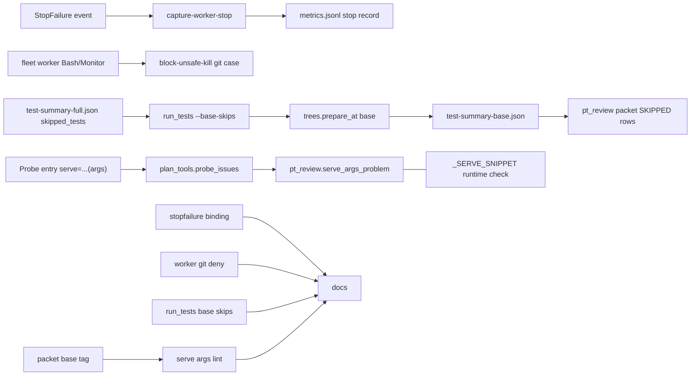

# Superlite B246: StopFailure stop records, worker git deny, base skips in the packet, serve= argument lint (#886 #887 #889 #891)

**Goal:** a turn that ends on an API error writes a fleet stop record (#887); a fleet worker cannot run `git checkout`, `git restore` or `git stash` behind git global options such as `-C <dir>` (#889); `sl run_tests --base-skips` runs the full run's skipped tests at the run's base commit and the review packet tags each SKIPPED test the base skips too `(base skips too)` (#886, Max's decision); plan lint `PROBE:` rejects `serve=` arguments pt_review is certain to refuse, and probe-plan.md names the accepted forms (#891).
**Architecture:** four independent units: `hooks/hooks.json` (one new event entry), `hooks/block-unsafe-kill` (a git case in its bash lexer, workers only), `run_tests.py` + `trees.py` (a new mode that runs in a scratch git worktree at the base commit) with `pt_review.py` reading its output file, and `pt_review.py` + `plan_tools.py` (one ast walker for serve= argument shapes shared by the runtime snippet and lint). Docs last.
**Tech stack:** Python 3.10+ stdlib (scripts), bash 3.2 builtins (hooks); pytest through `sl run_tests`.
**Spec:** issues #886 #887 #889 #891 and this file, section Design.
**Detail:** contracts
**Target-min:** 11
**Wave0:** none
**Edges:** hard
**Max chars:** 40000

Global constraints:
- Builds: the verdict is `sl run_tests` (the project's test command; a project with `.maxapp` runs `maxapp test`, which a build pool may place on another Mac, and a full run whose tree a green maxapp test stamp covers returns that result without a run); task trees build in <tree>/.build/DerivedData and any build of your own goes under .build/ of the worktree, never -derivedDataPath outside the worktree (your session scratchpad included; backlog cleanup removes scratchpad build folders when the worktree goes); a product, simulator or device build stays on this machine and runs only when an issue's acceptance asks for a running-app check.
- Simulators: append the UDID of each simulator you or a worker creates (`xcrun simctl create` or `clone`; a checker's `Simulators:` line marks its created ones) as one line to /Users/max/github/superlite/.claude/worktrees/superlite-b246-hooks-and-pt-review/.superlite/simulators.txt; never list one you did not create; ship cleanup shuts down and deletes each listed one.
- Every Python script line keeps the repo's `# O(...)` complexity comment as its neighbours do; stdlib only; LF endings. Hooks stay bash 3.2 and fail open (exit 0, no output, on malformed input); `hooks/block-unsafe-kill` spawns no process beyond its existing `ps` call.
- This repository is public: no host names, user names or home paths in code, tests, docs or commit messages.
- Do not touch files other open batches own: guard_tools.py, testcmd.py, backlog.py, fleet*.py, herdr_client.py, accounts.py, SDD SKILL.md and fleet.md, commands/backlog.md, AGENTS.md, scripts/test_layers.py, tests/scripts/test_doc_contract.py, tests/scripts/test_docs_contract.py. docs/tools.md and docs/fleet.md are append-only: add lines at the end, never edit existing ones.
- An existing test that pins a changed output is updated only when it is in the task's Owns; any other failing test is reported, never edited. New tests see a red run before the code they test.

## Design

What the issues ask, with the code facts behind each part (research: `.superlite/fleet/reports/R1.md` to `R5.md`):

- **#887.** `hooks/hooks.json` binds `StopFailure` (no matcher) to `capture-worker-stop`. Claude Code runs StopFailure instead of Stop when a turn ends on an API error; its input carries `error`, optional `error_details` and optional `last_assistant_message` (the API error text, such as `API Error: Rate limit reached`) per the Claude Code hooks reference. capture-worker-stop already copies `last_assistant_message` (empty when absent) and checks no event name, so the hook script does not change. backlog wait then sees a stop record with no Status line and re-prompts the lead once after READ_MS (backlog_run.py:890-925), instead of after lead.idle_minutes; fleet wait collects it as an ended turn (ASKED, then UNKNOWN). `tests/scripts/test_hooks_contract.py` CLAUDE_EVENTS gains `StopFailure` (the hooks reference lists it). hooks-cursor.json is unchanged (Cursor has no such event).
- **#889.** `hooks/block-unsafe-kill` already matches Bash, PowerShell and Monitor, runs for fleet workers and splits a command into simple commands (`lex`, `judge_words`, `$()`, `bash -c`, eval, wrappers). New: when `SUPERLITE_FLEET_WORKER` is set and `SUPERLITE_FLEET_ROLE` is not `lead` (the roles #784's `fleet_roles.GIT_DENY` covers), `judge_words` reads a `git` command word, skips git's global options (`-C <v>`, `-c <v>`, `--git-dir[=]<v>`, `--work-tree[=]<v>`, `--namespace[=]<v>`, `--super-prefix[=]<v>`, `--config-env[=]<v>`, `--exec-path[=<v>]`, and flag options such as `-p`, `-P`, `--no-pager`, `--bare`, `--no-optional-locks`, `--literal-pathspecs`) and blocks when the subcommand is `checkout`, `restore` or `stash` (any form). The block exits 2 with its own message and telemetry rule `worker-git`. The fast path also lets a worker's command containing `git` through to the lexer. guard_tools.py (B247) is not used.
- **#886 (Max's decision: run the skipped ids at base).** `--base` is already an `--affected` option of run_tests, so the new mode is `sl run_tests --base-skips [--plan DIR]`: it reads the newest full run's summary (`test-summary-full.json` in the run folder, else the default summary when its mode is `full`), takes its `skipped_tests`, finds the run's base commit (`checkpoints.json` `base` via `autocommit.base_of`, else the merge-base of HEAD with the default branch), builds a scratch git worktree `.superlite/trees/base-skips` at that commit with no overlay (new `trees.prepare_at`), runs the project's fast test command there for those tests' files (ids `file::name`; an id without `::` is passed as a Swift suite name as `--fast` does), parses the result as a fast run does, writes `<run folder>/test-summary-base.json` and removes the tree. It writes no ledger line, no incident and no other summary. `pt_review` reads that file and appends ` (base skips too)` to each `- SKIPPED: <id>` row whose id the base also skipped, when the file's `base` matches the packet's `--base` (prefix match either way) or the packet has none; `run_summaries` leaves the file out. A packet with SKIPPED rows and no usable base file prints one stdout line `note: skipped tests not compared with the base; run <sl> run_tests --base-skips, then rebuild the packet`.
- **#891.** pt_review's runtime serve check (`_SERVE_SNIPPET` `_check`, B217) and a new static check share one ast walker: the accepted shapes (literals; list, tuple, set and dict displays without a `**` entry; names; attribute chains without a dunder; calls whose callee is a name or attribute chain; `*` and `**` call arguments) live once, the runtime adds its name lookup in the serve module and the `_own` callee test. New `pt_review.serve_args_problem` runs the walker without importing anything; with the serve module's file on disk it also rejects a name the module does not bind (a builtin such as `dict` included: the runtime looks names up in `vars(mod)` only) and a callee whose root name the module imports from a standard-library module (`sys.stdlib_module_names`), such as `Path("x")` after `from pathlib import Path`. `plan_tools.probe_issues` calls it for every `serve=target(args)` entry and prints `PROBE: serve=<entry> arguments: <reason>; write literals, names of <module> and calls of the project's own code`. A third-party callee still fails only at run time (needs the installed package); probe-plan.md says so.

Ruling: (Max's decision) #886 runs the newest full run's skipped test ids at the run's base commit in a scratch tree; the flag is `--base-skips`, not `--base`, because `--base REV` already exists as an `--affected` modifier (run_tests.py:1489) (lead's ruling on the name; cost if wrong: one flag rename).
Ruling: the base run uses the skipped ids' test files, not single test ids (because `--fast` already takes files and Swift suite names; a file runs its other tests too, which costs seconds on pytest; cost if wrong: a longer base run).
Ruling: the base file is tagged only by name match and base sha; a skipped id the base ran without skipping gets no tag and no other text (because the issue asks only for the shared-name tag; cost if wrong: one more row word).
Ruling: the SDD Final review step that runs `--base-skips` goes to B245 (owns SDD SKILL.md) as a follow-up; until then the packet's stdout note names the command (cost if wrong: coordinators skip the base run).
Ruling: #889 covers every fleet worker role but the lead, the same roles as #784's deny list (because a lead rebases and resolves ship conflicts in its own worktree; cost if wrong: one role word).
Ruling: #889 blocks only `checkout`, `restore` and `stash`, as GIT_DENY does; `git switch` and `git reset --hard` stay out of scope (because the issue names #784's list; cost if wrong: a follow-up).
Ruling: #887 adds no field to the stop record (because `last` already carries the API error text from `last_assistant_message`; cost if wrong: one hook line).
Ruling: #891's static check rejects only what the runtime is certain to refuse; an unknown name is checked only when the serve module file exists (because a plan is linted before its code is written; cost if wrong: a refusal found at contract part2, as today).
Ruling: plan detail `contracts` (because every unit sits on existing test fixtures the implementer reads; named tests with exact inputs and outputs).

## Coverage

| Category | State | Basis |
|---|---|---|
| Scope and success criteria | settled | issues #886 #887 #889 #891; Max's #886 answer (answer-1.json); Design |
| Domain and data model | ruled | test-summary-base.json keys: mode "base", base, full_started, started, seconds, compared, skipped_tests, passed, failed, skipped (T3) |
| Persistence and migration | ruled | one new run-folder file, test-summary-base.json; no migration, older runs simply have none (T3, T4) |
| Interfaces and contracts | ruled | new CLI flag `--base-skips` refuses every other mode flag; `pt_review.serve_args_problem` signature (T5); stop record format unchanged (T1) |
| UI states | n/a | CLI and hooks only |
| Concurrency and state ownership | ruled | the base tree `.superlite/trees/base-skips` is marked busy (trees.busy) for the run and removed after; a second concurrent `--base-skips` waits on the tree lock (T3) |
| Error handling and recovery | ruled | no full summary, no skipped tests, no base commit, no result: one `run_tests: --base-skips: ...` line and exit 2 / 0 / 2 / 1; the tree is removed on every path (T3) |
| Security and privacy | ruled | #889 is a guard, fail-open on malformed input; data, quotes and heredoc bodies never block (T2) |
| Performance and limits | ruled | block-unsafe-kill stays builtin-only; the git lexing runs only for a worker whose command holds `git` (T2) |
| Observability | ruled | block telemetry rule `worker-git` (T2); packet stdout note when the base was not compared (T4) |
| Testing strategy | ruled | named pytest tests per task; the base run tested on a temp git repo with a tiny pytest project (T3) |
| Compatibility | ruled | bash 3.2 hooks; Claude Code events per the hooks reference; Cursor unchanged |
| Rollout | n/a | one patch release, no flag |
| Research unknowns | settled | R1-R5 reports answered every code question |

```mermaid
%% schedule
gantt
  title Predicted schedule (mm:ss)
  dateFormat X
  axisFormat %M:%S
  section lane 1
  T3 run_tests base skips :t3, 0, 414s
  T6 docs :t6, 786, 368s
  section lane 2
  T2 worker git deny :t2, 0, 383s
  section lane 3
  T4 packet base tag :t4, 0, 375s
  T5 serve args lint :t5, 375, 411s
  section lane 4
  T1 stopfailure binding :t1, 0, 368s
```

critical path: T4 → T5 → T6 (19.2 min) · peak width 4 · predicted build 19.2 min · predicted total ≈ 31.7 min (target ✗ 11.0)

## File structure

- `hooks/hooks.json`: StopFailure entry (T1).
- `tests/scripts/test_hooks_contract.py`: CLAUDE_EVENTS (T1). `tests/scripts/test_stopfailure_capture_887.py` (T1).
- `hooks/block-unsafe-kill`: worker git case (T2). `tests/scripts/test_block_unsafe_kill_git_889.py` (T2).
- `skills/subagent-driven-development/scripts/trees.py`: `prepare_at` (T3). `skills/subagent-driven-development/scripts/run_tests.py`: `--base-skips` (T3). `tests/scripts/test_run_tests_base_skips_886.py` (T3).
- `skills/subagent-driven-development/scripts/pt_review.py`: base tag (T4), shared serve walker and `serve_args_problem` (T5). `tests/scripts/test_pt_review_base_skips_886.py` (T4). `tests/scripts/test_serve_args_static_891.py` (T5).
- `skills/subagent-driven-development/scripts/plan_tools.py`: probe_issues serve arguments (T5).
- `skills/writing-plans/probe-plan.md`, `docs/hooks.md`, `docs/tools.md` (append), `tests/scripts/test_docs_b246.py`: docs (T6).

## Sections

### Hooks

App type: guard (protocol, state). **Probe entry:** none (bash hooks read one JSON event on stdin; their cases are named tests)

### T1 stopfailure binding · Complexity 1 · Est. context 30k
**Owns:** hooks/hooks.json, tests/scripts/test_hooks_contract.py, tests/scripts/test_stopfailure_capture_887.py
**Components:** 1
**LOC owned:** 60
**Tests:** fast
**Kind:** mechanical
**Model:** haiku
**Covers:** Design
**Review Focus:** protocol: `test_stopfailure_payload_writes_stop_record`
**Test code (contracts):**
- `hooks/hooks.json`: add, after the `"Stop"` key, `"StopFailure": [{"hooks": [{"type": "command", "command": "bash \"${CLAUDE_PLUGIN_ROOT}/hooks/capture-worker-stop\"", "shell": "bash"}]}]` (no matcher). Nothing else in the file changes.
- `tests/scripts/test_hooks_contract.py`: add `"StopFailure"` to the `CLAUDE_EVENTS` set; nothing else.
- New `tests/scripts/test_stopfailure_capture_887.py` (run the hook with bash as `tests/scripts/test_fleet_hooks.py` and `test_worker_plumbing_hooks.py` do: env `SUPERLITE_FLEET_WORKER`, `SUPERLITE_FLEET_AGENT`, `SUPERLITE_FLEET_PARENT_DIR=<tmp state dir>`; read `<tmp>/metrics.jsonl`):
  - `test_stopfailure_bound_to_capture_worker_stop`: `json.load(hooks/hooks.json)["hooks"]["StopFailure"] == [{"hooks": [{"type": "command", "command": "bash \"${CLAUDE_PLUGIN_ROOT}/hooks/capture-worker-stop\"", "shell": "bash"}]}]`, and the `Stop` list still runs final-review-check then capture-worker-stop.
  - `test_stopfailure_payload_writes_stop_record`: stdin `{"session_id":"s1","transcript_path":"/tmp/t1.jsonl","cwd":"/tmp","hook_event_name":"StopFailure","error":"rate_limit","error_details":"429 Too Many Requests","last_assistant_message":"API Error: Rate limit reached"}`, env worker `W3`, agent `superlite:implementer`: exit 0, empty stdout, metrics.jsonl holds exactly one line whose JSON has `ev == "stop"`, `agent_id == "W3"`, `type == "fleet:superlite:implementer"`, `transcript == "/tmp/t1.jsonl"`, `last == "API Error: Rate limit reached"`.
  - `test_stopfailure_without_message_writes_empty_last`: the same stdin without `last_assistant_message`: one line, `last == ""`.
  - `test_stopfailure_outside_worker_writes_nothing`: the first stdin with `SUPERLITE_FLEET_WORKER` unset: exit 0, no metrics.jsonl.
**Steps:** 1 write the tests, 2 run: FAIL (`test_stopfailure_bound_to_capture_worker_stop` and the contract test's unknown-event case), 3 edit hooks.json and CLAUDE_EVENTS, 4 run: PASS (also `tests/scripts/test_hooks_contract.py` and `tests/scripts/test_fleet_hooks.py`).

### T2 worker git deny · Complexity 4 · Est. context 55k
**Owns:** hooks/block-unsafe-kill, tests/scripts/test_block_unsafe_kill_git_889.py
**Components:** 1
**LOC owned:** 150
**Tests:** fast
**Kind:** design
**Model:** sonnet
**Covers:** Design
**Review Focus:** protocol: `test_worker_git_forms_blocked`, `test_worker_git_allowed_forms`; state: `test_lead_and_coordinator_not_blocked`; encoding: `test_git_words_in_data_never_block`
**Test code (contracts):** new `tests/scripts/test_block_unsafe_kill_git_889.py`, running the hook as `tests/scripts/test_block_unsafe_kill.py` does (tool Bash unless named; env `SUPERLITE_FLEET_WORKER=W2`, `SUPERLITE_FLEET_ROLE=fixer` unless named):
- `test_worker_git_forms_blocked` (parametrized, each exit 2 and stderr containing `fleet workers never run git checkout, git restore or git stash`): `git checkout -- a.py`, `git -C /tmp/x checkout -- a.py`, `git -C /tmp/x restore a.py`, `git -C /tmp/x stash`, `git -C a -C b stash pop`, `git -c core.x=1 restore --staged a.py`, `git --git-dir=/tmp/x/.git --work-tree=/tmp/x checkout main`, `git --git-dir /tmp/x/.git checkout main`, `git --no-pager -P stash list`, `/usr/bin/git -C d restore .`, `cd /tmp && git -C d checkout x`, `echo $(git -C d stash)`, `bash -c 'git -C d restore a'`, `env GIT_DIR=x git checkout y`, `sudo git -C d restore a`; Monitor tool with command `git -C d checkout x`.
- `test_worker_git_allowed_forms` (each exit 0, empty stderr): `git -C /tmp/x status`, `git -C /tmp/x diff -- a.py`, `git -C d log --oneline`, `git add a.py && git commit -m "fix checkout"`, `git -C d show HEAD:a.py`, `git branch --list`, `git -c x=1 rev-parse HEAD`.
- `test_git_words_in_data_never_block` (exit 0): `echo "git checkout x"`, `grep -n "git restore" a.md`, `printf '%s\n' 'git -C d stash'`, a heredoc body `cat <<'EOF'\ngit stash\nEOF`, a comment `ls # git checkout x`.
- `test_lead_and_coordinator_not_blocked` (exit 0 for `git -C d checkout x` and `git stash`): `SUPERLITE_FLEET_ROLE=lead` with `SUPERLITE_FLEET_WORKER=L1`; no `SUPERLITE_FLEET_*` variables at all.
- `test_kill_rules_unchanged_for_worker`: `pkill -f x` still exits 2 with the kill message for a worker; `kill 123` still exits 0.
- `test_worker_git_block_telemetry`: with the telemetry home the existing block-unsafe-kill telemetry test uses, a blocked worker git command writes one gate line with rule `worker-git` (follow that test's fixture; if the file has none, assert the rule word through the same helper `tel_gate` is checked with).
- `test_powershell_worker_git_blocked`: tool PowerShell, command `git -C d checkout x`: exit 2 (judge_words sees PowerShell command words too).
**Steps:** 1 write the tests, 2 run: FAIL, 3 add the git case to `judge_words` (global options skipped as Design lists; blocked subcommands checkout, restore, stash; gate on the two env variables read once at the top), a `block_git` with its own message and rule `worker-git`, and the fast-path change, 4 run: PASS, also `tests/scripts/test_block_unsafe_kill.py` and `tests/scripts/test_hooks_contract.py`.
**Notes:** block message, exactly: `Blocked: fleet workers never run git checkout, git restore or git stash (also behind -C <dir> and other git options): the run root is shared with other workers and the coordinator, and a dirty git status is its normal state. Leave files you did not change alone; to undo your own edit, edit the file back.` The header comment of the hook gains one line naming the worker git rule (#889).

### Base skips

App type: CLI (protocol, file, state) and a report generator (encoding). **Probe entry:** none (run_tests runs the project's own test suites; pt_review's packet needs a run folder; cases are named tests)

### T3 run_tests base skips · Complexity 6 · Est. context 70k
**Owns:** skills/subagent-driven-development/scripts/run_tests.py, skills/subagent-driven-development/scripts/trees.py, tests/scripts/test_run_tests_base_skips_886.py
**Components:** 2
**LOC owned:** 230
**Tests:** fast
**Kind:** design
**Model:** sonnet
**Covers:** Design
**Produces:** trees.prepare_at(root: str | Path, key: str, rev: str) -> Path
e.g. trees.prepare_at("/repo", "base-skips", "3f2a...") -> Path("/repo/.superlite/trees/base-skips") (detached at 3f2a..., no overlay)
**Review Focus:** state: `test_tree_removed_on_every_path`; protocol: `test_base_skips_refuses_other_modes`; file: `test_base_skips_writes_no_other_state`
**Test code (contracts):** new `tests/scripts/test_run_tests_base_skips_886.py`. Fixture: a temp git repo with a tiny pytest project (`tests/test_a.py` with `test_gated` skipped by `@pytest.mark.skip`, `test_plain`), `.superlite/test-cmd.json` `{"language": "python", "test_file": "<sys.executable> -m pytest {files} -q -p no:cacheprovider -o junit_family=xunit1 --junitxml={junit}", "junit": "{junit}"}`, commit it as the base, write `.superlite/checkpoints.json` with `"base": <that sha>`; then commit a change adding `test_new_skip` (skipped) to tests/test_a.py; write `.superlite/test-summary-full.json` `{"mode": "full", "started": 1763550000.5, "passed": 1, "failed": 0, "skipped": 2, "skipped_tests": ["tests/test_a.py::test_gated", "tests/test_a.py::test_new_skip"]}`. Run `run_tests.py --base-skips` in the repo (env without `SUPERLITE_*`).
- `test_base_skips_tags_only_base_skipped`: exit 0; `.superlite/test-summary-base.json` has `mode == "base"`, `base == <base sha>`, `full_started == 1763550000.5`, `compared == ["tests/test_a.py::test_gated", "tests/test_a.py::test_new_skip"]`, `skipped_tests == ["tests/test_a.py::test_gated"]`; stderr names `base <sha7> skips 1 of 2`.
- `test_base_skips_merge_base_without_checkpoints`: no checkpoints.json, the base commit on branch `main` and HEAD on a branch off it: the file's `base` is the merge-base sha.
- `test_base_skips_no_full_summary`: no full summary: exit 2, stderr `run_tests: --base-skips needs a full run's summary; run sl run_tests --full first`, no base file.
- `test_base_skips_nothing_skipped`: full summary with `skipped_tests: []`: exit 0, stderr `run_tests: --base-skips: the full run skipped nothing`, no base file.
- `test_base_skips_refuses_other_modes` (parametrized `--full`, `--fast tests/test_a.py`, `--affected`, `--task T1`, `--record`, `--destination all`, `--background`): exit 2, stderr names `--base-skips`.
- `test_base_skips_writes_no_other_state`: after a run, `.superlite/test-summary.json`, `test-summary.latest`, `incidents.jsonl` and the ledger (`progress.md`) are unchanged or absent as before; `test-summary-full.json` is byte-identical.
- `test_tree_removed_on_every_path`: after a green run, after a run whose base test file fails to import (exit 1, stderr `base run gave no result` or a red count, base file still written only when a skip list was parsed), and after a missing base commit (exit 2): `.superlite/trees/base-skips` does not exist and `git worktree list` has no entry for it.
- `test_prepare_at_detached_no_overlay`: `trees.prepare_at(repo, "k", base_sha)` returns `<repo>/.superlite/trees/k`, its HEAD is base_sha detached, a working-tree change in the repo is not in it; calling it again at a newer sha moves the tree to that sha.
**Steps:** 1 write the tests, 2 run: FAIL, 3 `trees.prepare_at` (git worktree add --force --detach, reuse with checkout --force --detach; same lock as `prepare`, no overlay), 4 `--base-skips` in run_tests (argparse next to `--record`; a branch in `main` before `run(a)`; reuse `fast_spec`, `with_derived_data`, `run_captured` and the junit / `testcmd.parse_output` parsing a fast run uses; `.superlite` linked into the tree with `_link_dir`; `trees.busy` around the run; `trees.drop` in a `finally`), 5 run: PASS, also `tests/scripts/test_trees.py` if it exists and the run_tests tests that import argparse flags.
**Notes:** `<run folder>/test-summary-base.json`, exactly these keys: `{"mode": "base", "base": "<40-hex sha>", "full_started": 1763550000.5, "started": 1763550100.0, "seconds": 2.1, "compared": ["tests/test_a.py::test_gated", "tests/test_a.py::test_new_skip"], "skipped_tests": ["tests/test_a.py::test_gated"], "passed": 2, "failed": 0, "skipped": 1}` (`full_started` is the full summary's `started`, null when it has none). The base run ids come from parsing the base run exactly like a fast run (junit `file::name`, or `skipped_names`), so they compare by string with the full run's ids. Only ids in `compared` count; `skipped_tests` keeps `compared` order. The run uses the project's `test_file` command (else `test`) for the unique files of the ids, through `fast_spec`; an xcodebuild command builds in `<tree>/.build/DerivedData`. No full-suite lock (a narrowed run).

### T4 packet base tag · Complexity 3 · Est. context 50k
**Owns:** skills/subagent-driven-development/scripts/pt_review.py, tests/scripts/test_pt_review_base_skips_886.py
**Components:** 1
**LOC owned:** 90
**Tests:** fast
**Kind:** design
**Model:** sonnet
**Covers:** Design
**Produces:** pt_review.base_skipped(summary_path: Path, base: str | None) -> set[str] | None
e.g. base_skipped(Path(".superlite/test-summary.json"), "abc1234") with test-summary-base.json {"mode": "base", "base": "abc1234def...", "skipped_tests": ["t.py::a"]} beside it -> {"t.py::a"}
e.g. base_skipped(Path(".superlite/test-summary.json"), "fff0000") with the same file -> None
**Review Focus:** encoding: `test_skipped_rows_tagged`; state: `test_base_file_not_a_run_summary`
**Test code (contracts):** the base file format is T3's Notes line (write it in the tests, never run T3's code). New `tests/scripts/test_pt_review_base_skips_886.py` (build summaries in a tmp run folder as `tests/scripts/test_pt_review.py` does around its SKIPPED assertion):
- `test_skipped_rows_tagged`: full summary skipped_tests `["t.py::a", "t.py::b"]`, base file `{"mode": "base", "base": "abc1234def5678", "skipped_tests": ["t.py::a"], "compared": ["t.py::a", "t.py::b"]}`, packet base `abc1234`: the packet text holds `- SKIPPED: t.py::a (base skips too)` and `- SKIPPED: t.py::b` with nothing after it.
- `test_base_mismatch_no_tag`: the same with packet base `fff0000`: no `(base skips too)`; stdout holds `note: skipped tests not compared with the base`.
- `test_no_base_file_note`: SKIPPED rows and no base file: stdout holds `note: skipped tests not compared with the base; run ` and `run_tests --base-skips`; no SKIPPED rows: no such note.
- `test_base_file_not_a_run_summary`: `run_summaries` on a folder holding test-summary-full.json and test-summary-base.json returns no dict with `mode == "base"`.
- `test_base_skipped_bad_file`: base file that is not JSON, or `mode != "base"`: `base_skipped(...) is None`.
**Steps:** 1 write the tests, 2 run: FAIL, 3 `base_skipped`, `run_summaries` filter, `_summary_rows` tag (a new keyword argument, default None, so other callers stay unchanged), packet note, 4 run: PASS, also `tests/scripts/test_pt_review.py` and `tests/scripts/test_run_scripts.py`.

### Serve argument lint

App type: library / parser (deep, encoding). **Probe entry:** none (the check takes two arguments and a file; its cases are named tests)

### T5 serve args lint · Complexity 5 · Est. context 60k
**Owns:** skills/subagent-driven-development/scripts/pt_review.py, skills/subagent-driven-development/scripts/plan_tools.py, tests/scripts/test_serve_args_static_891.py
**Components:** 2
**LOC owned:** 200
**Tests:** fast
**Kind:** design
**Model:** sonnet
**Covers:** Design
**Produces:** pt_review.serve_args_problem(target: str, args_src: str, module_file: Path | None = None) -> str | None
e.g. serve_args_problem("pkg.server.create_server", "Workbook(), port=0") -> None
e.g. serve_args_problem("pkg.server.create_server", "lambda: 1") -> "Lambda"
e.g. serve_args_problem("pkg.server.create_server", "Path('x')", Path("pkg/server.py")) with `from pathlib import Path` in that file -> "Path is imported from the standard library (pathlib), not the project's own code"
**Review Focus:** deep: `test_static_shapes` nested displays and calls; encoding: `test_static_module_names` star import and missing file; protocol: `test_lint_probe_serve_args`
**Test code (contracts):** new `tests/scripts/test_serve_args_static_891.py`:
- `test_static_shapes` (parametrized, `module_file=None`): `"Workbook(), port=0"` -> None; `"1, 'a', [1, 2], {'k': (1,)}, *ARGS, **KW"` -> None; `"cfg.Settings(debug=True)"` -> None; `"lambda: 1"` -> `"Lambda"`; `"x[0]"` -> `"Subscript"`; `"f()()"` -> `"callee Call"`; `"a + b"` -> `"BinOp"`; `"{**d}"` -> `"dict ** entry"`; `"__import__('os')"` -> `"name '__import__'"`; `"obj.__class__"` -> `"attribute '__class__'"`; `"f'x{y}'"` -> `"JoinedStr"`; `"-1, 2.5"` -> None; `"1, ("` -> a non-empty string (the parse error).
- `test_static_module_names`: module file text `from pathlib import Path\nfrom pkg.model import Workbook\nimport os\nDEFAULT = 3\ndef create_server(wb, port=0):\n    pass\n`: `"Path('x')"` -> `"Path is imported from the standard library (pathlib), not the project's own code"`; `"os.getcwd()"` -> `"os is imported from the standard library (os), not the project's own code"`; `"Workbook()"` -> None; `"DEFAULT"` -> None; `"dict(a=1)"` -> `"name 'dict'"`; `"Missing()"` -> `"name 'Missing'"`; `"requests.get('u')"` -> `"name 'requests'"`. A module holding `from x import *`: `"Missing()"` -> None. A module_file path that does not exist: `"Missing()"` -> None and `"lambda: 1"` -> `"Lambda"`.
- `test_lint_probe_serve_args`: a one-task plan (Owns `pkg/server.py`, `pkg/__init__.py`, tests) whose package section has `**Probe entry:** serve=pkg.server.create_server(Path("x"))`, with `pkg/server.py` on disk importing `Path` from `pathlib`: `plan_tools lint` prints `PROBE: serve=pkg.server.create_server(Path("x")) arguments: Path is imported from the standard library (pathlib), not the project's own code; write literals, names of pkg.server and calls of the project's own code`; `serve=pkg.server.create_server(Workbook())` with Workbook imported from `pkg.model`: no `PROBE:` line; `serve=pkg.server.create_server(lambda: 1)` with no file on disk: `PROBE: serve=pkg.server.create_server(lambda: 1) arguments: Lambda; write literals, names of pkg.server and calls of the project's own code`; `serve=pkg.server.create_server` (no arguments): no new line.
- `test_runtime_check_unchanged`: `tests/scripts/test_pt_review_serve_args_838.py` passes unchanged (run it with this task's tests), and the runtime refusal of `lambda: 1` still reads `serve arguments unparsable: Lambda; write literals, names of <module> and calls of the project's own code`.
**Steps:** 1 write the tests, 2 run: FAIL, 3 move the shape walk (`_is_lit`, displays, dict `**`, dunder names and attributes, callee chain type, call arguments) out of `_SERVE_SNIPPET` into one source string both use (the snippet concatenates it; `serve_args_problem` execs it once into a module-level namespace), with the name lookup and `_own` as the runtime's hooks; add the static hooks (module-bound names read with ast: imports, defs, classes, assignment targets; a star import turns the name check off; stdlib roots via `sys.stdlib_module_names`), 4 call it from `plan_tools.probe_issues` for every `serve=` entry with arguments (module file: the holding task's Owns `.py` file whose dotted path ends with the serve module, under the plan's project root, when it exists), 5 run: PASS, also `tests/scripts/test_pt_review_serve_args_838.py`, `tests/scripts/test_plan_tools.py -k probe` and the lint PROBE tests (`grep -l "PROBE:" tests/scripts/test_lint_probe*.py`).
**Notes:** the reason strings are the runtime `_bad(...)` reasons word for word (`name 'X'` uses `%r`, `callee <Type>`, `attribute '<a>'`, `dict ** entry`, `not one argument list`, the node type name); the two static-only reasons are `<root> is imported from the standard library (<top module>), not the project's own code` and `name '<X>'` for an unbound name. Literal checks use `ast.literal_eval` exactly as the runtime does, so `-1` and `2.5` pass.

### Docs

App type: docs. **Probe entry:** none (prose)

### T6 docs · Complexity 1 · Est. context 30k
**Owns:** skills/writing-plans/probe-plan.md, docs/hooks.md, docs/tools.md, tests/scripts/test_docs_b246.py
**Components:** 1
**LOC owned:** 50
**Tests:** fast
**Kind:** mechanical
**Model:** haiku
**Covers:** Design
**Test code (contracts):** new `tests/scripts/test_docs_b246.py` with one test per sentence below, each asserting the exact sentence is in its file: `test_probe_plan_serve_arguments`, `test_hooks_md_stopfailure`, `test_hooks_md_worker_git`, `test_tools_md_base_skips`, `test_tools_md_packet_tag`, `test_tools_md_serve_lint`.
**Steps:** 1 write the tests, 2 run: FAIL, 3 edit the docs exactly as Notes says, 4 run: PASS, also `tests/scripts/test_writing_plans_split_684.py`, `tests/scripts/test_docs_601_launch.py`, `tests/scripts/test_backlog_user_docs.py` and `tests/scripts/test_block_unsafe_kill.py`.
**Notes:** exact edits, nothing else in these files changes:
- `skills/writing-plans/probe-plan.md`: insert a new bullet directly after the bullet that starts ``- A **`**Probe entry:**` line per package**`` and before the bullet that starts ``- **`run=` runs for real.**``: ``- **`serve=` arguments.** A factory that needs arguments gets them in the entry: `serve=pkg.server.create_server(Workbook(), port=0)`. pt_review reads them with ast, never eval: literals; list, tuple, set and dict displays without a `**` entry; names and dotted names the serve module defines or imports; calls whose callee is a name or dotted name of the project's own code (a module file outside the standard library and site-packages); `*` and `**` arguments. Lint fails `PROBE: serve=<entry> arguments: <reason>; write literals, names of <module> and calls of the project's own code` for any other form (a lambda, subscript, operator, comprehension, f-string, or a name or attribute starting with `__`) and, once the serve module's file exists, for a name it does not bind (builtins such as `dict` included) and a callee it imports from the standard library (`Path("x")` after `from pathlib import Path`). A third-party callee (`requests.Session()`) passes lint and fails only when contract part2 starts the server: build such an object inside the factory instead.``
- `docs/hooks.md`, the bullet starting ``- `capture-worker-stop`: on a fleet worker's stop,``: replace ``on a fleet worker's stop,`` with ``on a fleet worker's stop (`Stop`, and `StopFailure` when a turn ends on an API error, whose record's `last` holds the API error text, #887),``.
- `docs/hooks.md`: insert after the bullet starting ``- `block-unsafe-kill` reads only command words (#666)`` a new bullet: ``- `block-unsafe-kill` also blocks a fleet worker's (`SUPERLITE_FLEET_WORKER` set, `SUPERLITE_FLEET_ROLE` not `lead`) `git checkout`, `git restore` and `git stash` in every form, also behind git's global options (`git -C <dir>`, `-c k=v`, `--git-dir`, `--work-tree`, `--no-pager`), which the `--disallowedTools` prefix rules of #784 miss; the coordinator and leads are not affected, and the gate line's rule is `worker-git` (#889).``
- `docs/tools.md`: append three lines at the end of the file (append-only file: never edit existing lines):
  ``sl run_tests --base-skips [--plan DIR]` runs the newest full run's skipped tests (their test files) at the run's base commit (`checkpoints.json` `base`, else the merge-base with the default branch) in the scratch tree `.superlite/trees/base-skips`, removed afterwards, and writes `test-summary-base.json` (`mode` `base`, `base`, `full_started`, `compared`, `skipped_tests`, counts) and nothing else; it refuses every other mode flag (exit 2) (#886).``
  ``The review packet appends ` (base skips too)` to each `- SKIPPED:` row whose test `test-summary-base.json` also lists as skipped (its `base` matching the packet's `--base`); with SKIPPED rows and no matching base file it prints `note: skipped tests not compared with the base; run <sl> run_tests --base-skips, then rebuild the packet` (#886).``
  ``Plan lint `PROBE:` reads a `serve=target(args)` entry's arguments with the same ast walker as pt_review's runtime check and fails `PROBE: serve=<entry> arguments: <reason>; write literals, names of <module> and calls of the project's own code` for a form pt_review refuses; with the serve module's file on disk it also fails a name the module does not bind and a callee imported from the standard library (#891).``
