# Superlite: plan_tools from a subfolder resolves the worktree's run, never creates or moves run state (#998)

**Goal:** `sl plan_tools prune` / `lint --stable` (and every plan_tools subcommand) run with the cwd in a subfolder of a checkout resolve a relative `--plan` against the enclosing checkout's run, and `lint --stable` refuses a plan that exists nowhere before it binds, so no `<subfolder>/.superlite` is created and no orchestrator.json, session marker or fleet link moves (#998).
**Architecture:** plan_tools.py gains `anchor_plan(value, cwd=None)`; `main` passes every `--plan` value (both the argparse branch and the pt_review branch) through it before the existing run-folder resolution; `cmd_lint_stable` resolves the plan file (`resolve_plan`) before `state.bind`, so a missing plan exits 2 through main's existing `error: ...` line with nothing written.
**Tech stack:** Python 3.10+ stdlib; pytest through `sl run_tests`.
**Spec:** this file, section Design.
**Detail:** contracts
**Target-min:** 11
**Wave0:** none
**Coverage:** off

Global constraints:
- Every line of a Python script under `skills/**/scripts/` keeps the repo's `# O(...)` complexity comment; stdlib only; LF endings. Files under `tests/` carry no such comments.
- This repository is public: no host names, user names, home paths, other project or repository names in code, tests, docs or commit messages.
- The verdict is `sl run_tests` (never raw pytest); every new test sees a red run before the code it tests.
- An existing test that pins a changed text or output may be updated in the task that changes it; name each such file in your report.
- Tests never touch the real `~/.superlite` or the real session: tests/scripts/conftest.py already sets SUPERLITE_HOME per test; set SUPERLITE_SESSION_ID to a test id with monkeypatch and delete CLAUDE_CODE_SESSION_ID and SUPERLITE_STATE_DIR.
- Builds: the verdict is `sl run_tests` (the project's test command; a project with `.maxapp` runs `maxapp test`, which a build pool may place on another Mac, and a full run whose tree a green maxapp test stamp covers returns that result without a run); task trees build in <tree>/.build/DerivedData and any build of your own goes under .build/ of the worktree, never -derivedDataPath outside the worktree (your session scratchpad included; backlog cleanup removes scratchpad build folders when the worktree goes); a product, simulator or device build stays on this machine and runs only when an issue's acceptance asks for a running-app check; copy this sentence into every worker brief.
- Simulators: append the UDID of each simulator you or a worker creates (`xcrun simctl create` or `clone`; a checker's `Simulators:` line marks its created ones) as one line to the worktree's `.superlite/simulators.txt`; never list one you did not create; ship cleanup shuts down and deletes each listed one; copy this sentence into every worker brief.

## Design

Issue #998: from `<worktree>/skills/subagent-driven-development/scripts`, `plan_tools prune` / `lint --stable` created `<subfolder>/.superlite`, linked the session fleet there and moved the run's orchestrator.json and session marker into it.

Research (R1): `cmd_lint_stable` (plan_tools.py) calls `state.bind(stable_root(args.plan) / ".superlite")` first. `stable_root` is `state.plan_dir(plan).parent`. For a relative plan file path that names nothing at the cwd (`docs/plans/x.md` typed from a subfolder), `plan_dir` takes the nearest `docs` ancestor of the *non-existing* path below the git toplevel (`/docs`) and returns `/.superlite`; `bind` mkdirs it, `_move_gate` moves orchestrator.json and human-replies.jsonl, the old session marker goes and `fleet_state.follow` re-links the fleet. Only then does `Plan.load` fail with `plan not found`. `prune` (shape.prune) only reads `.superlite`, but it fails with `plan not found` for the same path; the bare `--plan .superlite` from a subfolder also fails (`Path(".superlite").is_dir()` is false at the cwd, so `resolve_plan` never sees the walk-up of #707).

1. **`anchor_plan(value: str, cwd: str | None = None) -> str`.** `base` = `cwd` or the logical cwd (`state._abs(".")`). Unchanged: an empty value, an absolute value, or a value for which `base / value` exists. A bare `.superlite` (normpath equals `.superlite`): the #707 walk-up of `state.plan_dir`, from `base`: for `d` in `base` and its parents, the first `d / ".superlite"` that `state.holds_run_state` accepts is returned as `str(d / ".superlite")`; the walk stops after `state.git_root(base)` (outside a checkout after `base`); none found: unchanged. Any other relative value: `top = state.git_root(base)`; when `top` is not None and `top / value` exists, return `str(top / value)`; else unchanged. It never creates anything.
2. **`main`.** The argparse branch: `args.plan = anchor_plan(args.plan)` when it is a str, before the existing `Path(args.plan).is_dir()` check. The pt_review branch: the `--plan X` / `--plan=X` value is anchored first, then a folder becomes its plan file as today.
3. **`cmd_lint_stable`.** First statement: `resolve_plan(args.plan)` (PlanError propagates to main, which prints `error: plan not found: <value>` and exits 2); `state.bind` and everything after are unchanged. So a plan that exists nowhere never binds, mkdirs or moves.
4. Cwd behaviour that already works stays byte-identical: a plan path valid at the cwd, `--plan <run folder>` that exists at the cwd, and every message and exit code of a valid run.

### Rulings

- Ruling: resolve at the enclosing checkout's top (git_root: a linked worktree's own top), never at the main checkout, and only when the value names nothing at the cwd (because the issue asks to resolve the enclosing worktree's run, and a path valid at the cwd must keep its meaning).
- Ruling: a bare `.superlite` from a subfolder follows `state.plan_dir`'s nearest-run walk-up (#707) instead of jumping to the top (because a monorepo app's run below the top is the nearer run).
- Ruling: the fix stays in plan_tools.py; `state.plan_dir` and `state.bind` are unchanged (because they are on every hook's hot path and other tools pass a plan path that does not exist yet); `orchestrator set|bind|approve --plan <relative path naming nothing at the cwd>` from a subfolder still binds `/.superlite` through the same docs-ancestor rule, a follow-up.
- Ruling: lint's MISSED TARGET is accepted (because the batch is one task on one file plus its test; nothing splits further).
- Ruling: only `--plan` is anchored; `--spec` and prune's `--dir` keep cwd semantics (because they write no run state and a wrong one fails visibly).

## Task graph

```mermaid
%% schedule
gantt
  title Predicted schedule (mm:ss)
  dateFormat X
  axisFormat %M:%S
  section lane 1
  T1 anchor plan :t1, 0, 469s
```

critical path: T1 (7.8 min) · peak width 1 · predicted build 7.8 min · predicted total ≈ 22.3 min (target ✗ 11.0)

## Package: plan_tools CLI

App type: CLI. Categories: protocol (argument resolution, exit codes, unchanged messages), state (no run folder created, no gate file or session marker moved), file (paths relative to the cwd vs the checkout top, symlinked logical cwd).
**Probe entry:** none (the cases need a temporary git repository with a run folder and a session binding; they are named tests)

### T1 anchor plan · Complexity 3 · Est. context 40k
**Owns:** skills/subagent-driven-development/scripts/plan_tools.py, tests/scripts/test_plan_tools_subfolder_998.py
**Components:** 1
**LOC owned:** 140
**Tests:** fast
**Model:** sonnet
**Covers:** Design
**Produces:** plan_tools.anchor_plan(value: str, cwd: str | None = None) -> str
  e.g. anchor_plan("docs/plans/p.md", cwd="<top>/skills/x/scripts") -> "<top>/docs/plans/p.md"
  e.g. anchor_plan("docs/plans/nope.md", cwd="<top>/skills/x/scripts") -> "docs/plans/nope.md"
  e.g. anchor_plan(".superlite", cwd="<top>/skills/x/scripts") -> "<top>/.superlite" (when <top>/.superlite holds run state)
**Review Focus:** state: `test_lint_stable_from_subfolder_binds_top`, `test_lint_stable_missing_plan_writes_nothing`; protocol: `test_prune_from_subfolder`, `test_bare_superlite_from_subfolder`, `test_review_command_from_subfolder`; file: `test_anchor_plan_cases`
**Test code (contracts):** a temporary repository `<top>` (`git init -b main`, user config set, one commit) with `docs/plans/p.md`: a valid two-task plan (header `**Worktree:** none`, `**Wave0:** none`, `**Coverage:** off`; T1 and T2 each owning one file under `src/` with all measurable fields and a `%% taskgraph` block `T1 --> T2`), and the subfolder `<top>/skills/x/scripts` (one tracked file in it). `<top>/.superlite` holds an AI orchestrator.json (written through `orchestrator.main(["set", "ai", "--plan", "<top>/.superlite"])` with cwd `<top>`, so the test session is bound to it) and therefore the session marker. Each case then chdirs to the subfolder (monkeypatch.chdir and PWD) and calls `plan_tools.main([...])`.
- `test_anchor_plan_cases`: the three e.g. lines exactly (`<top>` as the tmp path); an absolute path is returned unchanged; with `/docs/plans/p.md` also present, `anchor_plan("docs/plans/p.md", cwd=)` is `"docs/plans/p.md"` (the cwd wins); in a folder outside any git repository a non-existing value is returned unchanged; nothing is created anywhere (the set of paths under `<top>` is the same before and after).
- `test_lint_stable_from_subfolder_binds_top`: `main(["lint", "--plan", "docs/plans/p.md", "--stable"])` from the subfolder returns 0 or 1 (not 2); afterwards `/.superlite` does not exist, `<top>/.superlite/orchestrator.json` exists, `<top>/.superlite/session` holds the test session id, and `<top>/.superlite/stable.json` names the plan.
- `test_lint_stable_missing_plan_writes_nothing`: `main(["lint", "--plan", "docs/plans/nope.md", "--stable"])` from the subfolder returns 2, stderr holds `error: plan not found: docs/plans/nope.md`; `/.superlite` does not exist; `<top>/.superlite/orchestrator.json` and `session` are byte-identical to before; the session binding file under SUPERLITE_HOME still names `<top>/.superlite`. The same call with cwd `<top>` returns 2 and also leaves both files byte-identical.
- `test_prune_from_subfolder`: `main(["prune", "--plan", "docs/plans/p.md"])` from the subfolder returns 0, stdout starts `pruned: `, `<top>/docs/plans/p.md` now holds a `%% schedule` block, `/.superlite` does not exist.
- `test_bare_superlite_from_subfolder`: after the binds-top case wrote stable.json (or a stable.json `{"plan": "<top>/docs/plans/p.md"}` written by the test), `main(["lint", "--plan", ".superlite"])` from the subfolder does not return 2 and its stderr has no `plan not found`; `/.superlite` does not exist.
- `test_review_command_from_subfolder`: `main(["contract", "--plan", "docs/plans/p.md"])` from the subfolder gives no `plan not found` on stderr (pt_review received the anchored path; capture the argv by monkeypatching `pt_review.main` to record it and return 0: the recorded `--plan` value is `<top>/docs/plans/p.md`).
**Steps:** 1 write the tests, 2 run: FAIL (the binds-top and missing-plan cases see `/.superlite` created; prune, bare and review cases see `plan not found`), 3 implement Design 1-3 (one module-docstring line naming the resolution, `anchor_plan` next to `resolve_plan`), 4 run: PASS
**Notes:** Verify with `sl run_tests --fast tests/scripts/test_plan_tools_subfolder_998.py tests/scripts/test_plan_tools.py tests/scripts/test_plan_folder_668.py tests/scripts/test_plan_load_errors.py tests/scripts/test_lint_dispatch_now.py tests/scripts/test_fleet_plan_folder_707.py tests/scripts/test_orchestrator_takeover.py --task T1`.

## Review Focus

- T1 state: no path from `main` creates a `.superlite` or calls `state.bind` before the plan file resolved; a lint --stable with a valid plan still binds before the gate check (a pending gate in the session's previous folder still moves to the plan's own run).
- T1 protocol: every message, exit code and stdout line of a call whose `--plan` is valid at the cwd is unchanged.
- T1 file: a logical (symlinked) cwd resolves to the logical top, as `state._abs` does.

## Self-review

#998 maps to T1: resolve the enclosing checkout's run (Design 1-2) or refuse (Design 3), never create or move run state; one task, one file plus its test.
