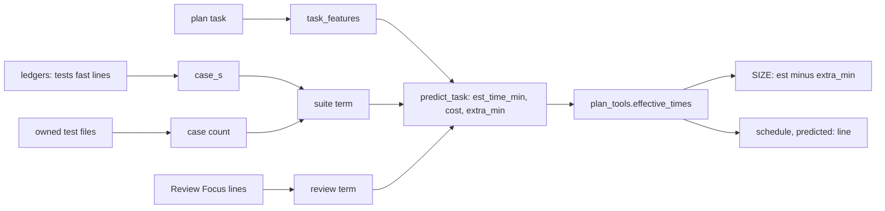
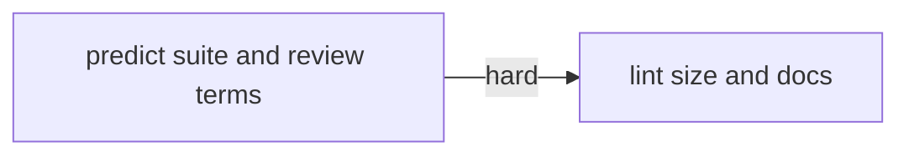

# Superlite: the forecast counts a task's existing test suite and the review rounds of flagged packages (B258, #787)

**Goal:** the run forecast (lint's `predicted:` line, the schedule, report.py) counts the runtime of the existing test cases a task's test runs rerun (red, green and the reviewer's rerun) and the review/fix rounds of a task in a package whose Review Focus line names `security` or `auth`, without lint `SIZE:` asking to split either cost away (#787).
**Architecture:** `predict.py` gains a live suite term (owned existing test files, their test cases counted statically, seconds per case from the run ledgers) and a plan-based review term (`predict_task(..., plan=)`), both folded into `est_time_min` and `cost.total` and named in an `extra_min` key (T1). `plan_tools.py` passes the plan to `predict_task`, compares `SIZE:` against `est_time_min - extra_min` and prints a `NOTE:` for a task with 1 min or more outside the band; two doc lines (T2).
**Tech stack:** Python 3.10+ stdlib; pytest through `sl run_tests`.
**Spec:** this file, section Design; issue #787.
**Detail:** tests
**Target-min:** 11
**Wave0:** none
**Worktree:** none
**Max chars:** 21000

Global constraints:
- Every script line keeps the repo's `# O(...)` complexity comment; stdlib only; LF endings.
- This repository is public: no host names, user names, home paths, other project or repository names in code, tests, docs or commit messages.
- `tests/scripts/conftest.py` sets `SUPERLITE_FORECAST_LIVE=0` for every script test, so `load_coef()` adds no live block there; a test of the live suite term builds its coefficients with `predict.apply_live(coef, live)` (or sets the variable to `1` with monkeypatch) and a `tmp_path` project.
- A prediction never fails because of the new terms: any error reading a file, the ledgers or the plan leaves that term at 0 (the existing `_with_live` / `_history_coef` pattern).
- Builds: the verdict is `sl run_tests` (the project's test command; a project with `.maxapp` runs `maxapp test`, which a build pool may place on another Mac, and a full run whose tree a green maxapp test stamp covers returns that result without a run); task trees build in <tree>/.build/DerivedData and any build of your own goes under .build/ of the worktree, never -derivedDataPath outside the worktree (your session scratchpad included; backlog cleanup removes scratchpad build folders when the worktree goes); a product, simulator or device build stays on this machine and runs only when an issue's acceptance asks for a running-app check.
- Simulators: append the UDID of each simulator you or a worker creates (`xcrun simctl create` or `clone`; a checker's `Simulators:` line marks its created ones) as one line to /Users/max/github/superlite/.claude/worktrees/superlite-b258-predictor-suite-and-review-rounds/.superlite/simulators.txt; never list one you did not create; ship cleanup shuts down and deletes each listed one.

## Design

Today (1.5.277): `test_extra_min` prices every test run of a task at the project's one fast-run figure (test-cmd.json `run_min`, else the ledger median, #605), so a task whose owned test file already holds 340 cases is forecast like any other (#787: T5 4.6 min forecast, 21.7 actual). Nothing in the forecast counts review or fix agents (R1: plan_tools, report.py and dispatch.py read only `est_time_min`, `schedule.tail_min` and `cost_usd.total`), so a package that went through review/fix rounds came in at 23.1 min / 3.37 USD against 12.3 min / 0.61 USD. The code has no "security-flagged" concept; the planning rule closest to it is the probe-plan table row `auth | protocol, state; **security review required** (Opus)` and the Review Focus section lines `- <package>: <categories>` (`plan_tools.review_focus_cases`).

Ruling: suite term (live input, like #605): a task's test files are its cmd= test-file tokens when its Tests field has `cmd=` (a `path::name` token counts 1 case; a `.py` file with a `-k EXPR` in the command counts only its test functions whose name holds a word of EXPR other than and/or/not), else `testcmd.verify_paths(task.owns)` filtered by `testcmd.is_test_path`; only regular files that exist under the project root count (folders and globs count nothing). Cases are counted statically per language (table in T1). One run then takes `max(fast_min or 0, cases x case_s / 60)` minutes, times the contention factor, for each of the task's runs (`tests.runs`: red, green, review) (lead's ruling).
Ruling: seconds per case (`case_s`): the median of `seconds / (passed + failed)` over the newest `- tests fast` ledger lines of the project's checkouts with at least `tests.case_min_cases` (20) cases, when at least `tests.history_min_runs` (3) such lines exist; else the prior `tests.case_s` (0.2 s). Superlite's own 920 ledger lines give 0.046 s; a slow-suite project's own lines replace the prior (lead's ruling).
Ruling: a security-flagged package is a Review Focus line whose package matches the task (a path segment of an owned file, as `fleet_io.review_reasons` matches, or the task's `## ` section name with `Package:` and a trailing `(...)` stripped) and whose words include one of `review.words` (`security`, `auth`); package reviews of other packages stay uncounted, as #787 asks only for flagged ones (lead's ruling).
Ruling: each task of a flagged package adds `review.rounds` (2.0) rounds; each round adds `review.round_min` (2.5) minutes to its time and the task's own token profile priced on `review.model` (`opus`) times `review.cost_factor` (1.0) to its cost. With the shipped coefficients a 1-component 100-LOC task goes from 1.704 min / about 0.087 USD to 6.704 min / about 0.433 USD; seven such tasks give about 3.03 USD, against #787's 3.37 USD measured (lead's ruling).
Ruling: the new priors live in `predict.py` (`TEST_COST_DEFAULTS` keys `case_s`, `case_min_cases`; `REVIEW_DEFAULTS`), and a `tests` or `review` block in predictor.json overrides them key by key; `config/predictor.json` stays unchanged (lead's ruling).
Ruling: the extras are folded into `est_time_min` and `cost.total` (that is what the schedule and the forecast line read, R1) and named per task: `suite` and `review` blocks and `extra_min` (their minutes), each present only when non-zero; lint `SIZE:` and the low-band `NOTE:` compare `est_time_min - extra_min`, since splitting a task does not shrink either cost, as B145 kept test cost out of `SIZE:` (lead's ruling).
Ruling: MISSED TARGET accepted: the critical path T1 -> T2 is forced (T2's tests run T1's predict_task) and the forecast's contention factor x3.5 comes from other live runs on this machine (lead's ruling).
Ruling: plan_tools.py is edited although the brief lists only predict.py: no open batch lists it, and without it the review term never reaches the schedule and `SIZE:` would ask to split review minutes; the two doc lines in skills/writing-plans/ likewise (no open batch lists them); docs/tools.md's predict row belongs to B259, so it is a follow-up (lead's ruling).

## Coverage

| Category | State | Basis |
|---|---|---|
| Scope and success criteria | settled | #787 Expected: count the existing suite's runtime (and the reviewer's rerun) and weight review/fix rounds of security-flagged packages; tests in T1 and T2 assert the numbers |
| Domain and data model | ruled | Ruling lines above: suite term, case_s, flagged package, review rounds |
| Persistence and migration | n/a | no stored data changes; predictor.json unchanged |
| Interfaces and contracts | ruled | `predict_task(task, models, coef, plan=None)` stays call-compatible; new keys only when non-zero; `effective_times(..., extra=None)` |
| UI states | n/a | no UI |
| Concurrency and state ownership | n/a | one process; the case-count cache keys on path, mtime and size |
| Error handling and recovery | ruled | any read error leaves the term at 0 (Global constraints) |
| Security and privacy | n/a | reads only the project's own test files and ledgers |
| Performance and limits | ruled | counting reads each test file once per (mtime, size); the live read stays cached for LIVE_TTL |
| Observability | ruled | per-task `suite`, `review`, `extra_min` in predict JSON; lint NOTE for 1 min or more outside the band |
| Testing strategy | settled | named tests in T1 and T2; full suite before ship |
| Compatibility | ruled | live off (tests, `--coef`): no suite term; no plan: no review term; refit and history fits use `time_from`, unchanged |
| Rollout | n/a | ships with the version bump |
| Research unknowns | n/a | answered by R1-R3 (fleet research reports) |

## Task graph

```mermaid
%% schedule
gantt
  title Predicted schedule (mm:ss)
  dateFormat X
  axisFormat %M:%S
  section lane 1
  T1 predict.py counts existing test cases :t1, 0, 687s
  T2 Lint SIZE ignores suite and review mi :t2, 687, 675s
```

critical path: T1 → T2 (22.7 min) · peak width 1 · predicted build 22.7 min · predicted total ≈ 41.2 min (target ✗ 11.0)

## Package: predictor

### T1 predict.py counts existing test cases and flagged review rounds · Complexity 4 · Est. context 31k
**Owns:** skills/subagent-driven-development/scripts/predict.py, tests/scripts/test_predict_suite_review_787.py
**Components:** 2
**LOC owned:** 260
**Tests:** fast
**Model:** sonnet
**Kind:** design
**Produces:** predict.predict_task(task, models: dict, coef: dict, plan=None) -> dict
  e.g. predict_task(t1, models, coef, plan=plan) with t1 = 1 component, 100 LOC, fast, sonnet, owning `src/auth/login.py`, in a plan whose Review Focus holds `- auth: protocol, state; security review required`, shipped coefficients, live off -> {"est_time_min": 6.704, "extra_min": 5.0, "review": {"why": ["Review Focus auth: security"], "rounds": 2.0, "model": "opus", "min": 5.0, "usd": U}, "cost": {..., "review": U, "total": round(T + U, 6)}, ...} where T is the plan=None total and U = round(2 x cost_from(feats, est_context, "opus", models, coef)["usd"]["total"], 6) (about 0.3467 and 0.4333 for a short task block)
  e.g. the same task with plan=None -> est_time_min 1.704, no "extra_min", "review" or "suite" key, cost total T (about 0.0867)
**Produces:** predict.count_cases(path: Path) -> int
  e.g. a .py file holding `def test_a():`, `async def test_b():`, `def helper():` -> 2
**Produces:** predict.ledger_case_seconds(paths: list, keep: int = 50, min_cases: int = 20) -> list
  e.g. one progress.md with `- tests fast passed=100 failed=0 skipped=0 seconds=50.0` three times and `- tests fast passed=5 failed=0 skipped=0 seconds=9.0` -> [0.5, 0.5, 0.5]
**Review Focus:** numeric: the suite term replaces, never adds to, the fast-run figure (`max`); state: `apply_live`'s `task_test_min`, `size_band.high_min` and `strip_live` stay as today; deep: a cmd= that `shlex` refuses counts nothing.
**Test code:** in `tests/scripts/test_predict_suite_review_787.py`; models and coefficients from `predict.load_models()` and `predict.load_coef(str(predict.CONFIG_DIR / "predictor.json"))`; plans written to `tmp_path` and loaded with `plan_tools.Plan.load`. Live coefficients: `predict.apply_live(coef, {"tests": {"fast_min": 1.0, "case_s": 0.5, "case_source": "prior"}, "contention": {"factor": 1.0}, "root": str(tmp_path)})`. Named tests:
- `test_count_cases_per_language`: `.py` with `def test_a():`, `    async def test_b(self):`, `def helper():` -> 2; `.swift` with `func testA() {`, `@Test func b() {` -> 2; `.ts` with `it("a", () => {})`, `test.each([1])("b", () => {})`, `describe("c", () => {})` -> 2; `.go` with `func TestA(t *testing.T) {` -> 1; `.rs` with `#[test]` twice -> 2; an `.md` file -> 0; a missing path -> 0.
- `test_suite_term_counts_existing_owned_cases`: a task owning `tests/test_big.py` (240 `def test_` functions, written under `tmp_path`) and `src/big.py`, 1 component, 100 LOC, fast -> `suite` == {"files": ["tests/test_big.py"], "cases": 240, "case_s": 0.5, "run_min": 2.0, "extra_min": 3.0}, `extra_min` 3.0, `est_time_min` 6.204, `test_min` 4.5.
- `test_suite_term_absent_for_new_or_small_suites`: the same task when `tests/test_big.py` does not exist, and when it holds 60 cases (0.5 min a run, under fast_min 1.0) -> no `suite` and no `extra_min` key, `est_time_min` 3.204.
- `test_suite_term_reads_cmd_tokens`: Tests `fast cmd=python -m pytest tests/test_big.py -k "alpha or beta"` with test functions `test_alpha_1`, `test_alpha_2`, `test_beta`, `test_gamma` -> `suite.cases` 3; `cmd=python -m pytest tests/test_big.py::test_gamma tests/test_big.py::test_beta` -> 2; `cmd=python -m pytest "tests/test_big.py` (unbalanced quote) -> no `suite`.
- `test_suite_term_off_without_live`: shipped coefficients (no `live` block) and the 240-case file -> no `suite`, `est_time_min` 1.704.
- `test_ledger_case_seconds`: the Produces example, plus a `- tests full passed=900 failed=0 skipped=0 seconds=90.0` line that does not count; `_read_live(tmp_path, coef)["tests"]["case_s"]` with three such ledger lines in `tmp_path/.superlite/progress.md` -> 0.5 with `case_source` "history", and with none -> 0.2 with `case_source` "prior".
- `test_review_rounds_for_flagged_package`: the two Produces examples; a task owning `src/billing/pay.py` with no Review Focus line for `billing` -> no `review`; a task under the heading `## Package: auth (login)` owning `lib/x.py` -> flagged (`why` == ["Review Focus auth: security"]); a predictor coefficients copy with `"review": {"rounds": 0}` -> no `review`.
- `test_predict_plan_totals_include_review`: a plan with the flagged task and one plain task -> `totals.cost_usd.total` == round(the two tasks' cost totals summed, 6) and `totals.cost_usd.review` == the flagged task's `review.usd`; a plan with only the plain task has no `review` key in `cost_usd`.
**Steps:** 1 failing tests, 2 run: FAIL, 3 implement: `count_cases` (per-extension regexes, cached on path, mtime_ns and size), `suite_cases(task, root)` -> (files, cases), `ledger_case_seconds`, `_read_live` adds `tests.case_s`, `tests.case_source` and `root`; `apply_live` keeps `root` in `live`; `task_features` adds `suite_run_min` when `coef` has `live`; `test_extra_min` prices a run at `max(fast or 0, suite_run_min or 0)` (0 when both are missing, as today); `security_review(task, plan, coef) -> list[str]` over `plan_tools.review_focus_cases(plan)`; `predict_task` folds both terms in and `predict_plan` passes `plan`; update the module docstring, 4 run: PASS, 5 `sl run_tests --fast tests/scripts/test_predict_suite_review_787.py tests/scripts/test_predict_forecast_605.py tests/scripts/test_predict_live_605.py tests/scripts/test_predict_live_659.py tests/scripts/test_predict_language.py` green.
**Notes:** case regexes (MULTILINE): `.py` `^\s*(?:async\s+)?def\s+(test\w*)\s*\(`; `.swift` `^\s*(?:@Test\b|(?:override\s+)?func\s+test\w*\s*\()`; `.js .jsx .ts .tsx .mjs .cjs` `^\s*(?:it|test)(?:\.\w+)?\s*\(` (a `test.each([...])(` line counts once); `.go` `^func\s+Test\w*\s*\(`; `.rs` `#\[(?:tokio::)?test\]`; `.kt .java` `@Test\b`; `.rb` `^\s*(?:it\s+['"]|def\s+test_)`; any other extension 0. `suite.extra_min` is `test_extra_min` with `suite_run_min` minus `test_extra_min` without it. Review cost: `cost_from(feats, peak, review_model)` total x rounds x cost_factor; a review model missing from models.json falls back to the task's model. `extra_min` = `suite.extra_min` + `review.min`, rounded to 3 places.

## Package: lint size

### T2 Lint SIZE ignores suite and review minutes; doc lines · Complexity 3 · Est. context 29k
**Owns:** skills/subagent-driven-development/scripts/plan_tools.py, skills/writing-plans/probe-plan.md, skills/writing-plans/task-template.md, tests/scripts/test_plan_tools_size_extra_787.py
**Components:** 2
**LOC owned:** 120
**Tests:** fast
**Model:** sonnet
**Kind:** design
**Consumes:** predict.predict_task(task, models: dict, coef: dict, plan=None) -> dict (T1)
**Review Focus:** numeric: `SIZE:` and the low-band `NOTE:` compare `est_time_min - extra_min`; state: `effective_times` without `extra` returns exactly what it returns today; protocol: the forecast line's cost includes review cost.
**Test code:** in `tests/scripts/test_plan_tools_size_extra_787.py`, running lint in-process the way `tests/scripts/test_predict_forecast_605.py` or another plan_tools lint test does (reuse its helper; copy a minimal valid plan from it). Named tests:
- `test_review_minutes_do_not_trigger_size`: a plan with Review Focus `- auth: protocol, state; security review required` and one task (1 component, 100 LOC, fast, sonnet) owning `src/auth/login.py` and `tests/test_login.py` -> lint has no `SIZE: T1` issue and warns `NOTE: T1 predicted 6.7 min, 5.0 of it outside the size band (existing tests, review rounds); splitting does not shrink it`.
- `test_size_still_fires_for_big_work`: the same plan without the Review Focus line and `LOC owned: 2500` -> a `SIZE: T1 predicted 6.9 min > 6 max` issue.
- `test_effective_times_passes_plan_and_fills_extra`: `effective_times(plan, graph, args, extra=ex)` on the flagged plan gives `times["T1"]` 6.704 and `ex == {"T1": 5.0}`; without `extra` the call returns the same times.
- `test_forecast_cost_includes_review`: the lint `predicted:` line of the flagged plan shows `$0.43`.
**Steps:** 1 failing tests, 2 run: FAIL, 3 implement: `effective_times(plan, graph, args, extra=None)` calls `predict.predict_task(task, models, coef, plan=plan)` and, given `extra`, sets `extra[tid] = p.get("extra_min", 0.0)` for each predicted task; the size-band loop builds `ex`, compares `times[t] - ex.get(t, 0.0)` (and prints that value in `SIZE:` and the low-band `NOTE:`), and adds the NOTE above when `ex[t] >= 1.0`; every other `predict.predict_task` call in plan_tools.py that has the plan at hand passes `plan=plan`; docs: probe-plan.md Rules gains one bullet `- **Forecast.** A package whose Review Focus line names \`security\` or \`auth\` counts \`review.rounds\` (2) extra review/fix rounds per task in the forecast (\`predict\`): 2.5 min each, priced on Opus; \`SIZE:\` leaves them out.`, and task-template.md's `Tests` row gains one sentence `The forecast prices each test run at the larger of the project's fast-run minutes and the task's existing test cases (cmd= test files, else its owned test files) x the ledgers' seconds per case (0.2 s without ledgers); \`SIZE:\` leaves that extra out.`, 4 run: PASS, 5 `sl run_tests --fast tests/scripts/test_plan_tools_size_extra_787.py tests/scripts/test_predict_forecast_605.py tests/scripts/test_plan_tools.py` green, then `grep -rln "probe-plan.md\|task-template.md" tests/` and run those files too (doc pins and size caps).
**Notes:** plans in tests carry the fields the lint needs; the 6.7 and 5.0 come from T1's shipped-coefficient numbers (1.704 + 2 x 2.5). The NOTE goes to the same `warnings` list as the low-band NOTE.

## Review Focus

- predictor (library): numeric, state; suite minutes priced once per run, the review term's rounds and price.
- lint size (CLI): protocol, numeric; SIZE and the forecast line read the folded minutes.

**Probe entry:** none (the predictor's entries take plan and task objects, never one text argument; the named tests cover the cases)

## Self-review

Coverage: suite term, case_s, review rounds and SIZE each have named tests. Placeholders: none. Types: T2 consumes T1's `predict_task(..., plan=None)` and its `extra_min` key exactly. Graph: T2's tests run T1's code (hard edge), so no two tasks share a file. Fields: all four set.
