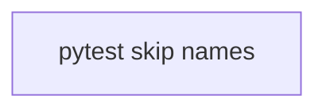

# Superlite: pytest runs name their skipped tests without JUnit (#974, #893)

**Goal:** a pytest run that writes no JUnit file (this repository's remote full run) fills the run_tests summary's `skipped_tests` from pytest's short test summary, so `sl run_tests --base-skips` has names to compare (#974); docs/testing.md names the command a machine's untracked `.superlite/test-cmd.json` runs for this repository (#893, #974).
**Architecture:** `testcmd.parse_output` gains pytest skip names from the unfolded `SKIPPED <node id>[ - <reason>]` lines of the short test summary (`-rs --no-fold-skipped`), written in the `<file>::<name>` form `run_tests.merge_junit` writes; run_tests already copies `skipped_names` into `skipped_tests` (full run) and reads them in the `--base-skips` base run, so run_tests.py is unchanged.
**Tech stack:** Python 3.10+ stdlib; pytest 9.2.0 (uv.lock) through `sl run_tests`.
**Spec:** this file, section Design.
**Detail:** tests
**Target-min:** 11
**Wave0:** none
**Coverage:** off

Global constraints:
- Every line of a Python script under `skills/**/scripts/` keeps the repo's `# O(...)` complexity comment; stdlib only; LF endings. Files under `tests/` carry no such comments.
- This repository is public: no host names, user names, home paths, other project or repository names in code, tests, docs or commit messages.
- The verdict is `sl run_tests` (never raw pytest); every new test sees a red run before the code it tests.
- An existing test that pins a changed text or output is updated in the same task only when it is in the task's Owns. Any other test your change turns red: leave it, and name the file and the failing assertion in your report (the coordinator rules it).
- Builds: the verdict is `sl run_tests` (the project's test command; a project with `.maxapp` runs `maxapp test`, which a build pool may place on another Mac, and a full run whose tree a green maxapp test stamp covers returns that result without a run); task trees build in <tree>/.build/DerivedData and any build of your own goes under .build/ of the worktree, never -derivedDataPath outside the worktree (your session scratchpad included; backlog cleanup removes scratchpad build folders when the worktree goes); a product, simulator or device build stays on this machine and runs only when an issue's acceptance asks for a running-app check; copy this sentence into every worker brief.
- Simulators: append the UDID of each simulator you or a worker creates (`xcrun simctl create` or `clone`; a checker's `Simulators:` line marks its created ones) as one line to the worktree's `.superlite/simulators.txt`; never list one you did not create; ship cleanup shuts down and deletes each listed one; copy this sentence into every worker brief.

## Design

### 1. Skip names from pytest's short summary (#974)

Research (R1) found `parse_output` returns `"skipped_names": []` for every pytest run, so `-rs` alone fills nothing. pytest's default `-rs` lines are folded (`SKIPPED [2] tests/x.py:6: reason`: a count and a location, no test id); `--no-fold-skipped` (pytest 8.3+) prints one `SKIPPED <node id> - <reason>` line per skipped test, `SKIPPED <node id>` when the reason is empty, and a module-level skip's node id is its file path (checked on pytest 9.2.0, with and without `-n 2`).

- New helper `testcmd._pytest_skipped(lines: list[str]) -> list[str]`: the lines between the last `=+ short test summary info =+` header and the last `PYTEST_SUMMARY` line (none without both, header above the summary line); each stripped line matching `^SKIPPED (?!\[\d+\] )(.+?)(?: - .*)?$` gives one node id (lazy: the id ends at the first ` - `). Read for every exit code. A folded line (`SKIPPED [N] ...`) gives nothing.
- Each node id is written as the JUnit form `run_tests.merge_junit` builds (`f"{file}::{name}"`, pytest's `mangle_test_address`): split the id at its first `[` into head and params; split the head on `::`; file is the first part; name is the last part plus `[` and the params; an id with no `::` (a module-level skip) has name = the file without `.py`, `/` replaced by `.`. So `tests/a/test_x.py::TestC::test_m` gives `tests/a/test_x.py::test_m`, `tests/a/test_x.py::test_p[a::b]` stays as it is, `tests/e2e/test_mod.py` gives `tests/e2e/test_mod.py::tests.e2e.test_mod`.
- No repeats, at most 50 (the cap the Swift parser and `merge_parsed` use).
- `parse_output` returns them as `skipped_names` when `_parse_pytest` found a summary (the pytest branch), else `[]` as today; every other parser branch is unchanged.

### 2. docs/testing.md (#893, #974)

After the Fresh clone paragraph that ends "a pytest-config or pin change reruns the suite.", one new paragraph (exact text):

`This repository's `.superlite/test-cmd.json` is untracked, so each machine sets its own. Its `test` command runs `uv run --group dev python -m pytest tests -q -rfEs --no-fold-skipped -p no:cacheprovider -n 4`: `--group dev` runs the pytest that `uv.lock` pins, as a fresh clone does, and `-rs --no-fold-skipped` prints one `SKIPPED <node id>` line per skipped test, which `sl run_tests` reads into the summary's `skipped_tests` when the run writes no JUnit file, so `sl run_tests --base-skips` has names to compare. pytest's default folded lines (`SKIPPED [N] <path>:<line>: <reason>`) name no test, and `--no-fold-skipped` needs pytest 8.3 or newer.`

### 3. Rulings

- Ruling: [scope] #974 asked for `-rs` (or a JUnit output) in the remote command; `-rs` alone names no test (folded lines, and no parser read them), so this batch adds the parser for pytest's unfolded skip lines and documents `--no-fold-skipped`; a JUnit file over `maxapp remote` was rejected because the file is written on the remote host and nothing copies it back (lead's ruling).
- Ruling: skip names use the JUnit `file::name` form, not the full node id (because `--base-skips` compares the full run's ids by exact string with the base run's, which come from JUnit; class names drop out, as in JUnit) (lead's ruling).
- Ruling: folded `SKIPPED [N] path:line` lines stay unread (because a location with a count names no test and `--base-skips` needs a test file and name to rerun and compare) (lead's ruling).
- Ruling: the `--base-skips` "names none of its N skipped tests" message stays unchanged (because docs/tools.md and doc tests pin run_tests messages and docs/testing.md now names the flag) (lead's ruling).
- Ruling: MISSED TARGET accepted (because the plan is one small task; the forecast comes from contention and history, not from its shape).

## Task graph

```mermaid
%% schedule
gantt
  title Predicted schedule (mm:ss)
  dateFormat X
  axisFormat %M:%S
  section lane 1
  T1 pytest skip names :t1, 0, 465s
```





critical path: T1 (7.8 min) · peak width 1 · predicted build 7.8 min · predicted total ≈ 22.3 min (target ✗ 11.0)

## Package: test output parsing

App type: library (output parser). Categories: protocol (exact line forms and the JUnit id form).
**Probe entry:** none (a pure parser; the named tests, one of them against a real pytest run, cover each case)

### T1 pytest skip names · Complexity 2 · Est. context 40k
**Owns:** skills/subagent-driven-development/scripts/testcmd.py, tests/scripts/test_testcmd_skipped_names_974.py, docs/testing.md
**Components:** 1
**LOC owned:** 95
**Tests:** fast
**Model:** sonnet
**Covers:** 1, 2
**Produces:** testcmd._pytest_skipped(lines: list[str]) -> list[str]
  e.g. testcmd.parse_output(".s\n=== short test summary info ===\nSKIPPED tests/a/test_x.py::TestC::test_m - Skipped\n1 passed, 1 skipped in 0.1s\n", 0)["skipped_names"] == ["tests/a/test_x.py::test_m"]
**Review Focus:** protocol: `test_unfolded_lines_give_junit_ids`, `test_module_level_skip_gets_the_junit_module_name`, `test_folded_lines_name_nothing`, `test_skips_named_on_a_red_run_too`, `test_skip_lines_outside_the_short_summary_are_ignored`, `test_no_short_summary_no_names`, `test_names_dedupe_and_cap_at_50`, `test_names_match_the_junit_ids`, `test_docs_name_the_repo_command`
**Test code (verbatim):**
```python
# tests/scripts/test_testcmd_skipped_names_974.py
import subprocess
import sys
from pathlib import Path

SCRIPTS = Path(__file__).resolve().parents[2] / "skills" / "subagent-driven-development" / "scripts"
sys.path.insert(0, str(SCRIPTS))
import run_tests  # noqa: E402
import testcmd  # noqa: E402

ROOT = SCRIPTS.parents[2]
HEAD = "=========================== short test summary info ============================"


def out(*lines, summary="1 passed, 4 skipped in 0.16s", before=()):
    return "\n".join([*before, ".ssss", HEAD, *lines, summary]) + "\n"


def names(text, rc=0):
    return testcmd.parse_output(text, rc)["skipped_names"]


def test_unfolded_lines_give_junit_ids():
    text = out("SKIPPED tests/a/test_x.py::test_s1 - Skipped: plain reason",
               "SKIPPED tests/a/test_x.py::TestC::test_m - Skipped",
               "SKIPPED tests/a/test_x.py::test_p[a::b] - Skipped: a - b",
               "SKIPPED tests/a/test_x.py::test_bare")
    assert names(text) == ["tests/a/test_x.py::test_s1", "tests/a/test_x.py::test_m",
                           "tests/a/test_x.py::test_p[a::b]", "tests/a/test_x.py::test_bare"]


def test_module_level_skip_gets_the_junit_module_name():
    assert names(out("SKIPPED tests/e2e/test_mod.py - Skipped: whole module")) == ["tests/e2e/test_mod.py::tests.e2e.test_mod"]


def test_folded_lines_name_nothing():
    text = out("SKIPPED [2] tests/a/test_x.py:6: param skip", "SKIPPED [1] tests/a/test_x.py:3: plain reason")
    assert names(text) == []
    assert testcmd.parse_output(text, 0)["skipped"] == 4


def test_skips_named_on_a_red_run_too():
    text = out("FAILED tests/a/test_y.py::test_f - assert 1 == 2", "SKIPPED tests/a/test_x.py::test_s1 - why",
               summary="1 failed, 1 skipped in 0.2s")
    r = testcmd.parse_output(text, 1)
    assert r["skipped_names"] == ["tests/a/test_x.py::test_s1"]
    assert r["names"] == ["tests/a/test_y.py::test_f"]


def test_skip_lines_outside_the_short_summary_are_ignored():
    text = out("SKIPPED tests/a/test_x.py::test_s1 - why", before=["SKIPPED tests/a/test_x.py::test_early - printed by a test"])
    assert names(text) == ["tests/a/test_x.py::test_s1"]


def test_no_short_summary_no_names():
    assert names("SKIPPED tests/a/test_x.py::test_s1 - why\n1 passed, 1 skipped in 0.1s\n") == []
    assert names("1 passed, 1 skipped in 0.1s\n") == []


def test_names_dedupe_and_cap_at_50():
    lines = [f"SKIPPED tests/a/test_x.py::test_{i} - r" for i in range(60)]
    lines.insert(1, "SKIPPED tests/a/test_x.py::TestC::test_0 - r")
    got = names(out(*lines, summary="61 skipped in 1.0s"))
    assert got == [f"tests/a/test_x.py::test_{i}" for i in range(50)]


def test_names_match_the_junit_ids(tmp_path):
    (tmp_path / "pkg").mkdir()
    (tmp_path / "pkg" / "test_a.py").write_text(
        "import pytest\n"
        "def test_ok(): pass\n"
        "@pytest.mark.skip(reason='plain reason')\n"
        "def test_s1(): pass\n"
        "@pytest.mark.parametrize('x', [1, 'a::b'])\n"
        "def test_p(x): pytest.skip('param skip')\n"
        "class TestC:\n"
        "    def test_m(self): pytest.skip()\n")
    (tmp_path / "pkg" / "test_mod.py").write_text("import pytest\npytest.skip('whole module', allow_module_level=True)\n")
    xml = tmp_path / "junit.xml"
    r = subprocess.run([sys.executable, "-m", "pytest", "pkg", "-q", "-rs", "--no-fold-skipped", "-p", "no:cacheprovider",
                        "-p", "no:xdist", f"--rootdir={tmp_path}", "-o", "junit_family=xunit1", f"--junitxml={xml}"],
                       cwd=tmp_path, capture_output=True, text=True, timeout=120)
    parsed = testcmd.parse_output(r.stdout + r.stderr, r.returncode)
    counts, _failures, _files = run_tests.merge_junit([xml])
    assert parsed["skipped"] == 5 and len(parsed["skipped_names"]) == 5
    assert sorted(parsed["skipped_names"]) == sorted(counts["skipped_tests"])


def test_docs_name_the_repo_command():
    text = (ROOT / "docs" / "testing.md").read_text()
    assert "uv run --group dev python -m pytest tests -q -rfEs --no-fold-skipped -p no:cacheprovider -n 4" in text
    assert "`--no-fold-skipped` needs pytest 8.3 or newer." in text
```
**Steps:** 1 write the test file, 2 run: FAIL, 3 add `_pytest_skipped` beside `_parse_pytest` (Design 1) and call it in `parse_output`'s pytest branch so its return dict's `skipped_names` holds the result (keep `[]` for every other branch), 4 add the docs/testing.md paragraph (Design 2, exact text, its own paragraph right after the one ending "a pytest-config or pin change reruns the suite."), 5 run: PASS
**Notes:** `merge_junit` writes `f"{case_file(case)}::{case.get('name')}"`; pytest's JUnit name for a class method is the method name and for a module-level skip the dotted module path, which is why the ids drop class parts. Keep `_parse_pytest`'s 5-tuple unchanged. Verify with `sl run_tests --fast tests/scripts/test_testcmd_skipped_names_974.py --task T1`, then once `sl run_tests --fast tests/scripts/test_testcmd_names_800_790.py tests/scripts/test_testcmd_pytest_summary_638.py tests/scripts/test_testcmd_counts_481.py tests/scripts/test_testcmd_reasons_b119.py tests/scripts/test_testcmd_names_597.py tests/scripts/test_testcmd_destinations_598.py tests/scripts/test_run_tests_base_skips_886.py --task T1` and report any red test outside Owns by file and assertion.

## Review Focus

- test output parsing (library): protocol. Risks: a lazy match cutting a node id whose parameter holds ` - `; a SKIPPED line from a test's printed output above the short summary read as a skip; a folded line read as an id; ids that differ from `merge_junit`'s, so `--base-skips` reports every skip as new; `skipped_names` changing for a non-pytest branch.

## Coordinator steps after the last task

1. Unit layer: `sl run_tests --full` (the change touches `skills/**/scripts/**` and `tests/scripts/**`; no other layer is required). This worktree's run copy of `.superlite/test-cmd.json` carries `--no-fold-skipped`, so the full run's summary must name its skipped tests.
2. Final review, then ship: notes.md, pr-body.md, `sl backlog ship B263 lock`, `bump`, `merge`.

## Self-review

- Coverage: Design 1 and 2 are T1.
- Graph: one task, no edges.
- Names: `_pytest_skipped`, `parse_output`, `skipped_names`, `merge_junit`, `skipped_tests` are written the same in every line.
