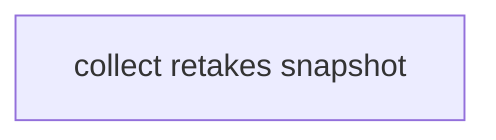

# Superlite: a remote write worker whose stop hook took no snapshot still comes home (#997)

**Goal:** when the task turn's stop record carries no `snapshot`, `fleet_remote_collect.collect` retakes the snapshot of the worker's host tree itself (its commits and its uncommitted changes against the start commit), fetches it and applies it as usual, instead of ending BLOCKED with the work left on the host.
**Architecture:** `collect` opens one Herdr shell pane on the worker's machine in its host tree (`hc.on(label)`, `hc.create_workspace`, `hc.run_in_pane`, the route `fleet_layer` uses), runs `sh -c` with `sl remote_apply snapshot --ref <snapshot_ref>` there writing its output to a file under the tree's `.superlite/`, reads that file with `fr.read` (bounded poll), closes the workspace, then goes on with today's fetch, sha check and three-state apply.
**Tech stack:** Python 3.10+ stdlib; pytest through `sl run_tests`.
**Spec:** this file, section Design.
**Detail:** tests
**Target-min:** 11
**Wave0:** none
**Coverage:** off

Global constraints:
- Every line of a Python script under `skills/**/scripts/` keeps the repo's `# O(...)` complexity comment; stdlib only; LF endings. Files under `tests/` carry no such comments.
- This repository is public: no host names, user names, home paths, other project or repository names in code, tests, docs or commit messages.
- The verdict is `sl run_tests` (never raw pytest); every new test sees a red run before the code it tests.
- An existing test that pins a changed text or output is updated in the same task only when it is in the task's Owns. Any other test your change turns red: leave it, and name the file and the failing assertion in your report (the coordinator rules it).
- Builds: the verdict is `sl run_tests` (the project's test command; a project with `.maxapp` runs `maxapp test`, which a build pool may place on another Mac, and a full run whose tree a green maxapp test stamp covers returns that result without a run); task trees build in <tree>/.build/DerivedData and any build of your own goes under .build/ of the worktree, never -derivedDataPath outside the worktree (your session scratchpad included; backlog cleanup removes scratchpad build folders when the worktree goes); a product, simulator or device build stays on this machine and runs only when an issue's acceptance asks for a running-app check; copy this sentence into every worker brief.
- Simulators: append the UDID of each simulator you or a worker creates (`xcrun simctl create` or `clone`; a checker's `Simulators:` line marks its created ones) as one line to the worktree's `.superlite/simulators.txt`; never list one you did not create; ship cleanup shuts down and deletes each listed one; copy this sentence into every worker brief.

## Design

Cause: `hooks/capture-worker-stop` takes the snapshot under `timeout 30`; a failure or a slow tree leaves the stop record without `snapshot`, and `collect` ends BLOCKED `left no snapshot: its stop hook took none`, the work staying in the host tree (B257, B262). The configured `remote_tree` command cannot help: its `fetch` takes only a full `refs/` name from the host's shared store (the trees are detached, `HEAD` is refused) and no verb runs a command in a tree. A Herdr shell pane on the worker's machine can: workers already start that way.

- `collect`, after `_await_stop` found the task turn's record and the record has no `snapshot`: `sha, why = _retake(remote, wid)`.
- `_retake(remote, wid) -> tuple[str | None, str]`:
  - `remote` lacks `tree`, `plugin` or `snapshot_ref`: `(None, "its record names no host tree or plugin tree")`, no Herdr call.
  - `out = f"{sd}/collect-{wid}-{time.time_ns()}.out"`, `sd = remote["sd"]` (else `<tree>/.superlite`): under `.superlite/`, so no snapshot holds it.
  - The pane command is `sh -c <script>` (shlex-quoted, so the host's login shell type does not matter), script: `mkdir -p <sd>; { cd <tree> && bash <plugin>/skills/subagent-driven-development/scripts/sl remote_apply snapshot --ref <ref>; } > <out>.tmp 2>&1; echo "exit $?" >> <out>.tmp; mv <out>.tmp <out>` (each path shlex-quoted).
  - Inside `hc.on(remote["label"])`: `ws, pane = hc.create_workspace(f"sl:collect {wid}", tree, {})`, `hc.run_in_pane(pane, command)`; the workspace is closed (`hc.close_workspace(ws)`, inside `hc.on`, a HerdrError ignored) on every path once it was created.
  - Poll: `fr.read(label, out)` every `POLL_S` until `RETAKE_S` = 120 s passed (`now_s`, `sleep`); the file is complete once its last non-empty line is `exit N`. `exit 0` with a 40-hex last output line: `(sha, "")`. Else `(None, <last output line before the exit line, at most 200 chars>)`, or `exit N` when there is none.
  - Reasons: a `hc.HerdrError` `herdr <code>: <message>`; a `fr.RemoteError` from the read ends the poll with `str(e)`; the bound `no result within 120 s`.
- Retake failed: BLOCKED, concern `remote worker W2 left no snapshot: its stop hook took none (remote_apply snapshot failed or ran past 30 s); its tree <tree> stays on <label>; retaking it there failed: <reason>; sl fleet collect W2 retries`.
- Retake succeeded: `snap = sha` and the existing path runs (fetch of `snapshot_ref`, `fetched X but the stop record names Y`, apply, conflicts, `collected` saved). The report gains `collected["retaken"] = True` and the concern `remote worker W2's stop hook took no snapshot (remote_apply snapshot failed or ran past 30 s); collect retook it on <label>: <sha>`, placed before any skipped-paths concern.
- A record with no stop record at all keeps today's BLOCKED (the turn may still run: a retake then would take half a turn's work).

### Rulings

- Ruling: the snapshot is retaken on the host through a Herdr shell pane, not fetched as a diff (because `remote_tree fetch` refuses `HEAD` and a detached tree's commits have no ref; a pane retake brings commits and uncommitted changes, reuses the hook's own command and needs no other repository's change).
- Ruling: `RETAKE_S` = 120 s (because `remote_apply snapshot` runs up to six git calls of 30 s each and this path is rare; a later `sl fleet collect Wn` retakes again).
- Ruling: the retake keeps the pinned prefix `its stop hook took none (remote_apply snapshot failed or ran past 30 s); its tree T stays on L` and appends the reason, so docs/fleet.md (B268's) stays true; its new wording is a follow-up.
- Ruling: B265 also edits tests no open batch lists: `tests/scripts/test_fleet_remote_collect_953.py` and `tests/scripts/test_fleet_remote_collect_984.py` (pins of the took-none concern), new `tests/scripts/test_fleet_remote_collect_997.py`.
- Ruling: fleet placement local for this run's build (because a remote write worker could hit this very defect).
- Ruling: accept predicted 25.9 min (MISSED TARGET) (because the plan is one task with no edge; the forecast comes from contention and history, not the plan's shape).

## Task graph

```mermaid
%% schedule
gantt
  title Predicted schedule (mm:ss)
  dateFormat X
  axisFormat %M:%S
  section lane 1
  T1 collect retakes snapshot :t1, 0, 564s
```





critical path: T1 (9.4 min) · peak width 1 · predicted build 9.4 min · predicted total ≈ 25.9 min (target ✗ 11.0)

## Package: remote collect

App type: library (fleet worker plumbing). Categories: protocol (pane command, exact concern texts), timing (bounded poll), state (`collected`, `retaken`).
**Probe entry:** none (Herdr and the host are faked; the fake pane runs the command on this machine in a local host tree)

### T1 collect retakes snapshot · Complexity 3 · Est. context 45k
**Owns:** skills/subagent-driven-development/scripts/fleet_remote_collect.py, tests/scripts/test_fleet_remote_collect_997.py, tests/scripts/test_fleet_remote_collect_953.py, tests/scripts/test_fleet_remote_collect_984.py
**Components:** 1
**LOC owned:** 190
**Tests:** fast
**Model:** sonnet
**Kind:** design
**Covers:** Design
**Produces:** fleet_remote_collect.RETAKE_S: int · fleet_remote_collect._retake(remote: dict, wid: str) -> tuple
**Review Focus:** protocol: `test_retake_command_runs_sl_in_the_tree`, `test_retake_failure_blocked`; state: `test_retake_brings_committed_and_uncommitted_work_home`, `test_hook_snapshot_is_not_retaken`, `test_recollect_retakes_again`; timing: `test_retake_without_result_blocked_after_bound`, `test_retake_read_error_blocked`; error: `test_retake_herdr_error_blocked`, `test_no_retake_without_plugin`
**Test code (verbatim):**
```python
# tests/scripts/test_fleet_remote_collect_997.py: a stop record without a snapshot: collect retakes it in a host shell pane (#997)
import json, subprocess
from test_fleet_remote_collect import env, host_snapshot, report, collected, frc, fs, git, NAME, REF  # noqa: F401
from test_fleet_remote_collect_953 import seed as seed_953
from test_plan_tools import SCRIPTS

PLUGIN = str(SCRIPTS.parents[2])
HEAD = "remote worker W2 left no snapshot: its stop hook took none (remote_apply snapshot failed or ran past 30 s); its tree {} stays on box; retaking it there failed: "


def host_tree(env, committed, uncommitted):
    host = env.trees / NAME
    git(env.proj, "clone", "-q", str(env.proj), str(host))
    (host / ".superlite").mkdir()
    for f, text in committed.items():
        (host / f).parent.mkdir(parents=True, exist_ok=True)
        (host / f).write_text(text)
    if committed:
        git(host, "add", "-A")
        git(host, "commit", "-q", "-m", "work")
    for f, text in uncommitted.items():
        (host / f).parent.mkdir(parents=True, exist_ok=True)
        (host / f).write_text(text)
    return host


def seed(env, host, plugin=PLUGIN):
    remote = {"label": "box", "name": NAME, "project": str(env.proj), "start": env.start, "snapshot_ref": REF, "write": True,
              "owns": ["src/*.py"], "tree": str(host), "sd": str(host / ".superlite"), "plugin": plugin}
    fs.save(env.sd, {**fs.default(), "workers": {"W2": {"state": "busy", "role": "implementer", "sent": 2000, "machine": "box", "remote": remote}}})
    d = env.sd / "remote" / "W2"
    d.mkdir(parents=True, exist_ok=True)
    (d / "metrics.jsonl").write_text(json.dumps({"ev": "stop", "agent_id": "W2", "t": 2500}) + "\n")


class Pane:  # a fake Herdr: run_in_pane runs the command here, as the host's shell would
    def __init__(self, run=True, fail=None):
        self.run, self.fail, self.calls = run, fail, []

    def install(self, monkeypatch):
        def create_workspace(label, cwd, env_vars):
            self.calls.append(("create", label, cwd))
            if self.fail:
                raise frc.hc.HerdrError(*self.fail)
            return "w9", "w9:p1"

        def run_in_pane(pane, command):
            self.calls.append(("run", pane, command))
            if self.run:
                subprocess.run(["bash", "-c", command], capture_output=True, timeout=60)
            return ""

        def close_workspace(ws):
            self.calls.append(("close", ws))
        monkeypatch.setattr(frc.hc, "create_workspace", create_workspace)
        monkeypatch.setattr(frc.hc, "run_in_pane", run_in_pane)
        monkeypatch.setattr(frc.hc, "close_workspace", close_workspace)
        return self


def clock(monkeypatch):
    t = [100.0]
    monkeypatch.setattr(frc, "now_s", lambda: t[0])
    monkeypatch.setattr(frc, "sleep", lambda s: t.__setitem__(0, t[0] + s))
    return t


def test_constants():
    assert frc.RETAKE_S == 120 and frc.POLL_S == 2


def test_retake_brings_committed_and_uncommitted_work_home(env, monkeypatch):
    clock(monkeypatch)
    host = host_tree(env, {"src/a.py": "two\n"}, {"src/b.py": "new\n"})
    seed(env, host)
    pane = Pane().install(monkeypatch)
    out = frc.collect(env.sd, "W2", report())
    sha = git(host, "rev-parse", REF)
    assert out["status"] == "DONE"
    assert out["collected"] == {"applied": ["src/a.py", "src/b.py"], "skipped": [], "sha": sha, "retaken": True}
    assert out["concerns"] == [f"remote worker W2's stop hook took no snapshot (remote_apply snapshot failed or ran past 30 s); collect retook it on box: {sha}"]
    assert (env.proj / "src" / "a.py").read_text() == "two\n" and (env.proj / "src" / "b.py").read_text() == "new\n"
    assert collected(env) == sha and git(host, "rev-parse", sha + "^") == git(host, "rev-parse", "HEAD")
    assert [c[0] for c in pane.calls] == ["create", "run", "close"]
    assert pane.calls[0] == ("create", "sl:collect W2", str(host)) and pane.calls[2] == ("close", "w9")


def test_retake_command_runs_sl_in_the_tree(env, monkeypatch):
    clock(monkeypatch)
    host = host_tree(env, {}, {"src/a.py": "two\n"})
    seed(env, host)
    pane = Pane().install(monkeypatch)
    frc.collect(env.sd, "W2", report())
    command = pane.calls[1][2]
    assert pane.calls[1][1] == "w9:p1" and command.startswith("sh -c ")
    assert "/skills/subagent-driven-development/scripts/sl remote_apply snapshot --ref " + REF in command
    outs = list((host / ".superlite").glob("collect-W2-*.out"))
    assert len(outs) == 1 and outs[0].read_text().splitlines()[-1] == "exit 0"
    assert not list((host / ".superlite").glob("*.tmp"))


def test_retake_failure_blocked(env, monkeypatch):
    clock(monkeypatch)
    host = host_tree(env, {}, {"src/a.py": "two\n"})
    seed(env, host, plugin=str(env.trees / "no-plugin"))
    pane = Pane().install(monkeypatch)
    out = frc.collect(env.sd, "W2", report())
    assert out["status"] == "BLOCKED" and len(out["concerns"]) == 1
    c = out["concerns"][0]
    assert c.startswith(HEAD.format(host)) and c.endswith("; sl fleet collect W2 retries") and "no-plugin" in c
    assert collected(env) is None and (env.proj / "src" / "a.py").read_text() == "one\n"
    assert pane.calls[-1] == ("close", "w9")


def test_retake_without_result_blocked_after_bound(env, monkeypatch):
    t = clock(monkeypatch)
    host = host_tree(env, {}, {"src/a.py": "two\n"})
    seed(env, host)
    pane = Pane(run=False).install(monkeypatch)
    out = frc.collect(env.sd, "W2", report())
    assert out["concerns"] == [HEAD.format(host) + "no result within 120 s; sl fleet collect W2 retries"]
    assert t[0] == 100 + frc.RETAKE_S and pane.calls[-1] == ("close", "w9")


def test_retake_read_error_blocked(env, monkeypatch):
    t = clock(monkeypatch)
    host = host_tree(env, {}, {"src/a.py": "two\n"})
    seed(env, host)
    pane = Pane(run=False).install(monkeypatch)

    def down(label, path, offset=0, timeout_s=30):
        raise frc.fr.RemoteError("box unreachable: cannot reach box")
    monkeypatch.setattr(frc.fr, "read", down)
    out = frc.collect(env.sd, "W2", report())
    assert out["concerns"] == [HEAD.format(host) + "box unreachable: cannot reach box; sl fleet collect W2 retries"]
    assert t[0] == 100 and pane.calls[-1] == ("close", "w9")


def test_retake_herdr_error_blocked(env, monkeypatch):
    clock(monkeypatch)
    host = host_tree(env, {}, {"src/a.py": "two\n"})
    seed(env, host)
    pane = Pane(fail=("unreachable", "no route to box")).install(monkeypatch)
    out = frc.collect(env.sd, "W2", report())
    assert out["concerns"] == [HEAD.format(host) + "herdr unreachable: no route to box; sl fleet collect W2 retries"]
    assert [c[0] for c in pane.calls] == ["create"]


def test_no_retake_without_plugin(env, monkeypatch):
    clock(monkeypatch)
    host = host_tree(env, {}, {"src/a.py": "two\n"})
    seed(env, host, plugin=None)
    pane = Pane().install(monkeypatch)
    out = frc.collect(env.sd, "W2", report())
    assert out["concerns"] == [HEAD.format(host) + "its record names no host tree or plugin tree; sl fleet collect W2 retries"]
    assert pane.calls == []


def test_hook_snapshot_is_not_retaken(env, monkeypatch):
    clock(monkeypatch)
    sha = host_snapshot(env, {"src/a.py": "two\n"})
    seed_953(env, 2000, [{"t": 2500, "snapshot": sha}])
    pane = Pane().install(monkeypatch)
    out = frc.collect(env.sd, "W2", report())
    assert out["collected"] == {"applied": ["src/a.py"], "skipped": [], "sha": sha} and out["concerns"] == [] and pane.calls == []


def test_recollect_retakes_again(env, monkeypatch):
    clock(monkeypatch)
    monkeypatch.setattr(frc.fr, "sync", lambda sd, wid: 0)
    host = host_tree(env, {}, {"src/a.py": "two\n"})
    seed(env, host)
    Pane(run=False).install(monkeypatch)
    assert frc.collect(env.sd, "W2", report())["status"] == "BLOCKED"
    Pane().install(monkeypatch)
    out = frc.collect(env.sd, "W2", report(), sync=True)
    assert out["status"] == "DONE" and out["collected"]["retaken"] is True and collected(env) == out["collected"]["sha"]
```
**Steps:** 1 write the test file and update the two pins below, 2 `sl run_tests --task T1`: FAIL, 3 implement, 4 `sl run_tests --task T1`: PASS
**Notes:** Pins to update (their seed has `tree` but no `plugin`, so no Herdr call): `test_fleet_remote_collect_953.py::test_stop_record_without_snapshot_blocked_at_once` and `test_fleet_remote_collect_984.py::test_hook_took_none_unchanged` expect `[f"remote worker W2 left no snapshot: its stop hook took none (remote_apply snapshot failed or ran past 30 s); its tree {HOST_TREE} stays on box; retaking it there failed: its record names no host tree or plugin tree; sl fleet collect W2 retries"]`; rename the 984 test to `test_hook_took_none_without_plugin_tree`. Keep the literal `its stop hook took none (remote_apply snapshot failed or ran past 30 s); its tree {tree} stays on {label}` in the source: `tests/scripts/test_docs_b259_fleet.py` pins it. Update the module docstring (the retake, `RETAKE_S`, `collected.retaken`). Import `re`, `shlex`, `herdr_client as hc`; `time.time_ns` names the out file (tests patch only `now_s` and `sleep`).

## Review Focus

Probe classes: protocol (the pane command quoting and the exact concern texts), timing (the 120 s poll ends on time, a read error ends it at once), state (`collected` saved once, `retaken` only on the retake path, a hook snapshot untouched). Every case is a named test in T1.

## Self-review

Coverage: the one requirement (no-snapshot work comes home) is T1. Placeholders: none. Graph: one task, no edges. Pins: the two exact-text tests are in T1's Owns; the docs pin keeps its literal.
