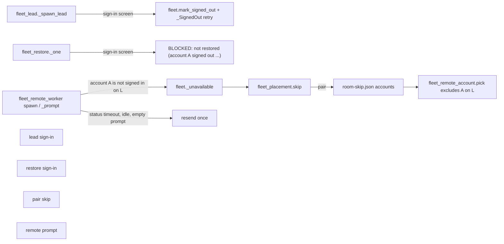

# Superlite: sign-in screen at lead start and restore, first remote prompt resend, per-account remote placement skip (#880, #931, #932)

**Goal:** a lead start and `sl fleet restore` notice Claude Code's sign-in screen (#880); a remote worker's first prompt that herdr reports as `timed out waiting for agent status` is resent once when the agent sits idle with the prompt not on screen (#931); a remote spawn that fails because one account is signed out on a host skips only that (host, account) pair, names it once and keeps placing on that host with its other accounts (#932).
**Architecture:** `fleet.spawn` already handles the sign-in screen for workers (`fail(..., signed_out=True)`, `mark_signed_out`, `_SignedOut` retry on another account); `fleet_lead._spawn_lead` and `fleet_restore._one` copy that path. Remote placement: `fleet._unavailable` calls `fleet_placement.skip(sd, label, why)`; `skip` now reads the reason and records a pair instead of a machine skip when the reason names a signed-out account; `fleet_remote_account.pick` excludes the pairs of its host. `fleet_remote_worker._prompt` gets a status-timeout arm.
**Tech stack:** Python 3.10+ stdlib; pytest through `sl run_tests`.
**Spec:** issues #880, #931, #932 and this file, section Design.
**Detail:** contracts
**Target-min:** 11
**Wave0:** none
**Coverage:** off (bounded: three fixes inside existing spawn, restore and placement flows)

Global constraints:
- Builds: the verdict is `sl run_tests` (the project's test command; a project with `.maxapp` runs `maxapp test`, which a build pool may place on another Mac, and a full run whose tree a green maxapp test stamp covers returns that result without a run); task trees build in <tree>/.build/DerivedData and any build of your own goes under .build/ of the worktree, never -derivedDataPath outside the worktree (your session scratchpad included; backlog cleanup removes scratchpad build folders when the worktree goes); a product, simulator or device build stays on this machine and runs only when an issue's acceptance asks for a running-app check.
- Simulators: append the UDID of each simulator you or a worker creates (`xcrun simctl create` or `clone`; a checker's `Simulators:` line marks its created ones) as one line to /Users/max/github/superlite/.claude/worktrees/superlite-b241-remote-signin-and-first-prompt/.superlite/simulators.txt; never list one you did not create; ship cleanup shuts down and deletes each listed one.
- Every Python script line keeps the repo's `# O(...)` complexity comment; stdlib only; LF endings. This repository is public: no host names, user names or home paths in code, tests, docs or commit messages (tests use labels like `box` and accounts like `claude1`).
- Edit only your task's Owns files. `fleet.py`, `herdr_client.py`, `fleet_io.py`, `accounts.py`, `docs/fleet.md`, `docs/tools.md` and `skills/subagent-driven-development/fleet.md` belong to other batches: call them, never edit them.
- The one reason phrase of a remote sign-in failure is `account <name> is not signed in on <label>` (`<name>` without `@label`); `fleet_remote_worker._signed_out` prints it today and T4 makes the send path use it too; T3 parses it.
- Tests never reach a real herdr or `claude-profile`: copy the fakes of the test files each task names. An existing test that pins a changed output is updated only when it is in the task's Owns; any other failing test is reported, never edited. New tests see a red run before the code they test.

## Design

What the issues ask: #880 a lead or restored worker on a signed-out account sits at the login prompt unnoticed; reuse `accounts.sign_in_screen` and `fleet.mark_signed_out`. #931 the first remote spawn after Claude Code updated itself on the host does not take its first prompt within 60 s; a second spawn a minute later takes it in 9 s. #932 one signed-out account on a host keeps the whole host out of placement, because the skip is keyed by machine and the next pick takes the same account again. Done when the named tests below pass and the full suite is green.

Ruling: lead start copies `fleet.spawn`'s sign-in handling (mark the account signed out, retry once on another account, then BLOCKED with the `sign in once (...claude, then /login), then rerun` hint) (because the issue says reuse it, and `fleet._SignedOut` subclasses `fleet._Slow`, which `spawn_lead` already retries).
Ruling: restore keeps the worker's account and does not retry on another one; a sign-in screen after the relaunch closes the new pane and prints a BLOCKED line naming the account (because `--resume <session>` needs the session that lives in that account's config dir).
Ruling: restore marks the account signed out only for a local record (no `machine`); a remote record's account is a host account and `fleet.json`'s `signed_out` list is this machine's (because marking it would drop the account for local spawns too).
Ruling: #931 is fixed by a resend, not by a longer first wait (because the host's Claude Code version is not known from here; a version record would be new state for one rare case). The resend happens only when the agent state is idle or done and the screen does not show the first 40 characters of the prompt's first line (the "empty prompt" check: a prompt still typed in the input would be doubled); working means the prompt landed late and counts as sent; any other state raises as before, so #929's local fallback stays.
Ruling: the pair skip lives in the run's `room-skip.json` under the machine's entry (`"accounts": {name: until}`), lasts 15 minutes (`fleet.SIGNED_OUT_TTL_MS`, the local signed-out time) and leaves the machine-level `until` unset, so `choose` keeps the host; a machine-level skip keeps the entry's `accounts` (because "once" and the exclusion must survive a later machine skip).
Ruling: "named once" is one stderr line per (host, account) per run, printed the first time `skip` records the pair; a renewal after it expired prints nothing (because `fleet._unavailable` already prints its `placement: <label> unavailable (...)` line on every failure).
Ruling: `pick` passes the excluded accounts to `fleet.choose_account` by wrapping `fleet.signed_out_accounts` for the length of that one call (restored in `finally`; spawns run one process per round, no threads), because `choose_account`'s `avoid` takes one name and `fleet.py` belongs to B242; follow-up: `avoid` should take a set.
Ruling: when every account is excluded on a host, `choose_account`'s own `BLOCKED: no account with headroom` makes the spawn fail and `skip` gets a reason without the phrase, so the machine is skipped for 10 minutes as before.
Ruling: Detail `contracts` (because each task copies the fakes of an existing test file the research named, and a verbatim test written without reading those fakes would be wrong).
Ruling: docs follow-ups only: `docs/fleet.md` (B245) should name the lead and restore sign-in lines, the status-timeout resend and the per-account placement skip.

```mermaid
%% schedule
gantt
  title Predicted schedule (mm:ss)
  dateFormat X
  axisFormat %M:%S
  section lane 1
  T3 pair skip :t3, 0, 223s
  section lane 2
  T1 lead sign-in :t1, 0, 198s
  section lane 3
  T2 restore sign-in :t2, 0, 198s
  section lane 4
  T4 remote prompt :t4, 0, 197s
```

critical path: T3 (3.7 min) · peak width 4 · predicted build 3.7 min · predicted total ≈ 12.2 min (target ✗ 11.0)

## File structure

- `skills/subagent-driven-development/scripts/fleet_lead.py`: `_spawn_lead` sign-in checks, `fail(signed_out=)` (T1).
- `skills/subagent-driven-development/scripts/fleet_restore.py`: `_start` returns the screen, `_one` sign-in checks, `_signed_out` line (T2).
- `skills/subagent-driven-development/scripts/fleet_placement.py`: `skip` pair branch, `signed_out_pairs`, `PAIR_MINUTES` (T3).
- `skills/subagent-driven-development/scripts/fleet_remote_account.py`: `signed_out_account`, `pick` exclusion (T3).
- `skills/subagent-driven-development/scripts/fleet_remote_worker.py`: `_prompt` status-timeout arm and account in the signed-out message (T4).
- New tests: `tests/scripts/test_fleet_lead_signed_out_880.py` (T1), `tests/scripts/test_fleet_restore_signed_out_880.py` (T2), `tests/scripts/test_fleet_placement_signed_out_932.py` (T3), `tests/scripts/test_fleet_remote_prompt_931.py` (T4).

## Sections

### Lead and restore sign-in (#880)

**Probe entry:** none (herdr pane starts; its cases are named tests in T1 and T2)

### T1 lead sign-in · Complexity 3 · Est. context 45k
**Owns:** skills/subagent-driven-development/scripts/fleet_lead.py, tests/scripts/test_fleet_lead_signed_out_880.py
**Components:** 1
**LOC owned:** 110
**Tests:** fast
**Model:** sonnet
**Kind:** design
**Covers:** Design
**Produces:** fleet_lead.spawn_lead(main_sd: Path, worktree: Path, model: str | None = None, env: dict | None = None, rc: dict | None = None) -> dict
**Review Focus:** state: `test_lead_signed_out_retries_on_another_account`; state: `test_lead_signed_out_twice_blocked_with_hint`; protocol: `test_lead_sign_in_screen_on_start_error`; encoding: `test_lead_quoted_mark_is_not_signed_out`
**Test code (contracts):** copy the fakes of `tests/scripts/test_fleet_lead.py` and `tests/scripts/test_fleet_lead_shell_551.py` (accounts `claude1`, `claude2`; a scripted `read_screen`). A sign-in screen is a line `Select login method:` (`accounts.SIGN_IN_MARKS`).
- `test_lead_signed_out_retries_on_another_account`: the first start's screen is the sign-in screen, the second a ready prompt. `spawn_lead` returns account `claude2`; stderr holds `W1 account claude1 signed out: Claude Code sign-in screen; retrying on account claude2`; `fleet.signed_out_accounts(main_sd) == {"claude1"}`; W1 is `blocked`, W2 `ready`; W1's pane was closed.
- `test_lead_signed_out_twice_blocked_with_hint`: both starts show the sign-in screen. `SystemExit` code 3; stdout has one line starting `BLOCKED: W2 account claude2 signed out: Claude Code sign-in screen; sign in once (` that contains `claude, then /login), then rerun` and ends with `; retried after W1 on claude1`; both accounts are in `fleet.signed_out_accounts(main_sd)`.
- `test_lead_sign_in_screen_on_start_error`: `start_on_shell` raises `HerdrError("agent_not_ready", ...)` while the screen is the sign-in screen: same result as the first test (marked, retried on `claude2`), not a `startup:` BLOCKED.
- `test_lead_quoted_mark_is_not_signed_out`: the screen holds `see the docs: Select login method: ...` mid-line after other text on that line: the lead is `ready` and `signed_out` is empty.
**Steps:** 1 failing tests, 2 run: FAIL, 3 implement, 4 run: PASS
**Notes:** `fail(why, screen=None, slow=False, shell=False, signed_out=False)`: signed_out sets W blocked, `fleet.mark_signed_out(main_sd, account)`, `why = fleet.SIGNED_OUT_WHY`, closes the pane; first try: `fleet._keep(main_sd, wid, why, screen, "fleet spawn retry")` then `raise fleet._SignedOut(wid, account, why)`; retry: `why += f"; sign in once ({var}claude, then /login), then rerun"` with `var = "" if fleet.ac.is_default_dir(cdir, base) else f"CLAUDE_CONFIG_DIR={cdir} "`, then `fleet._blocked(main_sd, wid, account, why + tail, screen)`. Checks: in the `except hc.HerdrError` branch of `start_on_shell`, before the TRUST test; and once after the whole start block (a failed read is an empty screen), before `set_state(..., "ready")`. `spawn_lead`'s `except (fleet._Slow, NoShell)` already catches `_SignedOut`.

### T2 restore sign-in · Complexity 3 · Est. context 45k
**Owns:** skills/subagent-driven-development/scripts/fleet_restore.py, tests/scripts/test_fleet_restore_signed_out_880.py
**Components:** 1
**LOC owned:** 110
**Tests:** fast
**Model:** sonnet
**Kind:** design
**Covers:** Design
**Produces:** fleet_restore.restore(sd: Path, client=None, prefix: str = "") -> tuple[list[str], bool]
**Review Focus:** state: `test_restore_signed_out_worker_blocked`; state: `test_restore_signed_out_dead_worker_keeps_record`; protocol: `test_restore_sign_in_after_start_error`; state: `test_restore_remote_record_not_marked`
**Test code (contracts):** copy the fake client and seeds of `tests/scripts/test_fleet_restore_577.py`.
- `test_restore_signed_out_worker_blocked`: a ready local worker W1 on `claude1` with `launch.env.CLAUDE_CONFIG_DIR = "/x/.claude-1"`; after `start_agent` the screen is `Select login method:`. `restore` returns blocked True and the line `BLOCKED: W1 not restored (account claude1 signed out: Claude Code sign-in screen; sign in once (CLAUDE_CONFIG_DIR=/x/.claude-1 claude, then /login), then rerun sl fleet restore)`; the new pane is closed; W1 is `blocked`; `fleet.signed_out_accounts(sd) == {"claude1"}`; no continue prompt was sent.
- Same worker with no `CLAUDE_CONFIG_DIR` in `launch.env`: the hint reads `sign in once (claude, then /login)` (asserted in the same test file as `test_restore_signed_out_default_dir_hint`).
- `test_restore_signed_out_dead_worker_keeps_record`: a dead worker (`state stopped`, `dead`, `was ready`): the BLOCKED line as above, the record keeps `stopped` and `dead` (a rerun tries again).
- `test_restore_sign_in_after_start_error`: `start_agent` raises with code `agent_not_ready` and the screen is the sign-in screen: the signed-out BLOCKED line, not `startup: ...`.
- `test_restore_remote_record_not_marked`: a worker with `machine: "box"` and account `claude1@box`: the BLOCKED line names `claude1@box`; `fleet.signed_out_accounts(sd) == set()`.
**Steps:** 1 failing tests, 2 run: FAIL, 3 implement, 4 run: PASS
**Notes:** `_start` returns the screen it reads last; `_one` checks `fleet.ac.sign_in_screen` on it, and on the start-error path reads the screen (`_try(c.read_screen, name, fleet.SCREEN_ROWS) or ""`) before closing the pane. A lead record goes the same path (its account lives in the main fleet's `sd`).

### Remote placement and first prompt (#931, #932)

**Probe entry:** none (herdr and placement state; its cases are named tests in T3 and T4)

### T3 pair skip · Complexity 4 · Est. context 45k
**Owns:** skills/subagent-driven-development/scripts/fleet_placement.py, skills/subagent-driven-development/scripts/fleet_remote_account.py, tests/scripts/test_fleet_placement_signed_out_932.py
**Components:** 2
**LOC owned:** 130
**Tests:** fast
**Model:** sonnet
**Kind:** design
**Covers:** Design
**Produces:** fleet_remote_account.signed_out_account(why: str | None) -> str | None · fleet_placement.signed_out_pairs(sd: Path, label: str, now: float | None = None) -> set · fleet_placement.skip(sd: Path, label: str, why: str, minutes: float = 10.0, now: float | None = None) -> None
e.g. `signed_out_account("W3 not sent: account claude2 is not signed in on box; run /login for it there") -> "claude2"`
e.g. `signed_out_account("BLOCKED: no account with headroom") -> None`
e.g. after `skip(sd, "box", "account claude2 is not signed in on box", now=1000.0)`: `signed_out_pairs(sd, "box", now=1001.0) == {"claude2"}`, `signed_out_pairs(sd, "box", now=1901.0) == set()`
**Review Focus:** state: `test_signed_out_skip_keeps_machine`; state: `test_pick_skips_signed_out_pair`; state: `test_pair_named_once`; state: `test_machine_skip_keeps_pairs`; encoding: `test_signed_out_account_parse`
**Test code (contracts):** copy the `env` fixture and choose stubs of `tests/scripts/test_fleet_placement.py` and the `fake()` `choose_account` stub of `tests/scripts/test_fleet_remote_account.py`.
- `test_signed_out_account_parse`: the two `e.g.` lines; `None` and `""` give `None`; `"account claude2 is not signed in on box"` gives `"claude2"`.
- `test_signed_out_skip_keeps_machine`: `skip(sd, "box", "account claude2 is not signed in on box", now=1000.0)`; `choose(sd, "research", project, now=1001.0)` still returns `"box"` (room 4, no live workers); a plain `skip(sd, "box", "startup: timeout", now=1000.0)` makes it return `None` (10 minutes, unchanged).
- `test_pair_named_once`: the first sign-in `skip` prints one stderr line `placement: account claude2 is signed out on box; box stays in placement with its other accounts; sign claude2 in there once (claude, then /login)`; a second `skip` for the same pair (also after it expired, `now=5000.0`) prints nothing; a pair for `claude3` prints its own line.
- `test_machine_skip_keeps_pairs`: a sign-in `skip` then a plain `skip` for `box`: `signed_out_pairs` still `{"claude2"}` and `choose` returns `None` until the machine `until`.
- `test_pick_skips_signed_out_pair`: with the pair `claude2` on `box` recorded, `pick(sd, "box", ...)` returns `("claude1@box", ...)` where the stubbed `fleet.choose_account` would pick `claude2` unless `fleet.signed_out_accounts(sd)` holds it (the stub reads that function); `pick(sd, "other", ...)` still returns `claude2@other`; after the call `fleet.signed_out_accounts` is the original function again.
**Steps:** 1 failing tests, 2 run: FAIL, 3 implement, 4 run: PASS
**Notes:** pair TTL `PAIR_MINUTES = 15.0`. `skip`'s pair branch writes under the existing `_lock`, keeps the entry's `until` and `why`, and stores `accounts[name] = now + PAIR_MINUTES * 60`; the plain branch writes `{**old, "until": ..., "why": ...}` so `accounts` survives. `signed_out_account` matches `account (\S+) is not signed in on ` anywhere in the text. `pick` imports `fleet_placement` inside the function (no import cycle) and wraps `fleet.signed_out_accounts` only when the exclusion is not empty. `choose` stays unchanged: a pair-only entry has no `until`.

### T4 remote prompt · Complexity 3 · Est. context 45k
**Owns:** skills/subagent-driven-development/scripts/fleet_remote_worker.py, tests/scripts/test_fleet_remote_prompt_931.py
**Components:** 1
**LOC owned:** 100
**Tests:** fast
**Model:** sonnet
**Kind:** design
**Covers:** Design
**Produces:** fleet_remote_worker.STATUS_MSG: str · fleet_remote_worker._prompt(name: str, msg: str, account: str = "") -> None
**Review Focus:** protocol: `test_status_timeout_idle_empty_resends_once`; protocol: `test_status_timeout_working_counts_as_sent`; state: `test_status_timeout_text_on_screen_raises`; protocol: `test_status_timeout_second_failure_raises`; encoding: `test_signed_out_prompt_names_account`
**Test code (contracts):** copy `world` and `Routed(FakeHerdr)` of `tests/scripts/test_fleet_remote_worker.py`; `HerdrError("timeout", "timed out waiting for agent status")` is herdr's error.
- `test_status_timeout_idle_empty_resends_once`: the first `prompt` raises the status timeout, `agent_state` is `idle`, the screen shows an empty prompt: `_prompt` returns; `prompt` was called twice with the same text and `["working"]`, `REMOTE_PROMPT_MS`.
- `test_status_timeout_working_counts_as_sent`: state `working`: one `prompt` call, no error.
- `test_status_timeout_text_on_screen_raises`: state `idle` and the screen shows the first 40 characters of the message: the HerdrError is raised, one `prompt` call.
- `test_status_timeout_second_failure_raises`: both prompts raise the status timeout: the second error propagates; two calls.
- `test_status_timeout_sign_in_raises_signed_out`: the screen after the timeout is the sign-in screen: `HerdrError` code `account_signed_out`, one `prompt` call.
- `test_signed_out_prompt_names_account`: `send_brief` to a remote worker with account `claude2@box` whose prompt fails on a `Please run /login` screen raises `HerdrError` code `account_signed_out` with message `account claude2 is not signed in on box; run /login for it there`; with `account=""` the message stays `the account is signed out on this machine; run /login for it there`.
**Steps:** 1 failing tests, 2 run: FAIL, 3 implement, 4 run: PASS
**Notes:** `STATUS_MSG = "timed out waiting for agent status"`; the arm matches `e.code == "timeout"` or `STATUS_MSG` in the text, after `_login_after_prompt`. `send_brief` and `send_task` pass the worker record's `account`. `_login_after_prompt(name, account="")` builds the named message when `account` holds `@`.

## Review Focus

- Lead and restore (CLI over herdr): state (marked accounts, worker states, a closed pane), protocol (start errors), encoding (a quoted mark is no sign-in screen).
- Placement (state file): state (pair vs machine skip, TTL, once), encoding (the reason phrase), file (`room-skip.json` stays the only skip file; `test_cache_files_replaced_never_half_written` pins the set).
- Remote prompt (herdr protocol): protocol (timeout arms, one resend), state (a prompt still typed is never doubled).

## Self-review

Every issue maps to a task (#880: T1, T2; #931: T4; #932: T3, T4's message). No two tasks share a file; no edges (T4 only writes the phrase T3 parses, pinned in Global constraints).
