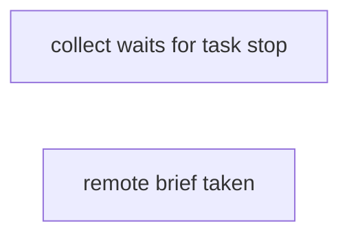

# Superlite: a remote write worker's snapshot comes home; a remote brief is checked taken (#953, #971)

**Goal:** `fleet wait` applies a finished remote write worker's snapshot even when the report is read before the stop hook's record is mirrored, and never takes an earlier turn's snapshot for the task's (#953); a fresh remote one-turn worker that drops its brief is resent once, then reported `brief_not_taken`, as a local one is (#971).
**Architecture:** `fleet_remote_collect.collect` waits (bounded) for the task turn's own mirrored stop record, syncing the mirror itself; `fleet_remote_worker.send_brief` runs a remote `took_brief` (sync per poll, inside `hc.on(label)`) for a fresh one-turn worker.
**Tech stack:** Python 3.10+ stdlib; pytest through `sl run_tests`.
**Spec:** this file, section Design.
**Detail:** tests
**Target-min:** 11
**Wave0:** none
**Coverage:** off

Global constraints:
- Every line of a Python script under `skills/**/scripts/` keeps the repo's `# O(...)` complexity comment; stdlib only; LF endings. Files under `tests/` carry no such comments.
- This repository is public: no host names, user names, home paths, other project or repository names in code, tests, docs or commit messages.
- The verdict is `sl run_tests` (never raw pytest); every new test sees a red run before the code it tests.
- An existing test that pins a changed text or output is updated in the same task only when it is in the task's Owns. Any other test your change turns red: leave it, and name the file and the failing assertion in your report (the coordinator rules it).
- Builds: the verdict is `sl run_tests` (the project's test command; a project with `.maxapp` runs `maxapp test`, which a build pool may place on another Mac, and a full run whose tree a green maxapp test stamp covers returns that result without a run); task trees build in <tree>/.build/DerivedData and any build of your own goes under .build/ of the worktree, never -derivedDataPath outside the worktree (your session scratchpad included; backlog cleanup removes scratchpad build folders when the worktree goes); a product, simulator or device build stays on this machine and runs only when an issue's acceptance asks for a running-app check; copy this sentence into every worker brief.
- Simulators: append the UDID of each simulator you or a worker creates (`xcrun simctl create` or `clone`; a checker's `Simulators:` line marks its created ones) as one line to the worktree's `.superlite/simulators.txt`; never list one you did not create; ship cleanup shuts down and deletes each listed one; copy this sentence into every worker brief.

## Design

### 1. Collect waits for the task turn's stop record (#953)

Cause (lead's diagnosis from the code): herdr marks the pane idle as soon as the turn ends, but `hooks/capture-worker-stop` writes the stop record only after `sl remote_apply snapshot` (up to 30 s). `fleet_io.wait` then takes the screen path after `SETTLE_MS` (10 s) and `_finish` calls `collect` while the mirror holds no record of the task turn: `_snapshot` reads the newest record, which is none (`left no snapshot`) or the READY turn's (its snapshot is the start tree: an empty apply that marks the work collected).

- `collect` reads the worker record's `sent` (ms, set by `fleet_io._busy`; missing: 0) and takes only a stop record whose `t` (missing: 0) is at or after it, the newest such one.
- None mirrored yet: it calls `fr.sync(sd, wid)` (any exception counts as nothing new), rereads, sleeps `POLL_S` = 2 s, until `WAIT_S` = 45 s passed (the hook's 30 s snapshot bound plus the mirror read).
- No such record after the wait: BLOCKED, concern `remote worker W2 left no snapshot: no stop record of its task reached this machine within 45 s; its tree <tree> stays on <label> (snapshot ref <ref>)`.
- A record without `snapshot`: BLOCKED at once, concern `remote worker W2 left no snapshot: its stop hook took none (remote_apply snapshot failed or ran past 30 s); its tree <tree> stays on <label>`.
- Everything after (fetch, sha check, apply, conflicts, `collected`) is unchanged. A BLOCKED report keeps the worker and its host tree (`_finish` stops a remote write worker only once collected).

### 2. Remote brief-taken check (#971)

- `fleet_remote_worker._took(sd, wid, name, sent_ms, write=False)`: `fleet_io.took_brief` for a host agent: `hc.wait_state(name, ["idle", "done"], fio.TOOK_MS)` (a HerdrError: still working, True); then each poll `fr.sync(sd, wid)` (exceptions swallowed) and `fio.latest_stop(sd, wid, sent_ms)`; True on a record, False after `fio.SETTLE_MS` plus `SNAPSHOT_MS` = 30 s for a write worker (the hook snapshots before it writes the record); polls every `SYNC_POLL_S` = 2 s (each sync is a remote read).
- `send_brief`, inside its `hc.on(label)` block: a fresh one-turn worker (`one_turn` and no `sent` yet) that did not take the brief gets the stderr line `W1: brief not taken (the pane went idle with no turn); resending once`, a new `sent` and one more `_prompt`; a second miss raises `hc.HerdrError("brief_not_taken", "brief not taken after one resend")` before `_busy`, so `fleet.py`'s send handler prints `BLOCKED: W1 Q1 not sent (brief not taken after one resend)` and stops the worker, as for a local one.

### 3. Rulings

- Ruling: collect blocks the wait loop for at most 45 s, and only when the report was read before the task's stop record was mirrored (because a 45 s pause once per such worker costs less than redoing its task locally).
- Ruling: `sent` (local clock) is compared with the host's `t`, as `fleet_io.wait` already does for remote stop records (because both clocks are network-synced; a skew above the task's length is not a case this batch handles).
- Ruling: the remote resend is unconditional, as the local #909 one (because a duplicated brief in one turn is harmless to a one-turn worker, a dropped one costs the worker).
- Ruling: B250 also edits tests no open batch lists: `tests/scripts/test_fleet_remote_collect.py` (the no-snapshot test's texts and clock), `tests/scripts/test_fleet_remote_worker.py` (the `world` fixture answers `_took` True), new `test_fleet_remote_collect_953.py` and `test_fleet_remote_brief_taken_971.py`.
- Ruling: fleet placement local for this run's build (because remote write workers lose their work until this batch ships).
- Ruling: accept predicted 18.8 min (MISSED TARGET) (because the two tasks already run in parallel with no edge; the forecast comes from contention and history, not the plan's shape).

## Task graph

```mermaid
%% schedule
gantt
  title Predicted schedule (mm:ss)
  dateFormat X
  axisFormat %M:%S
  section lane 1
  T1 collect waits for task stop :t1, 0, 378s
  section lane 2
  T2 remote brief taken :t2, 0, 377s
```





critical path: T1 (6.3 min) · peak width 2 · predicted build 6.3 min · predicted total ≈ 18.8 min (target ✗ 11.0)

## Package: remote fleet

App type: library (fleet worker plumbing). Categories: state (stop records, sent time), protocol (exact concern and error texts), timing (bounded waits).
**Probe entry:** none (herdr and the host are faked; the named tests cover each case)

### T1 collect waits for task stop · Complexity 3 · Est. context 40k
**Owns:** skills/subagent-driven-development/scripts/fleet_remote_collect.py, tests/scripts/test_fleet_remote_collect.py, tests/scripts/test_fleet_remote_collect_953.py
**Components:** 1
**LOC owned:** 120
**Tests:** fast
**Model:** sonnet
**Kind:** design
**Covers:** 1
**Produces:** fleet_remote_collect.WAIT_S: int · fleet_remote_collect.POLL_S: int · fleet_remote_collect.now_s() -> float · fleet_remote_collect.sleep(s: float) -> None
**Review Focus:** state: `test_ready_snapshot_before_sent_is_not_the_task`, `test_late_stop_record_is_waited_for`; protocol: `test_no_stop_record_within_wait_blocked`, `test_stop_record_without_snapshot_blocked_at_once`; timing: `test_sync_error_counts_as_nothing_new`
**Test code (verbatim):**
```python
# tests/scripts/test_fleet_remote_collect_953.py: collect waits for the task turn's own stop record, syncing the mirror (#953)
import json
from test_fleet_remote_collect import env, host_snapshot, report, collected, frc, fs, NAME, REF  # noqa: F401

HOST_TREE = "/rh/.maxapp/trees/proj/p-1a2b3c/W2"


def seed(env, sent, stops):
    remote = {"label": "box", "name": NAME, "project": str(env.proj), "start": env.start, "snapshot_ref": REF, "write": True,
              "owns": ["src/*.py"], "tree": HOST_TREE, "sd": HOST_TREE + "/.superlite"}
    fs.save(env.sd, {**fs.default(), "workers": {"W2": {"state": "busy", "role": "implementer", "sent": sent, "machine": "box", "remote": remote}}})
    d = env.sd / "remote" / "W2"
    d.mkdir(parents=True, exist_ok=True)
    (d / "metrics.jsonl").write_text("".join(json.dumps({"ev": "stop", "agent_id": "W2", **s}) + "\n" for s in stops))


def append_stop(env, **s):
    with open(env.sd / "remote" / "W2" / "metrics.jsonl", "a") as fh:
        fh.write(json.dumps({"ev": "stop", "agent_id": "W2", **s}) + "\n")


def clock(monkeypatch):
    t = [100.0]
    monkeypatch.setattr(frc, "now_s", lambda: t[0])
    monkeypatch.setattr(frc, "sleep", lambda s: t.__setitem__(0, t[0] + s))
    return t


def syncing(monkeypatch, on_call=None):
    calls = []

    def sync(sd, wid):
        calls.append(wid)
        if on_call:
            on_call(len(calls))
        return 0
    monkeypatch.setattr(frc.fr, "sync", sync)
    return calls


def test_constants():
    assert frc.WAIT_S == 45 and frc.POLL_S == 2


def test_ready_snapshot_before_sent_is_not_the_task(env, monkeypatch):
    clock(monkeypatch)
    sha = host_snapshot(env, {"src/a.py": "two\n"})
    seed(env, 2000, [{"t": 1000, "snapshot": "a" * 40}])
    calls = syncing(monkeypatch, lambda n: append_stop(env, t=2500, snapshot=sha) if n == 1 else None)
    out = frc.collect(env.sd, "W2", report())
    assert out["status"] == "DONE" and out["collected"]["sha"] == sha
    assert (env.proj / "src" / "a.py").read_text() == "two\n"
    assert calls == ["W2"] and collected(env) == sha


def test_late_stop_record_is_waited_for(env, monkeypatch):
    t = clock(monkeypatch)
    sha = host_snapshot(env, {"src/a.py": "two\n"})
    seed(env, 2000, [])
    calls = syncing(monkeypatch, lambda n: append_stop(env, t=2600, snapshot=sha) if n == 3 else None)
    out = frc.collect(env.sd, "W2", report())
    assert out["collected"]["applied"] == ["src/a.py"] and len(calls) == 3
    assert t[0] - 100 == 4


def test_no_stop_record_within_wait_blocked(env, monkeypatch):
    t = clock(monkeypatch)
    seed(env, 2000, [{"t": 1000, "snapshot": "a" * 40}])
    calls = syncing(monkeypatch)
    out = frc.collect(env.sd, "W2", report())
    assert out["status"] == "BLOCKED"
    assert out["concerns"] == [f"remote worker W2 left no snapshot: no stop record of its task reached this machine within 45 s; its tree {HOST_TREE} stays on box (snapshot ref {REF})"]
    assert 45 <= t[0] - 100 <= 47 and len(calls) >= 20
    assert collected(env) is None


def test_stop_record_without_snapshot_blocked_at_once(env, monkeypatch):
    t = clock(monkeypatch)
    seed(env, 2000, [{"t": 2500}])
    calls = syncing(monkeypatch)
    out = frc.collect(env.sd, "W2", report())
    assert out["status"] == "BLOCKED"
    assert out["concerns"] == [f"remote worker W2 left no snapshot: its stop hook took none (remote_apply snapshot failed or ran past 30 s); its tree {HOST_TREE} stays on box"]
    assert calls == [] and t[0] == 100


def test_sync_error_counts_as_nothing_new(env, monkeypatch):
    clock(monkeypatch)
    seed(env, 2000, [])

    def boom(sd, wid):
        raise frc.fr.RemoteError("box unreachable")
    monkeypatch.setattr(frc.fr, "sync", boom)
    out = frc.collect(env.sd, "W2", report())
    assert out["status"] == "BLOCKED" and "no stop record of its task" in out["concerns"][0]
```
**Steps:** 1 write the test file and replace `test_collect_no_snapshot` in tests/scripts/test_fleet_remote_collect.py with the version in Notes, 2 run: FAIL, 3 implement, 4 run: PASS
**Notes:** replace `_snapshot` with `_stop(sd, wid, sent)` (the newest mirrored stop record of the worker whose `t`, missing read as 0, is at or after `sent`; None when there is none), add `_sync(sd, wid)` (`fr.sync`, any `Exception` swallowed) and `_await_stop(sd, wid, sent)`: `end = now_s() + WAIT_S`; read once; while none and `now_s() < end`: `_sync`, reread, `sleep(POLL_S)` when still none. Module level: `WAIT_S = 45`, `POLL_S = 2`, `now_s = time.monotonic`, `sleep = time.sleep` (tests patch these names). In `collect`: `sent = int(rec.get("sent") or 0)`; the two concern texts of Design 1 with `tree = remote.get("tree")`, `label = remote.get("label")`, `ref = remote.get("snapshot_ref")`; the rest of `collect` unchanged. Update the module docstring's first paragraph to say it waits for the task turn's stop record. Replacement test:
```python
def test_collect_no_snapshot(env, monkeypatch):
    worker(env, snap=None)
    out = frc.collect(env.sd, "W2", report())
    assert out["status"] == "BLOCKED" and out["concerns"][0].startswith("remote worker W2 left no snapshot: its stop hook took none")
    t = [0.0]
    monkeypatch.setattr(frc, "now_s", lambda: t[0])
    monkeypatch.setattr(frc, "sleep", lambda s: t.__setitem__(0, t[0] + s))
    monkeypatch.setattr(frc.fr, "sync", lambda sd, wid: 0)
    (env.sd / "remote" / "W2" / "metrics.jsonl").unlink()
    worker(env)  # no mirrored record at all
    assert frc.collect(env.sd, "W2", report())["concerns"][0].startswith("remote worker W2 left no snapshot: no stop record of its task")
```
Verify with `sl run_tests --fast tests/scripts/test_fleet_remote_collect.py tests/scripts/test_fleet_remote_collect_953.py tests/scripts/test_fleet_io.py --task T1`.

### T2 remote brief taken · Complexity 3 · Est. context 42k
**Owns:** skills/subagent-driven-development/scripts/fleet_remote_worker.py, tests/scripts/test_fleet_remote_worker.py, tests/scripts/test_fleet_remote_brief_taken_971.py
**Components:** 1
**LOC owned:** 110
**Tests:** fast
**Model:** sonnet
**Kind:** design
**Covers:** 2
**Produces:** fleet_remote_worker._took(sd, wid: str, name: str, sent_ms: int, write: bool = False) -> bool · fleet_remote_worker.SNAPSHOT_MS: int · fleet_remote_worker.SYNC_POLL_S: int
**Review Focus:** timing: `test_took_settles_longer_for_a_write_worker`, `test_took_late_stop_record_through_sync`; protocol: `test_fresh_one_turn_never_taken_raises`, `test_fresh_one_turn_resent_once_then_taken`; state: `test_second_brief_or_multi_turn_not_checked`, `test_took_runs_inside_on`
**Test code (verbatim):**
```python
# tests/scripts/test_fleet_remote_brief_taken_971.py: a fresh remote one-turn worker that never takes its brief is resent once, then reported not sent (#971)
import json
import sys
import pytest
from test_fleet_remote_worker import world, started, record  # noqa: F401
from test_plan_tools import SCRIPTS
sys.path.insert(0, str(SCRIPTS))
import fleet_io as fio  # noqa: E402
import fleet_remote as fr  # noqa: E402
import fleet_remote_worker as rw  # noqa: E402

REAL_TOOK = rw._took


def fake_clock(monkeypatch):
    t = [1000]
    monkeypatch.setattr(fio, "now_ms", lambda: t[0])
    monkeypatch.setattr(fio, "sleep", lambda s: t.__setitem__(0, t[0] + int(s * 1000)))
    return t


def syncs(monkeypatch):
    calls = []
    monkeypatch.setattr(fr, "sync", lambda sd, wid: calls.append(wid) or 0)
    return calls


def brief(world):
    b = world.sd / "briefs" / "q.md"
    b.write_text("question")
    return str(b)


def patch_record(world, wid="W1", **kw):
    p = world.sd / "fleet.json"
    d = json.loads(p.read_text())
    d["workers"][wid].update(kw)
    p.write_text(json.dumps(d))


def prompts(world):
    return [c for c in world.fh.calls if c[0] == "prompt"]


def test_constants():
    assert rw.SNAPSHOT_MS == 30000 and rw.SYNC_POLL_S == 2


def test_took_late_stop_record_through_sync(world, monkeypatch):
    t = fake_clock(monkeypatch)
    calls = syncs(monkeypatch)
    monkeypatch.setattr(fio, "latest_stop", lambda sd, wid, after, stops=None: {"t": 9} if len(calls) >= 3 else None)
    assert REAL_TOOK(world.sd, "W1", "sl-proj-w1", 5) is True
    assert len(calls) == 3 and t[0] - 1000 == 4000


def test_took_settles_longer_for_a_write_worker(world, monkeypatch):
    t = fake_clock(monkeypatch)
    syncs(monkeypatch)
    monkeypatch.setattr(fio, "latest_stop", lambda sd, wid, after, stops=None: None)
    assert REAL_TOOK(world.sd, "W1", "sl-proj-w1", 5) is False
    assert t[0] - 1000 == fio.SETTLE_MS
    t[0] = 1000
    assert REAL_TOOK(world.sd, "W1", "sl-proj-w1", 5, write=True) is False
    assert t[0] - 1000 == fio.SETTLE_MS + 30000


def test_took_still_working_counts_as_taken(world, monkeypatch):
    calls = syncs(monkeypatch)
    waits = []

    def wait_state(name, until, ms):
        waits.append((name, until, ms))
        raise world.fh.HerdrError("timeout", "x")
    monkeypatch.setattr(world.fh, "wait_state", wait_state)
    assert REAL_TOOK(world.sd, "W1", "sl-proj-w1", 5) is True
    assert waits == [("sl-proj-w1", ["idle", "done"], fio.TOOK_MS)] and calls == []


def test_took_runs_inside_on(world, monkeypatch):
    started(world)
    world.fh.calls.clear()
    monkeypatch.setattr(rw, "_took", REAL_TOOK)
    syncs(monkeypatch)
    monkeypatch.setattr(fio, "latest_stop", lambda sd, wid, after, stops=None: {"t": 9})
    assert rw.send_brief(world.sd, "W1", brief(world), "Q1") == "Q1"
    inside, outside = world.fh.inside()
    assert any(c[0] == "wait_state" for c in inside) and all(c[0] != "wait_state" for c in outside)


def test_fresh_one_turn_resent_once_then_taken(world, monkeypatch, capsys):
    started(world)
    world.fh.calls.clear()
    answers, seen = [False, True], []
    monkeypatch.setattr(rw, "_took", lambda sd, wid, name, sent, write=False: (seen.append((wid, write)), answers.pop(0))[1])
    assert rw.send_brief(world.sd, "W1", brief(world), "Q1") == "Q1"
    assert len(prompts(world)) == 2 and seen == [("W1", False), ("W1", False)]
    cap = capsys.readouterr()
    assert "W1: brief not taken (the pane went idle with no turn); resending once" in cap.err
    assert "W1 Q1 sent" in cap.out
    assert record(world)["state"] == "busy"


def test_fresh_one_turn_never_taken_raises(world, monkeypatch, capsys):
    started(world)
    world.fh.calls.clear()
    monkeypatch.setattr(rw, "_took", lambda *a, **k: False)
    with pytest.raises(world.fh.HerdrError) as ei:
        rw.send_brief(world.sd, "W1", brief(world), "Q1")
    assert ei.value.code == "brief_not_taken" and ei.value.message == "brief not taken after one resend"
    assert len(prompts(world)) == 2 and record(world)["state"] != "busy"
    assert "Q1 sent" not in capsys.readouterr().out


def test_second_brief_or_multi_turn_not_checked(world, monkeypatch):
    started(world)

    def boom(*a, **k):
        raise AssertionError("_took called")
    patch_record(world, sent=123)
    monkeypatch.setattr(rw, "_took", boom)
    assert rw.send_brief(world.sd, "W1", brief(world), "Q2") == "Q2"
    patch_record(world, sent=None, one_turn=False)
    assert rw.send_brief(world.sd, "W1", brief(world), "Q3") == "Q3"


def test_write_worker_gets_the_longer_settle(world, monkeypatch):
    started(world)
    patch_record(world, remote={**record(world)["remote"], "write": True})
    seen = []
    monkeypatch.setattr(rw, "_took", lambda sd, wid, name, sent, write=False: seen.append(write) or True)
    rw.send_brief(world.sd, "W1", brief(world), "Q1")
    assert seen == [True]
```
**Steps:** 1 write the test file and add `monkeypatch.setattr(rw, "_took", lambda *a, **k: True)` to the `world` fixture in tests/scripts/test_fleet_remote_worker.py (after the `fra.pick` patch), 2 run: FAIL, 3 implement, 4 run: PASS
**Notes:** `_took` as Design 2: `try: hc.wait_state(name, ["idle", "done"], fio.TOOK_MS)` / `except hc.HerdrError: return True`; `end = fio.now_ms() + fio.SETTLE_MS + (SNAPSHOT_MS if write else 0)`; loop: `fr.sync(sd, wid)` in a `try/except Exception: pass`, `if fio.latest_stop(sd, wid, sent_ms) is not None: return True`, `if fio.now_ms() >= end: return False`, `fio.sleep(SYNC_POLL_S)`. In `send_brief`: `name = fs.name_of(sd, wid, w)`, `first = bool(w.get("one_turn")) and not w.get("sent")`; inside the existing `with hc.on(rec["label"]):` block, after the first `_prompt` and before `fio._busy`: `if first and not _took(sd, wid, name, sent, bool(rec.get("write")))`: print the stderr line of Design 2, `sent = fio.now_ms()`, `_prompt` again, and if `_took(...)` is False again raise `hc.HerdrError("brief_not_taken", "brief not taken after one resend")`. Call `_took` with `write` positionally or by keyword as `write=`; the tests' fakes accept both. Verify with `sl run_tests --fast tests/scripts/test_fleet_remote_brief_taken_971.py tests/scripts/test_fleet_remote_worker.py tests/scripts/test_fleet_remote_hygiene.py tests/scripts/test_fleet_remote_prompt_931.py tests/scripts/test_telemetry_stopped_remote_939.py tests/scripts/test_fleet_brief_taken_909.py --task T2`.

## Review Focus

- remote fleet (library): state, protocol, timing. Risks: collect taking a stop record older than `sent` (the READY turn) or the newest one when `sent` is set; a sync exception escaping collect or `_took`; real `time.sleep` in a test (an unpatched clock makes a test take 45 s); `_took` running outside `hc.on(label)`; a resend for a worker that already had a brief (`sent` set) or a multi-turn implementer; `_busy` or the `sent` line reached after `brief_not_taken`.

## Coordinator steps after the last task

1. Unit layer: `sl run_tests --full` (the change touches `skills/**/scripts/**` and `tests/scripts/**`; no other layer is required).
2. Final review, then ship: notes.md, pr-body.md, `sl backlog ship B250 lock`, `bump`, `merge`.

## Self-review

- Coverage: Design 1 is T1, Design 2 is T2.
- Graph: two tasks, no edges, no shared file (T1: collect and its tests; T2: remote worker and its tests).
- Names: `WAIT_S`, `POLL_S`, `now_s`, `sleep`, `_took`, `SNAPSHOT_MS`, `SYNC_POLL_S`, `brief_not_taken` are written the same in every line.
