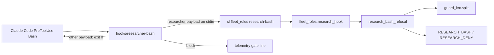
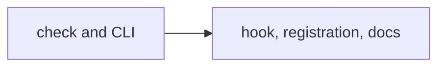

# Superlite B261: the in-process researcher's Bash is held to the read-only allowlist (#987)

**Goal:** a PreToolUse Bash hook refuses every Bash call of the in-process researcher (payload `agent_type` `superlite:researcher`) that `fleet_roles.RESEARCH_BASH` does not allow or `RESEARCH_DENY` forbids, since plugin agent frontmatter cannot set `permissionMode` or hooks (#809, B256 follow-up).
**Architecture:** a pure check in `fleet_roles.py` (`research_bash_refusal`, `research_hook`, a `research-bash` CLI) that lexes with `guard_lex.split`; a thin bash hook `hooks/researcher-bash` that exits at once for every other payload and otherwise runs `sl fleet_roles research-bash`; one appended `hooks/hooks.json` entry; docs.
**Tech stack:** Python 3.10+ stdlib, bash 3.2; pytest through `sl run_tests`.
**Spec:** this file, section Design.
**Detail:** tests
**Target-min:** 11
**Wave0:** none

Global constraints:
- Every line of a Python script under `skills/**/scripts/` keeps the repo's `# O(...)` complexity comment; stdlib only; LF endings. Files under `tests/` carry no such comments. Hook scripts use bash 3.2 syntax and LF endings.
- This repository is public: no host names, user names, home paths, other project or repository names in code, tests, docs or commit messages.
- The verdict is `sl run_tests` (never raw pytest); every new test sees a red run before the code it tests.
- Tests never quote `/bin/bash` (test_hooks_bash32 lint): run hooks with `shutil.which("bash")` (Git Bash on Windows), as tests/scripts/test_block_unsafe_kill_git_889.py does.
- An existing test that pins a changed text or output is updated in the same task only when it is in the task's Owns. Any other test your change turns red: leave it, and name the file and the failing assertion in your report (the coordinator rules it).
- Builds: the verdict is `sl run_tests` (the project's test command; a project with `.maxapp` runs `maxapp test`, which a build pool may place on another Mac, and a full run whose tree a green maxapp test stamp covers returns that result without a run); task trees build in <tree>/.build/DerivedData and any build of your own goes under .build/ of the worktree, never -derivedDataPath outside the worktree (your session scratchpad included; backlog cleanup removes scratchpad build folders when the worktree goes); a product, simulator or device build stays on this machine and runs only when an issue's acceptance asks for a running-app check; copy this sentence into every worker brief.
- Simulators: append the UDID of each simulator you or a worker creates (`xcrun simctl create` or `clone`; a checker's `Simulators:` line marks its created ones) as one line to the worktree's `.superlite/simulators.txt`; never list one you did not create; ship cleanup shuts down and deletes each listed one; copy this sentence into every worker brief.

## Design

Understood (#987): with the fleet off, the in-process researcher's Bash runs under the parent session's permission mode, and only `agents/researcher.md`'s text keeps it to the allowlist (B256 ruling). A PreToolUse hook sees every tool call of a subagent with `agent_type` in the payload (the SubagentStop records of this machine carry `"agent_type":"superlite:researcher"`), so a hook can hold that agent to `RESEARCH_BASH`.

1. **Check** (`fleet_roles.research_bash_refusal(command) -> str | None`): `guard_lex.split(command)` gives simple commands (separators `&&`, `||`, `;`, `|`, `&`, newline). For each segment in order, the first refusal wins, checks in this order: a subshell `( ... )` refuses (`runs a subshell`); any `bodies` (`$(...)`, backticks, `<(...)`, `>(...)`) refuses (`runs a substitution`); any `dyn` word (a variable, an unclosed quote) refuses (`expands a value`); a redirect with op `<<`, `<<-` or `<<<` refuses (`reads a heredoc or here-string`); any other redirect refuses (`redirects into a file`) unless it is op `>`, `>>`, `>|`, `&>` or `&>>` to `/dev/null`, op `>&` or `<&` to digits or `-`, or op `<` from a target without `$` or a backtick; a segment with no words and no redirects is skipped; a match of a `RESEARCH_DENY` pattern refuses (`writes a file (--output)`, `applies a patch (--apply)`); no `RESEARCH_BASH` match refuses (`not on the allowlist`). A refusal reads `<reason>: <segment text>`, the text being `(<subshell>)` if any, the words, then each redirect as `<op> <target>`, joined by spaces. A lexer exception returns `could not read the command (<ExceptionType>)`.
2. **Patterns.** A rule `Bash(<p>)` is the words of `<p>`. Matching is word-wise: token `*` matches zero or more words; any other token matches one word by `fnmatch.fnmatchcase`; a last token that ends in `*` also takes every word after it. So `git log *` allows bare `git log`, `git * --output*` refuses `git diff --output=x HEAD`, and `git apply * --apply*` refuses `git apply --apply x`.
3. **Hook payload** (`fleet_roles.research_hook(text) -> tuple[int, str]`): `(0, "")` unless the text is a JSON object with `agent_type == "superlite:researcher"`, `tool_name == "Bash"` and a string `tool_input.command`; then `(0, "")` when allowed, else `(2, message)`, the message being three lines:
   `Blocked: the researcher runs only read-only commands (hooks/researcher-bash, #987): <refusal>.`
   `Allowed, alone or joined by &&, ||, ;, & or |: <RESEARCH_BASH patterns without "Bash(" and " *)", joined by ", ">; never --output or git apply --apply; no $(...), backticks, <(...), variables, subshells, heredocs or redirects into a file (2>/dev/null, 2>&1 and < file are fine).`
   `A refused command is an answer: say what you could not check and never retry it another way.`
4. **CLI**: `python fleet_roles.py research-bash` reads the payload on stdin, prints the message to stderr and exits with the code; any other argv prints `usage: fleet_roles.py research-bash (hook payload on stdin)` to stderr, exit 2.
5. **Hook** `hooks/researcher-bash`: one bash regex on the raw payload (`"agent_type"` then `"superlite:researcher"`) or exit 0 before any process starts; else pipe the payload into `bash <scripts>/sl fleet_roles research-bash` (sl picks Python 3.10+). It blocks (stderr = the message, exit 2) only when sl exits 2 and its stderr starts `Blocked: the researcher `; every other result exits 0 with no output. A block appends one telemetry `gate` line (hook `researcher-bash`, rule `research-bash`, tool `Bash`, target the refusal).
6. **Registration**: appended as the last PreToolUse entry of `hooks/hooks.json`, matcher `Bash` (the researcher's `tools:` holds Bash, no Monitor or PowerShell); the first three entries keep their indices (pinned by three tests).

Ruling: the hook keys on `agent_type` alone, so a fleet research worker (started with `--agent superlite:researcher`) gets it too, a second guard beside its `dontAsk` allowlist (because both enforce the same list; cost if wrong: a refusal the fleet would have allowed, which the researcher reports as an answer).
Ruling: allowed redirects are `/dev/null`, fd duplication and `<` reads; heredocs, here-strings, variables and substitutions are refused (because the hook cannot judge text it cannot read; cost if wrong: a researcher reruns a simpler command).
Ruling: a lexer exception refuses the researcher's call; no Python 3.10+ or a failed helper start fails open (because every superlite hook fails open on its own errors and the agent text still binds the researcher; cost if wrong: an unchecked call on a machine without Python 3.10+).
Ruling: Claude Code only: Pi runs no hook scripts and Cursor has no subagent `agent_type`; `hooks/hooks-cursor.json` is unchanged (harness scope: Claude Code and Pi).
Ruling: `agents/researcher.md` is unchanged (its rule "with the fleet off, run no other command either" still holds; the hook now enforces it), so no evals layer is needed.
Ruling: MISSED TARGET accepted: T1 then T2 is inherently sequential, since T2's hook tests run T1's check through `sl`.

## Coverage

| Category | State | Basis |
|---|---|---|
| Scope and success criteria | settled | #987: hook in hooks/hooks.json holds agent_type superlite:researcher to RESEARCH_BASH |
| Domain and data model | n/a | no data model; a command string and a payload |
| Persistence and migration | n/a | no stored state beyond one telemetry line |
| Interfaces and contracts | ruled | Design 3-6: research_hook, the CLI, appended hooks.json entry; first three PreToolUse indices kept |
| UI states | n/a | no UI |
| Concurrency and state ownership | n/a | stateless per call |
| Error handling and recovery | ruled | lexer error refuses; helper or Python failure fails open (Ruling 3) |
| Security and privacy | ruled | untrusted command text: substitutions, variables, heredocs, file redirects refused (Ruling 2) |
| Performance and limits | ruled | non-researcher payloads: one bash regex, no process; researcher calls: one Python start |
| Observability | ruled | one telemetry `gate` line per block, rule `research-bash` |
| Testing strategy | ruled | unit cases of the check, hook subprocess cases, hooks.json pin; test_hooks_contract covers malformed inputs |
| Compatibility | ruled | Claude Code only (Ruling 4); bash 3.2; Windows Git Bash through sl |
| Rollout | ruled | patch release at ship; rollback = drop the hooks.json entry |
| Research unknowns | n/a | agent_type naming seen in this machine's stop records |

## Main diagram



## File structure

- `skills/subagent-driven-development/scripts/fleet_roles.py`: the check, the payload reader and the `research-bash` CLI.
- `tests/scripts/test_research_bash_check_987.py`: the check's allow and refuse tables, payload and CLI cases.
- `hooks/researcher-bash`: the PreToolUse hook (fast exit, sl call, block, gate line).
- `hooks/hooks.json`: the appended PreToolUse entry.
- `docs/hooks.md`, `docs/gates.md`: the hook's bullet and the gate row.
- `tests/scripts/test_researcher_bash_hook_987.py`: hook subprocess cases, registration and doc pins.

## Task graph

```mermaid
%% schedule
gantt
  title Predicted schedule (mm:ss)
  dateFormat X
  axisFormat %M:%S
  section lane 1
  T1 check and CLI :t1, 0, 473s
  T2 hook registration docs :t2, 473, 496s
```





critical path: T1 → T2 (16.2 min) · peak width 1 · predicted build 16.2 min · predicted total ≈ 30.7 min (target ✗ 11.0)

## Package: researcher Bash check

**App type:** library + hook (CLI). **Categories:** protocol (payload shapes, exit codes), encoding (quotes, escapes, substitutions), state (none). **Specific risks:** a write hidden in a compound, a substitution or a redirect; a deny flag after other words; a non-researcher call slowed or blocked.
**Probe entry:** call=fleet_roles.research_bash_refusal

### T1 check and CLI · Complexity 3 · Est. context 34k
**Owns:** skills/subagent-driven-development/scripts/fleet_roles.py, tests/scripts/test_research_bash_check_987.py
**Components:** 1
**LOC owned:** 170
**Tests:** fast
**Model:** sonnet
**Covers:** 1, 2, 3, 4
**Produces:** fleet_roles.research_bash_refusal(command: str) -> str | None · fleet_roles.research_hook(text: str) -> tuple[int, str] · fleet_roles.main(argv: list[str]) -> int
e.g. research_bash_refusal("git log -1 && git status") -> None
e.g. research_bash_refusal("git log -1 && rm -rf src") -> "not on the allowlist: rm -rf src"
e.g. research_hook('{"agent_type": "superlite:implementer", "tool_name": "Bash", "tool_input": {"command": "rm x"}}') -> (0, "")
**Review Focus:** protocol: `test_allowed`, `test_refused` (tables below), `test_hook_passes_every_other_payload`, `test_cli_reads_the_payload_from_stdin`; encoding: `git log --grep='a|b'` allowed, `git show "$(rm -rf x)"` refused
**Test code (verbatim):**
```python
"""#987: fleet_roles holds a researcher's Bash command to RESEARCH_BASH and RESEARCH_DENY."""
import json
import os
import shutil
import subprocess
import sys
from pathlib import Path

import pytest

ROOT = Path(__file__).resolve().parents[2]
SCRIPTS = ROOT / "skills" / "subagent-driven-development" / "scripts"
sys.path.insert(0, str(SCRIPTS))

import fleet_roles as fr  # noqa: E402

_GIT_BASH = r"C:\Program Files\Git\bin\bash.exe"
BASH = _GIT_BASH if os.name == "nt" and os.path.exists(_GIT_BASH) else shutil.which("bash")
HEAD = "Blocked: the researcher runs only read-only commands (hooks/researcher-bash, #987): "
LIST = ("Allowed, alone or joined by &&, ||, ;, & or |: git log, git show, git diff, git status, git blame, "
        "git ls-files, git rev-parse, git merge-base, git cat-file, git worktree list, git apply --check, ls, "
        "xcrun simctl list; never --output or git apply --apply; no $(...), backticks, <(...), variables, "
        "subshells, heredocs or redirects into a file (2>/dev/null, 2>&1 and < file are fine).")
TAIL = "A refused command is an answer: say what you could not check and never retry it another way."

ALLOWED = [
    "", "git log", "git log --oneline -5", "git status --short", "git show HEAD~1:docs/hooks.md",
    "git diff main...HEAD -- hooks/", "git log --grep='a|b' -3", "git log -5 2>/dev/null", "git log -5 2>&1",
    "git log -1 &>/dev/null", "git log -1 && git status", "git log -1; ls hooks", "git diff HEAD~1 | git apply --check",
    "git apply --check < x.patch", "ls", "ls -la hooks ~", "ls src/*.py", "xcrun simctl list devices",
    "git worktree list --porcelain", "git cat-file -p HEAD", "git log -1  # why", "git log \\\n -1",
]

REFUSED = [
    ("touch x", "not on the allowlist: touch x"),
    ("git log -1 && rm -rf src", "not on the allowlist: rm -rf src"),
    ("git log | head -5", "not on the allowlist: head -5"),
    ("git -C other log", "not on the allowlist: git -C other log"),
    ("git checkout main", "not on the allowlist: git checkout main"),
    ("FOO=1 git log", "not on the allowlist: FOO=1 git log"),
    ("cd src && ls", "not on the allowlist: cd src"),
    ("git worktree add x", "not on the allowlist: git worktree add x"),
    ("git apply x.patch", "not on the allowlist: git apply x.patch"),
    ("python3 -c 'print(1)'", "not on the allowlist: python3 -c print(1)"),
    ("git diff --output=x.patch", "writes a file (--output): git diff --output=x.patch"),
    ("git log --output x HEAD", "writes a file (--output): git log --output x HEAD"),
    ("git apply --check --apply x.patch", "applies a patch (--apply): git apply --check --apply x.patch"),
    ('git show "$(rm -rf x)"', "runs a substitution: git show $(rm -rf x)"),
    ("git log `id`", "runs a substitution: git log `id`"),
    ("git diff <(cat a)", "runs a substitution: git diff <(cat a)"),
    ("git log $X", "expands a value: git log $X"),
    ("(git log)", "runs a subshell: (git log)"),
    ("git log <<EOF\nx\nEOF", "reads a heredoc or here-string: git log << EOF"),
    ("git log <<< x", "reads a heredoc or here-string: git log <<< x"),
    ("git diff > x.patch", "redirects into a file: git diff > x.patch"),
    ("git log >> log.txt", "redirects into a file: git log >> log.txt"),
    ("git log >&x.txt", "redirects into a file: git log >& x.txt"),
    ("git log 2>err.txt", "redirects into a file: git log > err.txt"),
    ("ls <> f", "redirects into a file: ls <> f"),
]


def payload(command, agent="superlite:researcher", tool="Bash"):
    p = {"session_id": "s1", "tool_name": tool, "tool_input": {"command": command}}
    if agent is not None:
        p["agent_type"] = agent
    return json.dumps(p)


def sl(args, text):
    return subprocess.run([BASH, str(SCRIPTS / "sl"), *args], input=text, capture_output=True, text=True)


@pytest.mark.parametrize("command", ALLOWED)
def test_allowed(command):
    assert fr.research_bash_refusal(command) is None


@pytest.mark.parametrize("command,reason", REFUSED)
def test_refused(command, reason):
    assert fr.research_bash_refusal(command) == reason


def test_lexer_error_refuses(monkeypatch):
    import guard_lex

    def boom(text):
        raise RuntimeError("x")

    monkeypatch.setattr(guard_lex, "split", boom)
    assert fr.research_bash_refusal("git log") == "could not read the command (RuntimeError)"


def test_hook_passes_an_allowed_command():
    assert fr.research_hook(payload("git log -1")) == (0, "")


def test_hook_blocks_with_the_reason_and_the_list():
    code, msg = fr.research_hook(payload("touch x"))
    assert code == 2
    assert msg.splitlines() == [HEAD + "not on the allowlist: touch x.", LIST, TAIL]


@pytest.mark.parametrize("text", [
    payload("rm -rf x", agent="superlite:implementer"),
    payload("rm -rf x", agent=None),
    payload("rm -rf x", agent="researcher"),
    payload("rm -rf x", tool="Read"),
    json.dumps({"agent_type": "superlite:researcher", "tool_name": "Bash", "tool_input": {"command": 5}}),
    json.dumps({"agent_type": "superlite:researcher", "tool_name": "Bash", "tool_input": "rm -rf x"}),
    json.dumps(["superlite:researcher"]),
    '{"agent_type": "superlite:researcher", ',
    "",
])
def test_hook_passes_every_other_payload(text):
    assert fr.research_hook(text) == (0, "")


def test_cli_reads_the_payload_from_stdin():
    r = sl(["fleet_roles", "research-bash"], payload("git diff > x.patch"))
    assert (r.returncode, r.stdout) == (2, "")
    assert r.stderr.splitlines()[0] == HEAD + "redirects into a file: git diff > x.patch."
    ok = sl(["fleet_roles", "research-bash"], payload("git status"))
    assert (ok.returncode, ok.stdout, ok.stderr) == (0, "", "")


def test_cli_without_the_subcommand_is_usage():
    r = sl(["fleet_roles"], "")
    assert r.returncode == 2
    assert "usage: fleet_roles.py research-bash (hook payload on stdin)" in r.stderr
```
**Steps:** 1 write the test, 2 run: FAIL, 3 in fleet_roles.py add after `RESEARCH_TAIL`: `RESEARCH_AGENT = "superlite:researcher"` and `RESEARCH_DENY_WHY = {"Bash(git * --output*)": "writes a file (--output)", "Bash(git apply * --apply*)": "applies a patch (--apply)"}`; then the private helpers `_rule_words(rule) -> list[str]` and `_matches(tokens, words) -> bool` (Design 2), `_seg_text(seg) -> str` and `_redirect_ok(r) -> bool` (Design 1), then `research_bash_refusal`, `research_hook` and `main` (Design 1, 3, 4) and `if __name__ == "__main__": sys.exit(main(sys.argv[1:]))`; import `guard_lex` and `json` inside the functions that use them (an `import fleet_roles` stays as cheap as now) and `fnmatch` at the top; the allowed list in the message comes from `RESEARCH_BASH`; add the CLI to the module docstring's Library line; every new line keeps its `# O(...)` comment, 4 run: PASS
**Notes:** verify with `sl run_tests --fast tests/scripts/test_research_bash_check_987.py --task T1`, then once `sl run_tests --fast tests/scripts/test_fleet_roles.py tests/scripts/test_fleet_research_bash_809.py tests/regression/test_fleet_roles_final_b.py --task T1` and report any red test outside Owns by file and assertion. `guard_lex.split` drops a redirect's fd (`2>err.txt` is op `>` target `err.txt`) and keeps `$(...)` words as written with `bodies` set.

### T2 hook, registration, docs · Complexity 3 · Est. context 34k
**Owns:** hooks/researcher-bash, hooks/hooks.json, docs/hooks.md, docs/gates.md, tests/scripts/test_researcher_bash_hook_987.py
**Components:** 2
**LOC owned:** 140
**Tests:** fast
**Model:** sonnet
**Covers:** 5, 6
**Consumes:** fleet_roles.main(argv: list[str]) -> int (T1)
**Produces:** hooks/researcher-bash (PreToolUse Bash hook; exit 2 with the T1 message on stderr, else exit 0 silent)
**Review Focus:** protocol: `test_allowed_command_passes_silently`, `test_off_list_and_compound_commands_block`, `test_other_agents_pass`, `test_helper_failure_fails_open`; state: `test_block_appends_a_gate_line`
**Test code (verbatim):**
```python
"""#987: hooks/researcher-bash holds the in-process researcher's Bash calls to the read-only allowlist."""
import json
import os
import shutil
import subprocess
from pathlib import Path

import pytest

ROOT = Path(__file__).resolve().parents[2]
HOOK = ROOT / "hooks" / "researcher-bash"
_GIT_BASH = r"C:\Program Files\Git\bin\bash.exe"
BASH = _GIT_BASH if os.name == "nt" and os.path.exists(_GIT_BASH) else shutil.which("bash")
HEAD = "Blocked: the researcher runs only read-only commands (hooks/researcher-bash, #987): "


def run(home, command, agent="superlite:researcher", tool="Bash", env=None):
    p = {"session_id": "s1", "cwd": str(ROOT), "hook_event_name": "PreToolUse", "tool_name": tool,
         "tool_input": {"command": command}}
    if agent is not None:
        p["agent_type"] = agent
        p["agent_id"] = "a1"
    e = dict(os.environ)
    e["SUPERLITE_HOME"] = str(home)
    e.update(env or {})
    r = subprocess.run([BASH, str(HOOK)], input=json.dumps(p), capture_output=True, text=True, env=e, cwd=ROOT)
    return r.returncode, r.stdout, r.stderr


def test_allowed_command_passes_silently(tmp_path):
    assert run(tmp_path, "git log --oneline -5") == (0, "", "")


@pytest.mark.parametrize("command,reason", [
    ("touch probe.txt", "not on the allowlist: touch probe.txt"),
    ("git status && rm -rf src", "not on the allowlist: rm -rf src"),
    ("git diff --output=x.patch", "writes a file (--output): git diff --output=x.patch"),
])
def test_off_list_and_compound_commands_block(tmp_path, command, reason):
    code, out, err = run(tmp_path, command)
    assert (code, out) == (2, "")
    assert err.splitlines()[0] == HEAD + reason + "."
    assert err.splitlines()[2].startswith("A refused command is an answer")


@pytest.mark.parametrize("agent", ["superlite:implementer", "researcher", None])
def test_other_agents_pass(tmp_path, agent):
    assert run(tmp_path, "rm -rf src", agent=agent) == (0, "", "")


def test_researcher_read_tool_passes(tmp_path):
    assert run(tmp_path, "rm -rf src", tool="Read") == (0, "", "")


def test_block_appends_a_gate_line(tmp_path):
    run(tmp_path, "touch probe.txt")
    lines = [json.loads(x) for x in (tmp_path / "events.jsonl").read_text().splitlines()]
    gates = [x for x in lines if x["kind"] == "gate"]
    assert [(g["hook"], g["decision"], g["rule"], g["tool"]) for g in gates] == [
        ("researcher-bash", "block", "research-bash", "Bash")]


@pytest.mark.skipif(os.name == "nt", reason="the fake interpreter is a sh script")
@pytest.mark.parametrize("body", ["echo oops >&2; exit 2", "echo 'Blocked: x' >&2; exit 2", "exit 3", "exit 1"])
def test_helper_failure_fails_open(tmp_path, body):
    fake = tmp_path / "fakepy"
    fake.write_text("#!/bin/sh\n" + body + "\n", encoding="utf-8")
    fake.chmod(0o755)
    assert run(tmp_path, "touch probe.txt", env={"SUPERLITE_PYTHON": str(fake)}) == (0, "", "")


def test_hooks_json_appends_the_entry():
    pre = json.loads((ROOT / "hooks" / "hooks.json").read_text(encoding="utf-8"))["hooks"]["PreToolUse"]
    assert pre[-1] == {"matcher": "Bash", "hooks": [{"type": "command", "shell": "bash",
                       "command": 'bash "${CLAUDE_PLUGIN_ROOT}/hooks/researcher-bash"'}]}
    assert [e["matcher"] for e in pre[:3]] == ["Bash|PowerShell|Monitor",
                                              "Edit|Write|NotebookEdit|Bash|PowerShell|Monitor|Agent", "Bash|Monitor"]
    assert len(pre) == 6


def test_docs_name_the_hook():
    hooks = (ROOT / "docs" / "hooks.md").read_text(encoding="utf-8")
    assert "- `researcher-bash`: " in hooks and "`fleet_roles.RESEARCH_BASH`" in hooks
    assert "`block-unsafe-kill`, `researcher-bash`, `rewrite-test-runs`" in hooks
    assert "`researcher-bash` hook |" in (ROOT / "docs" / "gates.md").read_text(encoding="utf-8")
```
**Steps:** 1 write the test, 2 run: FAIL, 3 write `hooks/researcher-bash` (LF, mode 755, bash 3.2) exactly as Notes give it, 4 append to `hooks/hooks.json`'s `PreToolUse` list, after the `inline-worktree-guard` entry, `{"matcher": "Bash", "hooks": [{"type": "command", "command": "bash \"${CLAUDE_PLUGIN_ROOT}/hooks/researcher-bash\"", "shell": "bash"}]}` in the file's 2-space layout, 5 docs/hooks.md: after the bullet starting "- `block-unsafe-kill` also blocks a fleet worker's" add the bullet: "- `researcher-bash`: holds the in-process researcher (Bash calls whose payload `agent_type` is `superlite:researcher`; a fleet research worker started with `--agent superlite:researcher` too, beside its `dontAsk` allowlist) to `fleet_roles.RESEARCH_BASH`: each simple command of the call (split at `&&`, `||`, `;`, `|`, `&` and newlines by `guard_lex.split`) must match an allow pattern and no `RESEARCH_DENY` pattern (`--output`, `git apply --apply`); `$(...)`, backticks, `<(...)`, variables, subshells, heredocs, here-strings and redirects other than to `/dev/null`, fd duplication (`2>&1`) and `<` reads are refused. A block exits 2 with the reason, the allowed list and \"A refused command is an answer\", and appends a `gate` line (rule `research-bash`); every other payload exits 0 before any process starts, and a failed helper or no Python 3.10+ fails open. Plugin agent frontmatter cannot set `permissionMode` or hooks, so this hook is the binding (#809, #987)."; in the bullet starting "- `session-end`:" change "`block-unsafe-kill`, `rewrite-test-runs`" to "`block-unsafe-kill`, `researcher-bash`, `rewrite-test-runs`", 6 docs/gates.md: after the "No unsafe kills" row add `| **The researcher stays read-only** | The in-process researcher's Bash runs only the read-only allowlist (git log, show, diff and the like, ls, xcrun simctl list); anything else is refused | \`researcher-bash\` hook |`, 7 run: PASS
**Notes:** verify with `sl run_tests --fast tests/scripts/test_researcher_bash_hook_987.py tests/scripts/test_hooks_contract.py tests/scripts/test_hooks_bash32.py tests/scripts/test_mark_inline_flow.py --task T2`, then once `sl run_tests --fast $(grep -rlE "hooks\.json|hooks\.md|gates\.md" tests/scripts --include="*.py") --task T2` and report any red test outside Owns by file and assertion. The hook, verbatim:
```bash
#!/usr/bin/env bash
# PreToolUse hook (Bash): holds the in-process researcher (payload agent_type superlite:researcher; a fleet
# research worker started with --agent superlite:researcher too) to the read-only allowlist
# fleet_roles.RESEARCH_BASH and RESEARCH_DENY (#987). Plugin agent frontmatter cannot set permissionMode or
# hooks (#809), so this hook is the binding.
#
# Every other payload exits 0 before any process starts (one bash regex). A researcher's call is judged by
# `sl fleet_roles research-bash` (Python 3.10+, guard_lex.split). Exit 2 blocks (message on stderr) only when
# the judge exits 2 with its `Blocked: the researcher` message; anything else, including malformed input,
# a failed helper and no Python 3.10+, exits 0 with no output (fail open). Bash 3.2 syntax.

IFS= read -r -d '' input   # builtin; returns 1 at EOF, which is fine
re_agent='"agent_type"[[:space:]]*:[[:space:]]*"superlite:researcher"'
[[ $input =~ $re_agent ]] || exit 0

sl="${BASH_SOURCE[0]%/*}/../skills/subagent-driven-development/scripts/sl"
msg="$( { printf '%s' "$input" | bash "$sl" fleet_roles research-bash >/dev/null; } 2>&1 )"
rc=$?
[ "$rc" = 2 ] || exit 0
case "$msg" in "Blocked: the researcher "*) ;; *) exit 0 ;; esac

line1="${msg%%$'\n'*}"
reason="${line1#*'#987): '}"; reason="${reason%.}"
if . "${BASH_SOURCE[0]%/*}/telemetry.sh" 2>/dev/null; then
  re_s='"session_id"[[:space:]]*:[[:space:]]*"([A-Za-z0-9_-]{1,128})"'
  re_c='"cwd"[[:space:]]*:[[:space:]]*"([^"\\]*)"'
  SL_TEL_SESSION=""; SL_TEL_CWD=""
  [[ $input =~ $re_s ]] && SL_TEL_SESSION="${BASH_REMATCH[1]}"
  [[ $input =~ $re_c ]] && SL_TEL_CWD="${BASH_REMATCH[1]}"
  sl_tel_gate "researcher-bash" block research-bash Bash "$reason" 2>/dev/null
fi
printf '%s\n' "$msg" >&2
exit 2
```

## Review Focus

- Package researcher Bash check: library + hook; protocol, encoding. Risks: a write inside a compound, a substitution, a heredoc or a file redirect passing; a `--output` or `--apply` after other words passing; a non-researcher payload starting Python or blocking; a helper failure blocking instead of failing open; the hooks.json indices 0-2 moving. Cases are named in T1 and T2.

## Self-review

Coverage: Design 1-4 in T1, 5-6 in T2. No placeholders. T2 consumes T1's CLI (its hook tests run T1's code: the one edge). Owns are disjoint. Out of scope: agents/researcher.md, docs/fleet.md (B259's), hooks-cursor.json.
