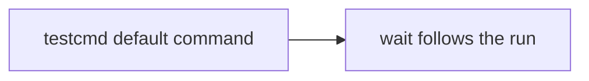

# Superlite: `sl testcmd` shows the default pytest command; `run_tests --wait` follows the run

**Goal:** `sl testcmd` prints the command `run_tests` really runs for a Python project without a configured `test` (#806), and `run_tests --wait` without `--timeout` waits as long as the run is predicted to need, within what one harness call allows, and says why when it stops first (#823).
**Architecture:** two changes on existing seams. `testcmd.py` gains `python_command`, the one builder of the default pytest argv; `run_tests.py` builds its default pytest run through it and `testcmd.main` prints it. `run_tests.py` writes a `
.meta` beside each background run (start, mode, limit, predicted length from `predict_live.project_tests`) and computes the default `--wait` length from it and the harness call cap.
**Tech stack:** Python 3.10+ stdlib; pytest through `sl run_tests`.
**Spec:** this file, section Design.
**Detail:** contracts
**Target-min:** 11
**Wave0:** none
**Coverage:** off

Global constraints:
- Every line of a Python script under `skills/**/scripts/` keeps the repo's `# O(...)` complexity comment; stdlib only; LF endings. Files under `tests/` carry no such comments.
- This repository is public: no host names, user names, home paths, other project or repository names in code, tests, docs or commit messages.
- The verdict is `sl run_tests` (never raw pytest); every new test sees a red run before the code it tests.
- An existing test that pins a changed text or output is updated in the same task only when it is in the task's Owns. Any other test your change turns red: leave it, and name the file and the failing assertion in your report (the coordinator rules it).
- Exit codes: 0 done, 2 usage error or refusal.
- Builds: the verdict is `sl run_tests` (the project's test command; a project with `.maxapp` runs `maxapp test`, which a build pool may place on another Mac, and a full run whose tree a green maxapp test stamp covers returns that result without a run); task trees build in <tree>/.build/DerivedData and any build of your own goes under .build/ of the worktree, never -derivedDataPath outside the worktree (your session scratchpad included; backlog cleanup removes scratchpad build folders when the worktree goes); a product, simulator or device build stays on this machine and runs only when an issue's acceptance asks for a running-app check; copy this sentence into every worker brief.
- Simulators: append the UDID of each simulator you or a worker creates (`xcrun simctl create` or `clone`; a checker's `Simulators:` line marks its created ones) as one line to the worktree's `.superlite/simulators.txt`; never list one you did not create; ship cleanup shuts down and deletes each listed one; copy this sentence into every worker brief.

## Design

### 1. `sl testcmd` prints the default pytest command (#806)

- `testcmd.resolve` is unchanged: a Python spec without `test` keeps `"command": None` (run_tests, plan_tools and wave0 read it that way).
- New `testcmd.python_command(root, paths, marker=None, junit="{junit}")`: the default pytest argv, the one place it is built: `pyrun.pytest_cmd()` (this interpreter's pytest, else `uv run --no-project --with pytest python -m pytest`, else `pyrun.PytestUnavailable`), then `paths` or `python_full_args(root)`, then `-m <marker>` when given, then `-q -rP -p no:cacheprovider -o junit_family=xunit1 --junitxml=<junit>`.
- `run_tests`' default pytest run builds its argv through it (temp junit path, pass-through args appended after), so `sl testcmd` and the run cannot drift.
- `sl testcmd [--fast PATHS]` printing a spec with `python: true` and `command: null` fills `command` with `shlex.join(python_command(root, paths))` and adds `"default_command": true`. With neither pytest nor uv, `command` stays null, stderr says `testcmd: <the PytestUnavailable text>`, exit 0. Per-run additions (an honoured `-m` marker, pass-through args, the temp junit path) are not shown; `{junit}` stands for the junit path as in a test-cmd.json.
- docs/language.md, "User-level default": the sentence on `sl testcmd` names the filled default command.

### 2. `run_tests --wait` follows the run (#823)

- Call cap: one harness call allows `BASH_MAX_TIMEOUT_MS / 1000` seconds when that environment value parses as a number above 0 (Claude Code's setting for its longest Bash call), else 600. The wait's cap is that less 60 s (B57's margin), or half of it when it is under 120 s. Default: 540 s, as today.
- `--background` writes `
.meta` (JSON) beside the summary, next to `.pid`: `started` (epoch seconds, the pointer's value), `mode` (`fast`/`full`, as the pointer), `limit` (the run's `--limit`, 0 = none), `predicted` (seconds or null) and `predicted_from` (text or null). The prediction is the plan forecast's test minutes for that mode (`predict_live.project_tests`: `run_min` in the test-cmd.json in effect, else the median of at least 3 ledger runs); any error leaves it null.
- Default wait length (no `--timeout`): expected = the smaller of `predicted` and `limit` when both are set, else whichever is set; remaining = expected - (now - started); wait = remaining + 60, at least `min(540, cap)`, at most `cap`. No meta, or neither value set: the cap. `--timeout S` still wins.
- The timeout line keeps B57's shape and adds parts inside the parentheses, joined by `; `: `pid N still running` (as today), then with a prediction `about R s left of a predicted P s run` (or `X s past its predicted P s` once the run is past it), then, when the default wait was cut by the cap, `one call waits at most C s; BASH_MAX_TIMEOUT_MS raises it`. No part: no parentheses (as today).
- The run_tests.py module docstring and docs/testing.md (no open batch lists it) describe the default; docs/tools.md (another batch's) is a follow-up.

### 3. Rulings

- Ruling: the 60 s margin under the call cap stays (B57); under Claude Code's default 600 s Bash cap the default wait stays 540 s and a longer run still needs a second wait call, now named by the timeout line - a tighter margin risks the harness killing the call with no rerun hint.
- Ruling: the prediction only lengthens a wait (floor 540 s), never shortens it - a short prediction that is wrong would cost extra wait calls.
- Ruling: the background start's `WAIT_CUE` text is unchanged - docs/tools.md quotes it and belongs to another open batch.
- Ruling: sequential [T1->T2] - both tasks edit run_tests.py.

## Task graph

```mermaid
%% schedule
gantt
  title Predicted schedule (mm:ss)
  dateFormat X
  axisFormat %M:%S
  section lane 1
  T1 testcmd default command :t1, 0, 309s
  T2 wait follows the run :t2, 309, 340s
```

critical path: T1 → T2 (10.8 min) · peak width 1 · predicted build 10.8 min · predicted total ≈ 21.3 min (target ✗ 11.0)

## Package: test command and wait

App type: CLI. Categories: protocol (printed JSON, stderr lines, exit codes), numeric (wait arithmetic), state (meta file).
**Probe entry:** none (a CLI over a project folder; the named tests cover each case)

### T1 testcmd default command · Complexity 3 · Est. context 40k
**Owns:** skills/subagent-driven-development/scripts/testcmd.py, docs/language.md, tests/scripts/test_testcmd_default_command_806.py
**Also-touches:** skills/subagent-driven-development/scripts/run_tests.py
**Components:** 2
**LOC owned:** 90
**Tests:** fast
**Model:** sonnet
**Kind:** design
**Covers:** 1
**Produces:** testcmd.python_command(root: Path, paths: list, marker: str | None = None, junit: str = "{junit}") -> list
  e.g. pytest importable, root holding a `tests/` folder and no testpaths config: python_command(root, []) -> [sys.executable, "-m", "pytest", "tests", "-q", "-rP", "-p", "no:cacheprovider", "-o", "junit_family=xunit1", "--junitxml={junit}"]
  e.g. python_command(root, ["tests/test_a.py"], marker="slow", junit="/x/j.xml") -> [sys.executable, "-m", "pytest", "tests/test_a.py", "-m", "slow", "-q", "-rP", "-p", "no:cacheprovider", "-o", "junit_family=xunit1", "--junitxml=/x/j.xml"]
  e.g. no pytest importable, uv at /x/uv: python_command(root, []) starts ["/x/uv", "run", "--no-project", "--with", "pytest", "python", "-m", "pytest", "tests"]; neither: raises pyrun.PytestUnavailable
**Review Focus:** protocol: `test_python_command_default_full` (first e.g.); protocol: `test_python_command_paths_marker_junit` (second e.g.); protocol: `test_python_command_uv_fallback` (`pyrun.have_pytest` patched False, `shutil.which` patched to `/x/uv`: third e.g.); protocol: `test_cli_prints_default_command` (`testcmd.main(["--root", R])` on a detected Python root with `tests/test_x.py` and a `pyproject.toml`: stdout JSON `command == shlex.join(python_command(R, []))`, `default_command` is True, `origin == "detection"`, exit 0); protocol: `test_cli_fast_paths_in_default_command` (`--fast tests/test_x.py`: `command` holds `tests/test_x.py` and not ` tests -q`); protocol: `test_cli_no_runner_keeps_null` (both runners patched away: `command` is None, no `default_command` key, stderr starts `testcmd: pytest is not installed`, exit 0); protocol: `test_cli_configured_command_unchanged` (a `.superlite/test-cmd.json` with `"test": "make check"`: `command == "make check"`, no `default_command` key); protocol: `test_resolve_keeps_null_command` (`testcmd.resolve(R)["command"] is None` on the detected root)
**Steps:** 1 failing tests, 2 run: FAIL, 3 implement, 4 run: PASS
**Notes:** testcmd.py imports `_pyrun as pyrun` the way run_tests.py does. In run_tests.py (Also-touches) the default pytest branch (`base = pyrun.pytest_cmd()` ... `cmd = [*base, ...]`) becomes `cmd = [*testcmd.python_command(Path("."), paths, marker, str(xml_path)), *(passthrough)]`, with the `pyrun.PytestUnavailable` catch around that call kept as the usage error it is today; no other run_tests.py change. Verify with `sl run_tests --fast tests/scripts/test_testcmd_default_command_806.py tests/scripts/test_testcmd.py tests/scripts/test_run_tests_summary.py --task T1`. docs/language.md: extend the "User-level default" sentence `sl testcmd prints the command in effect with its origin (the file, or detection)` with the filled default command and `"default_command": true`, the uv fallback and the null case, in the file's style.

### T2 wait follows the run · Complexity 5 · Est. context 52k
**Owns:** skills/subagent-driven-development/scripts/run_tests.py, docs/testing.md, tests/scripts/test_run_tests_wait_timeout_823.py
**Components:** 3
**LOC owned:** 170
**Tests:** fast
**Model:** sonnet
**Kind:** design
**Covers:** 2
**Produces:** run_tests.call_cap(env: dict | None = None) -> float · run_tests.predicted_length(root: Path, mode: str) -> tuple · run_tests.write_run_meta(mine: Path, started: float, mode: str, limit: float, root: Path) -> None · run_tests.run_meta(mine: Path) -> dict | None · run_tests.wait_seconds(meta: dict | None, now: float, cap: float) -> tuple
  e.g. call_cap({}) -> 540.0; call_cap({"BASH_MAX_TIMEOUT_MS": "1800000"}) -> 1740.0; call_cap({"BASH_MAX_TIMEOUT_MS": "90000"}) -> 45.0; "abc", "0" or "-5" -> 540.0
  e.g. predicted_length(R, "full") with `.superlite/test-cmd.json` `{"language": "python", "run_min": {"fast": 1, "full": 4}}` -> (240.0, "run_min in test-cmd.json"); (60.0, ...) for "fast"; no run_min and under 3 ledger runs -> (None, None); project_tests raising -> (None, None)
  e.g. wait_seconds(None, 1000.0, 540.0) -> (540.0, False); wait_seconds({"started": 1000.0, "predicted": 578.0, "limit": 3600.0}, 1000.0, 1740.0) -> (638.0, False); same meta, cap 540.0 -> (540.0, True); {"started": 1000.0, "predicted": None, "limit": 3600.0}, now 1100.0, cap 7200.0 -> (3560.0, False); {"started": 1000.0, "predicted": 60.0, "limit": 3600.0}, now 1000.0, cap 1740.0 -> (540.0, False); {"started": 1000.0, "predicted": None, "limit": 0}, cap 1740.0 -> (1740.0, False); predicted 578.0, cap 45.0 -> (45.0, True)
**Review Focus:** numeric: `test_call_cap_values` (the call_cap e.g.); numeric: `test_wait_seconds_examples` (every wait_seconds e.g.); state: `test_predicted_length_from_run_min` and `test_predicted_length_none_on_error` (predict_live.project_tests patched to raise); state: `test_write_and_read_run_meta` (write_run_meta then run_meta returns `started`, `mode`, `limit`, `predicted`, `predicted_from`; a missing or non-JSON `.meta` -> None); state: `test_background_writes_meta` (`run_tests --fast <a passing test> --background --summary <tmp>/s.json` in a tmp project: the printed summary's `.meta` holds `mode` "fast", `limit` 3600 and a float `started`); protocol: `test_timeout_line_names_prediction_and_cap` (no summary yet, meta `started` now-100, `predicted` 578, `limit` 3600, call_cap patched to 0.6, `--wait <path>` without `--timeout`: exit 2, stderr line matches `^tests: no result yet after 0.6 s \(about 4\d\d s left of a predicted 578 s run; one call waits at most 0.6 s; BASH_MAX_TIMEOUT_MS raises it\); run again: `); protocol: `test_timeout_line_past_prediction` (`started` now-700, `--timeout 0.5`: `\(\d+ s past its predicted 578 s\)`, no cap part); protocol: `test_timeout_line_unchanged_without_meta` (no meta, `--timeout 0.5`: the line is exactly `tests: no result yet after 0.5 s; run again: <rest of the wait line>`)
**Steps:** 1 failing tests, 2 run: FAIL, 3 implement, 4 run: PASS
**Notes:** `start_background` calls `write_run_meta(mine, ptr["started"], ptr["mode"], a.limit, Path("."))` after the pointer write; a failure to write it is ignored like the `.pid` write. `predicted_length` imports `predict_live` inside the function (predict_live imports run_tests) and labels the source `run_min in <label>` (`test-cmd.json` or `user test-cmd.json`, predict_live's SOURCES) or `median of N ledger runs` (source `history`). In `wait_background` the default becomes `wait_seconds(run_meta(mine), time.time(), call_cap(os.environ))`; `--timeout` keeps winning (capped False). The timeout line's parts follow Design 2 (rounded whole seconds; the cap part only when capped is True and `--timeout` was not given). Update the module docstring's `--wait` lines and the `--timeout` help text (`default: the run's predicted remaining time + 60 s, at least 540 s, at most one harness call less 60 s`); add one sentence after the `--limit` sentence in docs/testing.md saying the same and naming `BASH_MAX_TIMEOUT_MS`. Verify with `sl run_tests --fast tests/scripts/test_run_tests_wait_timeout_823.py tests/scripts/test_run_tests_wait_line.py tests/scripts/test_0_3_1_scripts.py --task T2`.

## Review Focus

- test command and wait (CLI): protocol, numeric, state. Risks: `resolve` callers that read `command: None` as "default pytest" now seeing a string (only `main` may fill it); the default pytest argv changing order or flags in run_tests; a default wait above the harness call cap; a wait shorter than 540 s under the default cap; the timeout line changing for runs without a meta file; a broken prediction breaking `--background`.

## Coordinator steps after the last task

1. Unit layer: `sl run_tests --full` (the change touches `skills/**/scripts/**` and `tests/scripts/**`; no other layer is required).
2. Final review, then ship: notes.md, pr-body.md, `sl backlog ship B238 lock`, `bump`, `merge`.

## Self-review

- Coverage: Design 1 is T1, Design 2 is T2.
- Graph: T1 -> T2 is a hard file-order edge (run_tests.py); no two tasks run at once on one file.
- Names: `testcmd.python_command`, `run_tests.call_cap`, `predicted_length`, `write_run_meta`, `run_meta` and `wait_seconds` are written the same in every line.
