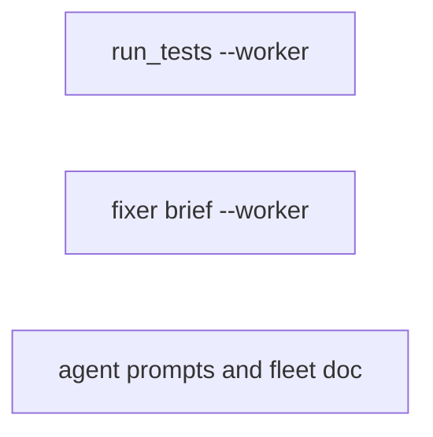

# Superlite: `run_tests --worker NAME` for fleet-off reviewers and fixers

**Goal:** a fleet-off (in-process Agent) package reviewer or fixer on a compiled (`isolate: true`) stack builds and tests in its own tree `.superlite/trees/worker-NAME`, not the shared run root, because its brief and agent prompt pass `run_tests --fast ... --worker NAME` (#826; decision recorded in B237's summary: "Brief gets run_tests --worker NAME").
**Architecture:** one new flag on the existing #479 worker-tree path. `run_tests.worker_tree_name(env, worker)` returns the fleet worker's `worker-<Wn>` from the environment as today and, when there is none, `worker-<NAME>` from `--worker`. Fixer briefs (`findings.shared_lines`) and the reviewer and fixer agent prompts carry the flag; docs/fleet.md gains one bullet.
**Tech stack:** Python 3.10+ stdlib; pytest through `sl run_tests`.
**Spec:** this file, section Design.
**Detail:** tests
**Target-min:** 11
**Wave0:** none
**Coverage:** off

Global constraints:
- Every line of a Python script under `skills/**/scripts/` keeps the repo's `# O(...)` complexity comment; stdlib only; LF endings. Files under `tests/` carry no such comments.
- This repository is public: no host names, user names, home paths, other project or repository names in code, tests, docs or commit messages.
- The verdict is `sl run_tests` (never raw pytest); every new test sees a red run before the code it tests.
- An existing test that pins a changed text or output is updated in the same task only when it is in the task's Owns. Any other test your change turns red: leave it, and name the file and the failing assertion in your report (the coordinator rules it).
- docs/fleet.md is append-only for this batch: add lines, never reorder, rewrite or delete an existing line.
- Exit codes: 0 done, 2 usage error or refusal.
- Builds: the verdict is `sl run_tests` (the project's test command; a project with `.maxapp` runs `maxapp test`, which a build pool may place on another Mac, and a full run whose tree a green maxapp test stamp covers returns that result without a run); task trees build in <tree>/.build/DerivedData and any build of your own goes under .build/ of the worktree, never -derivedDataPath outside the worktree (your session scratchpad included; backlog cleanup removes scratchpad build folders when the worktree goes); a product, simulator or device build stays on this machine and runs only when an issue's acceptance asks for a running-app check; copy this sentence into every worker brief.
- Simulators: append the UDID of each simulator you or a worker creates (`xcrun simctl create` or `clone`; a checker's `Simulators:` line marks its created ones) as one line to the worktree's `.superlite/simulators.txt`; never list one you did not create; ship cleanup shuts down and deletes each listed one; copy this sentence into every worker brief.

## Design

- `run_tests --worker NAME`: NAME is 1 to 64 characters of `[A-Za-z0-9_-]`; anything else is a usage error before any runner or tree (exit 2, stderr and red summary `--worker NAME: 1 to 64 letters, digits, - or _ (got '<value>')`), checked in `run()` next to `--also needs --task Tn`.
- Precedence: a non-lead fleet worker's environment id wins (`worker-<Wn>`, unchanged), so a brief that always carries `--worker` stays right under the fleet (busy_held keeps excluding the worker's own fleet brief). With no such id (no fleet env, or a lead's env, which an in-process Agent inherits from its lead pane) `--worker NAME` gives `worker-NAME`.
- Scope as #479: only a `--fast` run without `--task` on an `isolate: true` stack uses the tree; `--task` keeps the task's tree, `--full` stays in the run root, a non-isolated stack ignores the flag. free_disk's keep set holds the effective name.
- Fixer briefs: `findings.shared_lines(..., worker=NAME)` puts `--worker NAME` before `--background` in the plain Verify line (not in the `--task ... cmd=` line, where the task tree wins). `brief_text` and `coordinator_text` pass `worker_name(items[0]["id"])` = `fix-<first finding id>`, the brief file's own stem, characters outside the NAME alphabet turned into `-`, cut to 64.
- Agent prompts (agents/package-reviewer.md, agents/fixer-sonnet.md, agents/fixer-sonnet-high.md, agents/fixer-opus.md): one line each saying every `run_tests --fast` call without `--task` carries `--worker NAME` (the brief's name; none given: `rev-<package or task id>` for a reviewer, `fix-<first finding id>` for a fixer).
- docs/fleet.md: one new bullet after the worker-tree bullet; the run_tests.py module docstring gets one line.
- Ruling: the environment's fleet worker id wins over `--worker` (because a fleet worker's own brief is found by its fleet id; a brief-given name would hold the worker's own files at base).
- Ruling: a fleet-off worker tree holds back only unfinished plan tasks' files, not an in-process sibling's (because no registry lists running Agent workers or their briefs); docs/fleet.md says so.
- Ruling: fleet-off `worker-NAME` trees are not reaped mid-run (reap drops only stopped fleet workers' trees); `sl finish`, orchestrator end and `trees clean` drop them as idle trees (because a mid-run drop would cost each fixer a cold build).
- Ruling: the old docs/fleet.md sentence "fleet-off (Agent) workers test in the run root ... one fixer at a time" stays (append-only file); the new bullet narrows it to fleet-off runs without `--worker`.
- Ruling: MISSED TARGET accepted (because the three tasks have no edges, the critical path is the single task T1, and the forecast's contention x4 sets its length).

## Task graph

```mermaid
%% schedule
gantt
  title Predicted schedule (mm:ss)
  dateFormat X
  axisFormat %M:%S
  section lane 1
  T1 run_tests --worker NAME :t1, 0, 737s
  section lane 2
  T2 fixer brief names --worker :t2, 0, 729s
  section lane 3
  T3 agent prompts and fleet doc name --wo :t3, 0, 726s
```





critical path: T1 (12.3 min) · peak width 3 · predicted build 12.3 min · predicted total ≈ 32.8 min (target ✗ 11.0)

## run_tests

### T1 run_tests --worker NAME · Complexity 3 (O-1) · Est. context 40k
**Owns:** skills/subagent-driven-development/scripts/run_tests.py, tests/scripts/test_run_tests_worker_flag_826.py
**Components:** 1
**LOC owned:** 95
**Tests:** fast
**Model:** sonnet
**Kind:** design
**Produces:** run_tests.worker_tree_name(env=None, worker=None) -> str | None
e.g. worker_tree_name({}, "fix-F-T1-1") -> "worker-fix-F-T1-1"
e.g. worker_tree_name({"SUPERLITE_FLEET_WORKER": "W3", "SUPERLITE_FLEET_AGENT": "fixer-sonnet"}, "fix-F-T1-1") -> "worker-W3"
e.g. worker_tree_name({}, None) -> None
**Review Focus:** `test_fleet_worker_env_wins_over_flag`: env W3 plus `--worker fix-F-T1-1` tests in worker-W3; `test_bad_worker_name_is_a_usage_error`: `../x`, `a b`, 65 x, empty give exit 2
**Test code (verbatim):**
```python
"""#826: run_tests --worker NAME gives a fleet-off (in-process Agent) reviewer or fixer its own tree."""
from __future__ import annotations

import sys
from pathlib import Path

sys.path.insert(0, str(Path(__file__).resolve().parent))

import run_tests as rt  # noqa: E402
from test_isolated_review_builds_479 import cwd, go, repo  # noqa: E402

TREES = ".superlite/trees"


def test_worker_tree_name_flag_and_env():
    fleet = {"SUPERLITE_FLEET_WORKER": "W3", "SUPERLITE_FLEET_AGENT": "fixer-sonnet"}
    lead = {"SUPERLITE_FLEET_WORKER": "W9", "SUPERLITE_FLEET_ROLE": "lead", "SUPERLITE_FLEET_AGENT": "lead"}
    assert rt.worker_tree_name({}, "fix-F-T1-1") == "worker-fix-F-T1-1"
    assert rt.worker_tree_name(fleet, "fix-F-T1-1") == "worker-W3"
    assert rt.worker_tree_name(lead, "rev-T2") == "worker-rev-T2"
    assert rt.worker_tree_name({}, None) is None
    assert rt.worker_tree_name(lead) is None
    assert rt.worker_tree_name({}, "../x") is None


def test_fleet_off_fast_run_with_worker_uses_its_own_tree(tmp_path):
    plan = repo(tmp_path)
    cp = go(tmp_path, plan, "--fast", "src/b.py", "--worker", "fix-F-T1-1")
    assert cp.returncode == 0, cp.err
    assert f"run_tests: tree {TREES}/worker-fix-F-T1-1 = base + all working-tree changes (--fast)" in cp.err
    assert cwd(tmp_path) == (tmp_path / TREES / "worker-fix-F-T1-1").resolve()


def test_two_fleet_off_workers_get_separate_trees(tmp_path):
    plan = repo(tmp_path)
    go(tmp_path, plan, "--fast", "src/b.py", "--worker", "rev-P1")
    first = cwd(tmp_path)
    go(tmp_path, plan, "--fast", "src/b.py", "--worker", "fix-F-T2-1")
    assert cwd(tmp_path) != first
    assert (tmp_path / TREES / "worker-rev-P1/.git").exists()
    assert (tmp_path / TREES / "worker-fix-F-T2-1/.git").exists()


def test_fleet_worker_env_wins_over_flag(tmp_path):
    plan = repo(tmp_path)
    cp = go(tmp_path, plan, "--fast", "src/b.py", "--worker", "fix-F-T1-1", WORKER="W3", AGENT="fixer-sonnet")
    assert cp.returncode == 0, cp.err
    assert cwd(tmp_path) == (tmp_path / TREES / "worker-W3").resolve()
    assert not (tmp_path / TREES / "worker-fix-F-T1-1").exists()


def test_lead_env_honours_flag(tmp_path):
    plan = repo(tmp_path)
    cp = go(tmp_path, plan, "--fast", "src/b.py", "--worker", "rev-T2", WORKER="W9", ROLE="lead", AGENT="lead")
    assert cp.returncode == 0, cp.err
    assert cwd(tmp_path) == (tmp_path / TREES / "worker-rev-T2").resolve()


def test_task_and_full_runs_ignore_flag(tmp_path):
    plan = repo(tmp_path)
    cp = go(tmp_path, plan, "--fast", "src/b.py", "--task", "T2", "--worker", "fix-F-T2-1")
    assert f"{TREES}/T2" in cp.err
    assert not (tmp_path / TREES / "worker-fix-F-T2-1").exists()
    go(tmp_path, plan, "--full", "--worker", "fix-F-T2-1")
    assert cwd(tmp_path) == tmp_path.resolve()
    assert not (tmp_path / TREES / "worker-fix-F-T2-1").exists()


def test_bad_worker_name_is_a_usage_error(tmp_path):
    plan = repo(tmp_path)
    for bad in ("../x", "a b", "x" * 65, ""):
        cp = go(tmp_path, plan, "--fast", "src/b.py", "--worker", bad)
        assert cp.returncode == 2, (bad, cp.err)
        assert "--worker NAME: 1 to 64 letters, digits, - or _" in cp.err
    assert not list((tmp_path / TREES).glob("worker-*"))
```
**Steps:** 1 write the test file, 2 run it: FAIL, 3 add the `--worker` argparse flag (help: `fleet-off reviewer or fixer: its own test tree .superlite/trees/worker-NAME on an isolated stack (a fleet worker's id wins)`), the check in `run()`, the `worker` parameter of `worker_tree_name` and pass `a.worker` at both call sites (the free_disk keep set and the `key =` line), 4 add one module-docstring line after the #479 line: ``--worker NAME`` (1 to 64 of `[A-Za-z0-9_-]`, else exit 2) gives a fleet-off (in-process Agent) reviewer or fixer the same tree as `worker-NAME`; a fleet worker's own id wins (#826), 5 run: PASS, then the 479 file `tests/scripts/test_isolated_review_builds_479.py` stays green.
**Notes:** `worker_tree_name` checks NAME with the same `[A-Za-z0-9_-]` rule (length 1-64) and returns None for a bad one, so a direct caller never gets a path outside `trees/`. `go()` passes no SUPERLITE_FLEET_* vars when given no keywords, so the fleet-off tests run without fleet env.

## Fixer brief

### T2 fixer brief names --worker · Complexity 2 (O-1) · Est. context 30k
**Owns:** skills/subagent-driven-development/scripts/findings.py, tests/scripts/test_findings_worker_826.py, tests/scripts/test_findings_task_verify_744.py, tests/scripts/test_fixer_foreground_b26.py
**Components:** 1
**LOC owned:** 60
**Tests:** fast
**Model:** haiku
**Kind:** mechanical
**Produces:** findings.worker_name(fid: str) -> str
e.g. worker_name("F-T1-1") -> "fix-F-T1-1"
e.g. worker_name("F-T1.2-3") -> "fix-F-T1-2-3"
**Produces:** findings.shared_lines(sl_path: str, task_id: str | None = None, plan_file: Path | None = None, cmd: str | None = None, coordinator: bool = False, worker: str | None = None) -> list[str]
**Review Focus:** `test_cmd_line_has_no_worker`: the `--task ... cmd=` Verify line stays without `--worker`
**Test code (verbatim):**
```python
"""#826: a fixer brief's plain Verify line names run_tests --worker fix-<first finding id>."""
import json
import sys
from pathlib import Path
from test_plan_tools import SCRIPTS, make_plan
sys.path.insert(0, str(SCRIPTS))
import findings  # noqa: E402
from test_findings_route import put  # noqa: E402

TAIL = ", then run the printed `wait:` line in the foreground (never as a background command) and end your turn only after it reports."


def test_worker_name():
    assert findings.worker_name("F-T1-1") == "fix-F-T1-1"
    assert findings.worker_name("F-UI3a-2") == "fix-F-UI3a-2"
    assert findings.worker_name("F-T1.2-3") == "fix-F-T1-2-3"
    assert len(findings.worker_name("F-" + "T" * 80 + "-1")) == 64


def test_plain_line_names_worker():
    lines = findings.shared_lines("/sl/sl", worker="fix-F-T1-1")
    assert "Verify: `/sl/sl run_tests --fast <the test files you touched> --worker fix-F-T1-1 --background`" + TAIL in lines


def test_no_worker_keeps_old_line():
    assert "Verify: `/sl/sl run_tests --fast <the test files you touched> --background`" + TAIL in findings.shared_lines("/sl/sl")


def test_cmd_line_has_no_worker():
    text = "\n".join(findings.shared_lines("/sl/sl", "T1", Path("/p/plan.md"), "bash t.sh", worker="fix-F-T1-1"))
    assert "--task T1 --plan /p/plan.md --background" in text and "--worker" not in text


def test_routed_brief_names_its_worker(tmp_path):
    root = tmp_path / "repo"; sd = root / ".superlite"; (sd / "fleet" / "reports").mkdir(parents=True)
    plan = make_plan(sd, [{"id": "T2", "owns": "src/b.py", "tests": "fast"}], name="plan.md")
    put(root, "src/b.py", 3, "code at 3")
    item = {"file": "src/b.py", "line": 3, "problem": "p", "fix": "x", "tier": 1, "quote": "code at 3"}
    rep = sd / "fleet" / "reports" / "FR1.json"
    rep.write_text(json.dumps({"id": "W4", "label": "FR1", "status": "CHANGES_REQUESTED", "findings": [item], "valid": True}))
    findings.route(sd, plan, [str(rep)], "/sl/sl")
    assert "--worker fix-F-T2-1 --background`" in (sd / "briefs" / "fix-F-T2-1.md").read_text()
```
**Steps:** 1 write the test file, 2 run it: FAIL, 3 add `worker_name` (prefix `fix-`, every character outside `[A-Za-z0-9_-]` becomes `-`, cut to 64), the `worker` keyword of `shared_lines` (plain line only: `--fast <the test files you touched> --worker {worker} --background`), and pass `worker=worker_name(items[0]["id"])` from `brief_text` and `coordinator_text`, 4 update the pinned plain lines: in test_findings_task_verify_744.py `test_task_without_cmd_keeps_the_plain_line` expects the line with `--worker fix-F-T2-1`, `test_coordinator_brief_has_no_task_flag` with `--worker fix-F-C-1`; in test_fixer_foreground_b26.py `BRIEF_VERIFY` gains `--worker fix-<that test item's id>`, 5 run all three files: PASS.

## Prompts and docs

### T3 agent prompts and fleet doc name --worker · Complexity 1 (O-1) · Est. context 25k
**Owns:** agents/package-reviewer.md, agents/fixer-sonnet.md, agents/fixer-sonnet-high.md, agents/fixer-opus.md, docs/fleet.md
**Components:** 1
**LOC owned:** 8
**Tests:** fast cmd=test "$(grep -c -- '--worker' agents/package-reviewer.md agents/fixer-sonnet.md agents/fixer-sonnet-high.md agents/fixer-opus.md docs/fleet.md | grep -c ':0$')" = 0
**Model:** haiku
**Kind:** mechanical
**Steps:** 1 run the cmd= check: FAIL, 2 in agents/package-reviewer.md add right after the "Focused tests, in the background" bullet: `- Every \`run_tests --fast\` call without \`--task\` adds \`--worker NAME\`: the name your brief gives, else \`rev-<your package or task id>\`. On a compiled stack it gives you your own build and test tree (\`.superlite/trees/worker-NAME\`) when the fleet is off; under the fleet your worker id wins.`, 3 in each of the three fixer files add right after the "Run only the touched test files, in the background" bullet the same bullet with `else \`fix-<your first finding id>\``, 4 in docs/fleet.md add a new bullet right after the bullet that starts "A fleet worker's `run_tests --fast` without `--task`": `- A fleet-off (Agent) reviewer or fixer gets the same tree through \`run_tests --fast ... --worker NAME\` (#826): fixer briefs name \`--worker fix-<first finding id>\`, a reviewer uses \`rev-<package or task id>\`; a fleet worker's own id wins over the flag. Its tree keeps unfinished tasks' files at base but not an in-process sibling's (no registry lists running Agent workers), and \`sl finish\` or \`trees clean\` removes it. The run-root rule above (one fixer at a time) holds only for fleet-off runs without \`--worker\`.`, 5 run the cmd= check: PASS, then `sl run_tests --fast` on the agent-doc tests named in Notes.
**Notes:** change no existing line (docs/fleet.md is append-only). Agent-doc tests to run after: tests/scripts/test_fixer_foreground_b26.py, tests/scripts/test_fixer_doc_only_b43.py, tests/scripts/test_fixer_red_run_b59.py, tests/scripts/test_reviewer_scope_b59.py, tests/scripts/test_fleet_roles_docs.py.

## Review Focus

- App type: CLI scripts and agent prompt text; categories: input (NAME validation), state (precedence of env over flag), doc consistency.
- **Probe entry:** `sl run_tests --fast <path> --worker NAME` in a temp git repo whose `.superlite/test-cmd.json` has `"isolate": true` (the 479 test file's `repo()` builds one).
- Cases: T1 `test_fleet_worker_env_wins_over_flag`, `test_bad_worker_name_is_a_usage_error`, `test_task_and_full_runs_ignore_flag`; T2 `test_cmd_line_has_no_worker`; T3 the cmd= check.

## Self-review

- Coverage: #826's "briefs get `run_tests --worker NAME`" = T1 (flag), T2 (fixer briefs), T3 (reviewer and fixer prompts, doc).
- No two tasks share a file; no edges (T2 and T3 name the flag only; the names-only rule).
- Placeholders: none; every test has names and asserted values.
