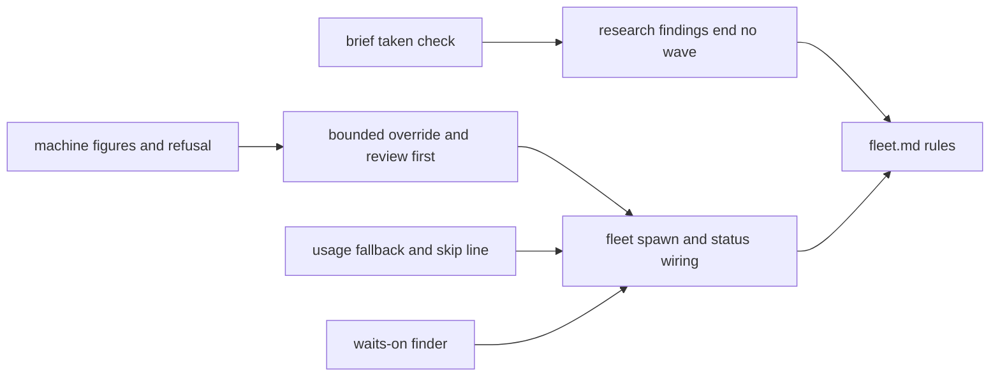

# Superlite: the machine gate names what drives a refusal and takes a bounded override; spawns survive slow usage checks and unsent briefs

**Goal:** a machine-gate refusal names the figures that drive it (pressure, swap, compressor, largest process; the free percentage only when the floor refused), `--over-limit` takes bounds that still refuse at critical, a gate that gives up says why and what would change it, and a waiting review spawn is admitted before a waiting implementer spawn (#902); a timed-out usage check falls back to the last known figures with their age and one line names the skipped accounts, a one-turn worker that never takes its brief is resent once and then reported `BLOCKED: Wn L not sent`, and `fleet status` shows the test or build command a busy worker waits on and for how long (#909).
**Architecture:** existing seams. `machine_load.py` reads swap and compressor figures, builds the refusal from the refusal's cause, and its `gate` takes a rank, bounds and the run's live worker count; a waiting review registers in `<home>/machine-wait/`. `accounts.py` rebuilds a failed usage read from `<home>/usage-last.json`. `fleet_io.send_brief` checks that a fresh one-turn worker took its brief. A new `fleet_waits.py` finds a busy worker's test or build process under its pane. `fleet.py` wires flags, ranks, the skip line and the status suffix.
**Tech stack:** Python 3.10+ stdlib; pytest through `sl run_tests`.
**Spec:** this file, section Design; issues #902, #909.
**Detail:** contracts
**Target-min:** 11
**Wave0:** none
**Coverage:** off (fixes on existing seams; the issues' Expected lists answer every row)

Global constraints:
- Every line of a Python script under `skills/**/scripts/` keeps the repo's `# O(...)` complexity comment; stdlib only; LF endings. Files under `tests/` carry no such comments.
- This repository is public: no host names, user names, home paths, other project or repository names in code, tests, docs or commit messages.
- The verdict is `sl run_tests` (never raw pytest); every new test sees a red run before the code it tests.
- An existing test that pins a changed text or output is updated in the same task only when it is in the task's Owns. Any other test your change turns red: leave it, and name the file and the failing assertion in your report (the coordinator rules it).
- Never edit docs/fleet.md or docs/tools.md (other batches own them).
- Exit codes: 0 done, 2 usage error or refusal, 3 BLOCKED.
- Builds: the verdict is `sl run_tests` (the project's test command; a project with `.maxapp` runs `maxapp test`, which a build pool may place on another Mac, and a full run whose tree a green maxapp test stamp covers returns that result without a run); task trees build in <tree>/.build/DerivedData and any build of your own goes under .build/ of the worktree, never -derivedDataPath outside the worktree (your session scratchpad included; backlog cleanup removes scratchpad build folders when the worktree goes); a product, simulator or device build stays on this machine and runs only when an issue's acceptance asks for a running-app check; copy this sentence into every worker brief.
- Simulators: append the UDID of each simulator you or a worker creates (`xcrun simctl create` or `clone`; a checker's `Simulators:` line marks its created ones) as one line to the worktree's `.superlite/simulators.txt`; never list one you did not create; ship cleanup shuts down and deletes each listed one; copy this sentence into every worker brief.

## Design

### 1. Machine gate (#902)

- Figures: `memory()` adds `swap_total`, `swap_used` and `compressed` (bytes, None when unreadable). macOS: `vm.swapusage` joins the one `sysctl -n` call; `vm_stat` gives the compressor (`Pages occupied by compressor` times its page size). Linux: `SwapTotal`/`SwapFree` from `/proc/meminfo`; no compressor (None).
- A refusal has one cause, checked in this order: `count` (agents at the count cap), `critical` (pressure), `floor` (free memory minus one agent under the floor). `warn` alone still refuses nothing (#916). The refusal text names pressure, swap used/total/free, compressor and the largest non-agent process; the free percentage and floor appear only when the floor refused. Status (`snapshot_text`) and the admission lines keep the percentage and add the swap and compressor figures.
- Give-up: the final busy line ends `; gave up after K checks in N s: <cause> at every check` (or the causes with their counts) and `; room comes when agents end (A running) or when <process> (G GB) ends`.
- Bounded override: `fleet spawn --over-limit --max-workers N --min-swap-free-mb M` (each bound optional, at least one) admits past the floor and count cap but still refuses at critical pressure, with swap free under M MB while swap is in use, and with N or more live workers in the run; it waits like the gate. Plain `--over-limit` stays unbounded. A bound without `--over-limit`: exit 2.
- Review first: a `package-reviewer` or `final-reviewer` spawn that has to wait registers `<home>/machine-wait/<pid>.json`; any other spawn (except plain `--over-limit`) yields while a live one exists, within its own wait.

### 2. Spawns under load (#909)

- Usage: a failed account reading takes its last stored reading of any age (was: 30 min), a whole failed `claude-profile usage` call takes every stored reading; a limit whose `resets_at` has passed is dropped from such a reading; the age is printed (`N min` under 2 h, else `N h`). `choose_account` prints one stderr line `accounts skipped: a (weekly_all 100%), b (usage unreadable: timeout)` when it chose an account and skipped others.
- Brief: `send_brief` to a fresh one-turn worker (record `one_turn`, no `sent` yet) waits up to `TOOK_MS` (10 s) for the pane to stay busy; a pane that went idle or done with no stop record since the send did not take it: one resend, then `HerdrError("brief_not_taken", "brief not taken after one resend")`, which every caller prints as `BLOCKED: Wn L not sent (brief not taken after one resend)`.
- Status: a busy local worker's line ends ` waits on <command> <N min|N s>` when a test or build process (run_tests, pytest, xcodebuild, maxapp/swift/cargo/go test|build, npm/pnpm/yarn/bun test, gradle) runs under its pane's shell.
- fleet.md gains a slow-but-alive rule, the bounded override, the skip and not-taken lines.

### 3. Rulings

- Ruling: the default gate gets no swap rule; swap bounds only bound `--over-limit` (because #916 decided free memory and critical pressure gate the default; cost if wrong: one more flag on the default path later).
- Ruling: fleet.py's `BUSY_TAIL` text stays (because docs/fleet.md and docs/tools.md quote it and other batches own them).
- Ruling: the not-taken check runs only for one-turn workers' first message (a primed worker proved its input with READY; the check costs up to 10 s per spawn).
- Ruling: `backlog start` keeps plain `--over-limit` (the issue names fleet spawn).
- Ruling: adjacent fix #903 (B242's follow-up names fleet_io.py, this batch's file): a research or writer worker's findings do not end a `fleet wait --wave`.

## Task graph

```mermaid
%% schedule
gantt
  title Predicted schedule (mm:ss)
  dateFormat X
  axisFormat %M:%S
  section lane 1
  T1 machine figures and refusal :t1, 0, 315s
  T2 bounded override and review first :t2, 315, 313s
  T7 fleet spawn and status wiring :t7, 627, 311s
  T8 fleet.md rules :t8, 939, 280s
  section lane 2
  T3 usage fallback and skip line :t3, 0, 310s
  section lane 3
  T5 waits-on finder :t5, 0, 290s
  section lane 4
  T4 brief taken check :t4, 0, 284s
  T6 research findings end no wave :t6, 284, 279s
```

critical path: T1 → T2 → T7 → T8 (20.3 min) · peak width 4 · predicted build 20.3 min · predicted total ≈ 30.8 min (target ✗ 11.0)

## Package: machine gate

App type: library (memory admission). Categories: numeric (byte figures, percentages), state (waiter files), protocol (printed lines).
**Probe entry:** none (reads the live machine; the named tests cover each case)

### T1 machine figures and refusal · Complexity 5 · Est. context 50k
**Owns:** skills/subagent-driven-development/scripts/machine_load.py, tests/scripts/test_machine_load_figures_902.py, tests/scripts/test_machine_load_560.py, tests/scripts/test_machine_load_warn_916.py
**Components:** 2
**LOC owned:** 150
**Tests:** fast
**Model:** sonnet
**Kind:** design
**Covers:** 1
**Produces:** machine_load.figures(m: dict) -> str · machine_load.cause(m: dict, floor_pct: float, lim: int) -> str | None · machine_load.refusal(m: dict, floor_pct: float, lim: int, src: str, why: str) -> str · machine_load.gave_up(causes: list, el: int, m: dict) -> str
  e.g. figures({"pressure": "warn", "swap_total": 2147483648, "swap_used": 1610612736, "compressed": 1073741824}) -> "pressure warn, swap 1.5 of 2.0 GB used (0.5 GB free), compressor 1.0 GB"; figures({"pressure": "normal", "swap_total": 0, "swap_used": 0, "compressed": None}) -> "pressure normal, no swap in use"; figures({"pressure": None}) -> "pressure unknown"
  e.g. with M = {"agents": 9, "each": 400 MiB, "total": 64 GiB, "free": 9 GiB, "pressure": "warn", "swap_total": 2 GiB, "swap_used": 1.5 GiB, "compressed": 1 GiB, "other": ("bigd", 20 GiB)}: cause(M, 15, 0) -> "floor"; cause({**M, "free": 32 GiB, "pressure": "critical"}, 15, 0) -> "critical"; cause({**M, "free": 32 GiB}, 15, 8) -> "count"; cause({**M, "free": 32 GiB}, 15, 0) -> None
  e.g. refusal(M, 15, 0, "default", "floor") -> "memory 14% free, floor 15%, pressure warn, swap 1.5 of 2.0 GB used (0.5 GB free), compressor 1.0 GB (9 agents, about 0.4 GB each); largest non-agent process bigd 20.0 GB"; refusal({**M, "free": 32 GiB, "pressure": "critical"}, 15, 0, "default", "critical") -> "memory pressure critical, swap 1.5 of 2.0 GB used (0.5 GB free), compressor 1.0 GB (9 agents, about 0.4 GB each); largest non-agent process bigd 20.0 GB"; refusal({**M, "free": 32 GiB}, 15, 8, "SUPERLITE_MACHINE_LIMIT", "count") -> "memory pressure warn, swap 1.5 of 2.0 GB used (0.5 GB free), compressor 1.0 GB (9 agents, about 0.4 GB each); 9 agents of limit 8 from SUPERLITE_MACHINE_LIMIT; largest non-agent process bigd 20.0 GB"
  e.g. gave_up(["critical", "critical", "critical"], 240, M) -> "gave up after 3 checks in 240 s: pressure critical at every check; room comes when agents end (9 running) or when bigd (20.0 GB) ends"; gave_up(["floor", "critical"], 10, {**M, "other": None, "agents": 2}) -> "gave up after 2 checks in 10 s: free memory under the floor at 1, pressure critical at 1; room comes when agents end (2 running)"; gave_up(["floor"], 0, {**M, "agents": 0}) -> "gave up after 1 check in 0 s: free memory under the floor; room comes when bigd (20.0 GB) ends"
**Review Focus:** numeric: `test_darwin_parses_swap_and_compressor` (`_darwin("68719476736\n52\n2\ntotal = 2048.00M  used = 1536.00M  free = 512.00M  (encrypted)\n", "Mach Virtual Memory Statistics: (page size of 16384 bytes)\nPages free: 100.\nPages occupied by compressor: 65536.\n")` -> `{"total": 68719476736, "free": 35734127902, "pressure": "warn", "swap_total": 2147483648, "swap_used": 1610612736, "compressed": 1073741824}`; a `G` unit parses too); numeric: `test_darwin_without_swap_line` (`_darwin("68719476736 52 2")` -> the three old keys plus the three new ones None); numeric: `test_linux_swap` (meminfo with `SwapTotal: 2097152 kB` and `SwapFree: 524288 kB` -> swap_total 2147483648, swap_used 1610612736, compressed None; no SwapTotal -> both None); protocol: `test_figures_examples`, `test_cause_examples`, `test_refusal_examples`, `test_gave_up_examples` (every e.g. above); protocol: `test_refusal_has_no_percent_unless_floor` (critical and count refusals hold no `% free`); protocol: `test_gate_final_line_says_why` (measure patched to the critical M, wait 0: `gate` returns `"machine busy after 0 s: " + refusal(...) + "; " + gave_up(["critical"], 0, m)`); state: `test_measure_passes_swap_figures` (measure(procs, mem with the three keys) carries them; mem None -> all three None)
**Steps:** 1 failing tests, 2 run: FAIL, 3 implement, 4 run: PASS
**Notes:** `room(m, flo, lim)` stays and returns `cause(...) is None`. `_busy` is replaced by `refusal`; `gate` keeps its signature and stderr lines, records the cause of every check and appends `"; " + gave_up(causes, el, m)` to its returned busy line; the first `machine busy: ...; waiting up to N s` line uses `refusal`. `describe` (status and admission lines) keeps `memory [pressure X, ]N% free, floor F%` and inserts `, swap ...` and `, compressor ...` (the figures parts, without the pressure part) before ` (agents...)` only when known, so a dict without the new keys prints as today. A swap figure reads `U of T GB used (F GB free)` with one decimal each (bytes / 2**30). `gave_up` phrases: count `agent count at the limit`, critical `pressure critical`, floor `free memory under the floor`; one cause for every check: `<phrase>` plus ` at every check` when K > 1; mixed: each phrase with ` at <n>` in first-seen order joined by `, `; room part: `agents end (A running)` when A > 0, `<name> (G GB) ends` when other is set, joined by ` or when `, prefix `room comes when `, and `room comes when memory frees up` when neither. Update the pinned strings in test_machine_load_560.py and test_machine_load_warn_916.py to the new texts. Verify with `sl run_tests --fast tests/scripts/test_machine_load_figures_902.py tests/scripts/test_machine_load_560.py tests/scripts/test_machine_load_warn_916.py tests/scripts/test_fleet_machine_gate_560.py tests/scripts/test_fleet_round_queue_916.py tests/scripts/test_backlog_machine_560.py tests/scripts/test_docs_machine_memory_643.py --task T1`.

## Package: spawns under load

App type: CLI (fleet spawn, status, accounts). Categories: protocol (printed lines, exit codes), state (usage store, fleet.json), numeric (ages, elapsed times).
**Probe entry:** none (drives herdr and claude-profile; the named tests fake both)

### T3 usage fallback and skip line · Complexity 4 · Est. context 45k
**Owns:** skills/subagent-driven-development/scripts/accounts.py, tests/scripts/test_accounts_fallback_909.py, tests/scripts/test_fleet_usage_unknown_917.py
**Components:** 2
**LOC owned:** 110
**Tests:** fast
**Model:** sonnet
**Kind:** design
**Covers:** 2
**Produces:** accounts.age_text(seconds: float) -> str · accounts.skip_line(usage: dict, allowed: list, tier: str | None = None, alias: dict | None = None, signed_out: list | None = None) -> str | None
  e.g. age_text(600) -> "10 min"; age_text(7199) -> "119 min"; age_text(7200) -> "2 h"; age_text(90000) -> "25 h"
  e.g. U = {"accounts": [{"name": "a", "limits": [{"kind": "weekly_all", "percent": 100}]}, {"name": "b", "limits": []}, {"name": "c", "error": "timeout"}]}: skip_line(U, ["a", "b", "c"]) -> "accounts skipped: a (weekly_all 100%), c (usage unreadable: timeout)"; skip_line(U, ["a", "b", "c"], signed_out=["d"]) -> "accounts skipped: a (weekly_all 100%), c (usage unreadable: timeout), d (signed out)"; skip_line(U, ["b"]) -> None; skip_line({}, ["a", "b"]) -> None
**Review Focus:** state: `test_failed_reading_uses_old_stored_reading` (store `a` at now-7200 with weekly_all 100 (resets_at in the future) and session 95 (resets_at in the past); report `{"accounts": [{"name": "a", "error": "timeout"}]}` -> a's entry has the weekly_all limit only, `error` None, `stale_s` 7200; stderr `a: usage unreadable (timeout); using its reading from 2 h ago`); state: `test_whole_call_failure_uses_store` (report `{}`, same store -> `{"accounts": [that entry]}`, one stderr line `usage: claude-profile usage gave no report; using last readings: a 2 h old`); state: `test_whole_call_failure_empty_store` (report `{}`, no store -> `{}`, no stderr); state: `test_old_full_account_still_skipped` (the rebuilt report through `pick_account(usage, ["a", "b"])` with b stored at 10 % -> "b"; a skipped as `weekly_all 100%`); protocol: `test_age_text_examples`, `test_skip_line_examples` (every e.g.)
**Steps:** 1 failing tests, 2 run: FAIL, 3 implement, 4 run: PASS
**Notes:** In `with_fallback` a report that is not a dict with an `accounts` list now rebuilds from the store (`{"accounts": [...]}`, entries sorted by name, each `{**stored account, "error": None, "stale_s": int(age)}` with expired limits dropped) and prints the one `usage:` line (names sorted, `<name> <age_text> old` joined by `, `); with no stored reading it returns the report as today, silently. A failed account takes its stored reading whatever its age; `RECENT_S` goes, and the coordinator's-own-account path stays for an account with no stored reading (its line says `no stored reading` instead of `no reading in the last 30 min`). A limit is expired when its `resets_at` parses (ISO, `Z` allowed) to a time at or before now; an unparsable or missing `resets_at` keeps the limit. `skip_line` uses `reasons()` and leaves out `not in usage` entries; no `accounts` in usage gives None unless signed_out is non-empty. Update test_fleet_usage_unknown_917.py's 30-minute assertions to the any-age rule. Verify with `sl run_tests --fast tests/scripts/test_accounts_fallback_909.py tests/scripts/test_fleet_usage_unknown_917.py tests/scripts/test_accounts.py --task T3` (drop a path that does not exist).

### T4 brief taken check · Complexity 4 · Est. context 45k
**Owns:** skills/subagent-driven-development/scripts/fleet_io.py, tests/scripts/test_fleet_brief_taken_909.py
**Components:** 1
**LOC owned:** 70
**Tests:** fast
**Model:** sonnet
**Kind:** design
**Covers:** 2
**Produces:** fleet_io.took_brief(sd: Path, wid: str, name: str, sent_ms: int) -> bool
  e.g. hc.wait_state raises HerdrError("timeout", "...") -> True; wait_state returns "idle" and latest_stop(sd, wid, sent_ms) is None -> False; wait_state returns "done" and latest_stop returns a record -> True; wait_state raises HerdrError("missing", "...") -> True
**Review Focus:** protocol: `test_took_brief_examples` (every e.g.; `hc.wait_state` called with `["idle", "done"]` and `TOOK_MS` 10000); state: `test_fresh_one_turn_resent_once_then_taken` (worker record `one_turn: True`, no `sent`; `_prompt` faked, took_brief faked False then True: `_prompt` called twice, stderr `W1: brief not taken (the pane went idle with no turn); resending once`, stdout `W1 R1 sent`, fleet.json state busy); state: `test_fresh_one_turn_never_taken_raises` (took_brief always False: raises `hc.HerdrError` with code `brief_not_taken` and message `brief not taken after one resend`, fleet.json state not busy, no `sent` line); state: `test_primed_or_resent_worker_not_checked` (record without `one_turn`, and a one_turn record with `sent` set: took_brief never called, one `_prompt`); protocol: `test_brief_cli_prints_not_sent` (fleet.py main `spawn --role research --brief F` with spawn faked and send_brief raising that error: stdout `BLOCKED: W1 R1 not sent (brief not taken after one resend)`, exit 3)
**Steps:** 1 failing tests, 2 run: FAIL, 3 implement, 4 run: PASS
**Notes:** `TOOK_MS = 10000` beside the other fleet_io constants. In `send_brief` (local branch only; the remote branch is unchanged) read `first = bool(w.get("one_turn")) and not w.get("sent")` before the send; after `_prompt` and only when first: `took_brief(sd, wid, name, sent)` false -> the stderr line, `sent = now_ms()`, `_prompt` once more, then false again -> raise. `took_brief`: `hc.wait_state(name, ["idle", "done"], TOOK_MS)`; a `HerdrError` (any code) -> True; else `latest_stop(sd, wid, sent_ms) is not None`. fleet.py is not edited: its `--brief` path already prints `BLOCKED: {wid} {label} not sent ({e.message})` for a HerdrError. Verify with `sl run_tests --fast tests/scripts/test_fleet_brief_taken_909.py tests/scripts/test_fleet_io.py --task T4`.

### T5 waits-on finder · Complexity 4 · Est. context 40k
**Owns:** skills/subagent-driven-development/scripts/fleet_waits.py, tests/scripts/test_fleet_waits_909.py
**Components:** 1
**LOC owned:** 120
**Tests:** fast
**Model:** sonnet
**Kind:** design
**Covers:** 2
**Produces:** fleet_waits.label(args: str) -> str | None · fleet_waits.etime_s(text: str) -> int | None · fleet_waits.waits_on(roots: dict, procs: list) -> dict · fleet_waits.suffixes(sd: Path, workers: dict) -> dict
  e.g. label("/usr/bin/python3 /x/scripts/run_tests.py --full --task T3") -> "run_tests --full --task T3"; label("bash /x/scripts/sl run_tests --fast a.py") -> "run_tests --fast a.py"; label("python3 -m pytest tests -q") -> "pytest tests -q"; label("/x/usr/bin/xcodebuild test -scheme App") -> "xcodebuild test -scheme App"; label("maxapp test") -> "maxapp test"; label("npm run test") -> "npm run test"; label("/bin/zsh -c sl run_tests --full") -> None; label("git status") -> None; label("claude --model sonnet") -> None
  e.g. etime_s("41:07") -> 2467; etime_s("02:03:04") -> 7384; etime_s("1-02:03:04") -> 93784; etime_s("abc") -> None
  e.g. waits_on({"W1": 100, "W2": 300}, [(100, 1, 600, "-zsh"), (150, 100, 590, "claude --model sonnet"), (200, 150, 500, "/bin/zsh -c sl run_tests --full"), (201, 200, 490, "python3 /x/run_tests.py --full"), (202, 201, 480, "python3 -m pytest tests -q"), (300, 1, 50, "-zsh")]) -> {"W1": ("run_tests --full", 490)}
  e.g. suffixes(sd, {"W1": {"state": "busy", "pane_id": "p1"}, "W2": {"state": "ready", "pane_id": "p2"}}) with pane p1's shell pid 100 and the procs above -> {"W1": " waits on run_tests --full 8 min"}; any herdr or ps failure -> {}
**Review Focus:** protocol: `test_label_examples`, `test_etime_examples`, `test_waits_on_example` (every e.g.); protocol: `test_label_cut_at_40` (a long xcodebuild line gives a label of at most 40 characters that starts `xcodebuild test`); state: `test_suffixes_reads_shell_pid_and_ps` (`hc.call` faked to answer `["pane", "process-info", "--pane", "p1"]` with `{"process_info": {"shell_pid": 100, ...}}`, `_ps` faked to the procs: the e.g.; seconds under 60 print as `N s`); state: `test_suffixes_skips_remote_and_idle` (a worker with `machine` set or state not busy gets no herdr call); state: `test_suffixes_error_is_empty` (`hc.call` raising HerdrError -> {})
**Steps:** 1 failing tests, 2 run: FAIL, 3 implement, 4 run: PASS
**Notes:** `label`: split on whitespace; argv0's basename `b`; when `b` is an interpreter (`python`, `python3`, `python3.N`, `bash`, `sh`, `node`), a `-c` before the first non-option word gives None, `-m X` makes X the command, else the first word not starting with `-` is the script, `b` its basename without `.py`/`.js`/`.sh`. Then: `run_tests` -> `run_tests` + rest; `sl` followed by `run_tests` -> `run_tests` + the rest after it; `pytest`/`py.test` -> `pytest` + rest; `xcodebuild`, `gradle`, `gradlew` -> b + rest; `maxapp`, `swift`, `cargo`, `go` followed by `test` or `build` -> b + rest; `npm`, `pnpm`, `yarn`, `bun` followed by `test`, or by `run test` -> b + rest; else None. The label is cut to 40 characters at a word end when possible. `waits_on`: for each root, the matching descendant nearest the root (fewest parent steps), ties to the larger seconds; roots with none are left out. `_ps()` runs one `ps -axo pid=,ppid=,etime=,args=` (timeout 10 s) into `(pid, ppid, seconds, args)`, skipping unparsable lines. `suffixes` asks `hc.call(["pane", "process-info", "--pane", pane])` (via `hc._pick(r, "process_info")`) for each busy worker without `machine` and with a `pane_id`, then one `_ps()`; text ` waits on <label> <N min>` (`seconds // 60`), or `<N s>` under 60. Verify with `sl run_tests --fast tests/scripts/test_fleet_waits_909.py --task T5`.

### T2 bounded override and review first · Complexity 5 · Est. context 30k
**Owns:** skills/subagent-driven-development/scripts/machine_load.py, tests/scripts/test_machine_gate_bounds_902.py
**Components:** 2
**LOC owned:** 130
**Tests:** fast
**Model:** sonnet
**Kind:** design
**Covers:** 1
**Produces:** machine_load.bounded_cause(m: dict, bounds: dict, run_workers: int | None) -> str | None · machine_load.review_waiting(own_pid: int | None = None, now: float | None = None) -> str | None · machine_load.gate(what: str, wait_s: float, over: bool = False, poll_s: float = 10.0, rank: int = 1, bounds: dict | None = None, run_workers: int | None = None) -> str | None
  e.g. with T1's M (swap 2 GiB total, 1.5 GiB used): bounded_cause({**M, "pressure": "critical"}, {"max_workers": 6, "min_swap_free_mb": 1024}, 2) -> "critical"; bounded_cause(M, {"min_swap_free_mb": 1024}, None) -> "swap"; bounded_cause({**M, "swap_total": 0, "swap_used": 0}, {"min_swap_free_mb": 1024}, None) -> None; bounded_cause(M, {"max_workers": 6}, 6) -> "workers"; bounded_cause(M, {"max_workers": 6}, 5) -> None; bounded_cause(M, {"max_workers": None, "min_swap_free_mb": None}, 9) -> None
  e.g. review_waiting() with `<home>/machine-wait/
.json` = {"pid": p (a live process other than this one), "rank": 0, "what": "fleet spawn (package-reviewer)", "t": now} -> "fleet spawn (package-reviewer)"; the same file with a dead pid -> None and the file is gone; rank 1 -> None; "t" older than 3600 s -> None; own_pid == p -> None
**Review Focus:** protocol: `test_bounded_cause_examples`, `test_review_waiting_examples` (every e.g.; a live other pid: a `subprocess.Popen(["sleep", "30"])` killed in teardown; a dead pid: one such process after `wait()`); state: `test_bounded_override_admits_past_floor` (measure patched to T1's M with free 9 GiB, floor 15, `gate(w, 0, True, bounds={"min_swap_free_mb": 256}, run_workers=1)` -> None; stderr `machine limit overridden (--over-limit within --min-swap-free-mb 256): ...`); state: `test_bounded_override_refuses_critical` (pressure critical, wait 0 -> a line starting `machine busy after 0 s: memory pressure critical` that holds `gave up after 1 check in 0 s: pressure critical`); state: `test_bounded_override_refuses_low_swap` (bounds 1024 -> the line holds `; swap free under --min-swap-free-mb 1024` and `swap free under 1024 MB`); state: `test_bounded_override_refuses_worker_cap` (max_workers 6, run_workers 6 -> holds `; 6 live workers in this run, --max-workers 6` and `this run at --max-workers 6`); state: `test_plain_over_limit_unbounded` (pressure critical, `gate(w, 0, True)` -> None, as today); state: `test_implementer_yields_to_waiting_review` (room, a live rank-0 waiter file, `gate("fleet spawn (implementer)", 0)` -> holds `; a review spawn waits first: fleet spawn (package-reviewer)`; with rank 0 -> None); state: `test_review_waiter_registers_and_cleans` (measure patched: no room on the first check, room on the second, `time.sleep` patched to assert the file `<home>/machine-wait/<os.getpid()>.json` exists with rank 0; after the gate returns None the file is gone)
**Steps:** 1 failing tests, 2 run: FAIL, 3 implement, 4 run: PASS
**Notes:** `bounded_cause` checks, in this order: pressure critical -> "critical"; `min_swap_free_mb` set and `swap_total` a number above 0 and `swap_total - swap_used < min_swap_free_mb * 2**20` -> "swap"; `max_workers` set and `run_workers` not None and `run_workers >= max_workers` -> "workers"; else None. In `gate` each check computes `plain = cause(m, flo, lim)`; plain `over` without bounds: as today (the overridden line when plain is set, then None, no queue); with bounds (any value not None) the bounds replace the floor and count cap: `why = bounded_cause(...)`, and when it is None while plain was set, print `machine limit overridden (--over-limit within <bounds text>): <_line text>` (`--max-workers N` and `--min-swap-free-mb M` joined by ` and `, only the given ones). Then rank 1 (and not plain over): `why = "review"` when `review_waiting(os.getpid())` names a waiter. Bounds apply even when `enabled()` is false; without bounds a disabled gate returns None at once, as today. A rank-0 gate registers `<home>/machine-wait/<os.getpid()>.json` (`{"pid", "rank": 0, "what", "t"}`) before its first sleep and removes it on every return (try/finally). `refusal` treats any cause other than floor and count like critical (figures, no percentage); `gate` appends to it `; swap free under --min-swap-free-mb M`, `; R live workers in this run, --max-workers N` or `; a review spawn waits first: <what>` for those causes. `gave_up` phrases: swap `swap free under M MB` (M from the bounds: give gave_up an optional `bounds=None` argument), workers `this run at --max-workers N`, review `a review spawn waits first`. Verify with `sl run_tests --fast tests/scripts/test_machine_gate_bounds_902.py tests/scripts/test_machine_load_figures_902.py tests/scripts/test_machine_load_560.py tests/scripts/test_machine_load_warn_916.py --task T2`.

### T6 research findings end no wave · Complexity 2 · Est. context 25k
**Owns:** skills/subagent-driven-development/scripts/fleet_io.py, tests/scripts/test_fleet_wave_research_903.py
**Components:** 1
**LOC owned:** 30
**Tests:** fast
**Model:** sonnet
**Kind:** design
**Produces:** fleet_io.wave_failure(r: dict) -> bool
  e.g. wave_failure({"status": "DONE", "findings": 3, "role": "research"}) -> False; {"status": "DONE", "findings": 3, "role": "writer"} -> False; {"status": "DONE", "findings": 3, "role": "package-reviewer"} -> True; {"status": "DONE", "findings": 3} -> True; {"status": "BLOCKED", "findings": 0, "role": "research"} -> True; {"status": "APPROVED", "findings": 0, "partial": True, "role": "final-reviewer"} -> True
**Review Focus:** protocol: `test_wave_failure_examples` (every e.g.); state: `test_finish_result_carries_role` (`_finish` on a research worker record returns a dict with `"role": "research"`; a record without role -> "implementer"); state: `test_wave_waits_for_both_research_workers` (a `fleet wait --wave` over two busy research workers, the first reporting `findings=3`: the call returns both results, not only the first; model the fakes on the existing `--wave` tests)
**Steps:** 1 failing tests, 2 run: FAIL, 3 implement, 4 run: PASS
**Notes:** Adjacent fix for #903 (B242's follow-up): `_finish` adds `"role": w.get("role") or "implementer"` to the dict it returns; `wave_failure` counts `findings > 0` as a failure only when `r.get("role")` is not `research` or `writer`; the status and partial rules stay. Verify with `sl run_tests --fast tests/scripts/test_fleet_wave_research_903.py tests/scripts/test_fleet_io.py --task T6` plus the existing `--wave` test files you modelled on.

### T7 fleet spawn and status wiring · Complexity 5 · Est. context 30k
**Owns:** skills/subagent-driven-development/scripts/fleet.py, tests/scripts/test_fleet_wiring_b243.py, tests/scripts/test_fleet_for_review_422.py
**Components:** 2
**LOC owned:** 120
**Tests:** fast
**Model:** sonnet
**Kind:** design
**Covers:** 1, 2
**Consumes:** machine_load.gate(what: str, wait_s: float, over: bool = False, poll_s: float = 10.0, rank: int = 1, bounds: dict | None = None, run_workers: int | None = None) -> str | None (T2) · accounts.skip_line(usage: dict, allowed: list, tier: str | None = None, alias: dict | None = None, signed_out: list | None = None) -> str | None (T3) · fleet_waits.suffixes(sd: Path, workers: dict) -> dict (T5)
**Produces:** fleet.live_workers(sd: Path) -> int
  e.g. fleet.json workers W1 busy, W2 ready, W3 stopped, W4 blocked, W5 starting -> 3
**Review Focus:** protocol: `test_bound_without_over_limit_exits_2` (`main(["spawn", "--role", "research", "--max-workers", "6", "--plan", sd])`: exit 2, stderr `error: --max-workers and --min-swap-free-mb bound --over-limit; pass --over-limit too`, no gate call); state: `test_bounds_and_rank_reach_gate` (ml.gate patched to record kwargs, `_spawn` patched: `spawn --role research --over-limit --max-workers 6 --min-swap-free-mb 1024` -> bounds `{"max_workers": 6, "min_swap_free_mb": 1024}`, rank 1, run_workers = live_workers(sd); `--role package-reviewer` and `final-reviewer` -> rank 0; no bound flags -> bounds None); state: `test_live_workers_example`; state: `test_for_dispatch_and_for_review_pass_bounds` (`_spawn_quiet` / `spawn` patched: both get the bounds dict); protocol: `test_for_review_blocked_line_names_worker` (send_brief raising HerdrError("x", "stalled"): `BLOCKED: W1 review-T3 not sent (stalled)`); protocol: `test_choose_account_prints_skip_line` (usage faked with a 100 % account and a usable one: stderr holds `accounts skipped: <full> (weekly_all 100%)`, the usable one chosen); protocol: `test_status_appends_waits` (`fleet_waits.suffixes` patched to `{"W1": " waits on run_tests --full 8 min"}`: the W1 busy line ends with it; a suffixes error prints the line unchanged)
**Steps:** 1 failing tests, 2 run: FAIL, 3 implement, 4 run: PASS
**Notes:** spawn subparser: `--max-workers` (int) and `--min-swap-free-mb` (int), help `bound --over-limit: ...`; checked in `main` before any spawn path. `bounds` = the dict of both values when either is set, else None; passed as a keyword to `spawn`, `_spawn_quiet`, `for_dispatch` (its `fresh` calls) and `for_review` from every `main` call site. `spawn` calls `ml.gate(f"fleet spawn ({role})", machine_wait, over, rank=0 if role in ("package-reviewer", "final-reviewer") else 1, bounds=bounds, run_workers=live_workers(sd) if bounds else None)`. `live_workers` counts records whose state is not `stopped` or `blocked`. `for_review`'s not-sent line becomes `BLOCKED: {w['id']} {label} not sent (...)`; update the two pinned lines in test_fleet_for_review_422.py. `choose_account`, once `account` is chosen: `line = ac.skip_line(usage, allowed, model, alias, sorted(out))`, printed to stderr when set. `status`: after the dead-worker probe, `waits = fleet_waits.suffixes(sd, fs.workers(sd))` inside try/except Exception (-> {}); a line shown `busy` ends with `waits.get(wid, "")`. BUSY_TAIL and QUEUE_TAIL stay. Verify with `sl run_tests --fast tests/scripts/test_fleet_wiring_b243.py tests/scripts/test_fleet_for_review_422.py tests/scripts/test_fleet_machine_gate_560.py tests/scripts/test_fleet_round_queue_916.py tests/scripts/test_fleet.py --task T7`.

### T8 fleet.md rules · Complexity 2 · Est. context 25k
**Owns:** skills/subagent-driven-development/fleet.md, tests/scripts/test_docs_fleet_b243.py
**Components:** 1
**LOC owned:** 40
**Tests:** fast
**Model:** sonnet
**Kind:** design
**Covers:** 1, 2
**Review Focus:** protocol: `test_fleet_md_names_b243_rules` asserts fleet.md holds each of: `--over-limit --max-workers N --min-swap-free-mb M`, `gave up after`, `a waiting review spawn`, `accounts skipped:`, `using its reading from`, `BLOCKED: Wn L not sent (brief not taken after one resend)`, ` waits on <command>`, `findings=N` of a research or writer worker is its answer
**Steps:** 1 failing tests, 2 run: FAIL, 3 implement, 4 run: PASS
**Notes:** Add to skills/subagent-driven-development/fleet.md, in its terse style and without removing a pinned phrase (run the docs tests below): (1) after the `Give every fleet spawn Bash call a timeout` paragraph, one paragraph: a machine-gate refusal names its cause (pressure, swap, compressor, largest non-agent process; the free percentage only when the floor refused) and ends `gave up after K checks ...; room comes when ...`; told to go on anyway, use `--over-limit --max-workers N --min-swap-free-mb M` (still refuses at critical pressure, under M MB swap free while swap is in use, and at N live workers of the run; plain `--over-limit` has no bound); a waiting review spawn (package or final reviewer) is admitted before a waiting implementer spawn; a failed usage check falls back to each account's last stored reading with its age (`using its reading from N h ago`) and `accounts skipped: a (...), b (...)` on stderr names the accounts passed over; a one-turn worker that does not take its brief is resent once, then `BLOCKED: Wn L not sent (brief not taken after one resend)`: rerun the spawn. (2) In Waiting and acting, after the `fleet status` paragraph: a busy line ending ` waits on <command> <N min>` means a test or build command runs under the worker (run_tests, pytest, xcodebuild, maxapp test or build, ...); the worker is alive, a `maxapp test` may wait queued on a busy build host: never stop, resend or replace it; keep waiting with `fleet wait --wave`; only past twice the run's usual length ask it with `fleet send Wn --text`. (3) In the wait-line list: `findings=N` of a research or writer worker is its answer, not a failure: `--wave` keeps waiting (#903). Verify with `sl run_tests --fast tests/scripts/test_docs_fleet_b243.py tests/scripts/test_docs_contract.py tests/scripts/test_docs_580_fleet.py tests/scripts/test_docs_b95_fleet.py tests/scripts/test_fleet_docs_b54.py --task T8`.

## Review Focus

- machine gate (library): numeric, state, protocol. Risks: a refusal that still quotes a free percentage for a critical or count cause; a waiter file left behind after an exception; a rank-1 gate that waits for a dead or stale waiter; bounds that admit at critical; plain `--over-limit` changing.
- spawns under load (CLI): protocol, state. Risks: a stale reading that keeps an account blocked after its window reset; the rebuild hiding a whole failure when no store exists; a not-taken check that fires on a primed worker or a resend to a busy one; `fleet status` slowed or broken by a ps or herdr failure; a shell `-c` wrapper shown as the command.

## Coordinator steps after the last task

1. Unit layer: `sl run_tests --full`; headless layer (`skills/**` docs changed): `python3 scripts/test_layers.py run headless` via `fleet run --layer headless`.
2. Final review, then ship: notes.md (follow-ups for docs/fleet.md and docs/tools.md), pr-body.md, `sl backlog ship B243 lock`, `bump`, `merge`.

## Self-review

- Coverage: Design 1 is T1, T2, T7; Design 2 is T3, T4, T5, T7; fleet.md is T8; #903 is T6.
- Graph: same-file pairs are ordered (T1->T2 machine_load.py, T4->T6 fleet_io.py); fleet.py only in T7.
- Names: `figures`, `cause`, `refusal`, `gave_up`, `bounded_cause`, `review_waiting`, `skip_line`, `age_text`, `took_brief`, `suffixes`, `live_workers` are written the same in every line.
