# Superlite: build the run's start SHA in a scratch tree for before-screenshots (#816)

**Goal:** a lead or checker that needs before-screenshots runs its build-and-capture command at the run's start SHA in a scratch git tree that shares one package cache and is removed afterwards, instead of swapping files in the run's own worktree (#816).
**Architecture:** `worktree.py` gains a `scratch` subcommand: it resolves the start SHA (`run_tests.base_commit_of`, or `--rev`), drops idle leftover `scratch-*` trees, makes a detached tree with `trees.prepare_at` under key `scratch-<pid>` (marked `trees.busy`), runs the command there in its own process group with xcodebuild flags and environment pointing at the tree's `.build/DerivedData` and the run root's shared `.build/SourcePackages`, and drops the tree on every path (exit, error, SIGTERM, SIGHUP, Ctrl-C); docs/tools.md and SDD fleet.md name it.
**Tech stack:** Python 3.10+ stdlib; pytest through `sl run_tests`.
**Spec:** this file, section Design.
**Detail:** contracts
**Target-min:** 11
**Wave0:** none
**Coverage:** off

Global constraints:
- Every line of a Python script under `skills/**/scripts/` keeps the repo's `# O(...)` complexity comment; stdlib only; LF endings. Files under `tests/` carry no such comments.
- This repository is public: no host names, user names, home paths, other project or repository names in code, tests, docs or commit messages.
- The verdict is `sl run_tests` (never raw pytest); every new test sees a red run before the code it tests.
- An existing test that pins a changed text or output may be updated in the task that changes it; name each such file in your report.
- Builds: the verdict is `sl run_tests` (the project's test command; a project with `.maxapp` runs `maxapp test`, which a build pool may place on another Mac, and a full run whose tree a green maxapp test stamp covers returns that result without a run); task trees build in <tree>/.build/DerivedData and any build of your own goes under .build/ of the worktree, never -derivedDataPath outside the worktree (your session scratchpad included; backlog cleanup removes scratchpad build folders when the worktree goes); a product, simulator or device build stays on this machine and runs only when an issue's acceptance asks for a running-app check; copy this sentence into every worker brief.
- Simulators: append the UDID of each simulator you or a worker creates (`xcrun simctl create` or `clone`; a checker's `Simulators:` line marks its created ones) as one line to the worktree's `.superlite/simulators.txt`; never list one you did not create; ship cleanup shuts down and deletes each listed one; copy this sentence into every worker brief.

## Design

Issue #816: a lead that needed before-screenshots for a render check swapped files in its own worktree. Expected: a helper that builds the run's start SHA in a scratch worktree (shared package cache, removed afterwards).

Research (R1, R2): the run's start SHA is `.superlite/checkpoints.json` `base`, read with a merge-base fallback by `run_tests.base_commit_of(root) -> (sha, reason)`; `run_tests --base-skips` already tests that SHA in a scratch tree (`trees.prepare_at(root, "base-skips", sha)`, `trees.busy`, `trees.drop` in `finally`). Task trees build in `<tree>/.build/DerivedData` (`trees.derived_data_path`, `run_tests.with_derived_data`); no package cache is shared anywhere, so every fresh tree re-resolves its Swift packages.

`sl worktree scratch [--rev REV] [--repo DIR] -- COMMAND...` (in worktree.py):

1. **Arguments.** `main` splits argv at the first `--` before `autocommit.split_plan`, so `--plan P` is stripped only before it; the command is the argv after `--` (one item: a shell string as given; several: `shlex.join`). No command: stderr `usage: worktree scratch [--rev REV] [--repo DIR] -- COMMAND...`, exit 2. `--plan` without a value keeps today's usage line and exit 2.
2. **Start SHA.** `root` is `git -C <--repo, default .> rev-parse --show-toplevel`; no repository or no commit: `worktree: scratch needs a git repository with a commit`, exit 2. `scratch_rev(root, rev)`: `--rev REV` resolves with `rev-parse --verify -q REV^{commit}` (label `--rev REV`; unknown: `worktree: scratch: unknown revision REV`, exit 2); without it `run_tests.base_commit_of(root)` (label `start SHA`; its reason on failure: `worktree: scratch: <reason>`, exit 2).
3. **Tree.** Every directory `.superlite/trees/scratch-*` that `trees.is_busy` says is idle is dropped first (`worktree: removed stale scratch tree <key>` each). Key `scratch-<pid>`; inside `trees.busy(root, key)`: `trees.prepare_at(root, key, sha)` (RuntimeError or OSError: `worktree: scratch tree at <sha[:12]> not prepared: <err>`, exit 1). `<root>/.build/SourcePackages` is created and `.build/` added once to the repository's info/exclude (`add_exclude`, only when git does not ignore it yet). Stderr: `worktree: scratch tree <tree> at <sha[:12]> (<label>); shared packages <root>/.build/SourcePackages`, then `missing_line(missing_ignored(root, tree))` when non-empty.
4. **Command.** `scratch_command(command, tree, packages)`: each xcodebuild segment that names `-scheme` and no `-clonedSourcePackagesDirPath` gets `-clonedSourcePackagesDirPath <packages>` right after the `xcodebuild` word; then `run_tests.with_derived_data(command, tree)`. It runs through `sh` (`shell=True`) with cwd the tree, `start_new_session=True` (POSIX), and env plus `SUPERLITE_SCRATCH_TREE` (tree), `SUPERLITE_RUN_ROOT` (root), `SUPERLITE_SCRATCH_SHA` (sha), `SUPERLITE_DERIVED_DATA_PATH` (`<tree>/.build/DerivedData`), `SUPERLITE_SOURCE_PACKAGES` (packages). stdout and stderr pass through.
5. **Cleanup.** SIGTERM and SIGHUP raise `SystemExit(128 + signum)` while the scratch runs (old handlers restored after). Any exception while the command runs (Ctrl-C included) sends SIGTERM to its process group, waits up to 10 s, then SIGKILL, and re-raises. `finally`: `trees.drop(root, key)`, then stderr `worktree: scratch tree removed`, or `worktree: scratch tree <tree> not removed; sl trees clean removes it`.
6. **Exit code:** the command's (a signal-killed command: 128 + signal); 2 refused, 1 tree not prepared.

Before-screenshots then read: `"$SL" worktree scratch -- '<build, install, launch and capture command writing $SUPERLITE_RUN_ROOT/.superlite/render/before-<name>.png>'`.

### Rulings

- Ruling: one subcommand that runs a given command and always removes the tree, no keep mode (because the issue asks for "removed afterwards" and a capture command can write its screenshots outside the tree through SUPERLITE_RUN_ROOT).
- Ruling: the start SHA is `run_tests.base_commit_of` (checkpoints.json `base`, else the merge-base with the default branch), the reader `--base-skips` uses; `--rev` overrides (because one run should have one start SHA, and a lead whose first checkpoint came late can pass the branch point).
- Ruling: the shared package cache is `<run root>/.build/SourcePackages` through `-clonedSourcePackagesDirPath` for xcodebuild segments naming `-scheme` and SUPERLITE_SOURCE_PACKAGES for scripts (because DerivedData is per tree and dropped with it; npm, uv, cargo and SwiftPM's repository cache are already shared per user; the brief keeps every build under `.build/` of the worktree).
- Ruling: the tree key is `scratch-<pid>` so two scratch runs never share a tree; a killed run's idle tree is dropped by the next scratch run, `trees clean` or ship cleanup.
- Ruling: no submodule init and no copy of ignored files (`.env`, secrets): the missing-ignored stderr line names them, and the command can run `git submodule update --init` itself (because ensure copies nothing either).
- Ruling: `sl` is unchanged (because `sl worktree` already routes to worktree.py and its header lists only some tools); docs/tools.md and SDD fleet.md are edited although outside the batch list (no open batch lists them).
- Ruling: lint's MISSED TARGET is accepted (because two tasks in a chain: the docs pin the texts T1 prints).

## Task graph

```mermaid
%% schedule
gantt
  title Predicted schedule (mm:ss)
  dateFormat X
  axisFormat %M:%S
  section lane 1
  T1 worktree scratch :t1, 0, 381s
  T2 scratch docs :t2, 381, 367s
```

critical path: T1 → T2 (12.5 min) · peak width 1 · predicted build 12.5 min · predicted total ≈ 25.0 min (target ✗ 11.0)

## Package: worktree tool

App type: CLI. Categories: protocol (arguments, `--` split, exact lines, exit codes), state (the tree goes on every path, stale trees, busy markers), file (info/exclude, quoting of paths with spaces), concurrency (process group, signals).
**Probe entry:** none (the subcommand creates git worktrees and runs a shell command; its cases are named tests on a temporary repository)

### T1 worktree scratch · Complexity 4 · Est. context 45k
**Owns:** skills/subagent-driven-development/scripts/worktree.py, tests/scripts/test_worktree_scratch_816.py
**Components:** 1
**LOC owned:** 150
**Tests:** fast
**Model:** sonnet
**Covers:** Design
**Produces:** worktree.scratch_command(command: str, tree: str, packages: str) -> str · worktree.scratch_rev(root: str, rev: str | None = None) -> tuple[str, str] · worktree.scratch(root: str, command: str, rev: str | None = None) -> int
  e.g. scratch_command("xcodebuild -scheme App build", "/w/.superlite/trees/scratch-7", "/w/.build/SourcePackages") -> "xcodebuild -derivedDataPath /w/.superlite/trees/scratch-7/.build/DerivedData -clonedSourcePackagesDirPath /w/.build/SourcePackages -scheme App build"
  e.g. scratch_command("make build", "/w/t", "/w/p") -> "make build"
  e.g. scratch_rev("/w", "nope") -> ("", "unknown revision nope") · scratch_rev("/w") -> ("<40-hex base>", "start SHA")
**Review Focus:** protocol: `test_scratch_command_examples`, `test_scratch_needs_command`, `test_scratch_plan_only_before_dashdash`, `test_scratch_bad_rev`, `test_scratch_not_a_repo`; state: `test_scratch_runs_at_start_sha`, `test_scratch_exit_code_and_removal`, `test_scratch_drops_stale_trees`; concurrency: `test_scratch_sigterm_removes_tree`; file: `test_scratch_env_and_packages`
**Test code (contracts):** a temporary repository (`git init -b main`, user config set): commit A writes `v` = `1`; `.superlite/checkpoints.json` `{"base": "<A>"}` (`.superlite/` in `.git/info/exclude`); commit B writes `v` = `2`. The CLI runs as `python worktree.py ...` with cwd the repository.
- `test_scratch_command_examples`: the two e.g. lines exactly; a segment already naming `-clonedSourcePackagesDirPath X` keeps it and still gets `-derivedDataPath`; `xcodebuild -version` and `xcodebuild -xctestrun r.xctestrun test-without-building` get no packages flag (the second gets `-derivedDataPath`); `xcodebuild -scheme A build && xcodebuild -scheme B build` gets both flags in both segments; packages `/w x/.build/SourcePackages` appears as `'/w x/.build/SourcePackages'`.
- `test_scratch_runs_at_start_sha`: `scratch -- 'cat v > "$SUPERLITE_RUN_ROOT/seen"; git rev-parse HEAD >> "$SUPERLITE_RUN_ROOT/seen"; pwd -P >> "$SUPERLITE_RUN_ROOT/seen"'` exits 0; `seen` lines are `1`, A, a path under `<repo>/.superlite/trees/scratch-`; stderr holds `worktree: scratch tree `, ` at <A[:12]> (start SHA); shared packages <repo>/.build/SourcePackages` and `worktree: scratch tree removed`; afterwards no `.superlite/trees/scratch-*` directory and `git worktree list --porcelain` names one worktree. `--rev HEAD` gives `2`, B and ` (--rev HEAD)`. Without checkpoints.json, on branch `feat` made at A with commit B: `1` (merge-base with main).
- `test_scratch_exit_code_and_removal`: `-- 'exit 3'` exits 3, `-- 'kill -TERM $$'` exits 143; both leave no scratch tree.
- `test_scratch_needs_command`: `scratch`, `scratch --` and `scratch --rev HEAD` each exit 2 with stderr `usage: worktree scratch [--rev REV] [--repo DIR] -- COMMAND...`; no `.superlite/trees` entry is made.
- `test_scratch_plan_only_before_dashdash`: `--plan .superlite scratch -- printf '%s ' --plan keep` exits 0 with stdout exactly `--plan keep `.
- `test_scratch_bad_rev`: `--rev nope -- true` exits 2, stderr `worktree: scratch: unknown revision nope`, no scratch tree.
- `test_scratch_not_a_repo`: in an empty temporary folder, `scratch -- true` exits 2 with stderr `worktree: scratch needs a git repository with a commit`.
- `test_scratch_env_and_packages`: the command writes `env` to `$SUPERLITE_RUN_ROOT/env`: SUPERLITE_SCRATCH_TREE equals its cwd, SUPERLITE_RUN_ROOT the repo, SUPERLITE_SCRATCH_SHA A, SUPERLITE_DERIVED_DATA_PATH `<tree>/.build/DerivedData`, SUPERLITE_SOURCE_PACKAGES `<repo>/.build/SourcePackages`; that folder exists afterwards; `git check-ignore -q .build/x` exits 0 and `.git/info/exclude` holds `.build/` once after two runs. A repo with an ignored top-level `.env`: stderr holds `worktree: ignored in the main checkout, missing here: .env`.
- `test_scratch_drops_stale_trees`: `trees.prepare_at(repo, "scratch-999999", A)` before the run: the run prints `worktree: removed stale scratch tree scratch-999999` and that tree is gone; a tree `scratch-1` with a busy marker `scratch-1.busy.<the test's own pid>` is kept.
- `test_scratch_sigterm_removes_tree`: POSIX only (skip elsewhere); Popen `scratch -- 'echo $$ > "$SUPERLITE_RUN_ROOT/pid"; exec sleep 30'`; once `pid` exists (at most 10 s), SIGTERM the worktree.py process: it exits 143 within 15 s, no scratch tree is left, and the pid in `pid` is no longer alive (retry 5 s).
**Steps:** 1 write the tests, 2 run: FAIL, 3 implement Design 1-6 (lazy `import run_tests` and `import trees` inside the scratch functions; one docstring line in the module usage block and one paragraph naming the subcommand, its lines and exit codes; argparse `scratch` subparser with `--rev` and `--repo`, the command taken from the split, never from argparse), 4 run: PASS
**Notes:** `start_new_session` and `os.killpg` exist only on POSIX: elsewhere start normally and `process.kill()`. Verify with `sl run_tests --fast tests/scripts/test_worktree_scratch_816.py tests/scripts/test_worktree.py tests/scripts/test_worktree_plan.py tests/scripts/test_worktree_dir_502.py tests/scripts/test_worktree_bare_589.py tests/scripts/test_worktree_bootstrap.py --task T1`.

## Package: docs

App type: docs. Categories: protocol (the documented lines match T1's texts).
**Probe entry:** none (docs only)

### T2 scratch docs · Complexity 1 · Est. context 25k
**Owns:** docs/tools.md, skills/subagent-driven-development/fleet.md, tests/scripts/test_docs_b262_scratch.py
**Components:** 1
**LOC owned:** 30
**Tests:** fast
**Kind:** mechanical
**Model:** haiku
**Covers:** Design
**Review Focus:** protocol: `test_tools_row_names_scratch`, `test_fleet_checker_names_scratch`
**Test code (contracts):**
- `test_tools_row_names_scratch`: the docs/tools.md line starting `` | `worktree` | `` contains each of: `` `worktree scratch [--rev REV] [--repo DIR] -- COMMAND...` ``, `start SHA`, `-clonedSourcePackagesDirPath`, `.build/SourcePackages`, `SUPERLITE_RUN_ROOT`, `SUPERLITE_SOURCE_PACKAGES`, `worktree: scratch tree removed`.
- `test_fleet_checker_names_scratch`: the skills/subagent-driven-development/fleet.md line starting `- Checker:` contains `` `worktree scratch -- '<build and capture command>'` `` and `never swap files in the run's worktree`.
**Steps:** 1 write the tests, 2 run: FAIL, 3 insert in docs/tools.md's `worktree` row, right before ` | ` that ends the row (after `` naming the config file and the `git config core.bare false` fix. ``), this sentence verbatim: `` `worktree scratch [--rev REV] [--repo DIR] -- COMMAND...` runs COMMAND (one item: a shell string; several: joined) through `sh` in a detached scratch tree `.superlite/trees/scratch-<pid>` at the run's start SHA (`checkpoints.json` `base`, else the merge-base with the default branch; `--rev` overrides) and removes the tree on every path, also on SIGTERM, SIGHUP and Ctrl-C (`worktree: scratch tree removed`); each xcodebuild segment naming `-scheme` gets `-derivedDataPath <tree>/.build/DerivedData` and `-clonedSourcePackagesDirPath <run root>/.build/SourcePackages` (the package cache scratch runs share; `.build/` is added to info/exclude), and the command sees `SUPERLITE_SCRATCH_TREE`, `SUPERLITE_RUN_ROOT`, `SUPERLITE_SCRATCH_SHA`, `SUPERLITE_DERIVED_DATA_PATH` and `SUPERLITE_SOURCE_PACKAGES`; idle leftover scratch trees are dropped first; exit: the command's, 2 refused (no command, unknown revision, no repository), 1 tree not prepared (#816). `` In fleet.md's `- Checker:` line, after `` at freeze delete the simulators its `Simulators:` line names. `` append: `` Before-screenshots of the run's start: `"$SL" worktree scratch -- '<build and capture command>'` builds the start SHA in a scratch tree that shares `.build/SourcePackages` and is removed afterwards, and the command writes its shots to `$SUPERLITE_RUN_ROOT/.superlite/render/before-<name>.png`; never swap files in the run's worktree for them (#816). `` 4 run: PASS
**Notes:** Verify with `sl run_tests --fast tests/scripts/test_docs_b262_scratch.py tests/scripts/test_docs_b67_tools.py tests/scripts/test_fleet_docs_b54.py tests/scripts/test_docs_contract.py tests/scripts/test_fleet_research_docs_b43.py --task T2`.

## Review Focus

- T1 protocol: `ensure` and `inplace` output, arguments and exit codes are byte-identical to before; `--plan` after `--` reaches the command.
- T1 state: the tree is dropped on exit, on a failed command, on SIGTERM and on Ctrl-C; a busy scratch tree of another live process is never dropped.
- T1 concurrency: the command's whole process group is stopped before the tree goes, so no build writes into a removed tree.

## Self-review

#816 maps to T1 (scratch tree at the start SHA, shared package cache, removed afterwards) and T2 (where leads and checkers learn it); no two tasks share a file; T2 waits for T1 because it pins T1's texts.
