# Superlite: triage and lead read a linked spec first (#824)

**Goal:** the backlog triage worker reads a spec, plan or design doc an issue links before it proposes batches and never proposes a decision that doc already rules; the lead brief says the same for the lead (#824).
**Architecture:** two text constants in `backlog_brief.py`: `SPEC_TRIAGE` opens the triage brief's `Rules:` line, `SPEC_LEAD` is the lead brief line right after `DATA_RULE` (every phase and variant).
**Tech stack:** Python 3.10+ stdlib; pytest through `sl run_tests`.
**Spec:** this file, section Design.
**Detail:** tests
**Target-min:** 11
**Wave0:** none
**Coverage:** off

Global constraints:
- Every line of a Python script under `skills/**/scripts/` keeps the repo's `# O(...)` complexity comment; stdlib only; LF endings. Files under `tests/` carry no such comments.
- This repository is public: no host names, user names, home paths, other project or repository names in code, tests, docs or commit messages.
- The verdict is `sl run_tests` (never raw pytest); every new test sees a red run before the code it tests.
- An existing test that pins a changed text or output is updated in the same task only when it is in the task's Owns. Any other test your change turns red: leave it, and name the file and the failing assertion in your report (the coordinator rules it).
- Builds: the verdict is `sl run_tests` (the project's test command; a project with `.maxapp` runs `maxapp test`, which a build pool may place on another Mac, and a full run whose tree a green maxapp test stamp covers returns that result without a run); task trees build in <tree>/.build/DerivedData and any build of your own goes under .build/ of the worktree, never -derivedDataPath outside the worktree (your session scratchpad included; backlog cleanup removes scratchpad build folders when the worktree goes); a product, simulator or device build stays on this machine and runs only when an issue's acceptance asks for a running-app check; copy this sentence into every worker brief.
- Simulators: append the UDID of each simulator you or a worker creates (`xcrun simctl create` or `clone`; a checker's `Simulators:` line marks its created ones) as one line to the worktree's `.superlite/simulators.txt`; never list one you did not create; ship cleanup shuts down and deletes each listed one; copy this sentence into every worker brief.

## Design

### 1. Triage brief (#824)

- New constant `SPEC_TRIAGE` (exact text, ends with one space):
  `An issue that links a spec, plan or design doc (a repo path, or a URL to a file of this repository, in its body or comments): read that file first; never propose a decision it already rules, and plan the batch to what it rules. `
- `triage_brief` builds its rules line as `"Rules: " + SPEC_TRIAGE + ROOT_DOC_TRIAGE + TRIAGE_RUN + ...` (the rest unchanged), so it holds for GitHub and Jira issues, pinned or not.

### 2. Lead brief (#824, same defect one step later)

- New constant `SPEC_LEAD` (exact text):
  `An issue that links a spec, plan or design doc (a path or URL in its body or comments): read it before you plan; follow what it rules and never ask a question or write a ruling against it.`
- `lead_brief` appends it right after `out.append(DATA_RULE)`, so every phase (one lead, plan, build) and both variants (default, lean) carry it once.

### 3. Rulings

- Ruling: [scope] the owner's sentence ends "name that ruling in the batch instead"; no proposal field carries such a ruling (`backlog_checks.check_proposal` drops unknown batch keys silently), so the triage text says "plan the batch to what it rules" and the lead brief's `SPEC_LEAD` line makes the lead read the spec itself (because a new proposal field would grow the batch into backlog_checks.py, plan output and the lead brief for a note the lead can read at the source).
- Ruling: the triage text names only repo paths and URLs to files of this repository (because the triage worker has only Read, Grep and Glob and cannot fetch an outside URL).
- Ruling: MISSED TARGET accepted (because the plan is one 40-line task; the forecast comes from contention and history, not from the plan's shape).

## Task graph

```mermaid
%% schedule
gantt
  title Predicted schedule (mm:ss)
  dateFormat X
  axisFormat %M:%S
  section lane 1
  T1 linked spec rule :t1, 0, 818s
```




critical path: T1 (13.6 min) · peak width 1 · predicted build 13.6 min · predicted total ≈ 36.1 min (target ✗ 11.0)

## Package: backlog briefs

App type: library (text builders). Categories: protocol (exact brief text and line order).
**Probe entry:** none (pure text builders; the named tests cover each case)

### T1 linked spec rule · Complexity 1 · Est. context 30k
**Owns:** skills/subagent-driven-development/scripts/backlog_brief.py, tests/scripts/test_backlog_brief_spec_824.py, tests/scripts/test_backlog_brief_jira_208.py
**Components:** 1
**LOC owned:** 40
**Tests:** fast
**Model:** haiku
**Kind:** mechanical
**Covers:** 1, 2
**Produces:** backlog_brief.SPEC_TRIAGE: str · backlog_brief.SPEC_LEAD: str
  e.g. bb.triage_brief([{"number": 5, "title": "A", "body": "b"}], {"repo": "o/r", "max_batches": 3}) has exactly one line starting "Rules: " + bb.SPEC_TRIAGE + bb.ROOT_DOC_TRIAGE
  e.g. bb.lead_brief({"id": "B1", "topic": "t", "issues": [7], "files": ["a.py"]}, ctx).splitlines(): the line after bb.DATA_RULE is bb.SPEC_LEAD
**Review Focus:** protocol: `test_spec_texts_exact`, `test_triage_rules_open_with_spec_rule`, `test_triage_spec_rule_once_jira_pinned`, `test_lead_spec_line_after_data_rule` (default, lean, plan, build)
**Test code (verbatim):**
```python
# tests/scripts/test_backlog_brief_spec_824.py
import sys

import pytest
from test_plan_tools import SCRIPTS
sys.path.insert(0, str(SCRIPTS))
import backlog_brief as bb  # noqa: E402

TCTX = {"repo": "o/r", "max_batches": 3}
LCTX = {"sl": "/x/sl", "repo": "o/r", "backlog_md": "/x/backlog.md", "titles": {"7": "Seven"}, "summaries": [],
        "approved": {"by": "AskUserQuestion", "time": "t"}, "text": "default"}
ONE = {"id": "B1", "topic": "t", "issues": [7], "files": ["a.py"], "decisions": []}
TRIAGE = ("An issue that links a spec, plan or design doc (a repo path, or a URL to a file of this repository, in its body or "
          "comments): read that file first; never propose a decision it already rules, and plan the batch to what it rules. ")
LEAD = ("An issue that links a spec, plan or design doc (a path or URL in its body or comments): read it before you plan; "
        "follow what it rules and never ask a question or write a ruling against it.")


def test_spec_texts_exact():
    assert bb.SPEC_TRIAGE == TRIAGE and bb.SPEC_LEAD == LEAD


def test_triage_rules_open_with_spec_rule():
    lines = bb.triage_brief([{"number": 5, "title": "A", "body": "see docs/specs/a.md"}], TCTX).splitlines()
    rules = [ln for ln in lines if ln.startswith("Rules: ")]
    assert len(rules) == 1 and rules[0].startswith("Rules: " + TRIAGE + bb.ROOT_DOC_TRIAGE)


def test_triage_spec_rule_once_jira_pinned():
    t = bb.triage_brief([{"number": "PIX-1", "title": "A", "body": "b"}], {**TCTX, "pinned": {"head": "abc", "version": "1.0"}})
    assert t.count(TRIAGE) == 1 and t.index("Pinned:") < t.index(TRIAGE)


@pytest.mark.parametrize("extra", [{}, {"text": "lean"}, {"phase": "plan"}, {"phase": "build", "plan": "docs/plans/p.md"}])
def test_lead_spec_line_after_data_rule(extra):
    lines = bb.lead_brief(ONE, {**LCTX, **extra}).splitlines()
    i = lines.index(bb.DATA_RULE)
    assert lines[i + 1] == LEAD and lines.count(LEAD) == 1
```
**Steps:** 1 write the test file, 2 run: FAIL, 3 add both constants next to `DATA_RULE` and `REOPEN_RULE` with `# O(1)` comments, prefix the triage `Rules:` string with `SPEC_TRIAGE`, append `SPEC_LEAD` after `out.append(DATA_RULE)` in `lead_brief`, 4 update the golden `GH_LEAD` (and any other expected lead brief) in test_backlog_brief_jira_208.py with `+ bb.SPEC_LEAD + '\n'` right after `+ bb.DATA_RULE + '\n'`, 5 run: PASS
**Notes:** verify with `sl run_tests --fast tests/scripts/test_backlog_brief_spec_824.py tests/scripts/test_backlog_brief_jira_208.py --task T1`, then once `sl run_tests --fast tests/scripts/test_backlog_brief.py tests/scripts/test_backlog_brief_563.py tests/scripts/test_backlog_brief_lean_683.py tests/scripts/test_backlog_brief_phase_699.py tests/scripts/test_backlog_brief_limits.py tests/scripts/test_backlog_steps_brief_674.py --task T1` and report any red test outside Owns by file and assertion.

## Review Focus

- backlog briefs (library): protocol. Risks: the rules line losing its `Rules: ` head or a separator between `SPEC_TRIAGE` and `ROOT_DOC_TRIAGE`; `SPEC_LEAD` missing in one phase or variant, or appearing twice; golden brief tests elsewhere pinning the line after `DATA_RULE`.

## Coordinator steps after the last task

1. Unit layer: `sl run_tests --full` (the change touches `skills/**/scripts/**` and `tests/scripts/**`; no other layer is required).
2. Final review, then ship: notes.md, pr-body.md, `sl backlog ship B249 lock`, `bump`, `merge`.

## Self-review

- Coverage: Design 1 and 2 are T1.
- Graph: one task, no edges.
- Names: `SPEC_TRIAGE`, `SPEC_LEAD`, `DATA_RULE`, `ROOT_DOC_TRIAGE` are written the same in every line.
