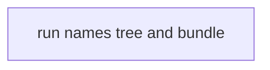

# Superlite: a verify run names the tree and result bundle it tested (#818)

**Goal:** a worker's green no longer hides that it tested a different tree: every isolated tree run records and prints the tree it ran in, the run root's changed files that tree lacks and the files that changed while it ran; every run whose command or output names an `.xcresult` result bundle records and prints it; the worker report contract asks for both (#818).
**Architecture:** `run_tests.py` gains two pure helpers (`result_bundles`, `tested_tail`) and one check (`outside_bundles`); the tree branch of `main` sets a `TESTED` global before the run and `run_other` sets `BUNDLES` from the run's commands and output, so `write_summary` writes `tree`, `lacks`, `drift` and `result_bundles` in the summary's first write; `summary_line` (the `--wait` line, `fleet wait --tests`, fleet_rearm) appends `tested_tail`, and one stderr line repeats it after a foreground run; `fleet_report.WORK` asks for the tree and bundle in `tests`.
**Tech stack:** Python 3.10+ stdlib; pytest through `sl run_tests`.
**Spec:** this file, section Design.
**Detail:** contracts
**Target-min:** 11
**Wave0:** none
**Coverage:** off

Global constraints:
- Every line of a Python script under `skills/**/scripts/` keeps the repo's `# O(...)` complexity comment; stdlib only; LF endings. Files under `tests/` carry no such comments.
- This repository is public: no host names, user names, home paths, other project or repository names in code, tests, docs or commit messages.
- The verdict is `sl run_tests` (never raw pytest); every new test sees a red run before the code it tests.
- An existing test that pins a changed text or output may be updated in this task (no open batch lists those test files, except tests/scripts/test_docs_b251.py, which stays untouched); name each such file in your report.
- Builds: the verdict is `sl run_tests` (the project's test command; a project with `.maxapp` runs `maxapp test`, which a build pool may place on another Mac, and a full run whose tree a green maxapp test stamp covers returns that result without a run); task trees build in <tree>/.build/DerivedData and any build of your own goes under .build/ of the worktree, never -derivedDataPath outside the worktree (your session scratchpad included; backlog cleanup removes scratchpad build folders when the worktree goes); a product, simulator or device build stays on this machine and runs only when an issue's acceptance asks for a running-app check; copy this sentence into every worker brief.
- Simulators: append the UDID of each simulator you or a worker creates (`xcrun simctl create` or `clone`; a checker's `Simulators:` line marks its created ones) as one line to the worktree's `.superlite/simulators.txt`; never list one you did not create; ship cleanup shuts down and deletes each listed one; copy this sentence into every worker brief.

## Design

Issue #818: a fleet worker reported an iOS run green; the coordinator's run of the same command a minute later failed the 4 expected cases; the worker's result bundle was not in the worktree's DerivedData. Expected: a verify run that tests the current tree, or a report naming the result bundle it read.

Research (R1, R2): a worker's verify run on an isolated stack runs in `.superlite/trees/<task>` or `worker-<Wn>` (B110, B254), which keeps unfinished siblings' files at base and builds in `<tree>/.build/DerivedData` (B117). Only a red tree run names the changed files the tree lacks and the files that changed while it ran (run_tests.py, after `run_other` in `main`); a green one says nothing, the summary JSON holds no tree, and nothing parses or names an `.xcresult`. `fleet_report.WORK` asks only for `"<test command and result line>"`, and nothing checks the claim.

1. **Tree facts in the summary.** Before `run_other`, the tree branch sets `TESTED = {"tree": <tree relative to the run root, posix>, "lacks": outside_tree(".", overlay_now), "path": <tree>, "overlay": overlay_now}` (an error in `outside_tree` gives `[]`). `write_summary` writes `tree`, `lacks` (when non-empty) and `drift` (`tree_drift(".", path, overlay)` at write time, when non-empty). `main` resets `TESTED = None`.
2. **Result bundles.** `run_other` sets `BUNDLES = result_bundles(<the commands it ran>, <their output text>, <the run directory>)` right where it saves the output; `write_summary` writes `result_bundles` (each path relative to the run root when inside it, else absolute) when non-empty. On a tree run, each bundle `outside_bundles` returns adds `result bundle <path> is outside the tree <tree>: it may hold another build's results` to `WARNING` (summary `warning`) and prints it as `run_tests: WARNING: ...`. `main` resets `BUNDLES = []`.
3. **Lines.** `summary_line(data)` appends `"; " + tested_tail(data)` when the tail is non-empty. After the run, `main` reads the summary and prints `run_tests: tested <tail>` to stderr on a tree run, `run_tests: <tail>` on a run-root run with a bundle; nothing when the tail is empty. The stdout `P F S SEC` line and the red-run lines (#517 hint, drift) stay byte-identical.
4. **Contract.** `fleet_report.WORK`'s `tests` placeholder becomes `<test command and result line, with the tree and result bundle run_tests named>` (WORK_BATCH and PLANNED derive from WORK).

### Rulings

- Ruling: tree runs keep their isolation (B110, #479, #517); a run that did not test the run root's current tree says so on its result instead (because #818 offers "a report naming the result bundle it read", and running workers in the run root would test other workers' unfinished files).
- Ruling: the new summary keys are written only when they hold a value, so a pytest run or a run-root run without a bundle writes exactly what it wrote before (because many readers and tests compare summaries).
- Ruling: `drift` is computed when the summary is written, not amended afterwards (because a `--background` waiter may read the first published summary).
- Ruling: a `maxapp` command (first word after NAME=value words) gets no outside-the-tree warning (because maxapp builds in its own pool, B155).
- Ruling: lint's MISSED TARGET is accepted: one task (because the fleet_report change is one placeholder text that shares T1's contract; a second worker for it costs more than it saves).
- Ruling: no cross-check of a worker's `tests` claim against run_tests summaries (because the report is free text and fleet_io.py, which prints the wait line, belongs to B260); the report contract and the run's own lines carry the facts.

## Task graph

```mermaid
%% schedule
gantt
  title Predicted schedule (mm:ss)
  dateFormat X
  axisFormat %M:%S
  section lane 1
  T1 run names tree and bundle :t1, 0, 591s
```

critical path: T1 (9.8 min) · peak width 1 · predicted build 9.8 min · predicted total ≈ 26.3 min (target ✗ 11.0)

## Package: test runner

App type: library (CLI test runner and report contract). Categories: protocol (exact lines and keys), state (globals reset per run), error handling (git errors give empty lists).
**Probe entry:** none (the runner runs in the named tests on a temporary git repository)

### T1 run names tree and bundle · Complexity 4 · Est. context 50k
**Owns:** skills/subagent-driven-development/scripts/run_tests.py, skills/subagent-driven-development/scripts/fleet_report.py, tests/scripts/test_run_tests_tested_818.py
**Components:** 2
**LOC owned:** 190
**Tests:** fast
**Model:** sonnet
**Covers:** Design
**Produces:** run_tests.result_bundles(commands: list[str], text: str, cwd: str) -> list[str] · run_tests.tested_tail(data: dict) -> str · run_tests.outside_bundles(bundles: list[str], tree: str, command: str) -> list[str]
  e.g. result_bundles(["xcodebuild test -scheme App -resultBundlePath out/r.xcresult"], "", "/w") -> ["/w/out/r.xcresult"]
  e.g. result_bundles(["xcodebuild test -scheme App"], "Test session results, code coverage, and logs:\n\t/dd/Logs/Test/Test-App.xcresult\n\n** TEST SUCCEEDED **", "/w") -> ["/dd/Logs/Test/Test-App.xcresult"]
  e.g. result_bundles(["pytest -q"], "3 passed", "/w") -> []
  e.g. tested_tail({"tree": ".superlite/trees/T3", "lacks": ["App/Foo.swift", "App/Bar.swift"]}) -> "tree .superlite/trees/T3; lacks 2 changed files of the run root: App/Foo.swift, App/Bar.swift"
  e.g. tested_tail({"tree": ".superlite/trees/worker-W2", "drift": ["a.swift"], "result_bundles": ["/dd/r.xcresult", "/dd/s.xcresult"]}) -> "tree .superlite/trees/worker-W2; 1 file changed while the tests ran: a.swift; result bundle /dd/r.xcresult (+1 more)"
  e.g. tested_tail({"passed": 3, "failed": 0}) -> ""
  e.g. outside_bundles(["/w/.superlite/trees/T1/.build/DerivedData/Logs/Test/r.xcresult", "/dd/x.xcresult"], "/w/.superlite/trees/T1", "xcodebuild test -scheme A") -> ["/dd/x.xcresult"] · outside_bundles(["/dd/x.xcresult"], "/w/.superlite/trees/T1", "maxapp test --ios") -> []
**Review Focus:** protocol: `test_result_bundles_examples`, `test_tested_tail_examples`, `test_summary_line_appends_tail`, `test_work_contract_names_tree_and_bundle`; state: `test_green_tree_run_names_lacking_files`, `test_drift_recorded_on_green`, `test_background_wait_line_names_tree`; error handling: `test_bundle_outside_tree_warns`, `test_root_run_names_bundle`, `test_python_run_unchanged`
**Test code (contracts):**
- `test_result_bundles_examples`: the three e.g. lines exactly; `Writing result bundle at path:` followed by a tab-indented path is read like the `Test session results` header; an absolute `-resultBundlePath /abs/r.xcresult` stays as is; a path named by both the command and the output appears once; at most 5 paths, in order of appearance; a quoted `-resultBundlePath 'out dir/r.xcresult'` gives `/w/out dir/r.xcresult`.
- `test_tested_tail_examples`: the three e.g. lines exactly; 5 lacking files show the first 3 and ` (+2 more)`; one lacking file reads `lacks 1 changed file of the run root: x`; `{"result_bundles": ["/dd/r.xcresult"]}` (no tree) -> `result bundle /dd/r.xcresult`.
- `test_summary_line_appends_tail`: `summary_line({"mode": "fast", "passed": 3, "failed": 0, "tree": ".superlite/trees/T1", "lacks": ["a.swift"]})` == `tests (fast): 3 passed, 0 failed; tree .superlite/trees/T1; lacks 1 changed file of the run root: a.swift`; the same dict without the two keys gives exactly `tests (fast): 3 passed, 0 failed`.
- `test_green_tree_run_names_lacking_files`: an isolated stack (the `setup`, `set_cmd` and `git` fixtures of tests/scripts/test_run_tests_also_517.py) with a passing command, plan T1 owning `src/a.txt` and unfinished T2 owning `src/b.txt`, both edited: `run_tests --fast src/a.txt --task T1` exits 0; the summary JSON has `"tree": ".superlite/trees/T1"` and `"lacks": ["src/b.txt"]`, no `drift`; stderr holds `run_tests: tested tree .superlite/trees/T1; lacks 1 changed file of the run root: src/b.txt`.
- `test_drift_recorded_on_green`: the same tree run with a command that appends to the root's `src/a.txt` (absolute path) and passes: summary `"drift": ["src/a.txt"]`; the stderr tested line holds `1 file changed while the tests ran: src/a.txt`.
- `test_background_wait_line_names_tree`: the green tree run of `test_green_tree_run_names_lacking_files` with `--background`, then `--wait`: the waiter's last stderr line ends with `; tree .superlite/trees/T1; lacks 1 changed file of the run root: src/b.txt`.
- `test_bundle_outside_tree_warns`: a tree run whose passing command prints `Test session results, code coverage, and logs:` and a tab-indented absolute path outside the tree (`<tmp>/dd/Logs/Test/x.xcresult`): summary `result_bundles` == [that path], `warning` holds `result bundle <that path> is outside the tree .superlite/trees/T1: it may hold another build's results`, stderr holds `run_tests: WARNING: result bundle`; the same output with the path inside the tree: no such warning, and the summary path is relative to the run root.
- `test_root_run_names_bundle`: a run-root run (no tree) whose command prints the header and `<tmp>/dd/x.xcresult`: summary `result_bundles` == [that path], no `tree` key, stderr holds `run_tests: result bundle <that path>` and no `run_tests: tested` line.
- `test_python_run_unchanged`: a pytest project run (no test-cmd.json command): the summary has none of `tree`, `lacks`, `drift`, `result_bundles`, and stderr has no `run_tests: tested` and no `result bundle` text.
- `test_work_contract_names_tree_and_bundle`: `fleet_report.WORK`, `WORK_BATCH` and `PLANNED` each contain `"tests": "<test command and result line, with the tree and result bundle run_tests named>"`; `fleet_report.brief_message("implementer", p)` for a plain brief ends with WORK; `parse()` of a reply whose json block has `"tests": "x; tree .superlite/trees/T1"` keeps that string.
**Steps:** 1 write the tests, 2 run: FAIL, 3 implement Design 1-4 (helpers next to `summary_line`; `result_bundles` reads `-resultBundlePath` values with `shlex.split` (unparsable command: skipped) and each line right after a `Test session results, code coverage, and logs:` or `Writing result bundle at path:` line whose stripped text ends `.xcresult`, relative paths against `cwd`, `os.path.normpath`; the outside check uses `Path.resolve()` on both sides; update the run_tests.py module docstring with one paragraph naming the keys and lines, and fleet_report's WORK text), 4 run: PASS
**Notes:** `write_summary` runs with the project root as cwd, so `tree_drift(".", ...)` compares against the run root; wrap `outside_tree` and `tree_drift` so an error gives `[]`. Verify with `sl run_tests --fast tests/scripts/test_run_tests_tested_818.py tests/scripts/test_run_tests_also_517.py tests/scripts/test_isolated_review_builds_479.py tests/scripts/test_run_tests_tree_busy_785.py tests/scripts/test_run_tests_wrapped_614.py tests/scripts/test_fleet_report.py tests/scripts/test_fleet_io.py --task T1`.

## Review Focus

- T1 protocol: the stdout `P F S SEC` line and the red-run lines are byte-identical to before; new keys appear only with a value.
- T1 state: `TESTED`, `BUNDLES` and the outside-bundle `WARNING` text are reset per run in `main`, so a second run in one process never inherits them.
- T1 error handling: a git error in `outside_tree` or `tree_drift`, or an unparsable command, gives empty lists, never an exception or a changed exit code.

## Self-review

#818 maps to T1 (both expectations: the tree it tested and the bundle it read); one task, no shared files, no edges; contracts name exact texts.
