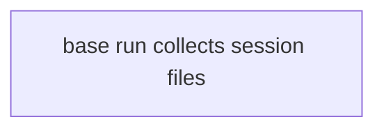

# Superlite: run_tests --base-skips collects every parity file too (#1007)

**Goal:** `sl run_tests --base-skips` reruns a skipped test's session at the base the way the full run had it, so `tests/scripts/test_guard_parity.py::test_parity_existing_suites` (which skips only when the session collects every parity file, #739) skips at the base too and the review packet tags it ` (base skips too)` instead of showing it as new (#1007).
**Architecture:** a test file whose skips depend on what else the session collects names those files in a module-level `SESSION_FILES` tuple of glob patterns relative to its folder. `base_skips` reads that declaration (by `ast`, never importing the file) from each narrowed base path, in the base tree and in the full run's tree, expands the patterns in the base tree and adds the matches to the narrowed run's files. `test_guard_parity.py` derives `parity_files()` from its own `SESSION_FILES`, so the parity list lives in one place.
**Tech stack:** Python 3.10+ stdlib; pytest 9.2.0 (uv.lock) through `sl run_tests`.
**Spec:** this file, section Design.
**Detail:** tests
**Target-min:** 11
**Wave0:** none
**Coverage:** off (bounded change to the existing --base-skips flow; Max decided the approach)

Global constraints:
- Every line of a Python script under `skills/**/scripts/` keeps the repo's `# O(...)` complexity comment; stdlib only; LF endings. Files under `tests/` carry no such comments.
- This repository is public: no host names, user names, home paths, other project or repository names in code, tests, docs or commit messages.
- The verdict is `sl run_tests` (never raw pytest); every new test sees a red run before the code it tests.
- Existing run_tests messages and test-summary-base.json keys stay byte-identical (docs/tools.md and doc tests pin them); only the one new stderr line below is added.
- An existing test that pins a changed text or output is updated in the same task only when it is in the task's Owns. Any other test your change turns red: leave it, and name the file and the failing assertion in your report (the coordinator rules it).
- Builds: the verdict is `sl run_tests` (the project's test command; a project with `.maxapp` runs `maxapp test`, which a build pool may place on another Mac, and a full run whose tree a green maxapp test stamp covers returns that result without a run); task trees build in <tree>/.build/DerivedData and any build of your own goes under .build/ of the worktree, never -derivedDataPath outside the worktree (your session scratchpad included; backlog cleanup removes scratchpad build folders when the worktree goes); a product, simulator or device build stays on this machine and runs only when an issue's acceptance asks for a running-app check; copy this sentence into every worker brief.
- Simulators: append the UDID of each simulator you or a worker creates (`xcrun simctl create` or `clone`; a checker's `Simulators:` line marks its created ones) as one line to the worktree's `.superlite/simulators.txt`; never list one you did not create; ship cleanup shuts down and deletes each listed one; copy this sentence into every worker brief.

## Design

### 1. The declaration

`run_tests.declared_session_files(source: Path) -> list[str]`: the patterns of a top-level `SESSION_FILES = (...)` (an `ast.Assign` with one `ast.Name` target, or an `ast.AnnAssign` with a value) in a Python file, read with `ast.parse` and `ast.literal_eval`. A tuple or list of `str` only, in order, duplicates dropped. `[]` when the file is missing or unreadable, does not parse, has no such assignment, or its value is not a literal sequence of strings (`PARITY + ("x",)`, a number, a list holding a non-string). The last top-level assignment wins, as at import.

### 2. Expanding it at the base

`run_tests.session_files(root: Path, tree: Path, paths: list[str]) -> list[str]`: the extra files the base run collects. For each tree-relative posix path in `paths` that ends in `.py` and is a file in `tree`: the patterns of `declared_session_files(root / p)` then those of `declared_session_files(tree / p)` not already seen (the full run's tree first, so a declaration that only the branch adds counts at an older base). Each pattern is globbed with `Path.glob` in `tree / parent(p)`, matches sorted; a pattern that is absolute, empty or holds a `..` part is skipped; a match counts only when it is a file whose resolved path lies inside `tree.resolve()`. The result: tree-relative posix paths, in pattern order, none already in `paths`, no duplicates.

### 3. base_skips

After `paths` is computed and before `run_base_tests`: `extra = session_files(root, Path(tree), paths)`; when `extra` is not empty, print to stderr `run_tests: --base-skips: the base run also collects {len(extra)} files SESSION_FILES names, so a skip that depends on what its session collects matches the full run's` and run with `paths + extra`. The remote and local branches already take `paths` unchanged; `compared` and `skipped_tests` in test-summary-base.json still list only the full run's skipped ids; the counts include the extra files' tests. No new key.

### 4. test_guard_parity

`PARITY` becomes `SESSION_FILES = ("test_block_coordinator_edits.py", "test_human_gate.py", "test_session_state.py", "test_fleet_hooks.py", "test_hooks_bash32.py", "test_guard_*.py")` with a comment naming #1007; `parity_files()` returns, per pattern in order, the sorted `HERE.glob(pattern)` matches other than this file and not already listed (the same list as today). Every other test in the file stays.

### 5. Rulings

- Ruling: the parity files come from a `SESSION_FILES` literal in the test file, read by `ast` (because one list then serves the test and the base run, nothing in run_tests names a superlite test file, and reading never runs the file's imports) (lead's ruling).
- Ruling: the declaration is read from the full run's tree and the base tree, globbed in the base tree (because this batch's own base predates the declaration, and the base's skip depends on the base's files) (lead's ruling).
- Ruling: no new test-summary-base.json key and no pt_review.py change: the base summary's `skipped_tests` now holds the parity id, which the packet already tags (lead's ruling).
- Ruling: the narrowed base run gets about 60 more files (about 2600 guard tests); today it runs the same tests nested inside test_parity_existing_suites, so the cost stays about the same (lead's ruling).
- Ruling: docs/tools.md (B271's file) is a follow-up: its `--base-skips` paragraph should name `SESSION_FILES` (lead's ruling).
- Ruling: MISSED TARGET accepted (because the plan is one small task).

## Task graph

```mermaid
%% schedule
gantt
  title Predicted schedule (mm:ss)
  dateFormat X
  axisFormat %M:%S
  section lane 1
  T1 base run collects session files :t1, 0, 198s
```





critical path: T1 (3.3 min) · peak width 1 · predicted build 3.3 min · predicted total ≈ 11.8 min (target ✗ 11.0)

## Package: run_tests base-skips

App type: CLI (a run_tests mode). Categories: protocol (the declaration's shape), state (the scratch tree's files, the base summary).
**Probe entry:** none (the mode runs git and a test command; the named tests, one through run_tests.py, cover each case)

### T1 base run collects session files · Complexity 2 · Est. context 45k
**Owns:** skills/subagent-driven-development/scripts/run_tests.py, tests/scripts/test_guard_parity.py, tests/scripts/test_run_tests_base_skips_1007.py
**Components:** 1
**LOC owned:** 150
**Tests:** fast
**Model:** sonnet
**Covers:** 1, 2, 3, 4
**Produces:** run_tests.declared_session_files(source: Path) -> list[str] · run_tests.session_files(root: Path, tree: Path, paths: list[str]) -> list[str]
  e.g. run_tests.declared_session_files(Path("tests/scripts/test_guard_parity.py")) == ["test_block_coordinator_edits.py", "test_human_gate.py", "test_session_state.py", "test_fleet_hooks.py", "test_hooks_bash32.py", "test_guard_*.py"]
  e.g. run_tests.session_files(tree, tree, ["tests/test_p.py"]) == ["tests/test_g_1.py", "tests/test_g_2.py"] for a tree whose tests/test_p.py declares ("test_g_*.py",)
**Review Focus:** protocol: `test_declared_session_files_reads_only_a_literal_string_sequence`, `test_session_files_skip_unsafe_patterns_and_known_paths`; state: `test_base_run_collects_the_session_files_a_skipped_test_names`, `test_guard_parity_session_files_are_its_parity_files`
**Test code (verbatim):**
```python
# tests/scripts/test_run_tests_base_skips_1007.py
"""run_tests --base-skips collects the files a skipped test's file names in SESSION_FILES, so a skip that depends on what its session collects matches the full run's (#1007)."""
import json
import os
import subprocess
import sys
from pathlib import Path

ROOT = Path(__file__).resolve().parents[2]
SCRIPTS = ROOT / "skills" / "subagent-driven-development" / "scripts"
sys.path.insert(0, str(SCRIPTS))
import run_tests  # noqa: E402
import test_guard_parity as parity  # noqa: E402

COMPOSITE = '''from pathlib import Path

import pytest

HERE = Path(__file__).resolve().parent
{decl}

def test_composite(request):
    collected = {{Path(str(i.path)).resolve() for i in request.session.items}}
    if all(p.resolve() in collected for p in HERE.glob("test_g_*.py")):
        pytest.skip("every companion runs in this session")


def test_plain():
    pass
'''
DECL = 'SESSION_FILES = ("test_g_*.py",)\n'
COMPANION = "def test_one():\n    pass\n"
SKIPPED = ["tests/test_p.py::test_composite"]
FULL = {"mode": "full", "started": 1763600000.5, "passed": 3, "failed": 0, "skipped": 1, "skipped_tests": SKIPPED}


def git(repo, *args):
    env = {k: v for k, v in os.environ.items() if k not in ("GIT_DIR", "GIT_INDEX_FILE", "GIT_WORK_TREE")}
    r = subprocess.run(["git", "-C", str(repo), "-c", "user.name=t", "-c", "user.email=t@t", *args], capture_output=True, text=True, env=env)
    assert r.returncode == 0, r.stderr
    return r.stdout.strip()


def write(path, text):
    path.parent.mkdir(parents=True, exist_ok=True)
    path.write_text(text, encoding="utf-8")
    return path


def make_repo(tmp_path):
    repo = tmp_path / "repo"
    write(repo / "pytest.ini", "[pytest]\n")
    write(repo / "tests" / "test_p.py", COMPOSITE.format(decl=""))
    write(repo / "tests" / "test_g_1.py", COMPANION)
    write(repo / "tests" / "test_g_2.py", COMPANION)
    sd = repo / ".superlite"
    cmd = {"language": "python", "test": f"{sys.executable} -m pytest tests -q -rs -p no:cacheprovider",
           "test_file": f"{sys.executable} -m pytest {{files}} -q -p no:cacheprovider -o junit_family=xunit1 --junitxml={{junit}}", "junit": "{junit}"}
    write(sd / "test-cmd.json", json.dumps(cmd))
    git(repo, "init", "-q", "-b", "main")
    git(repo, "add", "-A")
    git(repo, "commit", "-q", "-m", "base")
    base = git(repo, "rev-parse", "HEAD")
    write(sd / "checkpoints.json", json.dumps({"base": base, "entries": []}))
    write(repo / "tests" / "test_p.py", COMPOSITE.format(decl=DECL))
    git(repo, "add", "tests")
    git(repo, "commit", "-q", "-m", "declare")
    write(sd / "test-summary-full.json", json.dumps(FULL))
    return repo


def rt(repo, *args):
    env = {k: v for k, v in os.environ.items() if not k.startswith("SUPERLITE_") and k not in ("GIT_DIR", "GIT_INDEX_FILE", "GIT_WORK_TREE")}
    return subprocess.run([sys.executable, str(SCRIPTS / "run_tests.py"), *args], cwd=repo, capture_output=True, text=True, timeout=180, env=env)


def test_declared_session_files_reads_only_a_literal_string_sequence(tmp_path):
    f = tmp_path / "test_x.py"
    cases = [
        ('SESSION_FILES = ("a.py", "test_*.py", "a.py")\n', ["a.py", "test_*.py"]),
        ('SESSION_FILES = ["b.py"]\n', ["b.py"]),
        ('SESSION_FILES: tuple = ("c.py",)\n', ["c.py"]),
        ('SESSION_FILES = ("old.py",)\nSESSION_FILES = ("new.py",)\n', ["new.py"]),
        ('BASE = ("a.py",)\nSESSION_FILES = BASE + ("b.py",)\n', []),
        ('SESSION_FILES = ("a.py", 3)\n', []),
        ('SESSION_FILES = "a.py"\n', []),
        ('def f():\n    SESSION_FILES = ("a.py",)\n', []),
        ('SESSION_FILES = (\n', []),
        ('OTHER = ("a.py",)\n', []),
    ]
    for text, want in cases:
        f.write_text(text, encoding="utf-8")
        assert run_tests.declared_session_files(f) == want, text
    assert run_tests.declared_session_files(tmp_path / "missing.py") == []


def test_session_files_skip_unsafe_patterns_and_known_paths(tmp_path):
    root, tree = tmp_path / "root", tmp_path / "tree"
    write(root / "tests" / "test_p.py", 'SESSION_FILES = ("test_g_*.py", "test_x.py", "../outside.py", "/abs.py", "")\n')
    write(tree / "tests" / "test_p.py", 'SESSION_FILES = ("test_x.py", "sub/test_*.py", "test_dir")\n')
    for name in ("test_g_2.py", "test_g_1.py", "test_x.py", "sub/test_s.py", "test_other.py"):
        write(tree / "tests" / name, COMPANION)
    (tree / "tests" / "test_dir").mkdir()
    write(tree / "outside.py", COMPANION)
    write(tree / "tests" / "test_q.py", "")
    got = run_tests.session_files(root, tree, ["tests/test_p.py", "tests/test_g_2.py", "tests/test_q.py", "SwiftSuite"])
    assert got == ["tests/test_g_1.py", "tests/test_x.py", "tests/sub/test_s.py"]
    assert run_tests.session_files(root, tree, ["tests/test_q.py"]) == []
    assert run_tests.session_files(root, tree, ["tests/missing.py"]) == []


def test_base_run_collects_the_session_files_a_skipped_test_names(tmp_path):
    repo = make_repo(tmp_path)
    r = rt(repo, "--base-skips")
    assert r.returncode == 0, r.stdout + r.stderr
    assert "run_tests: --base-skips: the base run also collects 2 files SESSION_FILES names, so a skip that depends on what its session collects matches the full run's" in r.stderr
    assert "run_tests: base " in r.stderr and " skips 1 of 1 of the full run's skipped tests" in r.stderr
    data = json.loads((repo / ".superlite" / "test-summary-base.json").read_text(encoding="utf-8"))
    assert data["compared"] == SKIPPED
    assert data["skipped_tests"] == SKIPPED
    assert (data["passed"], data["failed"], data["skipped"]) == (3, 0, 1)


def test_guard_parity_session_files_are_its_parity_files():
    own = "tests/scripts/test_guard_parity.py"
    assert run_tests.declared_session_files(ROOT / own) == list(parity.SESSION_FILES)
    want = [p.relative_to(ROOT).as_posix() for p in parity.parity_files()]
    assert run_tests.session_files(ROOT, ROOT, [own]) == want
    assert len(want) == len(set(want)) and own not in want
    assert want[:5] == [f"tests/scripts/{n}" for n in parity.SESSION_FILES[:5]]
```
**Steps:** 1 write the test file, 2 `sl run_tests --task T1`: FAIL (no `declared_session_files`, no `SESSION_FILES` in test_guard_parity), 3 implement sections 1-4, 4 `sl run_tests --task T1`: PASS, also with `tests/scripts/test_guard_parity.py` and `tests/scripts/test_run_tests_base_skips_886.py` `tests/scripts/test_run_tests_base_skips_999.py` in the run.
**Notes:** in `session_files` the patterns of one file go in their order (root's, then the tree's new ones), each pattern's matches sorted, so the guard parity list keeps today's order (five named files, then the sorted `test_guard_*.py`). Put the two functions next to `base_commit_of`. The new stderr line goes after the `paths` line inside the `with trees.busy` block, only when `paths` is not empty.

## Review Focus

- protocol: `declared_session_files` accepts only a literal tuple or list of strings at module level (`test_declared_session_files_reads_only_a_literal_string_sequence`).
- protocol: `session_files` skips `..`, absolute and empty patterns, directories, files outside the tree and paths already in the run (`test_session_files_skip_unsafe_patterns_and_known_paths`).
- state: a base whose test file lacks the declaration still collects the files the full run's tree names; the base summary's `compared` and `skipped_tests` hold only the full run's ids (`test_base_run_collects_the_session_files_a_skipped_test_names`).
- state: test_guard_parity's `SESSION_FILES` expands to exactly its `parity_files()` (`test_guard_parity_session_files_are_its_parity_files`).

## Self-review

Coverage: sections 1-4 map to T1. Placeholders: none. Graph: one task. Limits: one task inside the band.
