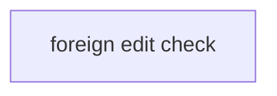

# Superlite: commit_task fails a task that edits a file another task owns (#907)

**Goal:** `commit_task Tn` no longer checkpoints Tn without a hunk Tn wrote into a file another task Tm owns (the hunk then rides in with Tm later, and every tree built in between does not compile); it fails the task with `Tn FAILED: edits F owned by Tm` and prints the `--also F --ruling` call that resolves it (main's ruling for #907).
**Architecture:** commit_task.py's `commit_one` gains one check between the out-of-scope block and the hold: the changed files another task owns (`theirs`) whose owners are all outside the call and that differ from the newest checkpoint are this task's edits when Tn's fresh fleet report lists them, or, with no report, when nothing but Tn can have written them; such files fail the task before anything is staged.
**Tech stack:** Python 3.10+ stdlib; pytest through `sl run_tests`.
**Spec:** this file, section Design.
**Detail:** contracts
**Target-min:** 11
**Wave0:** none
**Coverage:** off

Global constraints:
- Every line of a Python script under `skills/**/scripts/` keeps the repo's `# O(...)` complexity comment; stdlib only; LF endings. Files under `tests/` carry no such comments.
- This repository is public: no host names, user names, home paths, other project or repository names in code, tests, docs or commit messages.
- The verdict is `sl run_tests` (never raw pytest); every new test sees a red run before the code it tests.
- An existing test that pins a changed text or output may be updated in the task that changes it; name each such file in your report.
- Tests never touch the real `~/.superlite` or the real session: tests/scripts/conftest.py already sets SUPERLITE_HOME per test; delete SUPERLITE_FLEET_WORKER with monkeypatch.
- Builds: the verdict is `sl run_tests` (the project's test command; a project with `.maxapp` runs `maxapp test`, which a build pool may place on another Mac, and a full run whose tree a green maxapp test stamp covers returns that result without a run); task trees build in <tree>/.build/DerivedData and any build of your own goes under .build/ of the worktree, never -derivedDataPath outside the worktree (your session scratchpad included; backlog cleanup removes scratchpad build folders when the worktree goes); a product, simulator or device build stays on this machine and runs only when an issue's acceptance asks for a running-app check; copy this sentence into every worker brief.
- Simulators: append the UDID of each simulator you or a worker creates (`xcrun simctl create` or `clone`; a checker's `Simulators:` line marks its created ones) as one line to the worktree's `.superlite/simulators.txt`; never list one you did not create; ship cleanup shuts down and deletes each listed one; copy this sentence into every worker brief.

## Design

Issue #907: T1 edited `src/map.py`, which T2 owns. `commit_one` puts every changed file another task owns into `theirs` and leaves it out (commit_task.py, the `elif nt.owns_match(f, other)` branch); with T2 uncommitted or running nothing is said, with T2 committed only the `owned by` note prints. T1's checkpoint lacks the hunk until T2 is checkpointed. No code today ties such a file to the task being committed.

1. **Candidates.** After the out-of-scope block (an out-of-scope failure still wins) and before the running-sibling hold: `cands` = the files of `theirs` whose every owner (plan tasks other than Tn whose owns match, `nt.owns_match`) is outside the call (`a.task`), filtered by `changed_vs_parent` (a file equal to the newest checkpoint is no new edit). A file a ruling or claim names (`ruled`, `--also`, `--claim`, the plan's `Also-touches`) never reaches `theirs`, so it is never a candidate; T0 never reaches this branch.
2. **Attribution (a), the report.** `fresh_report_files(sd, tid, since)`: the `files` of Tn's newest fleet report (the report `report_files` picks: label split on commas names Tn, newest mtime), only when that report's mtime is later than `since`; `[]` otherwise. `since` = the committer time (`git show -s --format=%ct SHA`, seconds) of Tn's newest checkpoint, the last `commit Tn <sha>` line of the ledger (`last_checkpoint(ledger, tid) -> str | None`); None (no checkpoint yet) means every report is fresh. A stale report (its files were handled at Tn's last checkpoint) attributes nothing. A candidate the fresh report lists is Tn's edit.
3. **Attribution (b), nothing else can have written it.** With no fresh report naming it, a candidate is still Tn's edit when all hold: the call names Tn alone; every owner of the file is neither committed (`done`) nor running (`others_running`); `pool_readable(pool_path)` (the pool file parses as a JSON object); `others_running(pool_path, call)` is empty; `busy_editors(sd, me, tid)` is empty (`me` = SUPERLITE_FLEET_WORKER); `baseline_dirty(a.plan)` is not None and does not hold the file.
4. **Failure.** Tn's edits `E` (sorted by path) non-empty: nothing is staged; `fail(1, reason)` with reason `edits F owned by Tm` per file joined by `; ` (several owners: `owned by T2, T5`, plan order). Then one stderr line through `note_once`:
   - every file of `E` has a running owner (in `others_running`): `next: once T2 is done: commit_task T2 Tn --plan P, or commit_task Tn --also F1 F2 --ruling TEXT --plan P` (several running owners `once T2, T5 are done: commit_task T2 T5 Tn ...`, owners in plan order);
   - otherwise: `next: commit_task Tn --also F1 F2 --ruling TEXT --plan P`.
   `P` is the `--plan` value as passed (main's `plan_arg`, stored as `a.plan_arg`). No incident is logged. The files of `E` are dropped from `a.owned_notes`, so the `owned by ... run commit_task T2` note never contradicts the failure.
5. **Unchanged:** every other path and message; a candidate that is not Tn's edit stays out as today (silent, or the #397 `owned by` note); an owner in the same call commits the file itself; `--also F --ruling` and `--claim` resolve the failure (the file reaches `mine`); the docstring and docs/tools.md name the new failure.

### Rulings

- Ruling: attribute an edit by Tn's fresh fleet report first (because it is the only per-task record of the files a worker changed; rule (9) already trusts it for shared tests).
- Ruling: without a report, fail only when nothing but Tn can have written the file: one-task call, owners never started, a readable pool with nothing else running, no other busy editing worker, a known baseline without the file (because a missing or stale pool, a parallel task or a file dirty before the run would otherwise blame Tn for another writer's edit, and a false FAILED stalls the build loop).
- Ruling: a committed owner keeps the #397 `owned by` note when no fresh report names the file (because the format pass and the fix phase run `commit_task Tn` per owning task after another task's file changed; failing them would break both).
- Ruling: an owner in the same call is not a failure (because the call checkpoints the file with its owner and the chain is whole after the call).
- Ruling: a report older than Tn's newest checkpoint attributes nothing (because a fixer's later edit to another task's file must not fail Tn on Tn's old report).
- Ruling: no incident for the failure (because the FAILED line already stops the task and the coordinator rules it; an incident would stay open after the `--also` ruling).
- Ruling: docs/tools.md gets one paragraph (no open batch lists it); docs/fleet.md and SDD SKILL.md stay unchanged (other batches own docs/fleet.md; SKILL.md step 4 already says FAILED goes back to the coordinator).
- Ruling: lint's MISSED TARGET is accepted (because the batch is one task on one file plus its test and a docs paragraph).

## Task graph

```mermaid
%% schedule
gantt
  title Predicted schedule (mm:ss)
  dateFormat X
  axisFormat %M:%S
  section lane 1
  T1 foreign edit check :t1, 0, 658s
```

critical path: T1 (11.0 min) · peak width 1 · predicted build 11.0 min · predicted total ≈ 29.5 min (target ✗ 11.0)

## Package: commit_task CLI

App type: CLI. Categories: protocol (FAILED reason, the `next:` line, exit code, unchanged messages), state (nothing staged on failure; ledger, checkpoints.json, pool.json, fleet reports read only), file (paths relative to the checkout).
**Probe entry:** none (each case needs a temporary git repository with a plan, a ledger, a pool and fleet reports; they are named tests)

### T1 foreign edit check · Complexity 4 · Est. context 70k
**Owns:** skills/subagent-driven-development/scripts/commit_task.py, tests/scripts/test_commit_foreign_edit_907.py, docs/tools.md
**Components:** 1
**LOC owned:** 230
**Tests:** fast
**Model:** sonnet
**Covers:** Design
**Produces:** commit_task.fresh_report_files(sd: Path | str | None, tid: str, since: float | None) -> list[str]
  e.g. a report T1.json `{"label": "T1", "files": ["src/map.py"]}` with mtime 200, since 100 -> ["src/map.py"]; since 300 -> []; since None -> ["src/map.py"]; no report -> []
**Produces:** commit_task.last_checkpoint(ledger: str, tid: str) -> str | None
  e.g. ledger "- commit T1 abc1234\n- commit T2 def5678\n- commit T1 0123abc\n", "T1" -> "0123abc"; "T3" -> None; missing file -> None
**Produces:** commit_task.pool_readable(path: str) -> bool
  e.g. '{"agents": []}' -> True; missing file -> False; "[1]" -> False; "nope" -> False
**Review Focus:** protocol: `test_report_names_foreign_file_fails`, `test_two_files_reason_and_hint`, `test_running_owner_hint`, `test_foreign_only_change_fails_edits`; state: `test_also_ruling_commits_it`, `test_claim_then_commit`, `test_owner_in_call_commits_it`, `test_owner_checkpointed_first`, `test_owned_note_dropped_on_failure`; numeric: `test_stale_report_ignored`; file: `test_fallback_fails_single_task`, `test_fallback_off_cases`, `test_running_owner_without_report_silent`, `test_helpers`
**Test code (contracts):** fixture as in tests/scripts/test_commit_task_b94.py (`run`, importing `SCRIPTS, git, make_repo, write` from test_run_scripts; `spawn_background` patched to a no-op; SUPERLITE_AUTOCOMMIT=0; SUPERLITE_FLEET_WORKER deleted). Plan `docs/plans/p.md` with tasks T1 owns `src/a.py`, T2 owns `src/map.py`, T3 owns `src/c.py` (heading format as in that file); all three files committed at HEAD with `X = 0`. Helpers: `report(sd, label, files)` writes `.superlite/fleet/reports/<label>.json` `{"label": label, "role": "implementer", "files": files}`; `pool(sd, busy)` writes `.superlite/pool.json` with one agent per busy task `{"id": "W<n>", "busy": true, "current": task}` (`busy=[]` gives `{"agents": []}`); `stable(sd, plan, dirty)` writes `.superlite/stable.json` `{"plan": plan, "baseline_dirty": dirty}`; `files(sd)` = the newest checkpoints.json entry's `files`. "Edit" means writing `X = 1` (or a new number) to the file. P below is the plan path passed as `--plan`.
- `test_report_names_foreign_file_fails`: edit a.py and map.py; report T1 lists both; `main(["T1", "--plan", P]) == 1`; stdout holds `T1 FAILED: edits src/map.py owned by T2`; stderr holds `next: commit_task T1 --also src/map.py --ruling TEXT --plan P`; `.superlite/checkpoints.json` does not exist.
- `test_also_ruling_commits_it`: as above, then `main(["T1", "--also", "src/map.py", "--ruling", "needs the mapper", "--plan", P]) == 0`; `sorted(files(sd)) == ["src/a.py", "src/map.py"]`; the ledger holds `Ruling: T1 also commits src/map.py - needs the mapper`.
- `test_claim_then_commit`: edit and report as above; `main(["T1", "--claim", "src/map.py", "--ruling", "x", "--plan", P]) == 0`, then `main(["T1", "--plan", P]) == 0` and `src/map.py` is in `files(sd)`.
- `test_owner_in_call_commits_it`: edit and report as above; `main(["T1", "T2", "--plan", P]) == 0`; no `FAILED` in stdout; the newest entry (T2's) holds `src/map.py`, the entry before (T1's) does not.
- `test_owner_checkpointed_first`: edit a.py and map.py; `main(["T2", "--plan", P]) == 0`; then report T1 lists both; `main(["T1", "--plan", P]) == 0` and `files(sd) == ["src/a.py"]` (map.py equals the newest checkpoint).
- `test_two_files_reason_and_hint`: edit a.py, map.py and c.py; report T1 lists all three; exit 1; stdout holds `T1 FAILED: edits src/c.py owned by T3; edits src/map.py owned by T2`; stderr holds `next: commit_task T1 --also src/c.py src/map.py --ruling TEXT --plan P`.
- `test_running_owner_hint`: `pool(sd, ["T2"])`; edit a.py and map.py; report T1 lists both; exit 1; stdout holds `T1 FAILED: edits src/map.py owned by T2`; stderr holds `next: once T2 is done: commit_task T2 T1 --plan P, or commit_task T1 --also src/map.py --ruling TEXT --plan P`.
- `test_running_owner_without_report_silent`: `pool(sd, ["T2"])`; edit a.py and map.py; report T1 lists only `src/a.py`; exit 0; `files(sd) == ["src/a.py"]`; `edits` appears in neither stream (today's behaviour, green before and after).
- `test_foreign_only_change_fails_edits`: edit only map.py; report T1 lists it; exit 1; stdout holds `T1 FAILED: edits src/map.py owned by T2` and not `nothing to commit`.
- `test_owned_note_dropped_on_failure`: edit map.py; `main(["T2", "--plan", P]) == 0`; edit map.py again (`X = 2`) and a.py; report T1 (written after T2's checkpoint) lists both; exit 1; stdout holds `T1 FAILED: edits src/map.py owned by T2`; stderr does not hold `left uncommitted (owned by T2`.
- `test_stale_report_ignored`: edit a.py; report T1 lists `src/a.py`; `main(["T1", "--plan", P]) == 0`; rewrite report T1 to list a.py and map.py and set its mtime (`os.utime`) to the checkpoint's committer time minus 100 s; edit a.py (`X = 2`) and map.py; `main(["T1", "--plan", P]) == 0`; `files(sd) == ["src/a.py"]`; no `edits` in stdout.
- `test_fallback_fails_single_task`: no report; `pool(sd, [])`; `stable(sd, P, [])`; edit a.py and map.py; `main(["T1", "--plan", P]) == 1`; stdout holds `T1 FAILED: edits src/map.py owned by T2`.
- `test_fallback_off_cases`, parametrized; each starts from the `test_fallback_fails_single_task` setup and changes one thing; each gives exit 0, `src/map.py` not in `files(sd)`, no `edits` in stdout: `no-pool` (no pool.json), `other-running` (`pool(sd, ["T3"])`), `dirty-before` (`stable(sd, P, ["src/map.py"])`), `no-baseline` (no stable.json), `busy-editor` (`.superlite/fleet.json` `{"on": true, "workers": {"W3": {"state": "busy", "role": "implementer", "task": "T3"}}}`), `two-task-call` (edit c.py too; `main(["T1", "T3", "--plan", P]) == 0`), `owner-committed` (edit map.py, `main(["T2", "--plan", P]) == 0` first, then edit map.py again; stderr holds `left uncommitted (owned by T2, changed after its checkpoint; run commit_task T2): src/map.py`).
- `test_helpers`: the e.g. lines of the three Produces exactly (`fresh_report_files` with `os.utime` mtimes 200 and since 100/300/None; `last_checkpoint` on a written ledger and a missing path; `pool_readable` on the four files).
**Steps:** 1 write the tests, 2 run: FAIL (the failing cases see exit 0 and map.py left out; the helpers do not exist), 3 implement Design 1-4 in `commit_one` (helpers above `commit_one`, `a.plan_arg = plan_arg` in `main`), add one sentence to the module docstring after the `owned by` note and one paragraph to docs/tools.md right after the `commit_task and shared files (#667)` paragraph naming the failure, both attributions and the `next:` lines, 4 run: PASS
**Notes:** Verify with `sl run_tests --fast tests/scripts/test_commit_foreign_edit_907.py tests/scripts/test_commit_task_b94.py tests/scripts/test_commit_notes_397_400.py tests/scripts/test_commit_task_batch.py tests/scripts/test_commit_shared_hold_399.py tests/scripts/test_commit_claim_note_419.py --task T1`, then once `sl run_tests --fast tests/scripts --task T1` (other commit_task and docs tests may pin texts). An existing test that now fails because the fallback (b) blames its task: report it with the test name; never weaken Design 3 to pass it.

## Review Focus

- T1 protocol: the FAILED reason is exactly `edits F owned by Tm` per file; the `next:` line names `--plan` as passed; exit 1; every other message unchanged.
- T1 state: on failure nothing is staged, no checkpoint, ledger line or ref is written, the pool agent stays busy (release_agents takes only committed tasks).
- T1 numeric: `since` compares the report mtime (float seconds) with the checkpoint's committer time (integer seconds); equal is stale.
- T1 file: owners in the call, ruled or claimed files, Also-touches files and T0 never fail; a file equal to the newest checkpoint never fails.

## Self-review

#907 maps to T1: the edit is either attributed and failed with the ruling call (Design 2-4) or, when it cannot be attributed, keeps today's behaviour with its reasons ruled above; one task, one script, its test and one docs paragraph.
