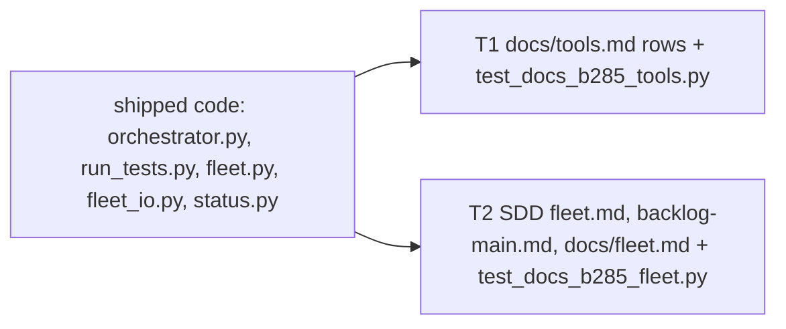
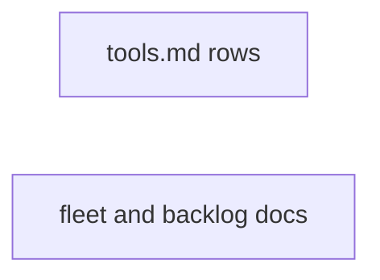

# B285: docs name what #1006, #1007, #906 and #1015 shipped (#1031)

**Goal:** docs/tools.md, skills/subagent-driven-development/fleet.md and backlog-main.md name four shipped behaviours: the `orchestrator` `--plan` anchoring from a subfolder (#1006), `run_tests --base-skips` reading `SESSION_FILES` (#1007), the plan lead role with its `lead Wn` status line, the `NEEDS_DECISION` report status and fleet wait's ` question=` suffix (#906), and the #1015/#1024 refusal of a brief outside the project, the run folder and the plugin skills folder. docs/fleet.md already names #906 and #1015 (B273, B279, B282); it gains only the brief-location error line it omits.
**Architecture:** docs only. Each new sentence is pinned by a new test that also checks every quoted message against the script that prints it (the test_docs_b255_* and test_docs_b273_fleet.py pattern), so a later message change fails the doc test.
**Tech stack:** Markdown; pytest via `sl run_tests`.
**Spec:** issue #1031 (follow-ups of B269, B270, B273, B279).
**Detail:** tests
**Wave0:** none
**Coverage:** off

## Global constraints

- Every quoted message is copied byte for byte from the code, with only the placeholders shown here: orchestrator.py:533 and :537 (#1006), run_tests.py:1862 (#1007), fleet.py outside_error and fleet_io.py:1140 (#1015), status.py lead_progress and fleet_io.py:1006 (#906).
- Existing pinned sentences stay byte-identical: SDD fleet.md's "One call does all three: ... exit 3)." sentence (test_fleet_docs_578_579.py), docs/fleet.md's seven "Leads outside backlog mode" bullets (test_docs_b273_fleet.py), docs/tools.md's --base-skips sentences (test_docs_b246.py, test_docs_b271_tools.py) and its B255 three-line block (test_docs_b255_tools.py). New text is inserted beside them, never into them.
- docs/tools.md rows stay one table line ending ` |`, with no ` | ` inside the text (test_docs_b32_tools.py).
- Files this batch may touch: docs/tools.md, docs/fleet.md, skills/subagent-driven-development/fleet.md, skills/subagent-driven-development/backlog-main.md, the two new tests below and this plan. skills/subagent-driven-development/scripts/fleet.py is B284's: never edit it. An existing test that breaks: name it in the report, do not edit it without the lead's word.
- Builds: the verdict is `sl run_tests` (the project's test command; a project with `.maxapp` runs `maxapp test`, which a build pool may place on another Mac, and a full run whose tree a green maxapp test stamp covers returns that result without a run); task trees build in <tree>/.build/DerivedData and any build of your own goes under .build/ of the worktree, never -derivedDataPath outside the worktree (your session scratchpad included; backlog cleanup removes scratchpad build folders when the worktree goes); a product, simulator or device build stays on this machine and runs only when an issue's acceptance asks for a running-app check; copy this sentence into every worker brief.
- Simulators: append the UDID of each simulator you or a worker creates (`xcrun simctl create` or `clone`; a checker's `Simulators:` line marks its created ones) as one line to /Users/max/github/superlite/.claude/worktrees/superlite-b285-docs-sweep-name-what-1006-1007-906/.superlite/simulators.txt; never list one you did not create; ship cleanup shuts down and deletes each listed one; copy this sentence into every worker brief.

Ruling: docs/fleet.md gets one adjacent fix only (the brief-location `error:` line next to the named-paths one, line 33); R3's other gap there (the `question: none`, `plan: none yet` and unreadable variants of the `lead Wn` line, and stopped leads hidden without `--all`) is left, since its bullet is pinned byte for byte by test_docs_b273_fleet.py and #1031 names no gap in docs/fleet.md (lead's ruling).
Ruling: the #906 facts go to backlog-main.md as one progress sentence beside "Main keeps a lean context" (a batch lead's `lead Wn` line) and one new closing section for plan leads; `backlog wait` keeps its own `B needs_decision question=<q>` line, unchanged (lead's ruling).
Ruling: the docs/tools.md `status` row names only where a lead's progress and run state live; the `lead Wn` line format is in the `fleet` row, the command that prints it (lead's ruling).
Ruling: two Kind: mechanical tasks on haiku: every sentence is given verbatim in the test code (lead's ruling).

## Main diagram



## File structure

- docs/tools.md: `orchestrator`, `status` and `fleet` rows and the `--base-skips` paragraph gain one sentence or clause each.
- tests/scripts/test_docs_b285_tools.py: pins T1's sentences and their messages in the code.
- skills/subagent-driven-development/fleet.md: Other roles gains the #1015 refusal sentence and a Lead bullet; Waiting and acting gains a `NEEDS_DECISION` sub-bullet.
- skills/subagent-driven-development/backlog-main.md: one progress line and one closing section.
- docs/fleet.md: line 33 gains the brief-location error line.
- tests/scripts/test_docs_b285_fleet.py: pins T2's sentences and their messages in the code.

## Task graph

```mermaid
%% schedule
gantt
  title Predicted schedule (mm:ss)
  dateFormat X
  axisFormat %M:%S
  section lane 1
  T1 tools.md rows :t1, 0, 188s
  section lane 2
  T2 fleet and backlog docs :t2, 0, 188s
```





critical path: T1 (3.1 min) · peak width 2 · predicted build 3.1 min · predicted total ≈ 11.6 min

## Docs

**Probe entry:** none (docs only; the cases are the named tests)

### T1 tools.md rows · Complexity 1 (O-1) · Est. context 30k
**Owns:** docs/tools.md, tests/scripts/test_docs_b285_tools.py
**Components:** 1
**LOC owned:** 60
**Tests:** fast
**Kind:** mechanical
**Model:** haiku
**Produces:** docs/tools.md sentences ORCH, STATUS, FLEET, BASE (test constants below)
**Review Focus:** `test_orchestrator_row_names_1006`, `test_status_row_names_lead_progress`, `test_fleet_row_names_906_and_1015`, `test_base_skips_names_session_files`, `test_messages_match_code`; the pinned tests test_docs_b32_tools.py, test_docs_b95_tools.py, test_docs_614_tools.py, test_docs_b246.py, test_docs_b271_tools.py, test_docs_b255_tools.py pass unchanged.
**Test code (verbatim):**
```python
"""docs/tools.md names #1006, #1007, #906 and #1015 (B285, #1031)."""
from pathlib import Path

ROOT = Path(__file__).resolve().parents[2]
SCRIPTS = ROOT / "skills" / "subagent-driven-development" / "scripts"
DOC = ROOT / "docs" / "tools.md"

ORCH = " A relative `--plan` (and `approve`'s or `status`'s `--review`) that names nothing at the cwd resolves at the enclosing checkout's top, a bare `.superlite` at the nearest folder up to that top that holds a run (else the cwd's); run from a subfolder, `set`, `bind` and `approve` refuse a relative plan found at neither place before they bind or approve: `orchestrator: plan not found: X (neither at the cwd nor at <top>); not set` (`not bound`, `not approved`), exit 2, and `approve --review R` without `--plan` prints `orchestrator: review plan not found: R (neither at the cwd nor at <top>); not approved` (#1006)."
STATUS = "; a lead's full run state is `sl status --plan <worktree>/.superlite`, its one-line progress the `lead Wn <worktree>: ...` line of `sl fleet status` (#906)"
FLEET = "; `spawn --role lead --plan P [--brief F] [--label L] [--wait]` starts a lead for the plan P in P's own worktree (its run is `<worktree>/.superlite`; without `--brief` it writes `<worktree>/.superlite/briefs/lead.md`, whose lead never pushes, merges or ships) and prints `Wn lead <worktree>: progress: sl fleet status; ...`; `status` prints one `lead Wn <worktree>: plan <plan> (N tasks); ...; workers busy K; question: open <path>` (or `question: none`) line per live lead, batch leads too (`status.lead_progress`); `NEEDS_DECISION` is a report status, and `wait` ends such a lead's line with ` question=<worktree>/.superlite/question.json` when that file exists (#906); `spawn --brief F` and `send Wn --brief F` (every role but lead) refuse with one `error:` line from `fleet_io.brief_refusal`, exit 2, before any gate, pane or prompt, a brief file outside the project, the run folder and the plugin skills folder (`error: brief F is outside the project, the run folder and the plugin skills folder; a worker cannot read it: move it into <sd>/briefs/ (#1015)`) and a brief that, with the plan's Global constraints (spawn) or a review spawn's `--note`, names such a path outside fenced code blocks (`error: brief F names paths outside the project, the run folder and the plugin skills folder: P, ...; a worker cannot read them: copy each file into <sd>/briefs/ and name the copy, or drop the path (#1015)`, at most five paths, then ` and N more`) (#1015, #1024)"
BASE = " A skipped test's file may name the files its session must collect in a module-level `SESSION_FILES` tuple or list of string globs relative to its own folder (read with `ast`, never imported; an absolute or `..` pattern is dropped, and a file that does not parse names none): the base run adds their matches in the base tree to the narrowed run and prints `run_tests: --base-skips: the base run also collects N files SESSION_FILES names, so a skip that depends on what its session collects matches the full run's`; test-summary-base.json keeps its keys (#1007)."


def _row(name):
    rows = [l for l in DOC.read_text(encoding="utf-8").splitlines() if l.startswith(f"| `{name}` | ")]
    assert len(rows) == 1, name
    return rows[0]


def test_orchestrator_row_names_1006():
    assert _row("orchestrator").endswith(ORCH + " |")


def test_status_row_names_lead_progress():
    assert _row("status").endswith(STATUS + " |")


def test_fleet_row_names_906_and_1015():
    assert _row("fleet").endswith(FLEET + " |")


def test_base_skips_names_session_files():
    lines = [l for l in DOC.read_text(encoding="utf-8").splitlines() if l.startswith("`sl run_tests --base-skips [--plan DIR]`")]
    assert len(lines) == 1 and lines[0].endswith("(#999)." + BASE)


def test_messages_match_code():
    orch = (SCRIPTS / "orchestrator.py").read_text(encoding="utf-8")
    for s in ("orchestrator: plan not found: {a.plan} (neither at the cwd nor at {top}); not {word}",
              "orchestrator: review plan not found: {review} (neither at the cwd nor at {top}); not approved"):
        assert s in orch, s
    rt = (SCRIPTS / "run_tests.py").read_text(encoding="utf-8")
    assert "SESSION_FILES" in rt
    assert "the base run also collects {len(extra)} files SESSION_FILES names, so a skip that depends on what its session collects matches the full run's" in rt
    io = (SCRIPTS / "fleet_io.py").read_text(encoding="utf-8")
    assert "is outside the project, the run folder and the plugin skills folder; a worker cannot read it: move it into {sd.resolve()}/briefs/ (#1015)" in io
    assert 'f" question={question}"' in io
    fl = (SCRIPTS / "fleet.py").read_text(encoding="utf-8")
    assert "names paths outside the project, the run folder and the plugin skills folder: {named}; " in fl
    assert "a worker cannot read them: copy each file into {sd}/briefs/ and name the copy, or drop the path (#1015)" in fl
    assert ' and {len(paths) - 5} more' in fl
    st = (SCRIPTS / "status.py").read_text(encoding="utf-8")
    for s in ('f"workers busy ', 'f"question: open {q}"', '"question: none"', "tasks)"):
        assert s in st, s
    assert "progress: sl fleet status; run state: sl status --plan " in (SCRIPTS / "fleet_lead.py").read_text(encoding="utf-8")
```
**Steps:** 1 write the test file, 2 `sl run_tests --task T1`: FAIL (four doc tests), 3 insert ORCH right before the closing ` |` of the `| \`orchestrator\` |` row (after "(#614)."), STATUS right before the closing ` |` of the `| \`status\` |` row, FLEET right before the closing ` |` of the `| \`fleet\` |` row (after "before anything runs)"), BASE at the end of the line that starts "`sl run_tests --base-skips [--plan DIR]`" (after "(#999)."), each exactly as the constant reads, 4 run: PASS, plus the pinned tests named in Review Focus.
**Notes:** in step 3 copy the constants from the test file, never retype them. If `test_messages_match_code` fails on a string, the code changed since the plan: report the line, do not edit the code. The status row may hold no `(N tasks)` literal in status.py; the `"tasks)"` probe only checks the line's task count part exists.

### T2 fleet and backlog docs · Complexity 1 (O-1) · Est. context 30k
**Owns:** skills/subagent-driven-development/fleet.md, skills/subagent-driven-development/backlog-main.md, docs/fleet.md, tests/scripts/test_docs_b285_fleet.py
**Components:** 1
**LOC owned:** 60
**Tests:** fast
**Kind:** mechanical
**Model:** haiku
**Produces:** SDD fleet.md sentences REFUSE, LEAD, DECIDE; backlog-main.md PROGRESS, SECTION; docs/fleet.md LOCATION (test constants below)
**Review Focus:** `test_sdd_fleet_names_1015_and_906`, `test_backlog_main_names_906`, `test_docs_fleet_names_location_error`, `test_messages_match_code`; the pinned tests test_fleet_docs_578_579.py, test_docs_fleet_restore_577.py, test_docs_b273_fleet.py, test_backlog_rules_split_684.py, test_backlog_docs*.py and test_docs_b255_skill.py pass unchanged.
**Test code (verbatim):**
```python
"""SDD fleet.md, backlog-main.md and docs/fleet.md name #906 and #1015 (B285, #1031)."""
from pathlib import Path

ROOT = Path(__file__).resolve().parents[2]
SDD = ROOT / "skills" / "subagent-driven-development"
SCRIPTS = SDD / "scripts"

PINNED = "(a missing brief exits 2 before any pane; a failed send stops the worker, `BLOCKED: Wn L not sent (...)`, exit 3)."
REFUSE = " A brief file outside the project, the run folder and the plugin skills folder, or a brief that (with the plan's Global constraints, or a review spawn's `--note`) names such a path outside fenced code, exits 2 the same way with one `error:` line (every role but lead; `fleet send Wn --brief` checks it too): copy the file into `.superlite/briefs/` and name the copy (#1015, #1024)."
LEAD = "- Lead: `fleet spawn --role lead --plan P [--brief F]` starts a lead for a plan in another worktree (the checkout P lies in; its run is `<worktree>/.superlite`; without `--brief` its generated brief builds and commits but never pushes, merges or ships). `\"$SL\" fleet status` prints one `lead Wn <worktree>: plan <plan> (N tasks); ...; workers busy K; question: open <path>` line per live lead, batch leads too. Details: docs/fleet.md \"Leads outside backlog mode\" (#906)."
DECIDE = "  - `NEEDS_DECISION` (a lead's report): the line ends ` question=<worktree>/.superlite/question.json` when that file exists; read it, ask the user, answer with `\"$SL\" fleet send Wn --text \"...\"`, then wait again (#906)."
PROGRESS = "A running lead's progress without its pane: `\"$SL\" fleet status` prints one `lead Wn <worktree>: ...` line per live lead, batch leads too (plan and task count, task groups, busy workers, `question: open <path>` while its question.json waits) (#906)."
SECTION = "## Plan leads outside backlog mode\n\nA plan outside the backlog (another repository's or worktree's) gets its own lead: `\"$SL\" fleet spawn --role lead --plan P [--brief F]` (docs/fleet.md, \"Leads outside backlog mode\"). Its `fleet wait` line ends at DONE, BLOCKED or `NEEDS_DECISION`, a report status whose line ends ` question=<worktree>/.superlite/question.json`: ask the user with AskUserQuestion, then answer with `\"$SL\" fleet send Wn --text \"<answer>\"`. A plan lead starts without the ship allow rules and its generated brief never pushes, merges or ships: main decides the integration (#906).\n"
LOCATION = " A brief file that itself lies outside them gets `error: brief F is outside the project, the run folder and the plugin skills folder; a worker cannot read it: move it into <run folder>/briefs/ (#1015)` instead."


def test_sdd_fleet_names_1015_and_906():
    text = (SDD / "fleet.md").read_text(encoding="utf-8")
    assert text.count(PINNED) == 1
    assert PINNED + REFUSE in text
    lines = text.splitlines()
    research = next(i for i, l in enumerate(lines) if l.startswith("- Research: `--role research`"))
    assert lines[research + 1] == LEAD
    ctx = next(i for i, l in enumerate(lines) if l.startswith("  - `NEEDS_CONTEXT`:"))
    assert lines[ctx + 1] == DECIDE


def test_backlog_main_names_906():
    text = (SDD / "backlog-main.md").read_text(encoding="utf-8")
    lines = text.splitlines()
    lean = next(i for i, l in enumerate(lines) if l.startswith("Main keeps a lean context:"))
    assert lines[lean + 1] == PROGRESS
    assert text.endswith("\n\n" + SECTION)


def test_docs_fleet_names_location_error():
    text = (ROOT / "docs" / "fleet.md").read_text(encoding="utf-8")
    assert "`, exit 2, nothing started." + LOCATION + " Copy each such file" in text


def test_messages_match_code():
    io = (SCRIPTS / "fleet_io.py").read_text(encoding="utf-8")
    assert "is outside the project, the run folder and the plugin skills folder; a worker cannot read it: move it into {sd.resolve()}/briefs/ (#1015)" in io
    assert 'f" question={question}"' in io
    st = (SCRIPTS / "status.py").read_text(encoding="utf-8")
    for s in ('f"workers busy ', 'f"question: open {q}"'):
        assert s in st, s
    assert "NEEDS_DECISION" in (SCRIPTS / "fleet_report.py").read_text(encoding="utf-8")
```
**Steps:** 1 write the test file, 2 `sl run_tests --task T2`: FAIL (three doc tests), 3 in skills/subagent-driven-development/fleet.md insert REFUSE right after PINNED (same line), LEAD as a new line right after the `- Research:` bullet, DECIDE as a new line right after the `  - \`NEEDS_CONTEXT\`:` sub-bullet; in backlog-main.md insert PROGRESS as a new line right after the "Main keeps a lean context:" line and append a blank line plus SECTION at the file's end (the file ends with one newline); in docs/fleet.md insert LOCATION on line 33 right after "`, exit 2, nothing started." and before " Copy each such file"; each exactly as the constant reads (unescape the Python `\"`), 4 run: PASS, plus the pinned tests named in Review Focus.
**Notes:** copy the constants from the test file, never retype them. If `test_messages_match_code` fails on a string, the code changed since the plan: report the line, do not edit the code.

## Review Focus

Docs only, no runnable entry. Each task's cases are its named tests; the reviewer checks each quoted message against the code line the Global constraints name and that no pinned sentence moved.

## Self-review

Every #1031 item maps to T1 (docs/tools.md rows, --base-skips paragraph) or T2 (SDD fleet.md, backlog-main.md); docs/fleet.md already names #906 and #1015 (checked by R3), plus one adjacent fix. The two tasks share no file and have no edge.
