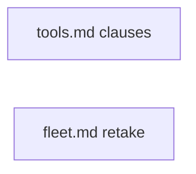

# Superlite: docs/tools.md and docs/fleet.md name what #997, #998 and #999 shipped (#1008)

**Goal:** docs/tools.md's `plan_tools` row names #998's `--plan` anchoring and lint --stable's missing-plan refusal; its `--base-skips` paragraph names #999's remote base rerun and the `host` and `command` keys; docs/fleet.md's "Remote machines" paragraph names #997's retake of a missing stop-hook snapshot.
**Architecture:** docs only. Each place gains clauses appended in place; no existing fact is dropped or reworded. Two new pin tests check each new clause and that each quoted message still exists in the script that prints it (the B259/B268 pattern).
**Tech stack:** Markdown docs; pytest through `sl run_tests`.
**Spec:** this file, section Design.
**Detail:** tests
**Target-min:** 11
**Wave0:** none
**Coverage:** off (bounded: docs only; every open choice is a Ruling below)

Global constraints:
- This repository is public: no host names, user names, home paths, other project or repository names in docs, tests or commit messages.
- The verdict is `sl run_tests` (never raw pytest); every new test sees a red run before the change it tests.
- Docs describe the code as it is today: each fact's code reference is in the Design; read it before writing the clause and copy each quoted message exactly (placeholders such as `Wn`, `L`, `R`, `<path>` for its variables).
- Append clauses; never drop or reword an existing fact. Existing pins stay green unchanged: test_docs_b246.py pins the whole `--base-skips` paragraph as a substring, test_docs_b259_fleet.py pins each Remote machines concern exactly once, test_docs_b67_tools.py pins the plan_tools row's `.json`). + PLAN_TOOLS run and every row's ` |` end.
- docs/tools.md rows and paragraphs stay one line each, terse: backticked names, exact output strings, the issue number in parentheses.
- Builds: the verdict is `sl run_tests` (the project's test command; a project with `.maxapp` runs `maxapp test`, which a build pool may place on another Mac, and a full run whose tree a green maxapp test stamp covers returns that result without a run); task trees build in <tree>/.build/DerivedData and any build of your own goes under .build/ of the worktree, never -derivedDataPath outside the worktree (your session scratchpad included; backlog cleanup removes scratchpad build folders when the worktree goes); a product, simulator or device build stays on this machine and runs only when an issue's acceptance asks for a running-app check; copy this sentence into every worker brief.
- Simulators: append the UDID of each simulator you or a worker creates (`xcrun simctl create` or `clone`; a checker's `Simulators:` line marks its created ones) as one line to the worktree's `.superlite/simulators.txt`; never list one you did not create; ship cleanup shuts down and deletes each listed one; copy this sentence into every worker brief.

## Design

Code references are under `skills/subagent-driven-development/scripts/`.

### 1. docs/tools.md

Each block below is the exact text to append (copy it byte for byte; it starts with a space).

- `plan_tools` row: insert the block right before the row's final ` |`, after `... splitting does not shrink it` (warning only) (#787)` (plan_tools.py:93, 96-114, 3473-3475, 3776-3800):

```text
. Every `plan_tools` subcommand's `--plan` (the `pt_review` ones too) is anchored by `anchor_plan`: a relative `--plan` that names nothing at the cwd resolves at the enclosing checkout's top (`state.git_root`: a linked worktree's own top), a bare `.superlite` at the nearest run up to that top, anything else stays as given and nothing is created; `--spec` and `prune`'s `--dir` keep cwd semantics; `lint --stable` refuses a missing plan with `error: plan not found: <path>` (exit 2) before it binds the run (`state.bind`) (#998)
```

(the block starts with `.` with no space before it, so the row reads `... (#787). Every ...`).

- The `--base-skips` paragraph (the line starting `` `sl run_tests --base-skips [--plan DIR]` ``): append the block after its final `(#886).` (run_tests.py:1815, 1837, 1853, 1917-1924):

```text
 A full run through `maxapp remote` reruns the base through that same remote command, narrowed to the skipped tests' files with every `maxapp remote` and pytest option kept (`run_tests: --base-skips runs on the full run's host: <command>`), or whole when it cannot be rewritten safely (`run_tests: --base-skips: the remote test command cannot be narrowed to the skipped tests' files; it runs whole at the base: <command>`), and test-summary-base.json gains `host` (`remote`, `local`, or empty when nothing ran) and `command` (its first 200 characters) (#999).
```

### 2. docs/fleet.md

- "## Remote machines", the paragraph starting `How work comes back:`: append the block after its final `(#984).` (fleet_remote_collect.py:31-32, 94-129, 146-150, 174-177):

```text
 A stop record whose hook took none is first retaken on the worker's machine: collect opens a Herdr shell pane (workspace `sl:collect Wn`) in its host tree, runs `sl remote_apply snapshot --ref R` there, reads its output file every 2 s for up to 120 s (`RETAKE_S`), closes the workspace on every path, then fetches and applies the snapshot as above; success adds `collected.retaken` and the concern `remote worker Wn's stop hook took no snapshot (remote_apply snapshot failed or ran past 30 s); collect retook it on L: <sha>`, and a failed retake (the record names no host tree or plugin tree, a Herdr or read error, no result within 120 s, or the snapshot's last output) stays BLOCKED with `; retaking it there failed: <reason>; sl fleet collect Wn retries` appended to the took-none concern (#997).
```

### 3. Rulings

- Ruling: each new text is appended at the end of its row or paragraph, never between pinned runs, so test_docs_b246.py, test_docs_b259_fleet.py and test_docs_b67_tools.py stay unchanged (lead's ruling).
- Ruling: the failed-retake text is quoted as its appended tail only; quoting the whole concern would repeat the took-none text test_docs_b259_fleet.py requires exactly once (lead's ruling).
- Ruling: the new pin tests test_docs_b271_tools.py and test_docs_b271_fleet.py and this plan are outside the batch's file list; no open batch lists them, and notes.md names them (lead's ruling).
- Ruling: fleet placement local (a remote research worker's account was logged out at R3) (lead's ruling).

## Task graph

```mermaid
%% schedule
gantt
  title Predicted schedule (mm:ss)
  dateFormat X
  axisFormat %M:%S
  section lane 1
  T1 tools.md clauses :t1, 0, 377s
  section lane 2
  T2 fleet.md retake :t2, 0, 375s
```





critical path: T1 (6.3 min) · peak width 2 · predicted build 6.3 min · predicted total ≈ 16.8 min (target ✗ 11.0)

## Package: docs sweep

App type: Markdown docs. Categories: file (doc rows and pins). Risks: a clause that drops or rewords an existing fact; an existing pin turned red; a quoted message that no script prints.
**Probe entry:** none (docs have no runnable entry)

### T1 tools.md clauses · Complexity 2 · Est. context 45k
**Owns:** docs/tools.md, tests/scripts/test_docs_b271_tools.py
**Components:** 1
**LOC owned:** 50
**Tests:** fast
**Model:** sonnet
**Kind:** prose
**Covers:** 1
**Review Focus:** file: `test_place_names_it_once`, `test_quoted_texts_match_the_code`
**Test code (verbatim):**
```python
"""B271 (#1008): docs/tools.md names #998's --plan anchoring and lint --stable's missing-plan refusal in the plan_tools row, and #999's remote base rerun with test-summary-base.json host and command in the --base-skips paragraph; each quoted text is checked against the script printing it."""
from pathlib import Path
import pytest

ROOT = Path(__file__).resolve().parents[2]
LINES = (ROOT / "docs" / "tools.md").read_text(encoding="utf-8").splitlines()
SCRIPTS = ROOT / "skills" / "subagent-driven-development" / "scripts"
START = {"plan_tools": "| `plan_tools` |", "base-skips": "`sl run_tests --base-skips [--plan DIR]`"}

NAMED = [  # (place, text it holds exactly once)
    ("plan_tools", "`anchor_plan`"),
    ("plan_tools", "resolves at the enclosing checkout's top (`state.git_root`: a linked worktree's own top)"),
    ("plan_tools", "a bare `.superlite` at the nearest run up to that top"),
    ("plan_tools", "`--spec` and `prune`'s `--dir` keep cwd semantics"),
    ("plan_tools", "`error: plan not found: <path>` (exit 2) before it binds the run (`state.bind`) (#998)"),
    ("base-skips", "A full run through `maxapp remote` reruns the base through that same remote command"),
    ("base-skips", "`run_tests: --base-skips runs on the full run's host: <command>`"),
    ("base-skips", "`run_tests: --base-skips: the remote test command cannot be narrowed to the skipped tests' files; it runs whole at the base: <command>`"),
    ("base-skips", "`host` (`remote`, `local`, or empty when nothing ran)"),
    ("base-skips", "`command` (its first 200 characters) (#999)"),
]
CODE = [  # (script, literal its source holds)
    ("plan_tools.py", "def anchor_plan(value: str, cwd: str | None = None) -> str:"),
    ("plan_tools.py", 'raise PlanError(f"plan not found: {path}")'),
    ("run_tests.py", "run_tests: --base-skips runs on the full run's host: {narrowed}"),
    ("run_tests.py", "run_tests: --base-skips: the remote test command cannot be narrowed to the skipped tests' files; it runs whole at the base: {full['command']}"),
    ("run_tests.py", '"host": host, "command": ran[:200]'),
]


def place(name):
    found = [x for x in LINES if x.startswith(START[name])]
    assert len(found) == 1, name
    return found[0]


@pytest.mark.parametrize("name,text", NAMED)
def test_place_names_it_once(name, text):
    assert place(name).count(text) == 1


@pytest.mark.parametrize("script,literal", CODE)
def test_quoted_texts_match_the_code(script, literal):
    assert literal in (SCRIPTS / script).read_text(encoding="utf-8")
```
**Steps:** 1 write the test file, 2 run: FAIL, 3 append the two clauses of Design 1 exactly as written, 4 run: PASS, 5 run every other test that reads docs/tools.md
**Notes:** verify with `sl run_tests --fast tests/scripts/test_docs_b271_tools.py --task T1`, then once `sl run_tests --fast $(grep -rlE '"tools\.md"|docs/tools\.md' tests/scripts) --task T1`. Rows are long: edit by appending before the plan_tools row's final ` |` and after the base-skips paragraph's `(#886).`; never touch other text on those lines.

### T2 fleet.md retake · Complexity 2 · Est. context 40k
**Owns:** docs/fleet.md, tests/scripts/test_docs_b271_fleet.py
**Components:** 1
**LOC owned:** 40
**Tests:** fast
**Model:** sonnet
**Kind:** prose
**Covers:** 2
**Review Focus:** file: `test_section_names_it_once`, `test_quoted_texts_match_the_code`
**Test code (verbatim):**
```python
"""B271 (#1008): docs/fleet.md "Remote machines" names #997's retake of a missing stop-hook snapshot on the worker's machine; each quoted text is checked against fleet_remote_collect.py."""
from pathlib import Path
import pytest

ROOT = Path(__file__).resolve().parents[2]
LINES = (ROOT / "docs" / "fleet.md").read_text(encoding="utf-8").splitlines()
SCRIPT = ROOT / "skills" / "subagent-driven-development" / "scripts" / "fleet_remote_collect.py"

NAMED = [  # text the "## Remote machines" section holds exactly once
    "is first retaken on the worker's machine",
    "(workspace `sl:collect Wn`)",
    "`sl remote_apply snapshot --ref R`",
    "every 2 s for up to 120 s (`RETAKE_S`)",
    "`collected.retaken`",
    "`remote worker Wn's stop hook took no snapshot (remote_apply snapshot failed or ran past 30 s); collect retook it on L: <sha>`",
    "`; retaking it there failed: <reason>; sl fleet collect Wn retries`",
    "(#997)",
]
CODE = [  # literal fleet_remote_collect.py holds
    "RETAKE_S = 120",
    "POLL_S = 2",
    'hc.create_workspace(f"sl:collect {wid}"',
    "remote_apply snapshot --ref {q(ref)}",
    'out["collected"]["retaken"] = True',
    "'s stop hook took no snapshot (remote_apply snapshot failed or ran past 30 s); collect retook it on {label}: {snap}",
    "; retaking it there failed: {why}; sl fleet collect {wid} retries",
]


def section(title):
    start = LINES.index(title)
    end = next((i for i in range(start + 1, len(LINES)) if LINES[i].startswith("## ")), len(LINES))
    return "\n".join(LINES[start:end])


@pytest.mark.parametrize("text", NAMED)
def test_section_names_it_once(text):
    assert section("## Remote machines").count(text) == 1


@pytest.mark.parametrize("literal", CODE)
def test_quoted_texts_match_the_code(literal):
    assert literal in SCRIPT.read_text(encoding="utf-8")
```
**Steps:** 1 write the test file, 2 run: FAIL, 3 append the sentence of Design 2 exactly as written, 4 run: PASS, 5 run every other test that reads docs/fleet.md
**Notes:** verify with `sl run_tests --fast tests/scripts/test_docs_b271_fleet.py --task T2`, then once `sl run_tests --fast $(grep -rlE '"fleet\.md"|docs/fleet\.md' tests/scripts) --task T2`. Append after the paragraph's last `(#984).` only; test_docs_b259_fleet.py requires each existing concern there exactly once.

## Self-review

Coverage: issue items 1 (T2), 2 and 3 (T1). No placeholders; no Consumes; no edges (two files, two owners). Pins of the touched lines checked by research R1-R3: appending at the ends keeps them green.
