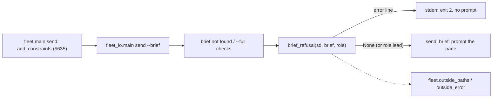

# B282: fleet send --brief runs the outside-path check before the prompt (#1024)

**Goal:** `sl fleet send Wn --brief F` refuses, before any prompt reaches the worker, a brief that worker could not read in full, with the same two #1015 checks and `error:` lines `sl fleet spawn --brief F` prints: a brief file outside the project, the run folder and the plugin skills folder, or a brief whose text (already holding the plan's Global constraints) names an existing path outside them. So docs/fleet.md's research path (spawn, then send) no longer wastes the worker's turn on an unreadable path.
**Architecture:** one helper `fleet_io.brief_refusal(sd, brief, role)` returns the #1015 error line or None, built on `fleet.outside_paths` and `fleet.outside_error` (loaded lazily through `fleet_io._fleet()`; fleet.py is untouched); `fleet_io.main`'s `send --brief` branch calls it after the existing `brief not found` and `--full` checks and before `send_brief`, prints the line and exits 2. Docs: fleet_io's module docstring and docs/fleet.md's skills-read bullet.
**Tech stack:** Python 3 stdlib (pathlib); pytest via `sl run_tests`.
**Spec:** issue #1024 (B279's follow-up of #1015: "call fleet.outside_paths there too, before the prompt").
**Detail:** tests
**Wave0:** none
**Coverage:** off

## Global constraints

- Allowed folders and containment exactly as spawn (fleet.py `main`, spawn branch, #1015): the project `state.git_root(sd) or Path(sd).parent`, the run folder `sd`, the plugin skills folder `fleet_roles.SKILLS` (read at call time); containment compares `Path(...).resolve()` of both sides.
- The brief text checked is the file's text as it will be sent: `fleet.main` has already appended the plan's Global constraints to the file (`add_constraints`, #635) before it delegates `send` to `fleet_io.main`, so `brief_refusal` reads the file and never calls `with_constraints` itself.
- Messages, byte-identical to spawn's: `error: brief <Path(brief).resolve()> is outside the project, the run folder and the plugin skills folder; a worker cannot read it: move it into <Path(sd).resolve()>/briefs/ (#1015)` and `fleet.outside_error("brief", <Path(brief).resolve()>, paths, <Path(sd).resolve()>)`. Exit 2, stderr, no prompt, no fleet.json change.
- A worker whose record has role `lead` is never checked (a lead reads outside its worktree, as in spawn). Every other role is (a record without a role is an implementer). An unknown worker keeps its current `error: unknown worker or task 'Wn'` exit 2.
- The check sits in `fleet_io.main`, never in `send_brief`: `fleet.main`'s spawn branch calls `send_brief` directly after its own check, and direct `send_brief` callers (tests, spawn) stay unchanged. A remote worker is checked too (main runs before `send_brief` hands it to the remote module).
- Files this batch may touch: docs/fleet.md, skills/subagent-driven-development/scripts/fleet_io.py, tests/scripts/test_fleet_send_brief_outside_1024.py (new), tests/scripts/test_fleet_io_ask_470.py and this plan. fleet.py is B281's: never edit it. An existing test that breaks: name it in the report, do not edit it without the lead's word.
- Builds: the verdict is `sl run_tests` (the project's test command; a project with `.maxapp` runs `maxapp test`, which a build pool may place on another Mac, and a full run whose tree a green maxapp test stamp covers returns that result without a run); task trees build in <tree>/.build/DerivedData and any build of your own goes under .build/ of the worktree, never -derivedDataPath outside the worktree (your session scratchpad included; backlog cleanup removes scratchpad build folders when the worktree goes); a product, simulator or device build stays on this machine and runs only when an issue's acceptance asks for a running-app check; copy this sentence into every worker brief.
- Simulators: append the UDID of each simulator you or a worker creates (`xcrun simctl create` or `clone`; a checker's `Simulators:` line marks its created ones) as one line to /Users/max/github/superlite/.claude/worktrees/superlite-b282-fleet-send-brief-run-the-outside-pa/.superlite/simulators.txt; never list one you did not create; ship cleanup shuts down and deletes each listed one; copy this sentence into every worker brief.

Ruling: send runs both #1015 checks (brief file location and named paths), not only `outside_paths`: the worker is told to read the brief's path, so a brief outside the three folders fails the same way (lead's ruling).
Ruling: the helper lives in fleet_io.py and reuses `fleet.outside_paths`/`outside_error`; fleet.py's spawn keeps its inline location check (B281 owns fleet.py), so the location message is duplicated and the new tests pin it byte for byte (lead's ruling).
Ruling: the check reads the brief file as sent, after `fleet.main`'s #635 constraints rewrite; a refused send still leaves that rewrite in the file (it is idempotent and the worker never saw the brief) (lead's ruling).
Ruling: test_fleet_io_ask_470.py's `test_send_brief_full` moves its packet from `tmp_path` (outside the project) into the run folder, since a real final-review packet lives in `.superlite/` (lead's ruling).

## Main diagram



## File structure

- skills/subagent-driven-development/scripts/fleet_io.py: `brief_refusal()`, its call in `main`'s `send --brief` branch, one docstring line.
- docs/fleet.md: the skills-read bullet (line 33) names the send check.
- tests/scripts/test_fleet_send_brief_outside_1024.py: CLI, helper and docs tests.
- tests/scripts/test_fleet_io_ask_470.py: `test_send_brief_full`'s packet moves into the run folder.

## Task graph

```mermaid
%% schedule
gantt
  title Predicted schedule (mm:ss)
  dateFormat X
  axisFormat %M:%S
  section lane 1
  T1 send brief outside check :t1, 0, 312s
```




critical path: T1 (5.2 min) · peak width 1 · predicted build 5.2 min · predicted total ≈ 15.7 min

## Fleet send

**Probe entry:** none (the check needs a fleet.json worker record and the herdr fake; its cases are named tests in T1)

### T1 send brief outside check · Complexity 3 (O-n) · Est. context 40k
**Owns:** skills/subagent-driven-development/scripts/fleet_io.py, docs/fleet.md, tests/scripts/test_fleet_send_brief_outside_1024.py, tests/scripts/test_fleet_io_ask_470.py
**Components:** 2
**LOC owned:** 100
**Tests:** fast
**Kind:** design
**Model:** sonnet
**Produces:** fleet_io.brief_refusal(sd: str | Path, brief: str | Path, role: str = "") -> str | None
e.g. brief_refusal("/r/proj/.superlite", "/r/proj/.superlite/briefs/R1.md", "research") -> "error: brief /r/proj/.superlite/briefs/R1.md names paths outside the project, the run folder and the plugin skills folder: /r/other/spec.md; a worker cannot read them: copy each file into /r/proj/.superlite/briefs/ and name the copy, or drop the path (#1015)" (the brief reads "Read /r/other/spec.md." and /r/other exists)
e.g. brief_refusal("/r/proj/.superlite", "/r/b.md", "fixer") -> "error: brief /r/b.md is outside the project, the run folder and the plugin skills folder; a worker cannot read it: move it into /r/proj/.superlite/briefs/ (#1015)"
e.g. brief_refusal("/r/proj/.superlite", "/r/b.md", "lead") -> None
**Review Focus:** `test_send_refuses_brief_naming_outside_path` asserts no prompt and an unchanged worker record; `test_lead_worker_is_not_checked`; `test_global_constraints_in_the_sent_brief_are_checked`; `test_unknown_worker_still_names_the_worker` (the role lookup moves before the check); messages byte-identical to spawn's.
**Test code (verbatim):**
```python
# tests/scripts/test_fleet_send_brief_outside_1024.py
"""`fleet send Wn --brief F` refuses a brief its worker cannot read in full before any prompt, as spawn does (#1015, #1024)."""
import json
import pytest
from test_fleet_io import io, world  # noqa: F401  (world is a fixture)
from test_plan_tools import SCRIPTS, make_plan
import fleet  # noqa: E402

TAIL = "a worker cannot read them: copy each file into"


def setw(world, wid, **kw):
    p = world.sd / "fleet.json"; data = json.loads(p.read_text()); data["workers"][wid].update(kw); p.write_text(json.dumps(data))


def prompts(world):
    return [c for c in world.fh.calls if c[0] == "prompt"]


def _other(tmp_path):
    other = tmp_path / "other"; other.mkdir(); (other / "spec.md").write_text("s")
    return other


def _brief(world, text, name="R1.md"):
    b = world.sd / "briefs" / name; b.parent.mkdir(exist_ok=True); b.write_text(text)
    return b


def test_send_refuses_brief_naming_outside_path(world, capsys, tmp_path):
    other = _other(tmp_path)
    b = _brief(world, f"Read {other}/spec.md.\n")
    assert io.main(["send", "W1", "--brief", str(b)]) == 2
    err = capsys.readouterr().err
    assert (f"error: brief {b.resolve()} names paths outside the project, the run folder and the plugin skills folder: {other}/spec.md; "
            f"a worker cannot read them: copy each file into {world.sd.resolve()}/briefs/ and name the copy, or drop the path (#1015)") in err
    assert prompts(world) == []
    w = json.loads((world.sd / "fleet.json").read_text())["workers"]["W1"]
    assert (w["state"], w["task"]) == ("ready", None)


def test_send_refuses_brief_file_outside(world, capsys, tmp_path):
    b = tmp_path / "b.md"; b.write_text("Answer the question.\n")
    assert io.main(["send", "W1", "--brief", str(b)]) == 2
    assert (f"error: brief {b.resolve()} is outside the project, the run folder and the plugin skills folder; a worker cannot read it: "
            f"move it into {world.sd.resolve()}/briefs/ (#1015)") in capsys.readouterr().err
    assert prompts(world) == []


@pytest.mark.parametrize("role", ["implementer", "fixer", "research", "writer", "checker", "package-reviewer", "final-reviewer"])
def test_every_worker_role_but_lead_is_checked(world, capsys, tmp_path, role):
    other = _other(tmp_path)
    setw(world, "W1", role=role)
    b = _brief(world, f"Read {other}/spec.md.\nOutput: out.md\n")
    assert io.main(["send", "W1", "--brief", str(b)]) == 2
    assert f"{other}/spec.md; {TAIL}" in capsys.readouterr().err
    assert prompts(world) == []


def test_send_with_inside_paths_still_sends(world):
    b = _brief(world, f"Read {world.proj}/src/c.py and {world.sd}/briefs/x.md.\n")
    assert io.main(["send", "W1", "--brief", str(b)]) == 0
    assert str(b.resolve()) in prompts(world)[-1][2]


def test_lead_worker_is_not_checked(world, monkeypatch, tmp_path):
    other = _other(tmp_path)
    setw(world, "W1", role="lead")
    b = _brief(world, f"Read {other}/spec.md.\n", "lead.md")
    seen = []
    monkeypatch.setattr(io, "send_brief", lambda sd, wid, brief, *a, **k: seen.append((wid, brief)))
    assert io.main(["send", "W1", "--brief", str(b)]) == 0
    assert seen == [("W1", str(b))]
    out = tmp_path / "lead-outside.md"; out.write_text("x\n")
    assert io.brief_refusal(world.sd, out, "lead") is None


def test_global_constraints_in_the_sent_brief_are_checked(world, capsys, tmp_path):
    other = _other(tmp_path)
    plan = make_plan(world.proj, [{"id": "T1", "owns": "src/a.py"}], header=f"\nGlobal constraints:\n- The spec is {other}/spec.md.\n", name="cplan.md")
    b = _brief(world, "Answer the question.\n")
    assert fleet.add_constraints(str(b), plan) is True  # what fleet.main does before it hands send to fleet_io (#635)
    assert io.main(["send", "W1", "--brief", str(b)]) == 2
    assert f"{other}/spec.md; {TAIL}" in capsys.readouterr().err
    assert prompts(world) == []


def test_unknown_worker_still_names_the_worker(world, capsys):
    b = _brief(world, "x\n")
    assert io.main(["send", "W9", "--brief", str(b)]) == 2
    assert "error: unknown worker or task 'W9'" in capsys.readouterr().err


def test_docs_name_the_send_check():
    doc = (SCRIPTS.parents[2] / "docs" / "fleet.md").read_text(encoding="utf-8")
    assert "`fleet send Wn --brief F` runs the same check before any prompt" in doc and "#1024" in doc
    assert "(#1024)" in io.__doc__
```
**Steps:** 1 write the test file, 2 `sl run_tests --fast tests/scripts/test_fleet_send_brief_outside_1024.py --task T1`: FAIL, 3 implement `brief_refusal` (lazy `import fleet_roles` inside it, as spawn does) and call it in `main`'s `elif a.brief:` branch: load the worker's role once (`fs.load(sd)["workers"][a.wid].get("role") or "implementer"`, KeyError for an unknown worker) before the `--full` check, then `why = brief_refusal(sd, a.brief, role)`; print it to stderr and return 2 when set; add the docstring line ``send --brief` refuses, before any prompt, a brief its worker cannot read in full: a brief file outside the project, the run folder and the plugin skills folder, or one naming such a path (fleet.outside_paths on the file, which already holds the plan's Global constraints); a lead is not checked (#1024).` after the `send --brief remembers the brief` line; append to docs/fleet.md line 33 after `(#905, #1015).`: `` `fleet send Wn --brief F` runs the same check before any prompt (every role but lead; the brief file already holds the plan's Global constraints): the same `error:` line, exit 2, nothing sent (#1024).``; in tests/scripts/test_fleet_io_ask_470.py `test_send_brief_full` change `p = tmp_path / "packet.md"` to `p = world.sd / "packet.md"`, 4 run the new file plus tests/scripts/test_fleet_io_ask_470.py, tests/scripts/test_fleet_io_roles.py, tests/scripts/test_fleet_brief_outside_1015.py and tests/scripts/test_fleet_brief_constraints_635.py: PASS.
**Notes:** keep `brief_refusal` free of printing; `main` prints. Do not touch `send_brief`.

## Review Focus

- Package fleet send (CLI): protocol (send's argument checks keep their order and messages), file (brief paths, symlinked tmp folders resolve on both sides), encoding (path tokens come from `fleet.outside_paths`, unchanged).
- Risks: a refusal that still prompts the pane or marks the worker busy; a false refusal of a normal send (a brief or review packet in `.superlite/`, a lead brief); an unknown worker losing its `unknown worker or task` line.

## Self-review

Coverage: #1024's one requirement (send runs the #1015 check before the prompt) is T1; docs ride with it. No placeholders. One task, no edges. Produces matches the tests' calls (`io.brief_refusal(world.sd, out, "lead")`).
