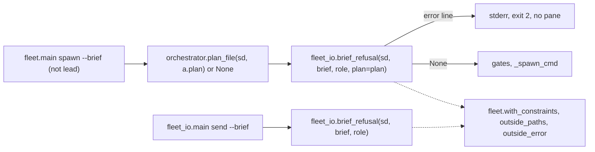
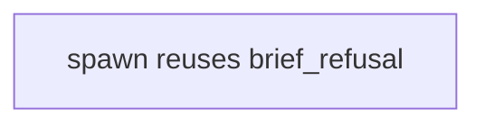

# B283: fleet spawn reuses fleet_io.brief_refusal for the #1015 brief check (#1027)

**Goal:** `sl fleet spawn --brief F`'s #1015 brief check calls `fleet_io.brief_refusal` instead of its inline copy, so the brief-location error line exists once in the code and spawn's and send's refusals cannot drift apart. Behaviour and every message stay byte-identical.
**Architecture:** `fleet_io.brief_refusal(sd, brief, role="", plan=None)` gains one keyword: given a plan, it scans `fleet.with_constraints(text, plan)` (the text spawn will send, #635) instead of the raw file text; an error there leaves the text as it was, as spawn does today. `fleet send` keeps calling it without a plan (`fleet.main` has already written the constraints into the file). fleet.py's spawn branch resolves the plan (`orchestrator.plan_file(sd, a.plan)`, None on any error), calls the helper, prints its line and exits 2.
**Tech stack:** Python 3 stdlib (pathlib); pytest via `sl run_tests`.
**Spec:** issue #1027 (B282's follow-up of #1024).
**Detail:** tests
**Wave0:** none
**Coverage:** off

## Global constraints

- Spawn's refusals stay byte-identical: same two `error:` lines (the brief-location line now built only in `fleet_io.brief_refusal`, the named-paths line from `fleet.outside_error`), stderr, exit 2, before the budget, disk and machine gates and any pane; the brief file is never rewritten by the check (spawn's `add_constraints` runs later, in `_spawn_cmd`).
- A spawn's named-paths line lists the brief's and the Global constraints' paths together (first seen, at most five, then `and N more`), as today: one scan over `with_constraints(text, plan)`, never two scans.
- A lead spawn is never checked and never loads the plan for the check (`a.brief and not is_lead` guards the call; `brief_refusal` also returns None for role `lead`).
- `fleet send` is unchanged: `fleet_io.main` calls `brief_refusal(sd, a.brief, role)` with no plan.
- Files this batch may touch: skills/subagent-driven-development/scripts/fleet.py, skills/subagent-driven-development/scripts/fleet_io.py, tests/scripts/test_fleet_brief_outside_1015.py, tests/scripts/test_fleet_send_brief_outside_1024.py and this plan. An existing test that breaks: name it in the report, do not edit it without the lead's word.
- Builds: the verdict is `sl run_tests` (the project's test command; a project with `.maxapp` runs `maxapp test`, which a build pool may place on another Mac, and a full run whose tree a green maxapp test stamp covers returns that result without a run); task trees build in <tree>/.build/DerivedData and any build of your own goes under .build/ of the worktree, never -derivedDataPath outside the worktree (your session scratchpad included; backlog cleanup removes scratchpad build folders when the worktree goes); a product, simulator or device build stays on this machine and runs only when an issue's acceptance asks for a running-app check; copy this sentence into every worker brief.
- Simulators: append the UDID of each simulator you or a worker creates (`xcrun simctl create` or `clone`; a checker's `Simulators:` line marks its created ones) as one line to /Users/max/github/superlite/.claude/worktrees/superlite-b283-fleet-spawn-reuse-fleet-io-brief-re/.superlite/simulators.txt; never list one you did not create; ship cleanup shuts down and deletes each listed one; copy this sentence into every worker brief.

Ruling: `brief_refusal` takes an optional `plan` instead of spawn calling it and then scanning the constraints separately: two scans would split one refusal's path list (brief paths only, constraints paths dropped), a visible change (lead's ruling).
Ruling: fleet_io.py is edited although the brief's file list omits it: #1027 needs the helper to read the constraints, and no open batch lists the file (lead's ruling).
Ruling: spawn resolves the plan itself (`orchestrator.plan_file`, inside a try) and passes the path; `brief_refusal` stays free of orchestrator imports (lead's ruling).

## Main diagram



## File structure

- skills/subagent-driven-development/scripts/fleet_io.py: `brief_refusal` gains `plan=None`, its comment names it.
- skills/subagent-driven-development/scripts/fleet.py: the spawn branch's inline #1015 block becomes one `brief_refusal` call.
- tests/scripts/test_fleet_brief_outside_1015.py: spawn delegates; the location literal lives only in fleet_io.py; one line names brief and constraints paths.
- tests/scripts/test_fleet_send_brief_outside_1024.py: `brief_refusal` with and without a plan.

## Task graph

```mermaid
%% schedule
gantt
  title Predicted schedule (mm:ss)
  dateFormat X
  axisFormat %M:%S
  section lane 1
  T1 spawn reuses brief_refusal :t1, 0, 219s
```





critical path: T1 (3.6 min) · peak width 1 · predicted build 3.6 min · predicted total ≈ 10.1 min

## Fleet spawn

**Probe entry:** none (the check needs a fleet.json run and the herdr fake; its cases are named tests in T1)

### T1 spawn reuses brief_refusal · Complexity 2 (O-n) · Est. context 35k
**Owns:** skills/subagent-driven-development/scripts/fleet.py, skills/subagent-driven-development/scripts/fleet_io.py, tests/scripts/test_fleet_brief_outside_1015.py, tests/scripts/test_fleet_send_brief_outside_1024.py
**Components:** 2
**LOC owned:** 70
**Tests:** fast
**Kind:** design
**Model:** sonnet
**Produces:** fleet_io.brief_refusal(sd: str | Path, brief: str | Path, role: str = "", plan: str | Path | None = None) -> str | None
e.g. brief_refusal("/r/proj/.superlite", "/r/proj/.superlite/briefs/R1.md", "research", plan="/r/proj/docs/plans/p.md") -> "error: brief /r/proj/.superlite/briefs/R1.md names paths outside the project, the run folder and the plugin skills folder: /r/other/spec.md; a worker cannot read them: copy each file into /r/proj/.superlite/briefs/ and name the copy, or drop the path (#1015)" (the brief reads "Answer the question."; the plan's Global constraints name /r/other/spec.md, which exists)
e.g. brief_refusal("/r/proj/.superlite", "/r/proj/.superlite/briefs/R1.md", "research") -> None (same brief, no plan)
e.g. brief_refusal("/r/proj/.superlite", "/r/b.md", "fixer", plan=None) -> "error: brief /r/b.md is outside the project, the run folder and the plugin skills folder; a worker cannot read it: move it into /r/proj/.superlite/briefs/ (#1015)"
**Review Focus:** `test_spawn_calls_fleet_io_brief_refusal` (role and plan passed, no pane); `test_location_message_lives_only_in_fleet_io`; `test_brief_and_constraint_paths_share_one_line` (one scan, brief file unchanged); `test_brief_refusal_reads_the_plan_constraints_when_given`; `test_brief_refusal_ignores_a_broken_plan`; the existing #1015 and #1024 tests pass unchanged.
**Test code (verbatim):**
```python
# append to tests/scripts/test_fleet_brief_outside_1015.py (#1027)
def test_spawn_calls_fleet_io_brief_refusal(world, capsys, monkeypatch):
    fleet.main(["on"])
    import fleet_io
    seen = []
    def stub(sd, brief, role="", plan=None):
        seen.append((str(sd), str(brief), role, plan))
        return "error: stub refusal (#1027)"
    monkeypatch.setattr(fleet_io, "brief_refusal", stub)
    brief = _brief(world, "Answer the question.\n")
    n = len(world.fh.calls)
    assert fleet.main(["spawn", "--role", "research", "--brief", str(brief), "--plan", str(world.plan)]) == 2
    assert "error: stub refusal (#1027)" in capsys.readouterr().err
    assert len(world.fh.calls) == n
    assert len(seen) == 1 and seen[0][1:3] == (str(brief), "research")
    assert seen[0][3] is not None and str(seen[0][3]) == str(world.plan)


def test_location_message_lives_only_in_fleet_io():
    lit = "is outside the project, the run folder and the plugin skills folder; a worker cannot read it"
    assert lit not in (SCRIPTS / "fleet.py").read_text(encoding="utf-8")
    assert (SCRIPTS / "fleet_io.py").read_text(encoding="utf-8").count(lit) == 1


def test_brief_and_constraint_paths_share_one_line(world, capsys, tmp_path):
    fleet.main(["on"])
    other = _other(tmp_path); (other / "notes.md").write_text("n")
    plan = make_plan(world.proj, [{"id": "T1", "owns": "src/a.py"}], header=f"\nGlobal constraints:\n- The spec is {other}/spec.md.\n")
    brief = _brief(world, f"Read {other}/notes.md.\n")
    assert fleet.main(["spawn", "--role", "research", "--brief", str(brief), "--plan", str(plan)]) == 2
    assert f"the plugin skills folder: {other}/notes.md, {other}/spec.md; {TAIL}" in capsys.readouterr().err
    assert brief.read_text() == f"Read {other}/notes.md.\n"
```
```python
# append to tests/scripts/test_fleet_send_brief_outside_1024.py (#1027)
def test_brief_refusal_reads_the_plan_constraints_when_given(world, tmp_path):
    other = _other(tmp_path)
    plan = make_plan(world.proj, [{"id": "T1", "owns": "src/a.py"}], header=f"\nGlobal constraints:\n- The spec is {other}/spec.md.\n", name="cplan.md")
    b = _brief(world, "Answer the question.\n")
    assert io.brief_refusal(world.sd, b, "research") is None
    why = io.brief_refusal(world.sd, b, "research", plan=plan)
    assert why is not None and f"{other}/spec.md; {TAIL}" in why
    assert io.brief_refusal(world.sd, b, "lead", plan=plan) is None
    assert b.read_text() == "Answer the question.\n"


def test_brief_refusal_ignores_a_broken_plan(world, tmp_path, monkeypatch):
    b = _brief(world, "Answer the question.\n")
    def boom(*a, **k):
        raise ValueError("bad plan")
    monkeypatch.setattr(fleet, "with_constraints", boom)
    assert io.brief_refusal(world.sd, b, "research", plan=tmp_path / "p.md") is None
```
**Steps:** 1 append the tests, 2 `sl run_tests --fast tests/scripts/test_fleet_brief_outside_1015.py tests/scripts/test_fleet_send_brief_outside_1024.py --task T1`: FAIL (the first two and the last two), 3 in fleet_io.py give `brief_refusal` the keyword `plan=None`; after `text = real.read_text(encoding="utf-8")`, when `plan is not None`, `text = fl.with_constraints(text, plan)` inside `try`/`except Exception:  # noqa: BLE001` that keeps the text; scan `fl.outside_paths(text, proj, sd)`; its comment adds `; PLAN: the plan whose Global constraints spawn adds before it sends (#635, #1027)`. In fleet.py's spawn branch replace the block under `if a.brief and not is_lead:` (from `import fleet_roles` to the named-paths `return 2`) with: `import orchestrator`; `try: plan = orchestrator.plan_file(sd, a.plan)` / `except Exception: plan = None` (`# noqa: BLE001`); `why = importlib.import_module("fleet_io").brief_refusal(sd, a.brief, a.role, plan=plan)`; `if why: print(why, file=sys.stderr); return 2`; keep the `# O(...)` line comments of the file's style; 4 run the two files plus tests/scripts/test_fleet_brief_constraints_635.py, tests/scripts/test_fleet_io_ask_470.py and tests/scripts/test_fleet_roles.py: PASS.
**Notes:** never call `add_constraints` in the check; do not touch `send_brief` or fleet_io.main's send branch.

## Review Focus

- Package fleet spawn (CLI): protocol (spawn's argument checks keep their order and messages), file (brief paths and symlinked tmp folders resolve on both sides), encoding (path tokens from `fleet.outside_paths`, unchanged).
- Risks: a refusal line that differs from today's; the constraints' paths dropped from or split off a spawn refusal; a lead spawn now loading the plan or refused; a plan error turning into a traceback instead of an unchecked constraints section.

## Self-review

Coverage: #1027's one requirement (spawn calls `brief_refusal`, one copy of the message) is T1. No placeholders. One task, no edges. Produces matches the tests' calls (`io.brief_refusal(world.sd, b, "research", plan=plan)`, the spawn stub's `(sd, brief, role, plan=None)`).
