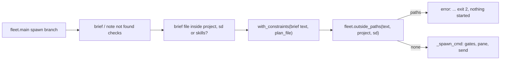
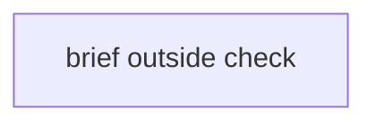

# B279: fleet spawn names brief paths outside the project before any pane starts (#1015)

**Goal:** `sl fleet spawn` refuses, before any gate, pane or worker id, a worker brief that the worker could not read in full: a brief file outside the project, the run folder and the plugin skills folder, or a brief (with the plan's Global constraints) or a review spawn's `--note` that names an existing path outside the project, the run folder and the plugin skills folder. The error names those paths, so the coordinator copies them into `.superlite/briefs/` instead of wasting a start that ends BLOCKED (#905's second half).
**Architecture:** one pure helper `fleet.outside_paths(text, project, sd, skills=None)` finds the path tokens of a text that resolve outside the three allowed folders; `fleet.main`'s spawn branch calls it on the `--note` text and on the `--brief` text (after `with_constraints`) for every role but `lead`, next to the existing brief checks, and exits 2 with one `error:` line. Docs: the fleet.py docstring and docs/fleet.md's skills-read bullet.
**Tech stack:** Python 3 stdlib (re, os.path, pathlib); pytest via `sl run_tests`.
**Spec:** issue #1015 (B272's follow-up of #905; #905 Expected: "`fleet spawn --role writer` refuses a brief that names files outside the project and the run folder before it starts a pane, and the fleet docs say so").
**Detail:** tests
**Wave0:** none
**Coverage:** off

## Global constraints

- Allowed folders: the project (`state.git_root(sd) or sd.parent`, the worker's cwd), the run folder `sd`, and the plugin skills folder `fleet_roles.SKILLS` (read at call time; B272 gives every worker `Read(//<skills>/**)`). Containment compares `Path(...).resolve()` of both sides (`relative_to`), so a symlink such as macOS `/tmp` -> `/private/tmp` cannot lead in or out.
- A path token starts at the text start or after whitespace or one of `` ` ' " ( [ { < = , > ``, optionally after `file://`, and is `/`, `~/` or `../` followed by one character of `[\w.@%+#~-]` (never `/` or `<`), then `[\w.@%+#~/-]*`; trailing `.` and `/` characters are dropped from the token. So URLs, `//<root>` templates, `read/write` and `a/b` relative paths never match; a glob ends the token at `*`.
- A token counts only when its path (after `os.path.expanduser`; a `../` token joined to the project; `os.path.normpath`, leading slashes collapsed to one) exists, or its parent folder exists and is not `/`. Paths whose first component is one of `dev bin sbin usr etc System Library opt Applications proc sys` never count (tools and system files, not work input).
- Exit 2, stderr, nothing started (no herdr call, no worker id, no fleet.json worker), checked after the existing `brief not found` and `note not found` checks and before `_spawn_cmd` (so before the budget, disk and machine gates). Message texts are fixed in T1's Produces lines; at most 5 tokens are named, in first-seen order, deduplicated, then ` and N more`.
- Role `lead` is never checked (a lead runs in auto mode and reads outside its worktree). `--for-dispatch` sends no brief and is not checked; a `--for-review|--package` spawn checks only its `--note` text (the generated review text names only paths sl writes itself).
- Files this batch may touch: docs/fleet.md, skills/subagent-driven-development/scripts/fleet.py, plus the new test file tests/scripts/test_fleet_brief_outside_1015.py and this plan (no open batch lists them). An existing test that breaks: name it in the report, do not edit it without the lead's word.
- Builds: the verdict is `sl run_tests` (the project's test command; a project with `.maxapp` runs `maxapp test`, which a build pool may place on another Mac, and a full run whose tree a green maxapp test stamp covers returns that result without a run); task trees build in <tree>/.build/DerivedData and any build of your own goes under .build/ of the worktree, never -derivedDataPath outside the worktree (your session scratchpad included; backlog cleanup removes scratchpad build folders when the worktree goes); a product, simulator or device build stays on this machine and runs only when an issue's acceptance asks for a running-app check; copy this sentence into every worker brief.
- Simulators: append the UDID of each simulator you or a worker creates (`xcrun simctl create` or `clone`; a checker's `Simulators:` line marks its created ones) as one line to /Users/max/github/superlite/.claude/worktrees/superlite-b279-fleet-spawn-outside-path-check/.superlite/simulators.txt; never list one you did not create; ship cleanup shuts down and deletes each listed one; copy this sentence into every worker brief.

Ruling: refuse with exit 2 and an `error:` line, like the writer's `Output:` check, not a stderr warning: only a refusal saves the wasted start #1015 names; #905 asked for a refusal (lead's ruling).
Ruling: the allowed folders are exactly the three #1015 names; a folder a user's own Claude Code settings add (`additionalDirectories`, extra allow rules) is not read, so such a path is refused too and the brief copies it (lead's ruling).
Ruling: a token counts only when it exists or its parent exists (parent not `/`), and system folders never count, so slash commands (`/superlite:review`), `<tree>/.build` templates, `2>/dev/null` and `/usr/bin/env` do not refuse a brief (lead's ruling).
Ruling: the brief file itself outside the three allowed folders is refused too: the worker is told to read that path, so it fails the same way (lead's ruling).
Ruling: no override flag: the error says how to fix the brief (copy the file into `<sd>/briefs/` and name the copy, or drop the path) (lead's ruling).
Ruling: `fleet send --brief` to a running worker is not checked (#1015 is spawn-time; fleet_io.py stays untouched); left as a follow-up (lead's ruling).

## Main diagram



## File structure

- skills/subagent-driven-development/scripts/fleet.py: `outside_paths()`, `outside_error()`, the two checks in `main`'s spawn branch, one docstring line.
- docs/fleet.md: the skills-read bullet (line 33) names the refusal.
- tests/scripts/test_fleet_brief_outside_1015.py: helper, CLI and docs tests.

## Task graph

```mermaid
%% schedule
gantt
  title Predicted schedule (mm:ss)
  dateFormat X
  axisFormat %M:%S
  section lane 1
  T1 brief outside check :t1, 0, 589s
```





critical path: T1 (9.8 min) · peak width 1 · predicted build 9.8 min · predicted total ≈ 26.3 min

## Fleet spawn

### T1 brief outside check · Complexity 4 (O-n) · Est. context 45k
**Owns:** skills/subagent-driven-development/scripts/fleet.py, docs/fleet.md, tests/scripts/test_fleet_brief_outside_1015.py
**Components:** 2
**LOC owned:** 170
**Tests:** fast
**Kind:** design
**Model:** sonnet
**Produces:** fleet.outside_paths(text: str, project: str | Path, sd: str | Path, skills: str | Path | None = None) -> list[str] · fleet.outside_error(what: str, where: str | Path, paths: list[str], sd: str | Path) -> str
e.g. outside_paths("Read /r/other/spec.md first.", "/r/proj", "/r/proj/.superlite") -> ["/r/other/spec.md"] (when /r/other exists)
e.g. outside_paths("Run /superlite:review; 2>/dev/null; see https://x.io/a/b", "/r/proj", "/r/proj/.superlite") -> []
e.g. outside_error("brief", "/r/proj/.superlite/briefs/R1.md", ["/a", "/b", "/c", "/d", "/e", "/f", "/g"], "/r/proj/.superlite") -> "error: brief /r/proj/.superlite/briefs/R1.md names paths outside the project, the run folder and the plugin skills folder: /a, /b, /c, /d, /e and 2 more; a worker cannot read them: copy each file into /r/proj/.superlite/briefs/ and name the copy, or drop the path (#1015)"
**Review Focus:** `test_prose_urls_and_commands_are_not_paths` (false positives refuse real briefs); `test_spawn_refuses_brief_naming_outside_path` asserts no herdr call; `test_lead_brief_is_not_checked`; containment uses resolved paths on both sides.
**Test code (verbatim):**
```python
# tests/scripts/test_fleet_brief_outside_1015.py
"""fleet spawn refuses a brief naming paths outside the project, the run folder and the plugin skills folder, before any pane starts (#1015)."""
import json
import types
import pytest
from test_fleet import world, SCRIPTS  # noqa: F401
from test_plan_tools import make_plan
import fleet  # noqa: E402
import fleet_roles  # noqa: E402

TAIL = "a worker cannot read them: copy each file into"


@pytest.fixture
def roots(tmp_path, monkeypatch):
    proj = tmp_path / "proj"; sd = proj / ".superlite"; sd.mkdir(parents=True)
    (proj / "docs").mkdir(); (proj / "docs" / "x.md").write_text("x")
    skills = tmp_path / "plug" / "skills"; (skills / "a").mkdir(parents=True); (skills / "a" / "SKILL.md").write_text("x")
    other = tmp_path / "other"; other.mkdir(); (other / "spec.md").write_text("spec")
    monkeypatch.setattr(fleet_roles, "SKILLS", skills)
    return types.SimpleNamespace(proj=proj, sd=sd, skills=skills, other=other, tmp=tmp_path)


def test_outside_path_is_named(roots):
    assert fleet.outside_paths(f"Read {roots.other}/spec.md first.\n", roots.proj, roots.sd) == [f"{roots.other}/spec.md"]


def test_inside_paths_are_not_named(roots):
    text = f"Read {roots.proj}/docs/x.md, {roots.sd}/briefs/b.md and `{roots.skills}/a/SKILL.md`; also docs/x.md.\n"
    assert fleet.outside_paths(text, roots.proj, roots.sd) == []


def test_new_file_in_an_existing_outside_folder_is_named(roots):
    assert fleet.outside_paths(f"Write {roots.other}/new.md\n", roots.proj, roots.sd) == [f"{roots.other}/new.md"]


def test_prose_urls_and_commands_are_not_paths(roots):
    text = ("Run /superlite:review and /commit-merge, see https://github.com/a/b and read/write it.\n"
            "Pipe to 2>/dev/null; call /usr/bin/env python3; never /etc/hosts.\n"
            "Templates: <tree>/.build/DerivedData and Read(//<plugin root>/skills/**).\n"
            f"Gone: {roots.tmp}/missing/deep/file.md\n")
    assert fleet.outside_paths(text, roots.proj, roots.sd) == []


def test_home_and_parent_relative_paths_count(roots, monkeypatch):
    monkeypatch.setenv("HOME", str(roots.tmp))
    text = "Read ~/other/spec.md, ../other/spec.md and ../proj/docs/x.md.\n"
    assert fleet.outside_paths(text, roots.proj, roots.sd) == ["~/other/spec.md", "../other/spec.md"]


def test_file_urls_globs_and_duplicates(roots):
    text = f"[spec](file://{roots.other}/spec.md) then `{roots.other}/**` and {roots.other}/spec.md again.\n"
    assert fleet.outside_paths(text, roots.proj, roots.sd) == [f"{roots.other}/spec.md", f"{roots.other}"]


def test_skills_argument_overrides_the_default(roots, tmp_path):
    assert fleet.outside_paths(f"Read {roots.skills}/a/SKILL.md\n", roots.proj, roots.sd, skills=tmp_path / "elsewhere") == [f"{roots.skills}/a/SKILL.md"]


def test_error_names_at_most_five():
    msg = fleet.outside_error("brief", "/r/b.md", ["/a", "/b", "/c", "/d", "/e", "/f", "/g"], "/r/.superlite")
    assert msg == ("error: brief /r/b.md names paths outside the project, the run folder and the plugin skills folder: "
                   "/a, /b, /c, /d, /e and 2 more; a worker cannot read them: copy each file into /r/.superlite/briefs/ "
                   "and name the copy, or drop the path (#1015)")
    assert fleet.outside_error("note", "/r/n.md", ["/a"], "/r/.superlite").startswith("error: note /r/n.md names paths outside the project, the run folder and the plugin skills folder: /a; ")


def _other(tmp_path):
    other = tmp_path / "other"; other.mkdir(); (other / "spec.md").write_text("s")
    return other


def _brief(world, text, name="R1.md"):
    b = world.sd / "briefs" / name; b.parent.mkdir(exist_ok=True); b.write_text(text)
    return b


def test_spawn_refuses_brief_naming_outside_path(world, capsys, tmp_path):
    fleet.main(["on"])
    other = _other(tmp_path)
    brief = _brief(world, f"Read {other}/spec.md.\n")
    n = len(world.fh.calls)
    assert fleet.main(["spawn", "--role", "research", "--brief", str(brief), "--plan", str(world.sd)]) == 2
    err = capsys.readouterr().err
    assert f"error: brief {brief.resolve()} names paths outside the project, the run folder and the plugin skills folder: {other}/spec.md; {TAIL}" in err
    assert len(world.fh.calls) == n
    assert json.loads((world.sd / "fleet.json").read_text()).get("workers", {}) == {}


@pytest.mark.parametrize("role", ["implementer", "fixer", "writer", "checker", "final-reviewer"])
def test_every_worker_role_is_checked(world, capsys, tmp_path, role):
    fleet.main(["on"])
    other = _other(tmp_path)
    brief = _brief(world, f"Read {other}/spec.md.\nOutput: out.md\n")
    n = len(world.fh.calls)
    assert fleet.main(["spawn", "--role", role, "--brief", str(brief), "--plan", str(world.sd)]) == 2
    assert f"{other}/spec.md; {TAIL}" in capsys.readouterr().err
    assert len(world.fh.calls) == n


def test_spawn_with_inside_paths_still_starts(world, monkeypatch):
    fleet.main(["on"])
    brief = _brief(world, f"Read {world.proj}/src/a.py and {world.sd}/briefs/x.md.\n")
    monkeypatch.setattr(fleet, "spawn", lambda *a, **k: {"id": "W1"})
    import fleet_io
    monkeypatch.setattr(fleet_io, "send_brief", lambda *a, **k: None)
    assert fleet.main(["spawn", "--role", "research", "--brief", str(brief), "--plan", str(world.sd)]) == 0


def test_global_constraints_are_checked_too(world, capsys, tmp_path):
    fleet.main(["on"])
    other = _other(tmp_path)
    plan = make_plan(world.proj, [{"id": "T1", "owns": "src/a.py"}], header=f"\nGlobal constraints:\n- The spec is {other}/spec.md.\n")
    brief = _brief(world, "Answer the question.\n")
    n = len(world.fh.calls)
    assert fleet.main(["spawn", "--role", "research", "--brief", str(brief), "--plan", str(plan)]) == 2
    assert f"{other}/spec.md; {TAIL}" in capsys.readouterr().err
    assert len(world.fh.calls) == n


def test_brief_file_outside_is_refused(world, capsys, tmp_path):
    fleet.main(["on"])
    b = tmp_path / "b.md"; b.write_text("Answer the question.\n")
    n = len(world.fh.calls)
    assert fleet.main(["spawn", "--role", "research", "--brief", str(b), "--plan", str(world.sd)]) == 2
    assert (f"error: brief {b.resolve()} is outside the project, the run folder and the plugin skills folder; a worker cannot read it: "
            f"move it into {world.sd.resolve()}/briefs/ (#1015)") in capsys.readouterr().err
    assert len(world.fh.calls) == n


def test_review_note_naming_outside_path_is_refused(world, capsys, tmp_path):
    fleet.main(["on"])
    other = _other(tmp_path)
    note = world.proj / "note.md"; note.write_text(f"Compare with {other}/spec.md.\n")
    n = len(world.fh.calls)
    assert fleet.main(["spawn", "--for-review", "T1", "--note", str(note), "--plan", str(world.plan)]) == 2
    assert f"error: note {note.resolve()} names paths outside the project, the run folder and the plugin skills folder: {other}/spec.md; {TAIL}" in capsys.readouterr().err
    assert len(world.fh.calls) == n


def test_lead_brief_is_not_checked(world, monkeypatch, tmp_path):
    fleet.main(["on"])
    other = _other(tmp_path)
    brief = _brief(world, f"Read {other}/spec.md.\n", "lead.md")
    import fleet_lead
    monkeypatch.setattr(fleet_lead, "start_plan_lead", lambda *a, **k: (0, "W1"))
    assert fleet.main(["spawn", "--role", "lead", "--plan", str(world.plan), "--brief", str(brief)]) == 0


def test_docs_name_the_refusal():
    doc = (SCRIPTS.parents[2] / "docs" / "fleet.md").read_text(encoding="utf-8")
    assert "`fleet spawn` refuses a brief that names one before any pane starts" in doc and "#1015" in doc
    assert "(#1015)" in fleet.__doc__
```
**Steps:** 1 write the test file, 2 run it: FAIL, 3 implement `outside_paths` and `outside_error` next to `writer_output` in fleet.py, then in `main`'s spawn branch: right after `note = Path(a.note).read_text(...)` refuse a note whose `outside_paths` is not empty (`outside_error("note", Path(a.note).resolve(), paths, sd)`, exit 2); right after the `brief not found` check (inside its block or just after it, before `tmo` parsing ends is fine) and only when `a.brief and not is_lead`: refuse a brief file whose resolved path is inside none of the project, `sd` and `fleet_roles.SKILLS` (exactly `f"error: brief {Path(a.brief).resolve()} is outside the project, the run folder and the plugin skills folder; a worker cannot read it: move it into {Path(sd).resolve()}/briefs/ (#1015)"`), else `text = with_constraints(Path(a.brief).read_text(encoding="utf-8"), orchestrator.plan_file(sd, a.plan))` (a constraints error falls back to the brief text alone) and refuse when `outside_paths(text, project, sd)` is not empty (`outside_error("brief", Path(a.brief).resolve(), paths, sd)`, exit 2); add the docstring line and the docs sentence, 4 run it: PASS, 5 run every tests/scripts/test_fleet*.py file and name each existing test that now fails in the report.
**Notes:** `project = state.git_root(sd) or sd.parent` as elsewhere in main. Docstring line, after the `spawn --role writer --brief F` line: "`spawn --brief F` (every role but lead) refuses with exit 2 before any pane when F lies outside the project, the run folder and the plugin skills folder, or when F (with the plan's Global constraints) or a review spawn's `--note` names an existing path outside the project, the run folder and the plugin skills folder; system folders such as /dev and /usr do not count (#1015)." docs/fleet.md line 33: replace its last sentence "Any other file outside the project and the run folder (a spec in another repository) still asks: copy it into `.superlite/briefs/` first (#905)." with "Any other file outside the project and the run folder (a spec in another repository) still asks, so `fleet spawn` refuses a brief that names one before any pane starts (every role but lead; a review spawn's `--note` too; a path counts when it or its parent folder exists, system folders such as `/usr` and `/dev` never): `error: brief F names paths outside the project, the run folder and the plugin skills folder: P, ...`, exit 2, nothing started. Copy each such file into `.superlite/briefs/` and name the copy (#905, #1015)." Every new function gets the file's `# O(...)` comment style on each line. The writer role's existing `Output:` check stays first and unchanged.
**Probe entry:** `sl fleet spawn --role research --brief <brief naming an outside spec> --plan .superlite` (exit 2, the error line, no pane)

## Review Focus

Package fleet spawn: app type CLI (fleet spawn). Categories: input parsing (the token regex over free brief text: false positives refuse a valid brief, false negatives keep the wasted start), file (resolved containment of both sides, `~` and `../` expansion, a missing path and a missing parent), state (nothing written and no herdr call on refusal; checks run before the budget, disk and machine gates), compatibility (lead spawns, `--for-dispatch` and writer `Output:` checks unchanged; existing spawn tests stay green).

## Self-review

Coverage: #1015 (name brief paths outside the project, the run folder and the plugin skills folder before any pane starts) maps to T1, with #905's "the fleet docs say so" in its docs sentence. Placeholders: none. Graph: one task. Fields: all filled. Limits: under 15k.
