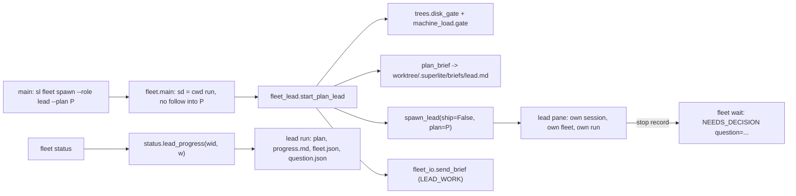
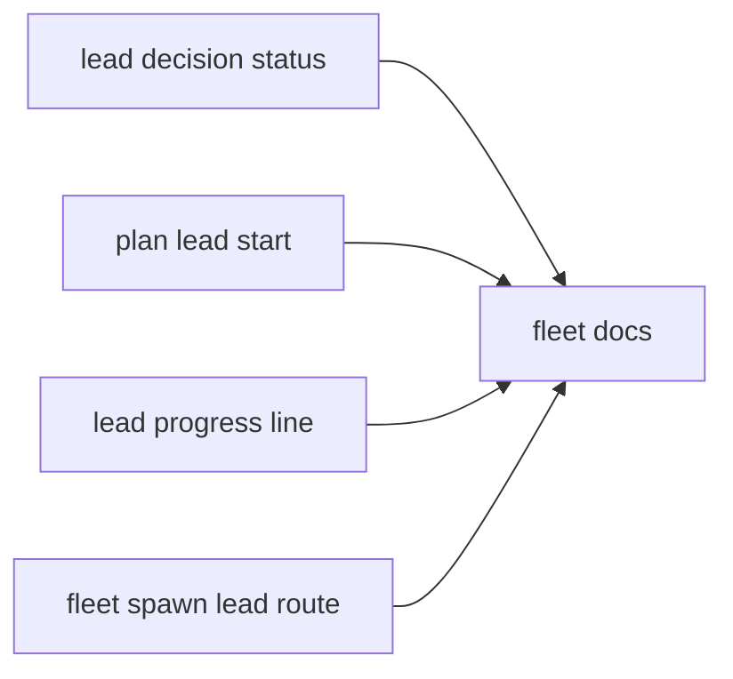

# B273: a lead role outside backlog mode (#906)

**Goal:** one main session starts a lead for a plan (or a brief) in another worktree with `sl fleet spawn --role lead --plan P`. Each lead has its own fleet and run binding. Main reads each lead's progress without stopping it, and `fleet wait` returns when a lead needs a decision. Several leads run at once across repositories, each admitted by the disk and machine gates.
**Architecture:** `fleet.py` routes `spawn --role lead` to `fleet_lead.start_plan_lead`. That function checks, gates, writes a plan brief, calls the existing `spawn_lead`, then `send_brief`. For this form `--plan` names the lead's plan, and main's fleet is the current directory's run, so main's fleet never follows into P. `status.lead_progress` builds one progress line per live lead from the lead's own run folder, and `fleet status` prints it. `NEEDS_DECISION` becomes a report status that the lead brief line lists, and `fleet wait` names the question file.
**Tech stack:** Python 3 stdlib; pytest via `sl run_tests`.
**Spec:** issue #906; main's ruling: a lead for a plan in another worktree is started with `fleet spawn --role lead --plan P`.
**Detail:** contracts
**Wave0:** none

## Global constraints

- Files this batch may touch: docs/fleet.md, skills/subagent-driven-development/scripts/fleet.py, skills/subagent-driven-development/scripts/fleet_lead.py, skills/subagent-driven-development/scripts/fleet_roles.py. No open batch lists these, so they may be touched too: skills/subagent-driven-development/scripts/fleet_report.py, fleet_io.py, metrics.py and status.py. New test files are allowed, and so is any existing test that pins a changed text and now breaks (name each one in your report). Never edit commit_task.py, build_prime.py, plan_tools.py, autocommit.py or finish.py, because other batches own them; calling their functions is fine.
- A lead process is local only: no remote placement and no `--machine`.
- Every refusal is one `error: ...` line on stderr, exit 2, before any pane is opened or any file is written. A gate refusal is one `BLOCKED: ...` line on stdout, exit 3.
- Builds: the verdict is `sl run_tests` (the project's test command; a project with `.maxapp` runs `maxapp test`, which a build pool may place on another Mac, and a full run whose tree a green maxapp test stamp covers returns that result without a run); task trees build in <tree>/.build/DerivedData and any build of your own goes under .build/ of the worktree, never -derivedDataPath outside the worktree (your session scratchpad included; backlog cleanup removes scratchpad build folders when the worktree goes); a product, simulator or device build stays on this machine and runs only when an issue's acceptance asks for a running-app check; copy this sentence into every worker brief.
- Simulators: append the UDID of each simulator you or a worker creates (`xcrun simctl create` or `clone`; a checker's `Simulators:` line marks its created ones) as one line to /Users/max/github/superlite/.claude/worktrees/superlite-b273-lead-role-multi-repo/.superlite/simulators.txt; never list one you did not create; ship cleanup shuts down and deletes each listed one; copy this sentence into every worker brief.

## Design

What #906 asks for: a lead role that can be started for a plan or a brief in a given worktree, with its own fleet and run binding, progress lines main can read without stopping the lead, a wait that returns when a lead needs a decision, and several leads at once across repositories, admitted by the machine gate. What I understood from the code: a lead (`fleet_lead.spawn_lead`) is already its own Claude session with `SUPERLITE_STATE_DIR=<worktree>/.superlite` and `SUPERLITE_FLEET_PARENT_DIR=<main's run>`. Its own `sl fleet on` therefore makes its own session fleet (`fleet_state.set_on`), and its stop records reach main's `fleet wait`. Today only `backlog start` calls it. Three things block a lead outside backlog mode:
1. `fleet spawn --plan P` follows main's fleet into P's run (`fleet._follow`, `fleet_state.follow`), which is the rebinding the issue reports.
2. `lead` is no `fleet_roles` role.
3. `NEEDS_DECISION` parses as UNKNOWN (`fleet_report.STATUSES`, `metrics.STATUS`).

Ruling: (main's ruling, #906) a lead for a plan in another worktree is started with `sl fleet spawn --role lead --plan P`.
Ruling: [scope] for `spawn --role lead`, `--plan P` names the lead's plan and never the spawning fleet's run. The spawning fleet is the current directory's run: there is no `no run state` refusal for P and no follow into P (because following P links the lead's run into main's fleet, the defect #906 reports; cost if wrong: main has to cd into its own run before it spawns).
Ruling: the lead's worktree is `state.git_root(P)` and its run is `<worktree>/.superlite`, the folder `spawn_lead` already uses. Without `--brief`, P must resolve to a plan file (`plan_tools.resolve_plan`). With `--brief F`, P may be any existing path inside the worktree (because a brief carries its own instructions; cost if wrong: one more refusal case).
Ruling: [scope] without `--brief`, spawn writes `<worktree>/.superlite/briefs/lead.md` from `fleet_lead.plan_brief`. That lead builds, reviews, runs the test layers and commits on its worktree's branch. It never pushes, merges, opens a pull request, bumps a version or ships, and it starts without the ship allow rules (`spawn_lead(ship=False)`) (because integration across repositories is main's and Max's outward-facing step; cost if wrong: main runs the finish step itself).
Ruling: [scope] progress goes into `sl fleet status`, as one `lead Wn <worktree>: ...` line per live lead (`status.lead_progress`). There is no new `sl lead status` tool (because fleet status already lists the lead record and main already reads it; the full run state stays `sl status --plan <lead run>`; cost if wrong: one more subcommand later).
Ruling: `NEEDS_DECISION` joins `fleet_report.STATUSES` and the `metrics` status patterns. Every lead's non-planning brief line lists it (`fleet_report.LEAD_WORK`). `fleet wait` ends a lead's NEEDS_DECISION line with ` question=<lead run>/question.json` when that file exists. It is not in `WAVE_OK`, so `--wave` and `--any` return. Main answers with `sl fleet send Wn --text T` (because send already resumes a lead; cost if wrong: an answer-file convention later).
Ruling: admission uses the same `trees.disk_gate` and `machine_load.gate` that `backlog start` uses, with the label `fleet spawn (lead)`. There is no lead count cap, because the memory gate admits each lead (#560; cost if wrong: a cap later).
Ruling: the report label defaults to `lead-<worktree folder name>`, because two leads labelled `lead` would overwrite one report file in main's run.
Ruling: a live lead of this fleet in the same worktree refuses a second one. The check does not cover a worktree run owned by another session: that lead's own `orchestrator set` ends it BLOCKED, and main sees why (cost if wrong: one wasted lead start).

## Coverage

| Category | State | Basis |
|---|---|---|
| Scope and success criteria | settled | #906 Expected: start for a plan or brief in a worktree, own fleet and run binding, progress without stopping, wait on a decision, several leads admitted by the machine gate. Non-goals: an `sl lead` tool, a lead cap, remote leads, auto-merge. |
| Domain and data model | ruled | the lead record in main's fleet.json gains `plan` (absolute path); report label `lead-<worktree name>` |
| Persistence and migration | ruled | one optional record key; a record without `plan` reads the lead run's own plan through `plan_tools.run_plan` |
| Interfaces and contracts | ruled | `fleet spawn --role lead --plan P` (main's ruling); for this form `--plan` names the lead's plan; `NEEDS_DECISION` is a report status; fleet wait adds `question=` |
| UI states | n/a | CLI only |
| Concurrency and state ownership | ruled | each lead is its own Claude session with its own session fleet; main's fleet holds only the lead record; one live lead per worktree per fleet |
| Error handling and recovery | ruled | refusals exit 2 before any pane; gate BLOCKED exit 3; spawn_lead's BLOCKED (SystemExit 3) passes through; a brief that was not sent stops the lead (exit 3) |
| Security and privacy | ruled | a plan lead gets no ship allow rules; AskUserQuestion stays disallowed as for batch leads |
| Performance and limits | ruled | each lead line reads its plan and ledger, O(t + L); a failed read gives `progress unreadable (<Error>)`, never a failed status |
| Observability | ruled | `fleet status` lead lines; `sl status --plan <lead run>`; the spawn hint line; fleet wait's `question=` |
| Testing strategy | ruled | unit tests with fakes for spawn_lead, send_brief, gates and herdr, as in tests/scripts/test_fleet_lead*.py; no live lead start |
| Compatibility | ruled | backlog leads keep their flow; their brief line now lists NEEDS_DECISION, and fleet status shows their lead line too |
| Rollout | ruled | one patch release; rollback is a revert |
| Research unknowns | n/a | research workers R1-R3 answered every code question |

## Main diagram



## File structure

- skills/subagent-driven-development/scripts/fleet_report.py: `NEEDS_DECISION` in STATUSES; `LEAD_WORK`; the lead brief line.
- skills/subagent-driven-development/scripts/fleet_io.py: `report_contract` for a lead; `_finish` adds `question=`.
- skills/subagent-driven-development/scripts/metrics.py: status patterns know NEEDS_DECISION.
- skills/subagent-driven-development/scripts/fleet_lead.py: `plan_brief`, `lead_argv(ship=)`, `spawn_lead(plan=, ship=)`, `start_plan_lead`.
- skills/subagent-driven-development/scripts/status.py: `lead_progress`.
- skills/subagent-driven-development/scripts/fleet.py: routing for `spawn --role lead`, the status lead lines, the docstring line.
- docs/fleet.md: section "Leads outside backlog mode".
- tests/scripts/test_lead_needs_decision_906.py, test_fleet_plan_lead_906.py, test_status_lead_progress_906.py, test_fleet_spawn_lead_906.py, test_docs_b273_fleet.py.

## Task graph

```mermaid
%% schedule
gantt
  title Predicted schedule (mm:ss)
  dateFormat X
  axisFormat %M:%S
  section lane 1
  T1 lead decision status :t1, 0, 429s
  T5 fleet docs :t5, 429, 368s
  section lane 2
  T2 plan lead start :t2, 0, 415s
  section lane 3
  T4 fleet spawn lead route :t4, 0, 404s
  section lane 4
  T3 lead progress line :t3, 0, 378s
```





critical path: T1 → T5 (13.3 min) · peak width 4 · predicted build 13.3 min · predicted total ≈ 25.8 min

## Reports

### T1 lead decision status · Complexity 2 (O-1) · Est. context 40k
**Owns:** skills/subagent-driven-development/scripts/fleet_report.py, skills/subagent-driven-development/scripts/fleet_io.py, skills/subagent-driven-development/scripts/metrics.py, tests/scripts/test_lead_needs_decision_906.py
**Components:** 3
**LOC owned:** 110
**Tests:** fast
**Kind:** design
**Model:** sonnet
**Produces:** fleet_report.LEAD_WORK: str · fleet_report.STATUSES: tuple[str, ...]
e.g. "NEEDS_DECISION" in fleet_report.STATUSES -> True
e.g. "`Status: <DONE|DONE_WITH_CONCERNS|NEEDS_CONTEXT|NEEDS_DECISION|BLOCKED>`" in fleet_report.LEAD_WORK -> True
**Review Focus:** `test_implementer_line_unchanged`: brief_message("implementer", p) still holds `Status: <DONE|DONE_WITH_CONCERNS|NEEDS_CONTEXT|BLOCKED>`; `test_planning_lead_keeps_planned`: a brief holding `End: Status: DONE planned: x` still gets fleet_report.PLANNED.
**Test code (named):** in tests/scripts/test_lead_needs_decision_906.py:
- `test_parse_json_needs_decision`: parse("Asked main.\n\nStatus: NEEDS_DECISION\n\n```json\n{\"status\": \"NEEDS_DECISION\", \"files\": [], \"tests\": \"\", \"red\": \"none - no test\", \"findings\": [], \"summary\": \"asks\"}\n```\n") gives status "NEEDS_DECISION" and valid True.
- `test_parse_text_needs_decision`: parse("Wrote .superlite/question.json.\n\nStatus: NEEDS_DECISION") gives status "NEEDS_DECISION".
- `test_metrics_status_of_needs_decision`: metrics.status_of("x\nStatus: NEEDS_DECISION") == "NEEDS_DECISION"; metrics.status_of("Status: NEEDS_CONTEXT") == "NEEDS_CONTEXT".
- `test_lead_brief_line_lists_needs_decision`: for a brief file without the PLANNED_END line, brief_message("lead", str(brief)) contains "`Status: <DONE|DONE_WITH_CONCERNS|NEEDS_CONTEXT|NEEDS_DECISION|BLOCKED>`".
- `test_implementer_line_unchanged` and `test_planning_lead_keeps_planned` as in Review Focus.
- `test_report_contract_lead`: fleet_io.report_contract({"role": "lead", "lead_sd": str(tmp_path)}) == fleet_report.LEAD_WORK (tmp_path has no briefs/lead.md).
- `test_wait_line_names_question`: `fleet_io._finish(sd, "W4", w, text, "transcript")` for a lead record w = {"role": "lead", "lead_sd": str(lsd), "task": "lead-b", "state": "busy"} (registered in sd's fleet.json), where text is the json reply from the first test and lsd/question.json exists. Its stdout line ends with f" question={lsd.resolve()}/question.json", the result holds "question" equal to that path, and fleet_io.wave_failure(result) is True. When lsd/question.json is missing, the line has no " question=" and the result has no "question" key.
**Steps:** 1 write the tests, 2 run: FAIL, 3 implement, 4 run: PASS, 5 run tests/scripts/test_fleet_report*.py, test_fleet_io*.py, test_metrics*.py and test_lead*.py, and fix each existing test that pins the old lead brief line (name it in your report).
**Notes:**
- STATUSES = ("APPROVED", "CHANGES_REQUESTED", "DONE_WITH_CONCERNS", "DONE", "NEEDS_CONTEXT", "NEEDS_DECISION", "BLOCKED").
- `LEAD_WORK = WORK.replace("NEEDS_CONTEXT|BLOCKED>", "NEEDS_CONTEXT|NEEDS_DECISION|BLOCKED>", 1)`.
- `_brief_line`: for role "lead" and not `_planning(path)`, return `f"Read {path} and do what it says. {LEAD_WORK}"`.
- `fleet_io.report_contract`: for role "lead", when the brief is not a planning brief, return `fleet_report.LEAD_WORK`.
- metrics.py: add `NEEDS_DECISION` after `NEEDS_CONTEXT` in the STATUS, LEAD and TASK_STATUS alternations.
- `_finish`: only when `w.get("role") == "lead"`, `rep["status"] == "NEEDS_DECISION"` and `Path(w["lead_sd"]) / "question.json"` is a file. Append ` question=<resolved path>` as the last part of the printed line, and add `"question": <that path as str>` to the returned dict.
- For the fleet_io fixtures (fake herdr, fleet state), see tests/scripts/test_fleet_io.py.
**Probe entry:** none (report parsing inside fleet wait; the named tests cover it)

## Lead start

### T2 plan lead start · Complexity 4 (O-n) · Est. context 50k
**Owns:** skills/subagent-driven-development/scripts/fleet_lead.py, tests/scripts/test_fleet_plan_lead_906.py
**Components:** 2
**LOC owned:** 230
**Tests:** fast
**Kind:** design
**Model:** sonnet
**Produces:** fleet_lead.plan_brief(plan: Path, worktree: Path, sl: str) -> str · fleet_lead.lead_argv(sl_path: str, model: str, window: int | None = None, effort: str | None = None, deny: list | None = None, mcp_config: str | None = None, ship: bool = True) -> list[str] · fleet_lead.spawn_lead(main_sd, worktree, model=None, env=None, rc=None, plan=None, ship=True) -> dict · fleet_lead.start_plan_lead(sd: Path, plan: str, brief: str | None = None, label: str = "", over: bool = False, machine_wait: float = 100.0) -> tuple[int, str | None]
e.g. start_plan_lead(Path("/r/a/.superlite"), "/r/b/docs/plans/p.md") -> (0, "W2")
e.g. start_plan_lead(Path("/r/a/.superlite"), "/r/missing.md") -> (2, None)
e.g. start_plan_lead(Path("/r/a/.superlite"), "/r/b/docs/plans/p.md") with the machine gate busy -> (3, None)
**Review Focus:** `test_start_blocked_by_gate_writes_nothing`: no briefs/lead.md and no spawn_lead call after a busy gate; `test_start_refuses_second_live_lead`: a stopped lead in the same worktree does not refuse.
**Test code (named):** in tests/scripts/test_fleet_plan_lead_906.py. Layout: tmp a/ and b/, each with a `.git` folder; a/.superlite holds fleet.json with the fleet on; b/docs/plans/p.md is a plan file. Fakes: `fleet_lead.spawn_lead`, `fleet_io.send_brief`, `machine_load.gate` and `trees.disk_gate` are monkeypatched.
- `test_plan_brief_names_plan_and_steps`: plan_brief(Path("/r/b/docs/plans/p.md"), Path("/r/b"), "/s/sl") contains "/r/b/docs/plans/p.md", "`/s/sl orchestrator set ai --plan .superlite`, then `/s/sl fleet on --plan .superlite`", "Status: NEEDS_DECISION", "Never push, merge", "/s/sl fleet wait --wave" and "/r/b/.superlite/simulators.txt", and does not contain "backlog ship".
- `test_lead_argv_without_ship`: lead_argv("/s/sl", "opus", ship=False) has no "--allowedTools", "Bash(maxapp ship *)" or "Bash(/s/sl backlog ship *)"; lead_argv("/s/sl", "opus") still holds all three.
- `test_start_refuses_missing_plan`: plan "a/../nope.md" gives (2, None); stderr has "error: --role lead --plan" and "not found"; spawn_lead is not called.
- `test_start_refuses_outside_git`: a plan file in a folder with no `.git` above it (patch `state.git_root` to return None) gives (2, None) and "not inside a git checkout".
- `test_start_refuses_own_worktree`: plan a/docs/plans/x.md with sd a/.superlite gives (2, None) and "this run's own worktree".
- `test_start_refuses_second_live_lead`: sd's fleet.json holds W1 {"role": "lead", "state": "busy", "lead_sd": str(b/.superlite)}, which gives (2, None) and stderr "error: W1 already leads {b}; stop it first: sl fleet stop W1". With W1 state "stopped", the start goes on.
- `test_start_refuses_non_plan_without_brief`: plan str(b) (a folder holding no plan) gives (2, None) and "pass a plan file, or --brief F".
- `test_start_blocked_by_gate_writes_nothing`: gate returns "memory pressure high", which gives (3, None) and stdout "BLOCKED: lead for {b} not started: memory pressure high; rerun, or --over-limit". b/.superlite/briefs/lead.md does not exist and spawn_lead is not called. A disk_gate ("refuse", "disk: 12 GB free") gives (3, None) and "BLOCKED: lead for {b} not started: 12 GB free".
- `test_start_writes_brief_and_sends`: fake spawn_lead returns {"id": "W2", "lead_sd": str(b/.superlite)}, and start_plan_lead(sd, str(plan)) gives (0, "W2"). b/.superlite/briefs/lead.md equals plan_brief(plan.resolve(), b.resolve(), <the real sl path>). spawn_lead got plan=plan.resolve() and ship=False. send_brief got (sd, "W2", str(brief path), "lead-b"). Stdout holds f"W2 lead {b}: progress: sl fleet status; run state: sl status --plan {b}/.superlite; wait: sl fleet wait W2 (returns at DONE, NEEDS_DECISION or BLOCKED); answer: sl fleet send W2 --text T".
- `test_start_with_brief_sends_it_unchanged`: brief=str(f) and plan=str(b) (no plan needed) give (0, "W2"). send_brief got str(f.resolve()) and no b/.superlite/briefs/lead.md is written.
- `test_start_brief_not_sent_stops_lead`: send_brief raises fleet.hc.HerdrError("x", "pane gone"), which gives (3, None). fleet.stop got (sd, ["W2"]) and stdout holds "BLOCKED: W2 lead-b not sent (pane gone); lead stopped".
- `test_start_spawn_blocked_passes_exit`: spawn_lead raises SystemExit(3), which gives (3, None).
- `test_spawn_lead_records_plan`: with the fixtures of tests/scripts/test_fleet_lead_record_577.py, spawn_lead(..., plan="/r/b/p.md", ship=False) stores record["plan"] == "/r/b/p.md" (resolved), and record["launch"]["argv"] has no "--allowedTools".
**Steps:** 1 write the tests, 2 run: FAIL, 3 implement, 4 run: PASS, 5 run tests/scripts/test_fleet_lead*.py.
**Notes:**
- `start_plan_lead` runs its steps in this order:
  1. P exists, else `error: --role lead --plan {plan}: not found`.
  2. `wt = state.git_root(P)`, else `error: --role lead --plan {plan}: not inside a git checkout`.
  3. `lsd = wt/.superlite`, and `lsd.resolve() != Path(sd).resolve()`, else `error: --role lead --plan {plan}: the plan lies in this run's own worktree {wt}; a lead runs a plan in another worktree`.
  4. No worker in `fleet.fs.workers(sd)` has role lead, a state outside ("stopped", "blocked") and the same resolved lead_sd, else the `already leads` error.
  5. With a brief: it is a file, else `error: brief not found: {abs}`. Without one: `planf = plan_tools.resolve_plan(plan)`, else on PlanError e: `error: --role lead --plan {plan}: {e}; pass a plan file, or --brief F`.
  6. `trees.disk_gate(wt)`: "refuse" gives the BLOCKED line with `dline.removeprefix("disk: ")` and returns 3; "warn" prints dline.
  7. `machine_load.gate("fleet spawn (lead)", machine_wait, over)`: a busy reason gives the BLOCKED line and returns 3.
  8. Write the brief when none was given.
  9. `rc = run_config.resolve(None, wt)`; `rec = spawn_lead(sd, wt, rc=rc, plan=planf or P, ship=False)`. Catch SystemExit e and return `(e.code if isinstance(e.code, int) else 3, None)`.
  10. `label = label or f"lead-{wt.name}"`; `fleet_io.send_brief(sd, rec["id"], str(brief), label)`. On (fleet.hc.HerdrError, OSError, KeyError), call `fleet.stop(sd, [rec["id"]])` and print the not-sent line with `getattr(e, "message", "") or e`.
  11. Print the hint line and return `(0, rec["id"])`.
- Pass `sl` to plan_brief as `str(Path(__file__).resolve().parent / "sl")`. `spawn_lead` stores `"plan": str(Path(plan).resolve())` in the record only when plan is given, and passes `ship` to lead_argv. `lead_argv(ship=False)` leaves out the `--allowedTools` pair and keeps everything else.
- `plan_brief` returns these lines, joined with "\n" plus a final "\n". It reuses backlog_brief.CODE_RULE, WAVE_WAIT and BUILD_TAIL with `.format(sl=sl)` where they take it:
  1. `# Lead brief: plan {plan}`
  2. `You are a lead started by \`sl fleet spawn --role lead\`: build the plan {plan} in the worktree {worktree} with your own fleet, review it and run its test layers. Main reads your progress with \`sl fleet status\` and waits for your Status line; it never reads your transcript.`
  3. `Your run: the worktree you start in, state in .superlite/; pass --plan .superlite to every sl call.`
  4. ``First: `{sl} orchestrator set ai --plan .superlite`, then `{sl} fleet on --plan .superlite`.``
  5. CODE_RULE.
  6. `Build: run the plan {plan} (a file without a \`%% taskgraph\` line is no superlite plan: write the plan from it with superlite:writing-plans first, in docs/plans/ of this worktree) with ` + BUILD_TAIL.
  7. `Simulators: append the UDID of each simulator you or a worker creates (\`xcrun simctl create\` or \`clone\`; a checker's \`Simulators:\` line marks its created ones) as one line to {worktree}/.superlite/simulators.txt; never list one you did not create; shut down and delete each listed one before you end your turn with DONE; copy this sentence into every worker brief.`
  8. WAVE_WAIT.
  9. `Never ask the user (AskUserQuestion is off): a major decision or an uncertainty goes to .superlite/question.json ({"questions": [...]}, the AskUserQuestion shape, 1 to 4 questions, your recommended option first and labelled "(Recommended)"); let running workers finish, then end your turn with Status: NEEDS_DECISION. Main answers with a message; continue from it. Rule minor and medium choices yourself and write each as one \`Ruling: ...\` line in .superlite/notes.md.`
  10. `Commit every task with commit_task on this worktree's branch. Never push, merge, open a pull request, bump a version or ship: main decides the integration after your DONE.`
  11. `End: Status: DONE once every plan task is committed, the final review approved and every test layer the changed paths require ran green; Status: DONE_WITH_CONCERNS with one \`Not run: <check> - <why>\` line per check you could not run; Status: NEEDS_DECISION as above; otherwise Status: BLOCKED with the reason. Then the JSON block.`
**Probe entry:** none (it starts a real lead pane; the named tests use fakes)

### T3 lead progress line · Complexity 3 (O-n) · Est. context 40k
**Owns:** skills/subagent-driven-development/scripts/status.py, tests/scripts/test_status_lead_progress_906.py
**Components:** 1
**LOC owned:** 120
**Tests:** fast
**Kind:** design
**Model:** sonnet
**Produces:** status.lead_progress(wid: str, w: dict) -> str | None
e.g. lead_progress("W4", {"role": "lead", "state": "busy", "lead_sd": "/r/b/.superlite", "worktree": "/r/b", "sent": 1}) -> "lead W4 /r/b: plan /r/b/.superlite/plan.md (3 tasks); tasks: checkpointed 1: T1; running 1: T2 (W1); open 1: T3; workers busy 1; question: none"
e.g. lead_progress("W4", {"role": "lead", "state": "ready", "lead_sd": "/r/b/.superlite", "worktree": "/r/b"}) on an empty run -> "lead W4 /r/b: plan: none yet; workers busy 0; question: none"
e.g. lead_progress("W1", {"role": "implementer", "state": "busy"}) -> None
**Review Focus:** `test_corrupt_plan_never_raises`: a plan.md that Plan.load refuses gives "plan {path} (unreadable)" in the line and no task part; `test_question_answered_is_none`: a question.json older than w["sent"] gives "question: none".
**Test code (named):** in tests/scripts/test_status_lead_progress_906.py, with a tmp worktree b/ whose b/.superlite is the lead's run:
- `test_tasks_and_busy_workers`: b/.superlite/plan.md is a minimal 3-task plan (T1, T2, T3) that plan_tools.Plan.load accepts (take the shape from the existing tests/scripts/test_status*.py fixtures); progress.md holds "- commit T1 abc1234 first"; b/.superlite/fleet.json holds W1 {"state": "busy", "task": "T2"}. The result is the first e.g. line with b's real paths.
- `test_empty_run`: an empty b/.superlite gives the second e.g. line.
- `test_open_question`: b/.superlite/question.json written with mtime (ms) >= w["sent"] ends the line with f"question: open {b}/.superlite/question.json".
- `test_question_answered_is_none` and `test_corrupt_plan_never_raises` as in Review Focus.
- `test_record_plan_fallback`: with no plan in the run (no stable.json, pool.json or plan.md), w["plan"] naming a plan file uses that file.
- `test_not_a_live_lead`: role implementer gives None; state "stopped" gives None; a lead_sd that is no folder gives None.
- `test_unexpected_error_is_a_line`: monkeypatching status.clean_state to raise RuntimeError("x") gives "lead W4 {b}: progress unreadable (RuntimeError)".
**Steps:** 1 write the tests, 2 run: FAIL, 3 implement, 4 run: PASS, 5 run tests/scripts/test_status*.py.
**Notes:**
- None unless `w.get("role") == "lead"`, the state is "ready" or "busy", and `Path(w.get("lead_sd") or "")` is a folder.
- `wt = w.get("worktree") or lsd.parent`.
- plan = `plan_tools.run_plan(lsd)`, else `Path(w["plan"])` when that is a file, else none: `plan: none yet`.
- With a plan: `plan {plan} ({n} tasks)`, then `"; " + tasks_line(lsd, ids, pool_data, fleet)` with `pool_data, fleet = clean_state(lsd)`. When Plan.load raises: `plan {plan} (unreadable)` and no tasks part.
- `workers busy N` counts fleet["workers"] whose state is "busy".
- `question: open {lsd}/question.json` when that file's `st_mtime * 1000 >= int(w.get("sent") or 0)`, else `question: none`.
- Parts join with "; " after `lead {wid} {wt}: `.
- Any other exception gives `lead {wid} {wt}: progress unreadable ({type(e).__name__})`.
**Probe entry:** none (read-only line builder; the named tests cover it)

## Fleet CLI

### T4 fleet spawn lead route · Complexity 3 (O-n) · Est. context 50k
**Owns:** skills/subagent-driven-development/scripts/fleet.py, tests/scripts/test_fleet_spawn_lead_906.py
**Components:** 2
**LOC owned:** 120
**Tests:** fast
**Kind:** design
**Model:** sonnet
**Consumes:** fleet_lead.start_plan_lead(sd: Path, plan: str, brief: str | None = None, label: str = "", over: bool = False, machine_wait: float = 100.0) -> tuple[int, str | None] (T2) · status.lead_progress(wid: str, w: dict) -> str | None (T3)
**Review Focus:** `test_lead_spawn_does_not_follow_into_plan`: `_follow` is called with None, and b/.superlite gets no fleet.json; `test_lead_spawn_fleet_off_hint`: the BLOCKED hint says `run sl fleet on first` with no `--plan` of the lead's plan.
**Test code (named):** in tests/scripts/test_fleet_spawn_lead_906.py. Layout: tmp a/ (cwd, a/.git, a/.superlite with the fleet on) and b/ (b/.git, b/docs/plans/p.md, no b/.superlite). Fakes: `fleet_lead.start_plan_lead` and `status.lead_progress` are monkeypatched (raising=False).
- `test_lead_spawn_routes_to_start_plan_lead`: fleet.main(["spawn", "--role", "lead", "--plan", str(p)]) returns 0 when the fake returns (0, "W3"). The fake got sd == (a/.superlite).resolve(), plan == str(p), brief None, label "", over False and machine_wait 100.0.
- `test_lead_spawn_does_not_follow_into_plan`: as in Review Focus.
- `test_lead_spawn_plan_without_run_state_is_not_refused`: the same call prints no "no run state" error (b/.superlite is missing) and reaches the fake.
- `test_lead_spawn_refuses_flags`: each of `--tier opus`, `--machine m`, `--for-dispatch`, `--for-review T1`, `--package X` and `--note f` with `--role lead --plan p` returns 2, and stderr holds "error: --role lead takes no --tier, --machine, --for-dispatch, --for-review, --package or --note". Without --plan it returns 2 with "error: --role lead needs --plan P (the lead's plan; with --brief F any path inside its worktree)".
- `test_lead_spawn_fleet_off_hint`: a's fleet off returns 3, and stdout holds f"BLOCKED: fleet is off in {a/.superlite resolved}; run sl fleet on first".
- `test_lead_spawn_wait`: `--wait` with the fake returning (0, "W3") calls fleet_io.wait (monkeypatched) with (sd, ["W3"], 540000) and returns 0. `--timeout 9m --wait` passes 540000. `--timeout 9m` without --wait returns 2 ("--timeout needs --wait").
- `test_lead_spawn_exit_passes`: the fake returning (3, None) makes main return 3, and fleet_io.wait is not called.
- `test_status_prints_lead_progress`: a's fleet.json holds W1 {"role": "lead", "state": "busy", "lead_sd": str(b/.superlite)}, with `agent_gone` faked False and `fleet_waits.suffixes` faked {}. The fake lead_progress returns "lead W1 x: plan: none yet; workers busy 0; question: none" for W1 and None for others. The stdout of fleet.main(["status"]) has that line right after the W1 row.
**Steps:** 1 write the tests, 2 run: FAIL, 3 implement, 4 run: PASS, 5 run tests/scripts/test_fleet_cli*.py, test_fleet_status*.py and test_fleet_follow*.py.
**Notes:**
- In `main()`, before the `_plan_problem` check, `lead = bool(argv) and argv[0] == "spawn" and _role_arg(argv) == "lead"`. The new `_role_arg(argv)` returns the last `--role X` or `--role=X`, else None, like `_plan_arg`. When `lead` is true, keep the value and set the local `plan = None`, so the plan refusal, the run-state refusal and `_follow(plan)` behave as for a spawn without --plan.
- After `a = p.parse_args(argv)`, when a.cmd == "spawn" and a.role == "lead", set `sd = Path(state.resolve(None)).resolve()`.
- In the spawn branch, the fleet-off hint is `sl fleet on` without --plan for a lead. Right after the fleet-off check, for a lead: refuse the flags as tested, and refuse a missing --plan. The generic `--wait needs --brief` check skips a lead. Parse `tmo` for a lead with --wait even without --brief, and keep the brief-exists check only for a given --brief.
- At the top of `_spawn_cmd`, for a lead: `import fleet_lead; code, wid = fleet_lead.start_plan_lead(sd, a.plan, brief=a.brief, label=a.label, over=a.over_limit, machine_wait=a.machine_wait)`. When code is 0 and a.wait: `restore()`, then `fio.wait(sd, [wid], tmo)`. Return code.
- Status: right after the worker-row loop, for each `(wid, w)` in `fs.workers(sd).items()`, `line = status.lead_progress(wid, w)`; print it when not None. Import status lazily.
- Docstring, after the spawn usage line: `    fleet.py spawn --role lead --plan P [--brief F] [--label L] [--wait]: a lead for the plan P in P's own worktree, its own session, fleet and run (#906); --plan names the lead's plan, the spawning fleet is the current directory's run`.
**Probe entry:** none (fleet spawn starts real panes; the named tests use fakes)

## Docs

### T5 fleet docs · Complexity 1 (O-1) · Est. context 25k
**Owns:** docs/fleet.md, tests/scripts/test_docs_b273_fleet.py
**Components:** 1
**LOC owned:** 60
**Tests:** fast
**Kind:** mechanical
**Model:** haiku
**Review Focus:** `test_docs_b273_messages_match_code`: each quoted message is in the script that prints it.
**Test code (named):** in tests/scripts/test_docs_b273_fleet.py:
- `test_docs_b273_section`: docs/fleet.md holds the heading "## Leads outside backlog mode" before "## Batch leads (backlog mode)", and holds each bullet below verbatim.
- `test_docs_b273_messages_match_code`: "already leads", "not started:", "progress: sl fleet status", "pass a plan file, or --brief F" are in skills/subagent-driven-development/scripts/fleet_lead.py; "question=" is in fleet_io.py; "NEEDS_DECISION" is in fleet_report.py; "lead_progress" is in fleet.py.
**Steps:** 1 write the test, 2 run: FAIL, 3 add the section, 4 run: PASS, 5 run tests/scripts/test_docs*fleet*.py.
**Notes:** Insert this section verbatim right before the line "## Batch leads (backlog mode)" of docs/fleet.md, with a blank line after it:

```
## Leads outside backlog mode

`sl fleet spawn --role lead --plan P [--brief F] [--label L] [--wait] [--machine-wait S] [--over-limit]` starts a lead for the plan P in P's own worktree (the git checkout P lies in), so one main session runs several repositories' plans at once (main's ruling on #906). For this form `--plan` names the lead's plan (a plan file, a run folder, or with `--brief` any path inside the worktree), never the spawning fleet's run: the lead is a worker of the current directory's run, its own run is `<worktree>/.superlite`, and main's fleet does not follow into P.

- The lead is its own Claude session: its `sl orchestrator set ai --plan .superlite` and `sl fleet on --plan .superlite` give it its own run binding and its own session fleet; main's binding stays.
- Without `--brief`, spawn writes `<worktree>/.superlite/briefs/lead.md` (`fleet_lead.plan_brief`): build the plan with its own fleet, the final review, the test layers, commits on the worktree's branch; never push, merge, open a pull request or ship (main decides the integration). With `--brief F` it sends F unchanged. A plan lead starts without the ship allow rules.
- Admission: the disk gate and the machine gate as for `backlog start` (`BLOCKED: lead for <worktree> not started: <why>`, exit 3). Refused with exit 2 before any pane: P not found, P outside a git checkout, P in this run's own worktree, a live lead of this fleet already in that worktree (`Wn already leads <worktree>; stop it first: sl fleet stop Wn`), a path that is no plan without `--brief` (`pass a plan file, or --brief F`), and `--tier`, `--machine`, `--for-dispatch`, `--for-review`, `--package` or `--note`.
- The report label defaults to `lead-<worktree folder>`. Spawn prints `Wn lead <worktree>: progress: sl fleet status; run state: sl status --plan <worktree>/.superlite; wait: sl fleet wait Wn (returns at DONE, NEEDS_DECISION or BLOCKED); answer: sl fleet send Wn --text T`.
- Progress without stopping the lead: `sl fleet status` prints one `lead Wn <worktree>: ...` line per live lead (`status.lead_progress`, batch leads too): its plan and task count, the task groups (checkpointed, running, held, open), its busy workers, and `question: open <path>` while a question.json newer than the last message waits.
- Decisions: `NEEDS_DECISION` is a report status; every lead's brief line lists it, and `fleet wait` ends the lead's line with ` question=<worktree>/.superlite/question.json` when that file exists. It is no wave-OK status, so `fleet wait --wave` and `--any` return on it. Main asks the user and answers with `sl fleet send Wn --text "<answer>"`.
- `fleet stop Wn` stops the lead's own workers first, then the lead; `fleet restore` resumes it like any lead.
```
**Probe entry:** none (docs)

## Review Focus

- Package Reports (T1): app type library/parser; categories: encoding, state. Risks: a new status token that changes the parse of other roles' replies, and the planning lead's PLANNED line.
- Package Lead start (T2): app type CLI; categories: protocol, state, file. Risks: writing the brief or opening a pane before a refusal; two leads in one worktree; a report label collision.
- Package T3: app type library; categories: state, file. Risks: raising inside `fleet status`; a stale question shown as open.
- Package Fleet CLI (T4): app type CLI; categories: protocol, state. Risks: `--plan` of a lead form still following main's fleet into P, and other spawn forms changed by the routing.

## Running-app checks

None: CLI only, no app target.

## Self-review

Every #906 Expected item maps to a task: start (T2, T4), own fleet and run (T2: own session; T4: no follow), progress (T3, T4), wait on a decision (T1), and several leads admitted by the gates (T2). No task shares a file with another. T4 consumes T2 and T3 only through fakes. T5 waits for all four.
