# Superlite: the no-result trace test holds in every checkout; run_tests names its command cuts (#1018)

**Goal:** `tests/scripts/test_run_tests_no_result_trace.py::test_zero_count_stop_names_command_exit_and_log` passes in the main checkout, a linked worktree and a `run_tests --task` tree alike, and the 200- and 300-character command cuts of a no-result stop are tested in every checkout (#1018).
**Architecture:** run_tests.py names its two no-result command cuts as module constants (`TARGET_COMMAND_CHARS = 200` for the incident `target`, `INCIDENT_COMMAND_CHARS = 300` for the incident `command`), used by `no_result_target` and `record_no_result`; behaviour unchanged. The trace test compares against the cut command and gains a test whose command is always longer than both cuts.
**Tech stack:** Python 3.10+ stdlib; pytest through `sl run_tests`.
**Spec:** this file, section Design.
**Detail:** tests
**Target-min:** 11
**Wave0:** none
**Coverage:** off

Global constraints:
- Every line of a Python script under `skills/**/scripts/` keeps the repo's `# O(...)` complexity comment; stdlib only; LF endings. Files under `tests/` carry no such comments.
- This repository is public: no host names, user names, home paths, other project or repository names in code, tests, docs or commit messages.
- The verdict is `sl run_tests` (never raw pytest); every new test sees a red run before the code it tests.
- Builds: the verdict is `sl run_tests` (the project's test command; a project with `.maxapp` runs `maxapp test`, which a build pool may place on another Mac, and a full run whose tree a green maxapp test stamp covers returns that result without a run); task trees build in <tree>/.build/DerivedData and any build of your own goes under .build/ of the worktree, never -derivedDataPath outside the worktree (your session scratchpad included; backlog cleanup removes scratchpad build folders when the worktree goes); a product, simulator or device build stays on this machine and runs only when an issue's acceptance asks for a running-app check; copy this sentence into every worker brief.
- Simulators: append the UDID of each simulator you or a worker creates (`xcrun simctl create` or `clone`; a checker's `Simulators:` line marks its created ones) as one line to the worktree's `.superlite/simulators.txt`; never list one you did not create; ship cleanup shuts down and deletes each listed one; copy this sentence into every worker brief.

## Design

Issue #1018 (follow-up from B274): the test fails in `run_tests --task` tree runs with a differing `inc["target"]`, passes in the full run; suspected the macOS `/private` symlink.

Cause (reproduced in this batch's worktree with `sl run_tests --fast tests/scripts/test_run_tests_no_result_trace.py`: 6 passed, 1 failed): the log path matches; the command part differs. `no_result_target` writes `command[:200]` into the target (run_tests.py `no_result_target`), and the test's command is `f'{sys.executable} -c "print(...); print(\'nothing here\')"'`, about 110 characters plus the interpreter path. The main checkout's `.venv/bin/python` path keeps it under 200; a linked worktree's or a task tree's `.venv` path (`<worktree>/.superlite/trees/Tn/.venv/bin/python`) pushes it past 200, so the target ends mid-command (`... print(\'nothing here\')"` cut to `... pri`) while the test expects the whole command. The incident's `command` field (`command[:300]`) has the same latent dependency on path length.

1. **Constants** (run_tests.py, beside the other module constants): `TARGET_COMMAND_CHARS = 200` (a no-result target names at most this much of its command) and `INCIDENT_COMMAND_CHARS = 300` (the no-result incident's `command` field keeps at most this much). `no_result_target` uses `command[:TARGET_COMMAND_CHARS]`, `record_no_result` uses `command[:INCIDENT_COMMAND_CHARS]`. Output byte-identical to today.
2. **Test** (test_run_tests_no_result_trace.py): `swift_zero(tmp_path, pad=0)` appends `pad` characters of a Python comment (`  # ` plus `x` * pad) inside the `-c` string, so the command still prints the same two lines; `test_zero_count_stop_names_command_exit_and_log` compares `inc["command"]` with `cmd[:run_tests.INCIDENT_COMMAND_CHARS]` and the target with `cmd[:run_tests.TARGET_COMMAND_CHARS]`; a new `test_long_command_is_cut_in_target_and_incident` pads the command past 300 characters so both cuts are exercised in every checkout, and checks that the kept log holds the whole command.

Rejected: a visible cut marker (`...`) in the target, since the whole command is already in the kept log and the incident's `command` field, and the issue asks for the failure's cause, not a format change.

### Rulings

- Ruling: the cause is the test's assumption that its command stays under the 200-character target cut, not the `/private` symlink (because the reproduced diff shows identical log paths and a command cut at 200).
- Ruling: run_tests' no-result output stays byte-identical; only the two cut lengths become named constants the test reads (because one canonical place for each cut keeps the test from copying magic numbers).
- Ruling: lint's MISSED TARGET is accepted (because the plan is one 30-line task; the forecast is its test runs).
- Ruling: lint's PYTHONPATH warning on run_tests.py is accepted without a test-cmd.json change (because run_tests.py's imports of its sibling scripts are unchanged and earlier batches committed it under this config).

## Task graph

```mermaid
%% schedule
gantt
  title Predicted schedule (mm:ss)
  dateFormat X
  axisFormat %M:%S
  section lane 1
  T1 no-result command cuts :t1, 0, 458s
```




critical path: T1 (7.6 min) · peak width 1 · predicted build 7.6 min · predicted total ≈ 22.1 min (target ✗ 11.0)

## Package: run_tests no-result stop

App type: CLI (run_tests summary and incidents). Categories: protocol (target and command texts).
**Probe entry:** none (named tests run run_tests as a subprocess)

### T1 no-result command cuts · Complexity 1 · Est. context 26k
**Owns:** skills/subagent-driven-development/scripts/run_tests.py, tests/scripts/test_run_tests_no_result_trace.py
**Components:** 1
**LOC owned:** 30
**Tests:** fast
**Model:** sonnet
**Covers:** Design
**Produces:** run_tests.TARGET_COMMAND_CHARS: int = 200 · run_tests.INCIDENT_COMMAND_CHARS: int = 300
  e.g. run_tests.no_result_target("c" * 250, 0, "L") -> "exit 0 from `" + "c" * 200 + "`; log L"
**Review Focus:** protocol: `test_zero_count_stop_names_command_exit_and_log` (green in a worktree and a task tree), `test_long_command_is_cut_in_target_and_incident`
**Test code (verbatim):** in tests/scripts/test_run_tests_no_result_trace.py replace `swift_zero` and `test_zero_count_stop_names_command_exit_and_log` with the code below and add the new test right after it (the other tests and helpers stay as they are):
```python
def swift_zero(tmp_path, pad=0):
    zero = "Executed 0 tests, with 0 failures (0 unexpected) in 0.0 (0.0) seconds"
    tail = f"  # {'x' * pad}" if pad else ""
    cmd = f'{sys.executable} -c "print(\'{zero}\'); print(\'nothing here\'){tail}"'
    spec = {"language": "swift", "test": cmd, "test_file": cmd}
    (tmp_path / ".superlite").mkdir(exist_ok=True)
    (tmp_path / ".superlite" / "test-cmd.json").write_text(json.dumps(spec), encoding="utf-8")
    return cmd


def test_zero_count_stop_names_command_exit_and_log(tmp_path):
    cmd, cp = zero_run(tmp_path)
    assert cp.returncode == 1, cp.both
    (inc,) = incidents(tmp_path)
    assert inc["exit"] == 0
    assert inc["command"] == cmd[:run_tests.INCIDENT_COMMAND_CHARS]
    log = inc["log"]
    assert os.path.isfile(log) and os.path.dirname(log).endswith(".superlite")
    text = open(log, encoding="utf-8").read()
    assert "command: " in text and "exit: 0" in text and "nothing here" in text
    assert inc["target"] == f"no test count; exit 0 from `{cmd[:run_tests.TARGET_COMMAND_CHARS]}`; log {log}"
    assert f"run_tests: no-result log {log}" in cp.err


def test_long_command_is_cut_in_target_and_incident(tmp_path):
    cmd = swift_zero(tmp_path, pad=400)
    cp = run(RUN_TESTS, "--full", cwd=tmp_path)
    assert cp.returncode == 1, cp.both
    assert (run_tests.TARGET_COMMAND_CHARS, run_tests.INCIDENT_COMMAND_CHARS) == (200, 300)
    assert len(cmd) > 400
    (inc,) = incidents(tmp_path)
    assert inc["command"] == cmd[:300]
    log = inc["log"]
    assert inc["target"] == f"no test count; exit 0 from `{cmd[:200]}`; log {log}"
    assert f"command: {cmd}\n" in open(log, encoding="utf-8").read()
```
**Steps:** 1 write the tests, 2 run: FAIL (no `TARGET_COMMAND_CHARS` / `INCIDENT_COMMAND_CHARS`), 3 implement Design 1, 4 run: PASS
**Notes:** Verify with `sl run_tests --fast tests/scripts/test_run_tests_no_result_trace.py tests/scripts/test_run_tests_cause_778_793.py --task T1` (the task tree has the long interpreter path that made the old test red). Place the two constants after `DEFAULT_LOCK_WAIT` with `# O(1)` comments that say what each cut is.

## Review Focus

- protocol: the target and the incident `command` keep today's texts byte for byte (`test_run_tests_cause_778_793.py::test_no_result_target_kinds` stays green unchanged); the trace test is green whatever the interpreter path length.

## Self-review

Coverage: Design 1-2 in T1. No placeholders. Produces names match the test. One task, no edges.
