# Superlite: orchestrator set/bind/approve from a subfolder resolves the worktree's run, never creates or moves run state (#1006)

**Goal:** `sl orchestrator set|bind|approve --plan <relative path>` (and `approve --review <relative path>` without `--plan`) run with the cwd in a subfolder of a checkout resolve the path against the enclosing checkout's run, and refuse a path that exists nowhere before `state.bind`, so no `<subfolder>/.superlite` is created and no orchestrator.json, session marker or fleet link moves (#1006, #998's sibling).
**Architecture:** orchestrator.py's `main` passes `--plan` and `--review` through `plan_tools.anchor_plan` (B266, lazy import) right after argparse; a new `unanchored(value)` names the checkout top when a relative value still names nothing from a subfolder; `set`, `bind` and `approve` refuse such a value (exit 2, one line) before any run folder is resolved or bound.
**Tech stack:** Python 3.10+ stdlib; pytest through `sl run_tests`.
**Spec:** this file, section Design.
**Detail:** contracts
**Target-min:** 11
**Wave0:** none
**Coverage:** off

Global constraints:
- Every line of a Python script under `skills/**/scripts/` keeps the repo's `# O(...)` complexity comment; stdlib only; LF endings. Files under `tests/` carry no such comments.
- This repository is public: no host names, user names, home paths, other project or repository names in code, tests, docs or commit messages.
- The verdict is `sl run_tests` (never raw pytest); every new test sees a red run before the code it tests.
- An existing test that pins a changed text or output may be updated in the task that changes it; name each such file in your report.
- Tests never touch the real `~/.superlite` or the real session: tests/scripts/conftest.py already sets SUPERLITE_HOME per test; set SUPERLITE_SESSION_ID to a test id with monkeypatch and delete CLAUDE_CODE_SESSION_ID and SUPERLITE_STATE_DIR.
- Builds: the verdict is `sl run_tests` (the project's test command; a project with `.maxapp` runs `maxapp test`, which a build pool may place on another Mac, and a full run whose tree a green maxapp test stamp covers returns that result without a run); task trees build in <tree>/.build/DerivedData and any build of your own goes under .build/ of the worktree, never -derivedDataPath outside the worktree (your session scratchpad included; backlog cleanup removes scratchpad build folders when the worktree goes); a product, simulator or device build stays on this machine and runs only when an issue's acceptance asks for a running-app check; copy this sentence into every worker brief.
- Simulators: append the UDID of each simulator you or a worker creates (`xcrun simctl create` or `clone`; a checker's `Simulators:` line marks its created ones) as one line to the worktree's `.superlite/simulators.txt`; never list one you did not create; ship cleanup shuts down and deletes each listed one; copy this sentence into every worker brief.

## Design

Issue #1006: from `<top>/skills/x/scripts`, `sl orchestrator set ai --plan docs/plans/p.md` runs `sl_dir` -> `state.resolve` -> `state.plan_dir` on `/docs/plans/p.md`, a path that does not exist; plan_dir takes its nearest `docs` ancestor below the toplevel (`/docs`) and returns `/.superlite`; `state.bind` then mkdirs it, moves orchestrator.json and human-replies.jsonl, rewrites the session marker and re-links the fleet. `approve --review <relative>` without `--plan` does the same through `state.plan_dir(review)`, and only afterwards says `review plan not found`.

1. **`_anchor(value)`** (orchestrator.py): `None`, `""` or an absolute value is returned unchanged without importing plan_tools; any other value is `plan_tools.anchor_plan(value)` (lazy import inside the function: orchestrator is imported by every gated tool). So a value valid at the cwd is unchanged, one valid at the checkout's top becomes that absolute path, a bare `.superlite` becomes the nearest run up to the top (#707), and nothing is created.
2. **`unanchored(value) -> Path | None`** (orchestrator.py): the checkout top `state.git_root(cwd)` (cwd = `state._abs(".")`) when all hold: `value` is a non-empty relative path, `Path(value)` does not exist, `Path(os.path.normpath(value)).name != ".superlite"`, the top is not None and the cwd is not the top. Else None. It is called on an already anchored value, so "does not exist" means neither at the cwd nor at the top.
3. **`main`**, right after `a = ap.parse_args(argv)`, for every subcommand: `a.plan = _anchor(a.plan)`; when the subcommand has `--review` and it is set, `a.review = _anchor(a.review)`; `review` takes the anchored value. Then, before the existing `sd` branch: for `set`, `bind`, `approve` with `a.plan`, `top = unanchored(a.plan)`; when not None print `orchestrator: plan not found: <a.plan> (neither at the cwd nor at <top>); not <set|bound|approved>` to stderr and return 2. For `approve` without `a.plan` and with `a.review`, `top = unanchored(a.review)`; when not None print `orchestrator: review plan not found: <a.review> (neither at the cwd nor at <top>); not approved` and return 2. Nothing is resolved, created or bound before these returns.
4. Unchanged: every message, exit code and stdout line of a call whose values are absolute or valid at the cwd; a missing relative plan typed at the top or outside a checkout (plan_dir is unambiguous there; existing tests pass not-yet-written absolute plans); `state.plan_dir` and `state.bind`; plan_tools.py. `end` and `takeover` keep their `plan not found` checks, which now see the anchored value; `status` and `resume` read the anchored run.

### Rulings

- Ruling: refuse an unresolvable relative plan or review only from a subfolder of a checkout (because at the top or outside a checkout plan_dir already lands on the cwd's run, and `set --plan <plan not yet written>` there is a working call today).
- Ruling: a `.superlite`-named value is never refused (because `set ai --plan .superlite` creates the run; a bare `.superlite` from a subfolder with no run up to the top keeps the #707 rule: the cwd's folder).
- Ruling: anchor `--plan` for every orchestrator subcommand and `--review` for `approve` and `status` (because a run reader from a subfolder must read the same run a writer binds); approve's `--review` without `--plan` is the same defect through `state.plan_dir(review)`, fixed here as an adjacent fix in this batch's file.
- Ruling: the recorded `review_path` is the anchored value (absolute when it was anchored); only `summary_line` reads it, for display.
- Ruling: plan_tools.py and state.py stay unchanged; orchestrator imports `plan_tools.anchor_plan` lazily, only for a relative value.
- Ruling: lint's MISSED TARGET is accepted (because the batch is one task on one file plus its test; nothing splits further).

## Task graph

```mermaid
%% schedule
gantt
  title Predicted schedule (mm:ss)
  dateFormat X
  axisFormat %M:%S
  section lane 1
  T1 orchestrator anchor :t1, 0, 198s
```

critical path: T1 (3.3 min) · peak width 1 · predicted build 3.3 min · predicted total ≈ 9.8 min (target ✓)

## Package: orchestrator CLI

App type: CLI. Categories: protocol (argument resolution, exit codes, unchanged messages), state (no run folder created, no gate file, session marker or binding moved), file (paths relative to the cwd vs the checkout top).
**Probe entry:** none (the cases need a temporary git repository with a run folder and a session binding; they are named tests)

### T1 orchestrator anchor · Complexity 3 · Est. context 40k
**Owns:** skills/subagent-driven-development/scripts/orchestrator.py, tests/scripts/test_orchestrator_subfolder_1006.py
**Components:** 1
**LOC owned:** 150
**Tests:** fast
**Model:** sonnet
**Covers:** Design
**Produces:** orchestrator.unanchored(value: str | None) -> Path | None
  e.g. unanchored("docs/plans/nope.md") with cwd "<top>/skills/x/scripts" -> Path("<top>")
  e.g. unanchored("docs/plans/nope.md") with cwd "<top>" -> None
  e.g. unanchored(".superlite") with cwd "<top>/skills/x/scripts" -> None
**Review Focus:** state: `test_set_from_subfolder_binds_top`, `test_bind_from_subfolder_binds_top`, `test_missing_plan_from_subfolder_writes_nothing`, `test_missing_review_from_subfolder_writes_nothing`; protocol: `test_approve_review_from_subfolder`, `test_status_from_subfolder_reads_top`, `test_takeover_from_subfolder`, `test_missing_plan_from_top_unchanged`; file: `test_unanchored_cases`
**Test code (contracts):** fixture as in tests/scripts/test_plan_tools_subfolder_998.py (reuse its `git`, `cd` and `tree` helpers by copying them): a temporary repository `<top>` (`git init -b main`, one commit) holding `docs/plans/p.md` (`# p` is enough), `docs/plans/p.review.md` and the subfolder `<top>/skills/x/scripts` with one tracked file. SUPERLITE_SESSION_ID is `test-1006`. With cwd `<top>`, `orchestrator.main(["set", "ai", "--plan", "<top>/.superlite"]) == 0` binds the session; then cwd is the subfolder (monkeypatch.chdir and PWD). The binding file is `$SUPERLITE_HOME/sessions/test-1006`; its first line names the bound folder.
- `test_unanchored_cases`: the three e.g. lines exactly; `unanchored(None)`, `unanchored("")` and an absolute missing path give None; with cwd the subfolder, `unanchored("docs/plans/p.md")` is `Path("<top>")` (the raw value names nothing at the cwd) and `unanchored(str(top / "docs/plans/p.md"))` is None; outside any git repository `unanchored("docs/nope.md")` is None; nothing is created under `<top>`.
- `test_set_from_subfolder_binds_top`: `main(["set", "human", "--plan", "docs/plans/p.md"]) == 0` from the subfolder; `/.superlite` does not exist; `<top>/.superlite/orchestrator.json` has mode `human`; `<top>/.superlite/session` holds `test-1006`; the binding's first line is `<top>/.superlite`.
- `test_bind_from_subfolder_binds_top`: `main(["bind", "--plan", "docs/plans/p.md"]) == 0`; stdout is `orchestrator: session bound to <top>/.superlite`; `/.superlite` does not exist.
- `test_approve_review_from_subfolder`, parametrized with and without `--plan docs/plans/p.md`: with cwd `<top>` run `set human --plan <top>/.superlite`, append `{"t": <review mtime ms + 5000>, "approves": true}` to `<top>/.superlite/human-replies.jsonl`; from the subfolder `main(["approve", "--review", "docs/plans/p.review.md", ...]) == 0`; `<top>/.superlite/orchestrator.json` has `approved` true and `review_path` `<top>/docs/plans/p.review.md`; `/.superlite` does not exist.
- `test_missing_plan_from_subfolder_writes_nothing`, parametrized over `["set", "ai"]`, `["bind"]`, `["approve", "--review", "docs/plans/p.review.md"]`: `main([*cmd, "--plan", "docs/plans/nope.md"]) == 2`; stderr holds `orchestrator: plan not found: docs/plans/nope.md (neither at the cwd nor at <top>); not ` followed by `set`, `bound` or `approved`; `/.superlite` does not exist; `<top>/.superlite/orchestrator.json` and `session` and the binding file are byte-identical to before.
- `test_missing_review_from_subfolder_writes_nothing`: `main(["approve", "--review", "docs/plans/nope.review.md"]) == 2`; stderr holds `orchestrator: review plan not found: docs/plans/nope.review.md (neither at the cwd nor at <top>); not approved`; the same three files byte-identical; `/.superlite` does not exist.
- `test_missing_plan_from_top_unchanged`: cwd `<top>`, `main(["set", "human", "--plan", "docs/plans/nope.md"]) == 0` and `<top>/.superlite/orchestrator.json` has mode `human` (today's behaviour, green before and after).
- `test_status_from_subfolder_reads_top`: `main(["status", "--plan", "docs/plans/p.md"]) == 0`; stdout starts `orchestrator: AI`; `/.superlite` does not exist.
- `test_takeover_from_subfolder`: `main(["takeover", "--plan", "docs/plans/p.md"]) == 0`; stdout names `<top>/.superlite`; `/.superlite` does not exist.
**Steps:** 1 write the tests, 2 run: FAIL (set, bind and approve see `/.superlite` created; status reads `not set`; takeover says `plan not found`; the missing cases see exit 0 or a later message), 3 implement Design 1-3 (`_anchor` and `unanchored` above `main`, one line in the `--plan` help naming the anchoring), 4 run: PASS
**Notes:** Verify with `sl run_tests --fast tests/scripts/test_orchestrator_subfolder_1006.py tests/scripts/test_orchestrator.py tests/scripts/test_orchestrator_takeover.py tests/scripts/test_orchestrator_worktree_guard.py tests/scripts/test_orchestrator_resume_384.py tests/scripts/test_orchestrator_resume_459.py tests/scripts/test_session_state.py tests/scripts/test_session_handover.py tests/scripts/test_plan_tools_subfolder_998.py --task T1`.

## Review Focus

- T1 state: no path through `main` reaches `state.bind`, `write_state` or a mkdir for a refused value; a valid call still binds before the human-mode and review checks, so a pending gate still moves to the plan's own run.
- T1 protocol: every message, exit code and stdout line of a call whose values are absolute or valid at the cwd is unchanged; the #199 foreign-worktree check (no `--plan`) is unchanged.
- T1 file: a logical (symlinked) cwd resolves to the logical top, as `state._abs` does; a `.superlite`-named value is never refused.

## Self-review

#1006 maps to T1: anchor (Design 1, 3) or refuse (Design 2, 3) before bind, never create or move run state; one task, one file plus its test.
