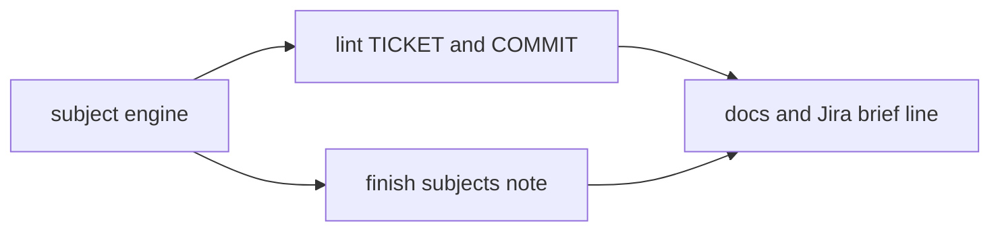

# Superlite: commit subjects take each plan task's tracker key and a subject template (#911)

**Goal:** a plan task may carry its own `**Ticket:** KEY`, which wins over the plan header's; a commit subject template (plan header `**Commit:**`, else `.superlite/test-cmd.json` `"commit_subject"`) shapes the subject from the task's fields; `commit_task` and `autocommit apply` write those subjects (apply rebuilds them from the plan), `sl finish` shows them before apply, and plan lint warns when some tasks have a key and others none (#911).
**Architecture:** one subject engine in `autocommit.py` (`subject`, `subject_template`, `template_fields`, `field_values`, `entry_subjects`), read by commit_task (unchanged call), `apply`, finish's checkpoint note and plan lint (`WARNING: TICKET:`, `WARNING: COMMIT:`); docs and the Jira lead-brief line name the per-task field.
**Tech stack:** Python 3.10+ stdlib; git; pytest through `sl run_tests`.
**Spec:** this file, section Design.
**Detail:** contracts
**Target-min:** 11
**Wave0:** none
**Coverage:** off

Global constraints:
- Python scripts under `skills/**/scripts/`: match the file's comment style (plan_tools.py, finish.py, commit_task.py, backlog_brief.py: every new line carries a `# O(...)` complexity comment; autocommit.py: as its neighbouring functions do); stdlib only; LF endings. Files under `tests/` carry no such comments.
- This repository is public: no host names, user names, home paths, other project or repository names in code, tests, docs or commit messages. Example keys are `PIX-<n>` or `A-<n>`.
- The verdict is `sl run_tests` (never raw pytest); every new test sees a red run before the code it tests.
- An existing test that pins a changed text or output may be updated in the task that changes it; name each such file in your report.
- Builds: the verdict is `sl run_tests` (the project's test command; a project with `.maxapp` runs `maxapp test`, which a build pool may place on another Mac, and a full run whose tree a green maxapp test stamp covers returns that result without a run); task trees build in <tree>/.build/DerivedData and any build of your own goes under .build/ of the worktree, never -derivedDataPath outside the worktree (your session scratchpad included; backlog cleanup removes scratchpad build folders when the worktree goes); a product, simulator or device build stays on this machine and runs only when an issue's acceptance asks for a running-app check; copy this sentence into every worker brief.
- Simulators: append the UDID of each simulator you or a worker creates (`xcrun simctl create` or `clone`; a checker's `Simulators:` line marks its created ones) as one line to the worktree's `.superlite/simulators.txt`; never list one you did not create; ship cleanup shuts down and deletes each listed one; copy this sentence into every worker brief.

## Design

Issue #911: a project tracks one issue per plan task and requires Conventional Commits with the task's key first in the description (`feat(scope): KEY-123 <title>`). The plan header has one `**Ticket:**`, so subjects were `<ticket> Tn: title` and every lead reworded each commit by hand from a kept mapping file.

1. **Template** (`autocommit.subject_template(plan, root=None)`): the plan header's `**Commit:**` value (header = lines before the first `##+ ` heading, as `ticket()` reads it; name matched case-insensitively; one enclosing pair of backticks stripped; the value stripped); else `commit_subject` from `<root>/.superlite/test-cmd.json` (root defaults to the cwd; when that file does not exist and root is a linked worktree, the main checkout's file, found with `testcmd._main_checkout_root`, imported lazily), used only when it is a non-empty string; else `DEFAULT_SUBJECT = "{ticket} {tid}: {title}"`. No plan, a missing or unreadable plan, a missing or bad JSON file: the next source, never an exit or a stderr line.
2. **Placeholders** (`PLACEHOLDER = re.compile(r"\{([A-Za-z][A-Za-z0-9_-]*)\}")`; `template_fields(template)`: the names lowercased, first-seen order, no repeats). `{tid}` is the task id, `{title}` the title the caller passes; any other `{name}` (`{ticket}` too) is the task block's own unfenced `**Name:**` field (read with `next_tasks.parse_plan` and `next_tasks._field`, the name `re.escape`d inside `(?i:...)`), else the header's `**Name:**` (case-insensitive), else empty. A value is stripped, one enclosing pair of backticks removed, whitespace runs collapsed to one space. Braces outside a placeholder stay literal; an inserted value is never scanned again.
3. **Render** (`subject(tid, title, plan, root=None)`): fill the template, drop every `(` + optional whitespace + `)`, collapse whitespace runs to one space, strip. An empty result gives `f"{tid}: {title}"`. The default template reproduces today's subjects exactly: `PIX-9 T2: tag counts` with a key, `T2: tag counts` without. `message(tid, title, plan)` stays and returns `subject(tid, title, plan)`; `ticket(plan)` stays the header key only.
4. **Apply rebuilds:** `entry_subjects(entries, plan, root=None)` gives, per entry in order, `subject(e["task"], <the plan's title for that task>, plan, root)` when the plan file is readable and still names `e["task"]`, else the entry's stored `title` (a Wave 0 `T0`, an entry without `task`, no plan). The plan is parsed once per call. `apply()` writes those subjects (hook_pass, the commits and the `applied ...` list use them); `record()` still stores the subject current at checkpoint time.
5. **Lint** (`plan_tools.subject_warnings(plan, root)`), over the plan's non-draft tasks other than `T0`: (a) when the header has no `**Ticket:**`, some tasks have their own and some none: `WARNING: TICKET: <without> have no **Ticket:** while <with> have one and the plan header has none; give each task its key, or put one **Ticket:** in the plan header` (`has` for one id); (b) for each template name other than tid, title and ticket that the header does not set, the tasks whose block does not set it: `WARNING: COMMIT: <ids> have no **<Name>:** for {<name>} in the commit subject template; their subjects leave it out (set it on the task or in the plan header)` (one id: `has` and `its subject`; `<Name>` is the name with its first letter upper-cased). An id list is in plan order, at most 5 ids then ` +N more`. Any exception: []. `lint_plan` adds the lines to its warnings.
6. **Finish:** `checkpoint_note` says `(one commit per task, subjects below; add ...` instead of `same titles`, and after the `to commit:` line prints `subjects (apply rebuilds them from the plan: edit its **Ticket:** fields or subject template before apply to change them):` and one `- <subject>` line per task of `autocommit.squash_entries(entries)` from `entry_subjects(..., st.get("plan"), root=<the .superlite folder's parent>)`, at most 5, then `- ... +N more`.
7. **Docs and brief:** docs/tools.md (the commit_task row's ticket clause, one appended line), skills/writing-plans/task-template.md (a `Ticket` field row), and the Jira line of the lead brief (backlog_brief.py) names the per-task field.

Rejected: a separate mapping file of task keys (a second place to keep in sync; the plan task already is the unit); `str.format` for the template (a literal brace or a missing name would raise).

### Rulings

- Ruling: a task's own `**Ticket:**` wins over the header's; the header key stays the default for tasks without one, and with a header key lint never warns TICKET (because every task then has a key).
- Ruling: `{type}`, `{scope}` and every other placeholder read the task's own field of that name, then the header's; a missing one renders empty and an empty `()` is dropped, so `feat: KEY title` stays valid Conventional Commits (because a refusal would block commit_task mid-run; lint warns COMMIT: instead).
- Ruling: the template lives in the plan header `**Commit:**` and, project-wide, in `.superlite/test-cmd.json` `"commit_subject"`; the plan wins (because a project convention should not need a header in every plan, and a plan may still differ).
- Ruling: `autocommit apply` rebuilds subjects from the plan at apply time (because a key fixed in the plan after a checkpoint then reaches the real commits without rewording).
- Ruling: [scope] the Jira line of the lead brief (backlog_brief.py, golden pins in tests) now names the per-task `**Ticket:**`, because a lead in a Jira backlog would otherwise keep one header key; B277 edits backlog_brief.py, docs/tools.md, skills/writing-plans/task-template.md and their tests besides its four listed files (no open batch lists them).
- Ruling: lint's MISSED TARGET is accepted (because T2 and T3 run T1's engine in their tests and T4 quotes their texts; the chain is four short tasks).
- Ruling: skills/writing-plans/SKILL.md stays unchanged (its `**Ticket:** KEY` header clause is still true as the default, task-template.md carries the field, and SKILL.md costs the evals layer); task-template.md costs the headless layer, which the lead runs.

## Task graph

```mermaid
%% schedule
gantt
  title Predicted schedule (mm:ss)
  dateFormat X
  axisFormat %M:%S
  section lane 1
  T1 subject engine :t1, 0, 656s
  T2 lint TICKET and COMMIT :t2, 656, 649s
  T4 docs and Jira brief line :t4, 1305, 640s
  section lane 2
  T3 finish subjects note :t3, 656, 642s
```





critical path: T1 → T2 → T4 (32.4 min) · peak width 2 · predicted build 32.4 min · predicted total ≈ 50.9 min (target ✗ 11.0)

## Package: autocommit

App type: library (plan and git reads). Categories: state (task vs header fields, fenced lines, missing plan), protocol (exact subjects), file (test-cmd.json).
**Probe entry:** none (the cases need plan files and git repositories; they are named tests)

### T1 subject engine · Complexity 4 · Est. context 40k
**Owns:** skills/subagent-driven-development/scripts/autocommit.py, skills/subagent-driven-development/scripts/commit_task.py, tests/scripts/test_commit_subject_911.py, tests/scripts/test_commit_also.py
**Components:** 1
**LOC owned:** 200
**Tests:** fast
**Model:** sonnet
**Covers:** Design
**Produces:** autocommit.subject(tid: str, title: str, plan: str | None, root: str | None = None) -> str
  e.g. subject("T1", "parser", "<tmp>/plan.md") with header `**Ticket:** PIX-9` and T1's block `**Ticket:** PIX-11` -> "PIX-11 T1: parser"
  e.g. subject("T1", "parser", "<tmp>/plan.md") with header `**Commit:** \`{type}({scope}): {ticket} {title}\`` and T1 fields Type feat, Ticket PIX-11, no Scope -> "feat: PIX-11 parser"
**Produces:** autocommit.subject_template(plan: str | None, root: str | None = None) -> str
  e.g. subject_template(None, root="<tmp>") with <tmp>/.superlite/test-cmd.json {"test": "pytest", "commit_subject": "{ticket}: {title}"} -> "{ticket}: {title}"
**Produces:** autocommit.template_fields(template: str) -> list[str]
  e.g. template_fields("{type}({scope}): {ticket} {title} {Type}") -> ["type", "scope", "ticket", "title"]
**Produces:** autocommit.field_values(plan: str | None, names: list[str]) -> tuple[dict, dict]
  e.g. field_values("<tmp>/plan.md", ["ticket", "scope"]) with header `**Ticket:** PIX-9`, T1 `### T1 parser` with `**Scope:** core`, T2 `### T2 cli` -> ({"ticket": "PIX-9"}, {"T1": {"title": "parser", "scope": "core"}, "T2": {"title": "cli"}})
**Produces:** autocommit.entry_subjects(entries: list[dict], plan: str | None, root: str | None = None) -> list[str]
  e.g. entry_subjects([{"task": "T1", "title": "T1: old", "files": []}, {"task": "T0", "title": "T0: skeleton", "files": []}], "<tmp>/plan.md") with header `**Ticket:** PIX-9` and `### T1 parser` -> ["PIX-9 T1: parser", "T0: skeleton"]
**Review Focus:** state: `test_task_ticket_wins`, `test_fenced_ticket_ignored`, `test_missing_plan_default`, `test_entry_subjects_keeps_unknown`; protocol: `test_default_subject_unchanged`, `test_template_missing_scope_drops_parens`, `test_apply_rebuilds_subjects`; file: `test_testcmd_template`
**Test code (contracts):** in tests/scripts/test_commit_subject_911.py; `plan(tmp_path, head, *blocks)` writes `# P\n\n<head>\n\n## Tasks\n\n<blocks>` to plan.md and returns its path; repo tests reuse `make_repo`, `write`, `git`, `run` of tests/scripts/test_run_scripts.py and `commit`/`OFF` as tests/scripts/test_commit_also.py defines them.
- `test_default_subject_unchanged`: header `**Ticket:** PIX-9`, `### T2 tag counts` -> `subject("T2", "tag counts", p) == "PIX-9 T2: tag counts"`; no header key -> "T2: tag counts"; plan None -> "T2: tag counts"; `message(...)` equals `subject(...)` in each case.
- `test_missing_plan_default`: a path that does not exist -> "T2: tag counts", no SystemExit, empty stderr (capsys).
- `test_task_ticket_wins`: header PIX-9; T1 block `**Ticket:** PIX-11`, T2 block none -> "PIX-11 T1: parser" and "PIX-9 T2: cli"; `ticket(p) == "PIX-9"`.
- `test_fenced_ticket_ignored`: T1's `**Ticket:** FENCE-1` only inside a ``` fence, no header key -> "T1: parser".
- `test_header_template`: header `` **Commit:** `{type}({scope}): {ticket} {title}` ``; T1 `**Type:** feat`, `**Scope:** parser`, `**Ticket:** PIX-11` -> "feat(parser): PIX-11 parser".
- `test_template_missing_scope_drops_parens`: same template, T1 Type fix, Ticket PIX-12, no Scope anywhere -> "fix: PIX-12 parser"; Type feat, Scope a, no ticket -> "feat(a): parser".
- `test_header_field_fallback`: header `**Type:** feat` and `**Scope:** core`, T1 only `**Ticket:** PIX-1` -> "feat(core): PIX-1 parser"; a task `**Type:** fix` beats the header's.
- `test_names_case_insensitive`: template `{Type}: {TITLE}`, T1 `**type:** docs` -> "docs: parser".
- `test_empty_render_falls_back`: template `{type}`, no Type -> "T1: parser".
- `test_testcmd_template`: no `**Commit:**`; `<tmp>/.superlite/test-cmd.json` {"test": "pytest", "commit_subject": "{ticket}: {title}"}, header PIX-9 -> `subject("T1", "parser", p, root=str(tmp_path)) == "PIX-9: parser"`; a header `**Commit:** {tid} {title}` wins -> "T1 parser"; `"commit_subject": 5` -> default; bad JSON -> default and empty stderr.
- `test_template_fields`: the e.g. above.
- `test_field_values`: the e.g. above; plan None -> ({}, {}).
- `test_entry_subjects_keeps_unknown`: the e.g. above plus `{"title": "x", "files": []}` (no task) -> stored "x"; plan None -> every stored title.
- `test_commit_task_uses_task_ticket`: make_repo, add `**Ticket:** PIX-5` as the line after T1's heading in plan.md, write src/a.py, `commit(repo, "T1", env=OFF)` -> checkpoint subject (`git log -1 --format=%s <sha>`) "PIX-5 T1: parser" and the checkpoints.json entry title the same; with autocommit on (`env=ENV`) HEAD's subject is the same.
- `test_apply_rebuilds_subjects`: make_repo, checkpoint T1 with OFF, then add `**Ticket:** PIX-7` to T1's block, run `autocommit apply --plan plan.md` (as tests/scripts/test_autocommit.py runs it) -> HEAD subject "PIX-7 T1: parser" and the `applied` list prints it.
- In tests/scripts/test_commit_also.py, `test_ticket_only_from_header_block` keeps `ticket(p) is None` and now asserts `message("T1", "x", p) == "BODY-1 T1: x"`; rename it `test_ticket_header_and_task_block`.
**Steps:** 1 write the tests, 2 run: FAIL (no `subject`; T1's block key ignored), 3 implement Design 1-4 in autocommit.py and change only the commit_task.py docstring line about `autocommit.message()` (its calls stay), 4 run: PASS (test_commit_also.py, test_autocommit.py, test_autocommit_squash.py, test_autocommit_hooks_709.py stay green)
**Notes:** Verify with `sl run_tests --fast tests/scripts/test_commit_subject_911.py tests/scripts/test_commit_also.py tests/scripts/test_autocommit.py tests/scripts/test_autocommit_squash.py tests/scripts/test_autocommit_hooks_709.py --task T1`. `next_tasks.read_text` exits on a missing file: check the path first. Import next_tasks lazily (the scripts folder is on sys.path when autocommit runs). In `apply`, give `hook_pass` copies of the todo entries with the rebuilt titles; the saved state is not rewritten. The module docstring names the template and the per-task key.

## Package: plan lint

App type: library (lint warnings). Categories: state (header key, drafts, T0), protocol (exact warning text).
**Probe entry:** none (named tests cover the warnings)

### T2 lint TICKET and COMMIT · Complexity 3 · Est. context 36k
**Owns:** skills/subagent-driven-development/scripts/plan_tools.py, tests/scripts/test_lint_ticket_911.py
**Components:** 1
**LOC owned:** 130
**Tests:** fast
**Model:** sonnet
**Covers:** Design
**Consumes:** autocommit.subject_template(plan: str | None, root: str | None = None) -> str (T1) · autocommit.template_fields(template: str) -> list[str] (T1) · autocommit.field_values(plan: str | None, names: list[str]) -> tuple[dict, dict] (T1)
**Produces:** plan_tools.subject_warnings(plan: Plan, root: Path | None) -> list[str]
  e.g. no header key; T1 `**Ticket:** A-1`, T2 none, T3 `**Ticket:** A-3`, T4 none -> ["WARNING: TICKET: T2, T4 have no **Ticket:** while T1, T3 have one and the plan header has none; give each task its key, or put one **Ticket:** in the plan header"]
**Review Focus:** state: `test_header_key_quiet`, `test_draft_ignored`, `test_all_or_none_quiet`; protocol: `test_mixed_keys_warn`, `test_one_id_singular`, `test_list_cut_at_five`, `test_commit_field_missing_warns`, `test_lint_prints_both`
**Test code (contracts):** in tests/scripts/test_lint_ticket_911.py, build plans the way tests/scripts/test_lint_reach_owns_606.py does (valid minimal tasks).
- `test_mixed_keys_warn`: the e.g. -> exactly that list.
- `test_one_id_singular`: T1 key, T2 none -> `WARNING: TICKET: T2 has no **Ticket:** while T1 has one and the plan header has none; ...`.
- `test_header_key_quiet`: the e.g. plan plus header `**Ticket:** A-0` -> no TICKET line.
- `test_all_or_none_quiet`: every task keyed -> []; none keyed -> [].
- `test_draft_ignored`: T1, T2 keyed, T3 `**Status:** draft` without key -> [].
- `test_list_cut_at_five`: T1 keyed, T2-T8 none -> the line starts `WARNING: TICKET: T2, T3, T4, T5, T6 +2 more have no **Ticket:**`.
- `test_commit_field_missing_warns`: header `**Ticket:** A-0` and `**Commit:** {type}({scope}): {ticket} {title}`; T1 Type feat, Scope a; T2 Type fix, no Scope -> exactly `["WARNING: COMMIT: T2 has no **Scope:** for {scope} in the commit subject template; its subject leaves it out (set it on the task or in the plan header)"]`; with T3 also lacking Scope: `T2, T3 have no **Scope:** ...; their subjects leave it out ...`.
- `test_header_field_quiet`: the same plus header `**Scope:** core` -> [].
- `test_default_template_quiet`: no `**Commit:**`, every task keyed -> [].
- `test_testcmd_template_read`: root with .superlite/test-cmd.json {"test": "pytest", "commit_subject": "{type}: {title}"}, T1 without Type -> one COMMIT line naming `**Type:**` for `{type}`.
- `test_lint_prints_both`: `cmd_lint` (as test_lint_reach_owns_606.py runs it) on a plan with mixed keys and a missing Scope prints both lines among its WARNING lines.
**Steps:** 1 write the tests, 2 run: FAIL (no `subject_warnings`), 3 implement Design 5 and add `(TICKET:)` and `(COMMIT:)` to the module docstring's "Lint also warns" line, 4 run: PASS (test_lint_reach_owns_606.py and test_plan_tools.py stay green)
**Notes:** Verify with `sl run_tests --fast tests/scripts/test_lint_ticket_911.py tests/scripts/test_lint_reach_owns_606.py tests/scripts/test_plan_tools.py --task T2`. Call autocommit with `str(plan.path)` and the root lint_plan already gives its root-aware warnings (`root_`), else the plan's folder. Import autocommit lazily inside `subject_warnings`. Keep the edit to the new function, one docstring line and one line in lint_plan.

## Package: finish

App type: CLI (finish text). Categories: protocol (note lines), state (no plan, many tasks).
**Probe entry:** none (named tests cover the note)

### T3 finish subjects note · Complexity 2 · Est. context 30k
**Owns:** skills/subagent-driven-development/scripts/finish.py, tests/scripts/test_finish_subjects_911.py, tests/scripts/test_finish_last_full_498.py
**Components:** 1
**LOC owned:** 70
**Tests:** fast
**Model:** sonnet
**Covers:** Design
**Consumes:** autocommit.entry_subjects(entries: list[dict], plan: str | None, root: str | None = None) -> list[str] (T1)
**Review Focus:** protocol: `test_note_lists_subjects`, `test_note_cuts_at_five`; state: `test_note_without_plan_uses_stored`
**Test code (contracts):** in tests/scripts/test_finish_subjects_911.py, build the ledger and checkpoints.json as `test_checkpoint_note_names_the_trailer_flag` in tests/scripts/test_finish_last_full_498.py does (is_on patched False).
- `test_note_lists_subjects`: plan.md with `### T1 parser` holding `**Ticket:** PIX-3` and `### T2 cli`; entries T1, T1, T2 (with "task", "plan" set to the plan's absolute path) -> the note holds `subjects (apply rebuilds them from the plan: edit its **Ticket:** fields or subject template before apply to change them):`, then `- PIX-3 T1: parser` and `- T2: cli`, each once, right after the `to commit:` line, and `(one commit per task, subjects below; add` in the `to commit:` line.
- `test_note_cuts_at_five`: 7 tasks -> 5 `- ` subject lines then `- ... +2 more`.
- `test_note_without_plan_uses_stored`: no "plan" key, entries `{"title": "T1 x", ...}` -> `- T1 x`.
- In tests/scripts/test_finish_last_full_498.py, `test_checkpoint_note_names_the_trailer_flag` asserts `subjects below` in place of `same titles`.
**Steps:** 1 write the tests, 2 run: FAIL, 3 implement Design 6 in `checkpoint_note`, 4 run: PASS
**Notes:** Verify with `sl run_tests --fast tests/scripts/test_finish_subjects_911.py tests/scripts/test_finish_last_full_498.py tests/scripts/test_finish.py --task T3`; run every other tests/scripts/test_finish*.py once and keep pinned texts green.

## Package: docs

App type: docs. Categories: protocol (quoted texts match the code).
**Probe entry:** none (docs)

### T4 docs and Jira brief line · Complexity 2 · Est. context 34k
**Owns:** docs/tools.md, skills/writing-plans/task-template.md, skills/subagent-driven-development/scripts/backlog_brief.py, tests/scripts/test_backlog_brief_jira_208.py, tests/scripts/test_docs_911.py
**Components:** 1
**LOC owned:** 50
**Tests:** fast
**Model:** sonnet
**Covers:** Design
**Review Focus:** protocol: `test_docs_911_clauses_once`, `test_quoted_texts_match_code`, `test_jira_brief_names_task_ticket`
**Test code (contracts):** in tests/scripts/test_docs_911.py: each new clause below appears exactly once in its file; `WARNING: TICKET:`, `WARNING: COMMIT:` appear in plan_tools.py source and `DEFAULT_SUBJECT = "{ticket} {tid}: {title}"` and `commit_subject` in autocommit.py source.
**Steps:** 1 write the tests, 2 run: FAIL, 3 edit: (a) docs/tools.md commit_task row: replace `a \`**Ticket:** KEY\` plan header prefixes messages \`KEY Tn: title\`` with `a \`**Ticket:** KEY\` (the task's own, else the plan header's) prefixes messages \`KEY Tn: title\`, or the subject template sets them (#911)`; append one line at the end: the template sources (header `**Commit:**`, `.superlite/test-cmd.json` `"commit_subject"`, default `{ticket} {tid}: {title}`), the placeholders (`{tid}`, `{title}`, any task field, then the header's; an empty `()` dropped), `autocommit apply` rebuilding subjects from the plan, finish's `subjects` lines and lint's `WARNING: TICKET:` and `WARNING: COMMIT:` (#911); (b) skills/writing-plans/task-template.md: a `Ticket` row after `Also-touches`: optional tracker key of the issue this task builds (`**Ticket:** PIX-12`), wins over the header's; the subject is `{ticket} {tid}: {title}` unless the header's `**Commit:**` (else test-cmd.json `"commit_subject"`) sets a template whose `{<field>}` reads the task's field, else the header's (`{type}({scope}): {ticket} {title}` reads `**Type:**` and `**Scope:**`); `sl autocommit apply` rebuilds subjects from the plan; lint warns `TICKET:` and `COMMIT:`; (c) backlog_brief.py Jira line: `Jira: give each task the key of the issue it builds as its own **Ticket:** (a key for the whole plan: **Ticket:** {first} in the plan header); commit subjects then start with it, pass merge --title "<keys>: <summary>", (main moves the issues).`, and update its golden pins in test_backlog_brief_jira_208.py (and in any other test whose pin quotes the old line; name them); 4 run: PASS
**Notes:** Verify with `sl run_tests --fast tests/scripts/test_docs_911.py tests/scripts/test_backlog_brief_jira_208.py tests/scripts/test_docs_contract.py --task T4`; then grep tests/ for `commit subjects then start with it` and `prefixes messages` and run each file that pins either, plus every tests/scripts/test_docs_*tools*.py once. A pin in a file no task owns: take it with `commit_task T4 --also F --ruling "pins the changed brief line"`.

## Review Focus

- T1 state: a task's key beats the header's; fenced lines and missing plans never set or crash; T0 and taskless entries keep stored titles. Protocol: the default template reproduces today's subjects byte for byte.
- T2 protocol: the exact TICKET and COMMIT lines, singular and plural, the 5-id cut; state: a header key or header field silences them; drafts and T0 are ignored.
- T3 protocol: subjects follow the `to commit:` line, 5 then `+N more`.
- T4 protocol: quoted texts match the code; golden brief pins updated.

## Self-review

#911 Expected maps: per-task `**Ticket:**` (T1), subject template in plan header or test-cmd config (T1), used by commit and finish (T1 commit_task and apply, T3 finish note), lint warning on mixed keys (T2); docs and the Jira brief (T4). T2 and T3 run T1's code (Wave0 none); T4 quotes their texts.
