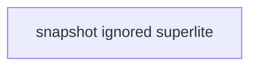

# Superlite: remote_apply snapshot succeeds when `.superlite/` is gitignored, so collect's retake brings a remote fix home (#1012)

**Goal:** `remote_apply.snapshot` (the stop hook's snapshot and `sl fleet collect`'s retake on the remote host) records the tree's working state and returns its sha when `.superlite/` exists and is gitignored, instead of failing with `git add failed: hint: ... advice.addIgnoredFile ...`; ignored paths stay out of the snapshot and nothing under `.superlite/` is recorded (#1012).
**Architecture:** one function, `remote_apply.snapshot`: it asks git whether `.superlite` is ignored and stages without the `:(exclude).superlite` pathspec when it is (git's own ignore rules keep its untracked content out), then resets `.superlite` in the temporary index to HEAD; every call runs at the tree's top.
**Tech stack:** Python 3.10+ stdlib; git; pytest through `sl run_tests`.
**Spec:** this file, section Design.
**Detail:** contracts
**Target-min:** 11
**Wave0:** none
**Coverage:** off

Global constraints:
- Every line of a Python script under `skills/**/scripts/` keeps the repo's `# O(...)` complexity comment; stdlib only; LF endings. Files under `tests/` carry no such comments.
- This repository is public: no host names, user names, home paths, other project or repository names in code, tests, docs or commit messages.
- The verdict is `sl run_tests` (never raw pytest); every new test sees a red run before the code it tests.
- An existing test that pins a changed text or output may be updated in the task that changes it; name each such file in your report.
- Builds: the verdict is `sl run_tests` (the project's test command; a project with `.maxapp` runs `maxapp test`, which a build pool may place on another Mac, and a full run whose tree a green maxapp test stamp covers returns that result without a run); task trees build in <tree>/.build/DerivedData and any build of your own goes under .build/ of the worktree, never -derivedDataPath outside the worktree (your session scratchpad included; backlog cleanup removes scratchpad build folders when the worktree goes); a product, simulator or device build stays on this machine and runs only when an issue's acceptance asks for a running-app check; copy this sentence into every worker brief.
- Simulators: append the UDID of each simulator you or a worker creates (`xcrun simctl create` or `clone`; a checker's `Simulators:` line marks its created ones) as one line to the worktree's `.superlite/simulators.txt`; never list one you did not create; ship cleanup shuts down and deletes each listed one; copy this sentence into every worker brief.

## Design

Issue #1012: a remote fixer worker's stop hook took no snapshot, and collect's retake on its host failed with `git add failed: hint: "git config advice.addIgnoredFile false"`, so `sl fleet collect W4` stayed BLOCKED and the fix never reached the local tree.

Cause (reproduced with git 2.54): `snapshot` stages with `git add -A -- . ':(exclude).superlite'`. Superlite lists `.superlite/` in the repository's `info/exclude`, and the retake itself writes its output under `<tree>/.superlite/`. When `.superlite` exists and is ignored, git's ignored-path check counts the exclude pathspec as naming an ignored path: it prints `The following paths are ignored by one of your .gitignore files: .superlite` plus the hint and exits 1, although every other path was staged. `_git` turns that into `RuntimeError("git add failed: <last stderr line>")`.

1. **Top and head in one call:** `top, head = _out(tree, ["rev-parse", "--show-toplevel", "HEAD"]).splitlines()`; every later git call in `snapshot` runs with `cwd=top`, so a hook whose cwd is a subfolder snapshots the whole tree and `.superlite` names the top one.
2. **Ignored test:** `ignored = _git(top, ["check-ignore", "--no-index", "-q", "--", ".superlite"], env_extra=env, check=False).returncode == 0`. `--no-index` because a `.superlite/` holding tracked files reads as not ignored with the index, yet `git add` still refuses the exclude pathspec (reproduced). Any other exit (1, 128) means not ignored.
3. **Stage:** ignored: `git add -A -- .`; not ignored: today's `git add -A -- . ':(exclude).superlite'` unchanged.
4. **Keep `.superlite` at HEAD:** only when ignored, `git reset -q <head> -- .superlite` on the temporary index, so tracked `.superlite/` files keep HEAD's content (`add -A` would have staged their edits); it exits 0 when nothing matches.
5. Commit as today (`_commit(top, idx, head, ref, "superlite remote stop")`). The module docstring's `snapshot` sentence names the top and the ignored rule. Unchanged: `start_commit`, `apply`, `main`'s output and exit codes, the snapshot's parent (HEAD), the real index and the working tree.

Rejected: a glob exclude such as `:(exclude,glob)[.]superlite/**`, which slips past the check only through how git compares a pathspec's literal prefix (internal, version-dependent); and always `add -A -- .` then reset, which hashes a not-ignored `.superlite/`'s whole content into the object store on every snapshot.

### Rulings

- Ruling: snapshot tests `.superlite` with `git check-ignore --no-index` and stages without the exclude pathspec when it is ignored, then resets `.superlite` to HEAD in the temporary index (because git's own ignore rules already keep an ignored folder's untracked files out, and the reset keeps the "never `.superlite/`" contract for tracked ones).
- Ruling: adjacent fix: snapshot runs every git call at `rev-parse --show-toplevel` (because the stop hook runs it in the hook input's cwd, which can be a subfolder, where `.` staged only that subfolder); same function, no new decision.
- Ruling: fleet_remote_collect.py, the stop hook and docs stay unchanged (because the retake and the hook already call `sl remote_apply snapshot`; fixing it fixes both).
- Ruling: lint's MISSED TARGET is accepted (because the batch is one task on one function plus its tests; nothing splits further).

## Task graph

```mermaid
%% schedule
gantt
  title Predicted schedule (mm:ss)
  dateFormat X
  axisFormat %M:%S
  section lane 1
  T1 snapshot ignored superlite :t1, 0, 464s
```

critical path: T1 (7.7 min) · peak width 1 · predicted build 7.7 min · predicted total ≈ 22.2 min (target ✗ 11.0)

## Package: remote_apply

App type: CLI (git plumbing). Categories: file (ignored and tracked paths, subfolder cwd), protocol (CLI stdout sha and exit code unchanged).
**Probe entry:** none (the cases need a temporary git repository with an ignored `.superlite/`; they are named tests)

### T1 snapshot ignored superlite · Complexity 2 · Est. context 30k
**Owns:** skills/subagent-driven-development/scripts/remote_apply.py, tests/scripts/test_remote_apply.py
**Components:** 1
**LOC owned:** 90
**Tests:** fast
**Model:** sonnet
**Covers:** Design
**Produces:** remote_apply.snapshot(tree: str, ref: str) -> str
  e.g. snapshot("<repo>", "refs/superlite/remote/p/W4/stop") with `.superlite/` in info/exclude and `.superlite/x` on disk -> 40-hex sha (today: RuntimeError "git add failed: ...")
**Review Focus:** file: `test_snapshot_superlite_ignored`, `test_snapshot_ignored_superlite_keeps_tracked_head`, `test_snapshot_from_subfolder_takes_whole_tree`; protocol: `test_main_snapshot_superlite_ignored`
**Test code (contracts):** in tests/scripts/test_remote_apply.py, reuse its `repo` fixture and `git`, `put`, `show` helpers. "Ignore X" means appending the line X to the file `git(repo, "rev-parse", "--git-path", "info/exclude")` names (relative to `repo`; create its folder if missing). `paths(sha)` is `git(repo, "ls-tree", "-r", "--name-only", sha).splitlines()`.
- `test_snapshot_superlite_ignored`: ignore `.superlite/` and `*.log`; put `.superlite/x` (`no\n`), `build.log` (`log\n`), edit `a.py` to `edited\n`, put new `b.py` (`new\n`), unlink `c.py`; record `git status --porcelain`; `sha = ra.snapshot(str(repo), "refs/superlite/remote/p/W4/stop")`; sha is 40 hex and equals `rev-parse` of that ref; its parent is HEAD; `show(repo, sha, "a.py") == "edited"`, `show(repo, sha, "b.py") == "new"`; `paths(sha)` holds no `.superlite/` entry, no `build.log` and no `c.py`; `git status --porcelain` is unchanged.
- `test_snapshot_ignored_superlite_keeps_tracked_head`: put `.superlite/t` (`head\n`), `git add -f .superlite/t`, commit; then ignore `.superlite/`; put `.superlite/t` (`edited\n`) and `.superlite/u` (`new\n`); edit `a.py` to `edited\n`; snapshot; `show(repo, sha, ".superlite/t") == "head"`; `.superlite/u` is not in `paths(sha)`; `show(repo, sha, "a.py") == "edited"`.
- `test_snapshot_from_subfolder_takes_whole_tree`: `.superlite/` not ignored; put `.superlite/x` (`no\n`), edit `a.py` and `src/b.py` to `edited\n`; `sha = ra.snapshot(str(repo / "src"), "refs/superlite/remote/p/W4/stop")`; `show(repo, sha, "a.py") == "edited"` and `show(repo, sha, "src/b.py") == "edited"`; no `.superlite/` entry in `paths(sha)`.
- `test_main_snapshot_superlite_ignored`: ignore `.superlite/`; put `.superlite/collect-W4-1.out.tmp` (`exit\n`); edit `a.py` to `edited\n`; `monkeypatch.chdir(repo)`; `ra.main(["snapshot", "--ref", "refs/superlite/remote/p/W4/stop"]) == 0`; stdout stripped is 40 hex; `show(repo, <that sha>, "a.py") == "edited"`; stderr is empty.
**Steps:** 1 write the tests, 2 run: FAIL (the three ignored cases raise or exit 1 with `git add failed: ...`; the subfolder case keeps `a.py` at `base`), 3 implement Design 1-5, 4 run: PASS (the existing `test_snapshot_excludes_superlite` and `test_main_snapshot` stay green unchanged)
**Notes:** Verify with `sl run_tests --fast tests/scripts/test_remote_apply.py tests/scripts/test_fleet_remote_collect*.py tests/scripts/test_fleet_remote_worker*.py --task T1` (drop a glob that matches no file). Keep `_git`'s error text: only `snapshot` and the docstring change.

## Review Focus

- T1 file: an ignored `.superlite/` with untracked files, tracked files, or both, and an ignored build file, never reach the snapshot; a not-ignored `.superlite/` still stays out through the exclude pathspec; the real index and working tree are untouched.
- T1 file: from a subfolder cwd the snapshot covers the whole tree and its parent is HEAD.
- T1 protocol: `remote_apply.py snapshot --ref R` prints only the sha and exits 0, or one stderr line and exits 1, as before.

## Self-review

#1012 maps to T1: snapshot no longer names an ignored path in a pathspec (Design 2-4), so the stop hook's snapshot and collect's retake both succeed; one task, one function plus its tests.
