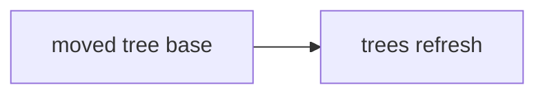

# Superlite: task trees follow a run moved onto a new base, and `sl trees refresh` moves it (#908)

**Goal:** after the run branch moves (a fast-forward or rebase onto a newer main, the run's work still checkpointed or uncommitted), every task tree rebuilds on HEAD plus the run's checkpoints at its next `run_tests` instead of on the pre-move checkpoint, and `sl trees refresh [--onto REV]` moves the run safely (overlap check, fast-forward or rebase) and re-validates the checkpoints (#908).
**Architecture:** `trees.base_commit` stays the one base every tree path reads (task trees, worker trees, `--fast` and `--full` overlays, `outside_tree`, the remote worker). A new `trees.moved_base(root)` notices HEAD moved off checkpoints.json's `base` and builds one deterministic commit on HEAD that carries the newest checkpoint's changes since that base; `base_commit` returns it, so `prepare`'s existing reset to the base rebuilds every stale tree. A new `refresh` subcommand in `trees.main` checks overlap, moves HEAD and reports the re-validation.
**Tech stack:** Python 3.10+ stdlib; git 2.38+; pytest through `sl run_tests`.
**Spec:** this file, section Design; issue #908.
**Detail:** contracts
**Target-min:** 11
**Wave0:** none
**Coverage:** off
**Max chars:** 22000

Global constraints:
- Every line of a Python script under `skills/**/scripts/` keeps the repo's `# O(...)` complexity comment; stdlib only; LF endings. Files under `tests/` carry no such comments.
- This repository is public: no host names, user names, home paths, other project or repository names in code, tests, docs or commit messages.
- The verdict is `sl run_tests` (never raw pytest); every new test sees a red run before the code it tests.
- An existing test that pins a changed text or output may be updated in the task that changes it; name each such file in your report.
- Tests build their own temporary git repositories (`git init -b main`, user.email and user.name set locally, `.git/info/exclude` holding `.superlite/`); they never touch the real `~/.superlite` (tests/scripts/conftest.py sets SUPERLITE_HOME) and never the stash list of a real repository.
- autocommit.py and commit_task.py are other batches' files: import from them, never edit them.
- Builds: the verdict is `sl run_tests` (the project's test command; a project with `.maxapp` runs `maxapp test`, which a build pool may place on another Mac, and a full run whose tree a green maxapp test stamp covers returns that result without a run); task trees build in <tree>/.build/DerivedData and any build of your own goes under .build/ of the worktree, never -derivedDataPath outside the worktree (your session scratchpad included; backlog cleanup removes scratchpad build folders when the worktree goes); a product, simulator or device build stays on this machine and runs only when an issue's acceptance asks for a running-app check; copy this sentence into every worker brief.
- Simulators: append the UDID of each simulator you or a worker creates (`xcrun simctl create` or `clone`; a checker's `Simulators:` line marks its created ones) as one line to the worktree's `.superlite/simulators.txt`; never list one you did not create; ship cleanup shuts down and deletes each listed one; copy this sentence into every worker brief.

## Design

Cause (#908): `trees.base_commit` returns the newest checkpoint sha. Checkpoints (autocommit.record) chain on checkpoints.json's `base`, the HEAD at the run's first checkpoint. After the run branch was fast-forwarded, the chain still sits on the old HEAD, so `_prepare` checks every tree out at a pre-move commit: files an unfinished task owns stay at their pre-move version (`--fast` keeps them at base), a `--full --task` tree overlays only its own files on the old base, and nothing compiles. `prepare` already resets an existing tree to `base_commit` on every run, so a right base is the whole of #908's second bullet.

1. **`trees.moved_base(root) -> dict | None`.** Reads `<root>/.superlite/checkpoints.json`: base = `autocommit.base_of(state)`, newest = `entries[-1]["sha"]`. Returns None when the file is missing or unreadable, there is no entry, the base is empty, HEAD does not resolve, or HEAD equals the base. Otherwise it builds the moved base: a temporary index `<root>/.superlite/trees/base-<pid>.index` (removed in a `finally`) gets `read-tree HEAD`; `git diff-tree -r -z --no-renames <base> <newest>` lists the checkpoints' changes; each added or modified path goes into the index with its new mode and blob, each deleted path is removed (one `update-index -z --index-info` call; mode 0 removes a path); `write-tree`; `commit-tree <tree> -p HEAD --no-gpg-sign -m "superlite tree base: checkpoint <newest7> on HEAD <head7>"` with author and committer `superlite <superlite@localhost>` and both dates the newest checkpoint's committer date (`git show -s --format=%ct <newest>`), so the same HEAD and checkpoint give the same sha. The result: `{"base", "head", "checkpoint", "sha", "files", "overlap", "error"}`: `files` the sorted checkpoint paths, `overlap` the sorted paths both `diff-tree <base> <newest>` and `diff --name-only <base> HEAD` name, `error` "" (on a git failure: `sha` "" and `error` one line). Memoized per process by `(resolved root, base, newest, head)` in a module dict `_MOVED`.
2. **`base_commit(root)`.** Unchanged when `moved_base` is None. A dict with a sha returns that sha. A dict with an error prints once per memo key `trees: base not rebuilt on HEAD <head7>: <error>; trees use the newest checkpoint <newest7>` to stderr and returns the newest checkpoint (today's behaviour). The fake-sha states of existing tests (entries without a `base` key) stay on the newest checkpoint.
3. **`_prepare` notice.** When `moved_base(root)` has a sha, `_prepare` prints after the checkout `trees: <task> tree on HEAD <head7> plus the run's checkpoints (the run moved off its base <base7>)`, and with an overlap adds `; checkpointed files the move also changed keep the checkpoint's version: <first 8, comma-separated>[ ...] (re-checkpoint their tasks with sl commit_task)`. Untracked build output in a reused tree stays.
4. **`trees refresh [--onto REV] [--plan P]`** (trees.main; `--plan` as for `clean`). Messages go to stdout; refusals and git failures to stderr.
   - `--onto` absent: no checkpoint: `trees refresh: no checkpoints; trees follow HEAD <h7>`, exit 0. Not moved: `trees refresh: HEAD <h7> is the run's base; trees are current`, exit 0. Moved: `trees refresh: base <b7> -> HEAD <h7>; <T> task trees rebuild on <s7> (HEAD plus <F> checkpointed files) at their next run` (T = folders under `.superlite/trees` holding `.git`), exit 0; with an overlap a second line `trees refresh: checkpointed files the move also changed: <first 8>[ ...]; the trees keep the checkpoint's version: re-checkpoint their tasks with sl commit_task`, exit 1. A moved base whose build failed: `trees refresh: base not rebuilt on HEAD <h7>: <error>`, exit 3.
   - `--onto REV`: REV must resolve to a commit, else `trees refresh: unknown revision REV`, exit 2; an unborn HEAD is exit 2 `trees refresh: no HEAD to move`. REV already an ancestor of HEAD: `trees refresh: HEAD already contains REV`, then the report above. Else mb = `merge-base HEAD REV`; incoming = `diff --name-only -z --no-renames mb REV`; run files = `diff --name-only -z --no-renames HEAD` (staged and unstaged) + `ls-files -o --exclude-standard -z` + the checkpoints' paths (item 1's `files`, or `diff-tree base newest` names when HEAD is still the base) + `diff --name-only -z mb HEAD` when HEAD is not an ancestor of REV; `.superlite/` paths dropped. Any common path: `trees refresh: refused, REV changes files of the run: <first 8>[ ...]; move the run by hand`, exit 2, nothing moved. HEAD an ancestor of REV: `git merge --ff-only REV`, then `trees refresh: fast-forwarded <branch> <h7> -> <r7>`. Else `git rebase --autostash REV`, then `trees refresh: rebased <branch> (<N> commits) onto <r7>`; a failed merge or rebase runs `git rebase --abort` (rebase only, result ignored) and prints `trees refresh: <fast-forward|rebase> onto REV failed: <last stderr line>; nothing moved`, exit 3. `<branch>` is `symbolic-ref --short -q HEAD`, else `HEAD`. After a move, the report above, whose exit code is the command's.
   - Usage (exit 2, every unknown form): `usage: trees.py clean | path Tn | refresh [--onto REV] [--plan P]`.
5. Unchanged: checkpoints.json, the checkpoint refs and autocommit.py (`apply` already replays the checkpoints onto a moved HEAD); run_tests.py (every tree path reads `trees.base_commit`); the `--base-skips` tree (`run_tests.base_commit_of`, a self-consistent commit).

### Rulings

- Ruling: the tree base after a move is HEAD plus the newest checkpoint's changes since checkpoints.json's base, one deterministic commit on HEAD, memoized per process (because `prepare` already resets each tree to `base_commit`, so the fix reaches task, worker, `--fast`, `--full` and remote-worker trees through one function, and the same inputs never pile up distinct objects).
- Ruling: a checkpointed file the move also changed keeps the checkpoint's version, named in the tree line and `refresh` exit 1 with the re-checkpoint fix (because `autocommit.apply` refuses the same overlap; a 3-way merge would add a second merge mechanism beside apply's replay).
- Ruling: #908's `sl rebase-run` is `sl trees refresh [--onto REV]` (the issue names that form; trees.py is this batch's file and `sl trees` already routes to it).
- Ruling: `refresh` does not drop trees (because each one resets its checkout to the new base at its next run and keeps its build output; a drop costs a cold build, B248).
- Ruling: `refresh --onto` refuses before moving on any overlap with the run's files, so neither git step can conflict; rebase uses `--autostash` and is aborted on failure (because the run's uncommitted work must survive and an autostash entry reaches the shared stash list only when its re-apply conflicts, which the overlap check rules out).
- Ruling: no busy-tree check in `refresh` (because a running tree run has its own checkout; the move touches only files outside the run's).
- Ruling: run_tests.py and the `--base-skips` base stay unchanged (because every tree path already reads `trees.base_commit`, and the base-skips tree checks out a consistent old commit that compiles).
- Ruling: lint's MISSED TARGET, if printed, is accepted (because both tasks edit trees.py and run in order).

## Task graph

```mermaid
%% schedule
gantt
  title Predicted schedule (mm:ss)
  dateFormat X
  axisFormat %M:%S
  section lane 1
  T1 moved tree base :t1, 0, 742s
  T2 trees refresh :t2, 742, 742s
```

critical path: T1 → T2 (24.7 min) · peak width 1 · predicted build 24.7 min · predicted total ≈ 45.2 min (target ✗ 11.0)

## Package: trees

App type: library plus CLI. Categories: state (base choice, memo, reused tree, temporary index), protocol (subcommand, exit codes, messages), file (deleted and untracked paths, `.superlite/` excluded), encoding (paths with spaces through `-z`).
**Probe entry:** none (every case needs a temporary git repository with checkpoints and a moved HEAD; they are named tests)

### T1 moved tree base · Complexity 4 · Est. context 30k
**Owns:** skills/subagent-driven-development/scripts/trees.py, tests/scripts/test_trees_moved_base_908.py
**Components:** 1
**LOC owned:** 170
**Tests:** fast
**Model:** sonnet
**Covers:** Design
**Produces:** trees.moved_base(root: str | Path) -> dict | None
  e.g. moved_base(repo) right after a checkpoint, HEAD still the base -> None
  e.g. moved_base(repo) after HEAD moved B0 -> M with checkpoint C1 of src/a.py -> {"base": B0, "head": M, "checkpoint": C1, "sha": S, "files": ["src/a.py"], "overlap": [], "error": ""}
  e.g. moved_base(repo) when C1 is not an object -> {"base": B0, "head": M, "checkpoint": "<C1>", "sha": "", "files": [], "overlap": [], "error": "git diff-tree ... failed: ..."}
**Review Focus:** state: `test_tree_after_move_holds_main_and_checkpoints`, `test_reused_tree_rebuilt_after_move`, `test_moved_base_is_deterministic`; file: `test_moved_base_removes_checkpointed_deletion`, `test_path_with_space`; protocol: `test_overlap_named_in_tree_line`, `test_fallback_on_missing_checkpoint`, `test_signing_config_ignored`
**Test code (contracts):** fixture: repo at tmp_path (constraints' setup) with `plan.md` (T1 owns src/a.py, T2 owns src/b.py, T3 owns src/c.py), `src/a.py` `A = 1\n`, `src/b.py` `B = 1\n`, `src/c.py` `C = 1\n`, committed as B0; cwd the repo (monkeypatch.chdir); `trees._MOVED.clear()` per test. Checkpoint: write `src/a.py` `A = 2\n`, `autocommit.record("T1", "first", ["src/a.py"], str(repo / "plan.md"))` -> C1. Move: write `src/c.py` `C = 2\n` and new `src/d.py` `D = 1\n`, `git add src/c.py src/d.py`, `git commit -qm main -- src/c.py src/d.py` -> M (src/a.py stays uncommitted).
- `test_unmoved_base_is_newest_checkpoint`: after the checkpoint, before the move: `moved_base(repo) is None`, `base_commit(repo) == C1`; with no checkpoints.json `base_commit(repo)` is HEAD.
- `test_moved_base_replays_checkpoints_on_head`: after the move, `s = base_commit(repo)` is neither C1 nor M; `git show s:src/a.py` is `A = 2\n`, `s:src/c.py` `C = 2\n`, `s:src/d.py` `D = 1\n`; `git rev-parse s^` is M; `moved_base(repo)` equals the second e.g. line.
- `test_moved_base_is_deterministic`: two calls with `_MOVED.clear()` between give the same sha; the temporary index file is gone.
- `test_moved_base_removes_checkpointed_deletion`: `git rm -q src/b.py`, `record("T2", "drop b", ["src/b.py"], ...)`, then the move: `git cat-file -e s:src/b.py` fails, `s:src/a.py` is `A = 2\n`.
- `test_path_with_space`: a checkpointed `src/x y.py` `X = 1\n` is in s after the move.
- `test_tree_after_move_holds_main_and_checkpoints` (#908): `trees.prepare(repo, "T2", ["src/b.py"])` after the move: `tree/src/c.py` is `C = 2\n` (red before the fix: `C = 1\n`), `tree/src/a.py` `A = 2\n`, `tree/src/d.py` exists; stderr holds `trees: T2 tree on HEAD <M7> plus the run's checkpoints (the run moved off its base <B07>)`.
- `test_reused_tree_rebuilt_after_move`: prepare T2 before the move, write `tree/.build/out.txt`, move, prepare again: `git -C tree rev-parse HEAD` is s, `tree/src/c.py` `C = 2\n`, `tree/.build/out.txt` still exists.
- `test_overlap_named_in_tree_line`: the move is a commit made with `commit-tree` whose tree has `src/a.py` `A = 9\n` and `src/c.py` `C = 2\n`, set with `git update-ref HEAD <sha>` (working tree untouched): `moved_base(repo)["overlap"] == ["src/a.py"]`, `s:src/a.py` is `A = 2\n`, prepare T2's stderr holds `checkpointed files the move also changed keep the checkpoint's version: src/a.py (re-checkpoint their tasks with sl commit_task)`.
- `test_fallback_on_missing_checkpoint`: checkpoints.json `{"base": B0, "entries": [{"sha": "f" * 40, "task": "T1", "files": ["src/a.py"]}]}` with HEAD at M: `base_commit(repo) == "f" * 40`; stderr holds `trees: base not rebuilt on HEAD <M7>:` once over two calls.
- `test_no_base_keeps_newest_checkpoint`: entries `[{"sha": "a1"}, {"sha": "b2"}]` without `base`: `base_commit(repo) == "b2"`, stderr empty.
- `test_signing_config_ignored`: `git config commit.gpgsign true` and `git config gpg.program false` in the repo, then the move: `moved_base(repo)["sha"]` is non-empty and `error` is "".
**Steps:** 1 write the tests, 2 run: FAIL, 3 implement Design 1-3 (`_MOVED`, `moved_base`, `base_commit`, the `_prepare` line; module docstring: the base after a move), 4 run: PASS
**Notes:** Verify with `sl run_tests --fast tests/scripts/test_trees_moved_base_908.py tests/scripts/test_trees.py tests/scripts/test_trees_index_799.py tests/scripts/test_run_tests_fast_tree.py tests/scripts/test_run_tests_fast_tree_siblings.py tests/scripts/test_fleet_remote_worker.py --task T1`. `git` in trees.py raises RuntimeError; `update-index --index-info` takes `ls-tree`-style lines (`<mode> <type> <sha>\t<path>`, `-z`), and `0 0000000000000000000000000000000000000000\t<path>` removes one. Import autocommit lazily inside `moved_base` (`main` does the same).

### T2 trees refresh · Complexity 4 · Est. context 34k
**Owns:** skills/subagent-driven-development/scripts/trees.py, tests/scripts/test_trees_refresh_908.py, tests/scripts/test_trees_plan.py, docs/tools.md
**Components:** 1
**LOC owned:** 170
**Tests:** fast
**Model:** sonnet
**Covers:** Design
**Consumes:** trees.moved_base(root: str | Path) -> dict | None (T1)
**Produces:** trees.refresh(root: str | Path, onto: str | None) -> int
  e.g. refresh(repo, None) with HEAD the run's base -> 0, stdout `trees refresh: HEAD <h7> is the run's base; trees are current`
  e.g. refresh(repo, "main") where main is one commit ahead and touches no run file -> 0, HEAD is main
**Review Focus:** state: `test_onto_fast_forwards_keeps_work`, `test_onto_rebases_own_commits`, `test_onto_failure_moves_nothing`; protocol: `test_refresh_reports`, `test_onto_refuses_overlap`, `test_usage`; file: `test_onto_refuses_untracked_overlap`
**Test code (contracts):** fixture: T1's repo and checkpoint on branch `run` (created from main at B0 with `git checkout -qb run`), cwd the repo; `main` gets one commit M (`git commit-tree` of a tree with `src/c.py` `C = 2\n`, then `git update-ref refs/heads/main <M>`), so the run's working tree is untouched. Calls go through `trees.main([...])` with capsys.
- `test_refresh_reports`: no checkpoints.json -> 0, `trees refresh: no checkpoints; trees follow HEAD <h7>`; after the checkpoint -> 0, `trees refresh: HEAD <h7> is the run's base; trees are current`; after `git merge -q --ff-only main` and one `trees.prepare(repo, "T2", ["src/b.py"])` -> 0, `trees refresh: base <B07> -> HEAD <M7>; 1 task trees rebuild on <s7> (HEAD plus 1 checkpointed files) at their next run`; with T1's overlap move instead -> 1 and the second line names src/a.py.
- `test_onto_fast_forwards_keeps_work`: `["refresh", "--onto", "main"]` -> 0; HEAD is M; `src/a.py` still `A = 2\n`; stdout `trees refresh: fast-forwarded run <B07> -> <M7>` then the moved-base line.
- `test_onto_already_contained`: `--onto` B0 -> 0, `trees refresh: HEAD already contains <B0 as typed>`, HEAD unchanged.
- `test_onto_refuses_overlap`: main's commit also changes `src/a.py` -> 2; stderr `trees refresh: refused, main changes files of the run: src/a.py; move the run by hand`; HEAD and `src/a.py` unchanged.
- `test_onto_refuses_untracked_overlap`: an untracked `src/new.py` in the run and main adding `src/new.py` -> 2, stderr names src/new.py.
- `test_onto_rebases_own_commits`: the run branch has its own commit R adding `src/r.py`: -> 0; `git rev-parse HEAD^` is M; `git show HEAD:src/r.py` exists; `src/a.py` still `A = 2\n`; stdout `trees refresh: rebased run (1 commits) onto <M7>`; `git stash list` is empty.
- `test_onto_failure_moves_nothing`: own commit R as above and an executable `.git/hooks/pre-rebase` that exits 1: -> 3; stderr starts `trees refresh: rebase onto main failed:` and ends `; nothing moved`; HEAD is R; `src/a.py` still `A = 2\n`; no `.git/rebase-merge` folder.
- `test_onto_unknown_revision`: `--onto nope` -> 2, stderr `trees refresh: unknown revision nope`.
- `test_refresh_with_plan_flag`: from another cwd, `["refresh", "--plan", str(repo / ".superlite")]` reports on repo.
- `test_usage`: `["refresh", "--onto"]` and `["refresh", "x"]` -> 2 with the Design 4 usage line; test_trees_plan.py's `USAGE` becomes that line.
**Steps:** 1 write the tests, 2 run: FAIL, 3 implement Design 4 (`refresh`, its branch in `main`, the module docstring's usage lines; docs/tools.md's `trees` row gains one sentence each on the moved base and on `refresh`), 4 run: PASS
**Notes:** Verify with `sl run_tests --fast tests/scripts/test_trees_refresh_908.py tests/scripts/test_trees_moved_base_908.py tests/scripts/test_trees_plan.py tests/scripts/test_trees.py tests/scripts/test_docs_contract.py --task T2`. git 2.54 measured: a pre-rebase hook refusal under `--autostash` prints `Created autostash` and `Applied autostash`, exits 1 and leaves the work in place with an empty stash list.

## Review Focus

- T1 state: no path writes checkpoints.json, a checkpoint ref, HEAD, the user's index or the root's working tree; the temporary index is removed on every path; an unmoved run spawns at most one extra `git rev-parse HEAD` per `base_commit` call.
- T1 protocol: `base_commit` returns exactly today's value when HEAD is the base, with no checkpoint or no recorded base.
- T2 state: a refused or failed `--onto` leaves HEAD, the index, the working tree and the stash list as they were.
- T2 protocol: exit codes 0, 1, 2, 3 as in Design 4; `clean` and `path` unchanged apart from the usage line.

## Self-review

#908 bullet 2 (trees notice the moved HEAD and rebuild) maps to T1; bullet 1 (a supported move: overlap check, fast-forward or rebase, trees rebuilt, checkpoints re-validated) to T2. Both tasks own trees.py, so T2 follows T1.
