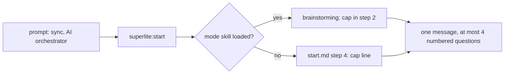

# B284: start.md carries the plain-text 4-question cap (#1028)

**Goal:** a run that goes through `/superlite:start` and never loads brainstorming still asks at most 4 numbered questions in one plain-text message, so `evals/ai-asks-once` one-batch passes on changes that do not touch brainstorming.
**Architecture:** `commands/start.md` step 4 is the one step every start run reads before it asks. Its first line now says to load the mode's skill before reading code or asking, and states the question cap with or without a question tool. The one-batch grader and the brainstorming text stay as they are.
**Tech stack:** Markdown prompt text; pytest via `sl run_tests`.
**Spec:** issue #1028 (earlier: #281, #758).
**Detail:** tests
**Wave0:** none
**Coverage:** off

## Global constraints

- `commands/start.md` step 4's first line is exactly the `CAP` string in T1's test (one line, ending in a newline); the four mode bullets under it stay byte-identical.
- `commands/start.md` keeps every phrase existing tests pin: `AskUserQuestion is unavailable`, `sl orchestrator set ai`, `Ruling:`, `superlite:brainstorming`, `.superlite/orchestrator.json`, `lint --stable`, `--branch`, `--dir`, and `sl orchestrator set` once or twice.
- Files this batch may touch: skills/subagent-driven-development/scripts/fleet.py (untouched: the cause is not there), plus commands/start.md, the new tests/regression/test_start_plain_text_cap_1028.py and this plan, which no open batch lists. An existing test that breaks outside your Owns: name it in the report, do not edit it.
- Builds: the verdict is `sl run_tests` (the project's test command; a project with `.maxapp` runs `maxapp test`, which a build pool may place on another Mac, and a full run whose tree a green maxapp test stamp covers returns that result without a run); task trees build in <tree>/.build/DerivedData and any build of your own goes under .build/ of the worktree, never -derivedDataPath outside the worktree (your session scratchpad included; backlog cleanup removes scratchpad build folders when the worktree goes); a product, simulator or device build stays on this machine and runs only when an issue's acceptance asks for a running-app check; copy this sentence into every worker brief.
- Simulators: append the UDID of each simulator you or a worker creates (`xcrun simctl create` or `clone`; a checker's `Simulators:` line marks its created ones) as one line to /Users/max/github/superlite/.claude/worktrees/superlite-b284-evals-ai-asks-once-one-batch-is-fla/.superlite/simulators.txt; never list one you did not create; ship cleanup shuts down and deletes each listed one; copy this sentence into every worker brief.

## Evidence (lead's measurement, sonnet, haiku judge x3)

- Unchanged tree, real case: one-batch 25 of 26 plugin runs. The failing run asked 6 numbered questions after `superlite:start` without loading brainstorming (8 turns; passing runs that load brainstorming take 9 to 15).
- Probe, a plugin copy without `skills/brainstorming` and `commands/feature.md` (the path that skips the cap): one-batch failed 4 of 10, all four after start's failed brainstorming load.
- Same probe with T1's line in start.md: 10 of 10 pass, raises-decisions 10 of 10.

Ruling: the fix is the start.md text, not the one-batch grader: the failing messages really ask 5 or more questions, which breaks the product's 4-per-message rule (#758), so a looser grader would hide a real miss (lead's ruling).
Ruling: skills/using-superlite/SKILL.md stays unchanged: it sits at 1496 of its 1500-character cap, and every probe run that never loaded start passed one-batch (lead's ruling).
Ruling: commands/start.md and the new regression test are edited although the batch list names only fleet.py: no open batch lists them and #1028's cause lives there; fleet.py is not touched (lead's ruling).
Ruling: T1 is mechanical (haiku): its exact text was measured and is fixed here (lead's ruling).

LAYERS: unit, headless, evals

## Main diagram



## File structure

- commands/start.md: step 4's first line loads the mode skill first and states the cap.
- tests/regression/test_start_plain_text_cap_1028.py: pins the line and the mode bullets after it.

## Task graph

```mermaid
%% schedule
gantt
  title Predicted schedule (mm:ss)
  dateFormat X
  axisFormat %M:%S
  section lane 1
  T1 start.md cap line :t1, 0, 276s
```




critical path: T1 (4.6 min) · peak width 1 · predicted build 4.6 min · predicted total ≈ 15.1 min

## Start command

### T1 start.md cap line · Complexity 1 (O-1) · Est. context 22k
**Owns:** commands/start.md, tests/regression/test_start_plain_text_cap_1028.py
**Components:** 1
**LOC owned:** 25
**Tests:** fast
**Kind:** mechanical
**Model:** haiku
**Produces:** commands/start.md step 4 line `CAP`
**Review Focus:** `test_start_step_4_states_the_plain_text_cap_1028`: the exact line is in start.md; `test_start_step_4_keeps_the_mode_bullets_1028`: the four mode bullets follow it unchanged.
**Test code (verbatim):**
```python
# tests/regression/test_start_plain_text_cap_1028.py
"""#1028: start.md step 4 states the 4-question cap for a run that never loads brainstorming."""
from pathlib import Path

START = Path(__file__).resolve().parents[2] / "commands/start.md"
CAP = (
    "4. Load the skill for the mode before you read code or ask anything, and follow it. "
    "Its one question batch holds at most 4 questions, with or without a question tool: "
    "in plain text at most 4 numbered questions in one message and nothing asked after them; "
    "rule the rest as `Ruling:` lines or ask them after the reply.\n"
)
BULLETS = (
    "   - Regular: `superlite:using-superlite` sizing, then `superlite:brainstorming`.\n"
    "   - MVP: same as `/superlite:mvp`.\n"
    "   - Feature: same as `/superlite:feature`.\n"
    "   - Debug: same as `/superlite:debug`.\n"
)


def test_start_step_4_states_the_plain_text_cap_1028():
    assert CAP in START.read_text(encoding="utf-8")


def test_start_step_4_keeps_the_mode_bullets_1028():
    assert CAP + BULLETS in START.read_text(encoding="utf-8")
```
**Steps:** 1 write the test file, 2 `sl run_tests --task T1`: FAIL (2 failed), 3 replace step 4's first line `4. Load the skill for the mode and follow it:` with the `CAP` text (one line), 4 run: PASS.
**Notes:** change no other line of start.md.

## Review Focus

- Package: prompt text (no runnable entry; the eval case `evals/ai-asks-once` is the behaviour check, run by the evals layer). Categories: wording, pins.
- `test_start_step_4_states_the_plain_text_cap_1028`, `test_start_step_4_keeps_the_mode_bullets_1028`; existing pins in tests/scripts/test_start_unattended.py and tests/scripts/test_orchestrator_once_486.py stay green.

## Self-review

Coverage: #1028's expected outcome (one-batch passes on untouched paths) maps to T1 plus the evals layer. No placeholders. One task, no edges, no shared files.
