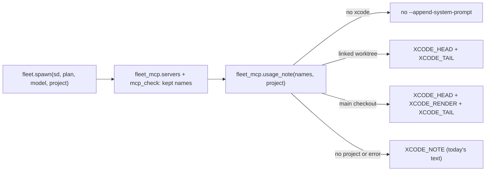
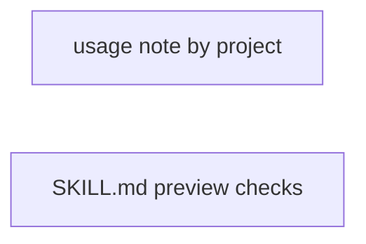

# B281: the fleet usage note drops the RenderPreview sentence where it cannot reach the run (#1021)

**Goal:** a fleet worker of an Xcode project in a linked git worktree gets an `--append-system-prompt` usage note without the RenderPreview sentence (RenderPreview renders the main checkout, never the run); a main-checkout worker gets the plain render rule without the worktree exception; SDD SKILL.md Final review step 2 names the per-package preview checks of a worktree run that fleet.md already names.
**Architecture:** `fleet_mcp.usage_note(names, project=None)` builds the note from three parts (`XCODE_HEAD`, `XCODE_RENDER`, `XCODE_TAIL`) and picks the render part by `state.linked_worktree(project)`; without a project, or when the check raises, it returns today's `XCODE_NOTE` (byte-identical, with its conditional sentence). `fleet.spawn` passes its `project` and computes the note once. Docs: SDD SKILL.md step 2 and the docs/tools.md `fleet_mcp` row.
**Tech stack:** Python 3 stdlib; pytest via `sl run_tests`.
**Spec:** issue #1021 (B276's follow-up of #910).
**Detail:** tests
**Wave0:** none
**Coverage:** off

## Global constraints

- `XCODE_NOTE` stays byte-identical to today's text: `XCODE_HEAD + <today's conditional render sentence> + XCODE_TAIL`. No variant holds any of the characters `` ` ' " $ ! # `` or a newline (the note rides in argv).
- `XCODE_HEAD` = `"Xcode MCP tools (mcp__xcode__...) are connected. After each edit of a Swift file run XcodeRefreshCodeIssuesInFile on it and fix what it reports. "`; `XCODE_RENDER` = `"Render every Preview you add or change with RenderPreview before you report DONE. "`; `XCODE_TAIL` = `"Look up Apple APIs with DocumentationSearch. Only the coordinator opens or closes an Xcode workspace; if none is open for this project, say so in your report instead of opening one."` (each exactly as quoted, trailing space included where shown).
- SDD SKILL.md stays at or under 13300 characters (`SDD_CAP`, tests/scripts/test_orchestrator.py); today 13288, after T2 13293.
- Files this batch may touch: skills/subagent-driven-development/scripts/fleet.py, skills/subagent-driven-development/scripts/fleet_mcp.py, skills/subagent-driven-development/SKILL.md, docs/tools.md, tests/scripts/test_fleet_spawn_mcp_576.py, tests/scripts/test_docs_checker_600.py, the new tests/scripts/test_fleet_usage_note_1021.py and this plan. Never touch docs/fleet.md (B282 owns it) or B277's files (autocommit.py, commit_task.py, finish.py, plan_tools.py). An existing test that breaks outside your Owns: name it in the report, do not edit it.
- Builds: the verdict is `sl run_tests` (the project's test command; a project with `.maxapp` runs `maxapp test`, which a build pool may place on another Mac, and a full run whose tree a green maxapp test stamp covers returns that result without a run); task trees build in <tree>/.build/DerivedData and any build of your own goes under .build/ of the worktree, never -derivedDataPath outside the worktree (your session scratchpad included; backlog cleanup removes scratchpad build folders when the worktree goes); a product, simulator or device build stays on this machine and runs only when an issue's acceptance asks for a running-app check; copy this sentence into every worker brief.
- Simulators: append the UDID of each simulator you or a worker creates (`xcrun simctl create` or `clone`; a checker's `Simulators:` line marks its created ones) as one line to /Users/max/github/superlite/.claude/worktrees/superlite-b281-fleet-usage-note-drop-the-renderpre/.superlite/simulators.txt; never list one you did not create; ship cleanup shuts down and deletes each listed one; copy this sentence into every worker brief.

Ruling: in a linked worktree the render sentence is left out whole, with no replacement sentence: implementers get the prime's `- Previews:` line (B276), and #1021 asks for the sentence to be left out (lead's ruling).
Ruling: in a main checkout the note keeps the render rule without the worktree exception (`XCODE_RENDER`), since with the project known the exception cannot apply (lead's ruling).
Ruling: the worktree test is `state.linked_worktree(project)` (one file read), not `worktree_previews` (its xcode test is already true when the note is asked for, and its git call could fail into the wrong branch); without a project, or on any error, the note stays today's `XCODE_NOTE` (lead's ruling).
Ruling: SDD SKILL.md step 2 is edited although the batch list names only fleet.py: no open batch lists it and #1021 asks for it; the headless and evals layers run. It stays under SDD_CAP (13296 of 13300) by dropping two repeats: ", same text per tier" (the quoted message right before it shows it) and " (20 tasks, 80k, 50m)" (config/routing.json holds the limits); T2's block first named "never paste the prime; ", which test_orchestrator pins, so its fix round kept that phrase (lead's ruling).
Ruling: fleet_mcp.py, docs/tools.md and two existing tests are edited outside the listed file; no open batch lists them (lead's ruling).

## Main diagram



## File structure

- skills/subagent-driven-development/scripts/fleet_mcp.py: the three note parts, `XCODE_NOTE` built from them, `usage_note(names, project=None)`.
- skills/subagent-driven-development/scripts/fleet.py: `spawn` passes `project` to `usage_note`, once.
- tests/scripts/test_fleet_usage_note_1021.py: the note variants and the spawn wiring.
- tests/scripts/test_fleet_spawn_mcp_576.py: `test_xcode_kept_adds_deny_and_note` expects the project's note.
- skills/subagent-driven-development/SKILL.md: Final review step 2 names the per-package preview checks; two repeats dropped.
- tests/scripts/test_docs_checker_600.py: `SDD_CHECKER` pin follows step 2.
- docs/tools.md: the `fleet_mcp` row names `usage_note(names, project)`.

## Task graph

```mermaid
%% schedule
gantt
  title Predicted schedule (mm:ss)
  dateFormat X
  axisFormat %M:%S
  section lane 1
  T1 usage note by project :t1, 0, 221s
  section lane 2
  T2 SKILL.md preview checks :t2, 0, 185s
```





critical path: T1 (3.7 min) · peak width 2 · predicted build 3.7 min · predicted total ≈ 12.2 min

## Fleet usage note

### T1 usage note by project · Complexity 2 (O-1) · Est. context 32k
**Owns:** skills/subagent-driven-development/scripts/fleet_mcp.py, skills/subagent-driven-development/scripts/fleet.py, tests/scripts/test_fleet_usage_note_1021.py, tests/scripts/test_fleet_spawn_mcp_576.py
**Components:** 2
**LOC owned:** 90
**Tests:** fast
**Kind:** design
**Model:** sonnet
**Produces:** fleet_mcp.usage_note(names: list[str], project: str | Path | None = None) -> str
e.g. usage_note(["xcode"]) -> fleet_mcp.XCODE_NOTE
e.g. usage_note(["xcode"], "/r/main") -> XCODE_HEAD + XCODE_RENDER + XCODE_TAIL
e.g. usage_note(["xcode"], "/r/wt") -> XCODE_HEAD + XCODE_TAIL (when /r/wt/.git is a linked-worktree file)
**Review Focus:** `test_note_without_project_is_unchanged` pins today's literal; `test_detection_error_keeps_full_note`; `test_spawn_passes_project_to_usage_note`; no variant holds a shell-special character.
**Test code (verbatim):**
```python
# tests/scripts/test_fleet_usage_note_1021.py
"""fleet_mcp.usage_note leaves the RenderPreview sentence out in a linked worktree, where it cannot reach the run (#1021)."""
from __future__ import annotations

from pathlib import Path

import pytest

from test_fleet_mcp_worktree_910 import repos  # noqa: F401  (fixture: main checkout and a linked worktree)
from test_fleet_spawn_mcp_576 import _argv, fleet, world  # noqa: F401  (world is a fixture)
from test_fleet import REAL

import fleet_mcp  # noqa: E402
import state  # noqa: E402

OLD = ("Xcode MCP tools (mcp__xcode__...) are connected. After each edit of a Swift file run XcodeRefreshCodeIssuesInFile on it "
       "and fix what it reports. Render every Preview you add or change with RenderPreview before you report DONE, "
       "unless your checkout is a linked git worktree (its .git is a file): RenderPreview renders the workspace Xcode has open, "
       "the main checkout, so there skip it and never report a preview as unrendered. "
       "Look up Apple APIs with DocumentationSearch. Only the coordinator opens or closes an Xcode workspace; "
       "if none is open for this project, say so in your report instead of opening one.")
MAIN = fleet_mcp.XCODE_HEAD + fleet_mcp.XCODE_RENDER + fleet_mcp.XCODE_TAIL
WT = fleet_mcp.XCODE_HEAD + fleet_mcp.XCODE_TAIL


def test_note_without_project_is_unchanged():
    assert fleet_mcp.XCODE_NOTE == OLD
    assert fleet_mcp.usage_note(["xcode"]) == OLD


def test_main_checkout_keeps_plain_render_rule(repos):
    main, _ = repos
    note = fleet_mcp.usage_note(["docs", "xcode"], main)
    assert note == MAIN
    assert "Render every Preview you add or change with RenderPreview before you report DONE. Look up" in note
    assert "linked git worktree" not in note


def test_linked_worktree_leaves_render_rule_out(repos):
    _, wt = repos
    note = fleet_mcp.usage_note(["xcode"], wt)
    assert note == WT
    assert "RenderPreview" not in note and "Preview" not in note
    assert "XcodeRefreshCodeIssuesInFile" in note and "DocumentationSearch" in note


def test_str_project_works(repos):
    main, wt = repos
    assert fleet_mcp.usage_note(["xcode"], str(wt)) == WT
    assert fleet_mcp.usage_note(["xcode"], str(main)) == MAIN


def test_no_xcode_gives_empty(repos):
    main, wt = repos
    assert fleet_mcp.usage_note(["docs"], wt) == ""
    assert fleet_mcp.usage_note([], main) == ""
    assert fleet_mcp.usage_note([]) == ""


def test_detection_error_keeps_full_note(repos, monkeypatch):
    _, wt = repos
    monkeypatch.setattr(state, "linked_worktree", lambda p: (_ for _ in ()).throw(OSError("x")))
    assert fleet_mcp.usage_note(["xcode"], wt) == OLD


def test_variants_are_shell_safe():
    for note in (OLD, MAIN, WT):
        assert not any(c in note for c in "`'\"$!#\n")


@pytest.mark.skipif(REAL, reason="argv is read from the in-process fake")
def test_spawn_passes_project_to_usage_note(world, monkeypatch):
    seen = []
    monkeypatch.setattr(fleet_mcp, "servers", lambda *a, **k: ({"xcode": fleet_mcp.XCODE}, []))
    monkeypatch.setattr(fleet_mcp, "usage_note", lambda names, project=None: seen.append((list(names), project)) or "NOTE-1021")
    fleet.main(["on"])
    fleet.spawn(world.sd, world.plan, "sonnet", world.proj)
    argv = _argv(world)
    assert argv[argv.index("--append-system-prompt") + 1] == "NOTE-1021"
    assert seen == [(["xcode"], seen[0][1])] and Path(seen[0][1]).resolve() == Path(world.proj).resolve()
```
**Steps:** 1 write the test file, 2 run it: FAIL, 3 in fleet_mcp.py split the note into `XCODE_HEAD`, `XCODE_RENDER`, `XCODE_TAIL` (texts in Global constraints) and build `XCODE_NOTE` as `XCODE_HEAD + <today's conditional render sentence, unchanged> + XCODE_TAIL`; rewrite `usage_note(names, project=None)`: no `"xcode"` in names gives `""`; `project is None` gives `XCODE_NOTE`; else `import state` lazily (as `worktree_previews` does) and return `XCODE_HEAD + XCODE_TAIL` when `state.linked_worktree(Path(project))`, else `XCODE_HEAD + XCODE_RENDER + XCODE_TAIL`; any exception from the import or the check gives `XCODE_NOTE`. Add `#1021` to its trailing comment and the module docstring's Library line stays as is. 4 in fleet.py `spawn` replace the two-call block `if names and fleet_mcp.usage_note(names): argv += [...]` with one call: `note = fleet_mcp.usage_note(names, project) if names else ""`, then `if note: argv += ["--append-system-prompt", note]` (keep the `# O(...)` comment style of the file on every line). 5 in tests/scripts/test_fleet_spawn_mcp_576.py `test_xcode_kept_adds_deny_and_note` change the last assert to `== fleet_mcp.usage_note(["xcode"], world.proj)`. 6 run the new file, test_fleet_spawn_mcp_576.py, test_fleet_mcp_576.py and test_fleet_mcp_worktree_910.py: PASS.
**Notes:** `names` is `[]` in fleet.py's except path, where `fleet_mcp` may be unbound: keep the `if names` guard before any `fleet_mcp.` call. The repos fixture's `wt/.git` is a real `gitdir: <main>/.git/worktrees/wt` file, so `state.linked_worktree` is true for it.
**Probe entry:** none (library call inside `fleet spawn`; covered by the tests above)

### T2 SKILL.md preview checks · Complexity 1 (O-1) · Est. context 26k
**Owns:** skills/subagent-driven-development/SKILL.md, tests/scripts/test_docs_checker_600.py, docs/tools.md
**Components:** 1
**LOC owned:** 6
**Tests:** fast
**Kind:** mechanical
**Model:** haiku
**Review Focus:** `test_sdd_names_worktree_preview_checks_1021`; SKILL.md length at or under 13300.
**Test code (verbatim):**
```python
# append to tests/scripts/test_docs_checker_600.py
def test_sdd_names_worktree_preview_checks_1021():
    sdd = (SDD / "SKILL.md").read_text(encoding="utf-8")
    assert "by a checker (fleet.md; a worktree run also checks previews per package); FAIL lines are findings." in sdd
    assert "never paste the prime" not in sdd and "(20 tasks, 80k, 50m)" not in sdd
    assert len(sdd) <= 13300
    tools = (ROOT / "docs" / "tools.md").read_text(encoding="utf-8")
    assert "`deny` and `usage_note(names, project)` give the denied tools and the `--append-system-prompt` text, whose RenderPreview sentence a linked worktree leaves out (#1021)" in tools
```
**Steps:** 1 append the test above to tests/scripts/test_docs_checker_600.py, 2 run it: FAIL, 3 make exactly these replacements, each string occurring once: in skills/subagent-driven-development/SKILL.md replace `by a checker (fleet.md); FAIL lines` with `by a checker (fleet.md; a worktree run also checks previews per package); FAIL lines`, replace `same text per tier; never paste the prime; send the task` with `same text per tier; send the task`, replace ``past `routing.json` limits (20 tasks, 80k, 50m).`` with ``past `routing.json` limits.``; in tests/scripts/test_docs_checker_600.py set `SDD_CHECKER = "A plan's `## Running-app checks` run here once, by a checker (fleet.md; a worktree run also checks previews per package); FAIL lines are findings."`; in docs/tools.md replace ``give the denied tools and the `--append-system-prompt` text |`` with ``give the denied tools and the `--append-system-prompt` text, whose RenderPreview sentence a linked worktree leaves out (#1021) |`` and `` `deny` and `usage_note` give`` with `` `deny` and `usage_note(names, project)` give``. 4 run tests/scripts/test_docs_checker_600.py and tests/scripts/test_orchestrator.py: PASS.
**Notes:** change nothing else in these files.
**Probe entry:** none (docs)

## Review Focus

Package fleet usage note: app type library (the note text for `fleet spawn`'s argv). Categories: encoding (no shell-special character or newline in any variant), file (the worktree test reads `.git`; a folder, a missing `.git` or garbage give the main-checkout text), state (an error in the check keeps today's note), compatibility (`XCODE_NOTE` byte-identical; callers without a project unchanged; a lean worker with no xcode server gets no note). Docs package: SKILL.md stays under SDD_CAP and keeps every pinned phrase (the headless and evals layers run).

## Self-review

Coverage: #1021 part 1 (fleet.py passes the project, the RenderPreview sentence is left out where it cannot reach the run) maps to T1; part 2 (SKILL.md Final review step 2 names the per-package preview checks) maps to T2. Placeholders: none. Graph: two independent tasks, no shared file. Fields: all filled. Limits: under 15k.
