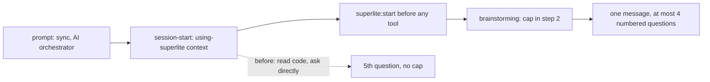
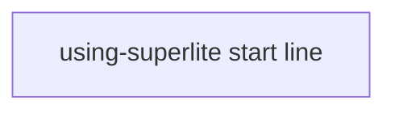

# B286: using-superlite loads /superlite:start before any tool (#1034)

**Goal:** a non-trivial first request with no mode loads `/superlite:start` before any other tool, so no run skips the skills that hold the 4-question cap and `evals/ai-asks-once` one-batch stops failing on runs that never loaded a skill.
**Architecture:** `skills/using-superlite/SKILL.md` is the context every session gets from `hooks/session-start`. Its first body line now says to load start before any tool. Brainstorming SKILL.md stays as it is: its path already holds the cap.
**Tech stack:** Markdown prompt text; pytest via `sl run_tests`.
**Spec:** issue #1034 (earlier: #1028, #758).
**Detail:** tests
**Wave0:** none
**Coverage:** off

## Global constraints

- `skills/using-superlite/SKILL.md` line 6 (the first body line) is exactly `No mode, not trivial: `/superlite:start` before any tool.`, replacing `First message, no mode, not trivial: `/superlite:start`.`; every other byte of the file stays.
- The file stays under its 1500-character cap (1497 after the change) and keeps every phrase `tests/scripts/test_fleet_hint_wording.py` OLD_RULES pins.
- Files this batch may touch: skills/brainstorming/SKILL.md (untouched: its path holds the cap), plus skills/using-superlite/SKILL.md, the new tests/regression/test_using_superlite_start_first_1034.py and this plan, which no open batch lists. An existing test that breaks outside your Owns: name it in the report, do not edit it.
- Builds: the verdict is `sl run_tests` (the project's test command; a project with `.maxapp` runs `maxapp test`, which a build pool may place on another Mac, and a full run whose tree a green maxapp test stamp covers returns that result without a run); task trees build in <tree>/.build/DerivedData and any build of your own goes under .build/ of the worktree, never -derivedDataPath outside the worktree (your session scratchpad included; backlog cleanup removes scratchpad build folders when the worktree goes); a product, simulator or device build stays on this machine and runs only when an issue's acceptance asks for a running-app check; copy this sentence into every worker brief.
- Simulators: append the UDID of each simulator you or a worker creates (`xcrun simctl create` or `clone`; a checker's `Simulators:` line marks its created ones) as one line to /Users/max/github/superlite/.claude/worktrees/superlite-b286-brainstorming-no-fifth-question/.superlite/simulators.txt; never list one you did not create; ship cleanup shuts down and deletes each listed one; copy this sentence into every worker brief.

## Evidence (lead's measurement, sonnet, haiku judge x3, plugin arm only)

- Unchanged tree: one-batch 24 of 24. Probe copies of it, three prompts (the case's, "use my notes", "share with my partner"): 48 of 48; traced runs that skipped every skill: 3 of 32.
- Brainstorming path: 0 misses in about 145 runs, with the current text and with a candidate line that names the trailing scope check ("Anything to leave out?").
- Every miss came from a run that loaded no skill (3 to 9 turns: read the code, then ask): 4 numbered questions plus a trailing "Also tell me ..." or "Separately: ...?" ask, or 5 numbered. Natural runs: 3 of about 15 such runs; forced (only using-superlite present): 3 of 48, and 2 of 48 with a plain-text cap added to the Size line.
- With this plan's line: 64 of 64 one-batch, 64 of 64 raises-decisions, 0 of 64 runs skipped a skill, every run loaded brainstorming (a longer variant: 0 of 32).

Ruling: [scope] the fix lands in skills/using-superlite/SKILL.md line 6, not brainstorming SKILL.md: the reported 5th question came from runs that never loaded brainstorming, and the brainstorming path missed 0 times in about 145 runs - cost if wrong: a rare brainstorming-path miss stays (lead's ruling).
Ruling: a cap line in using-superlite's Size sentence is left out: forced skill-less runs missed 2 of 48 with it and 3 of 48 without it, so routing every run through start is the fix (lead's ruling).
Ruling: "First message, " goes so the line fits the 1500 cap; "no mode" already scopes it to a session with no mode chosen (lead's ruling).
Ruling: T1 is mechanical (haiku): its exact text was measured and is fixed here (lead's ruling).

LAYERS: unit, headless, evals

## Main diagram



## File structure

- skills/using-superlite/SKILL.md: line 6 routes to start before any tool.
- tests/regression/test_using_superlite_start_first_1034.py: pins the line and that the old one is gone.

## Task graph

```mermaid
%% schedule
gantt
  title Predicted schedule (mm:ss)
  dateFormat X
  axisFormat %M:%S
  section lane 1
  T1 using-superlite start line :t1, 0, 366s
```





critical path: T1 (6.1 min) · peak width 1 · predicted build 6.1 min · predicted total ≈ 18.6 min

## Routing line

### T1 using-superlite start line · Complexity 1 (O-1) · Est. context 22k
**Owns:** skills/using-superlite/SKILL.md, tests/regression/test_using_superlite_start_first_1034.py
**Components:** 1
**LOC owned:** 20
**Tests:** fast
**Kind:** mechanical
**Model:** haiku
**Produces:** skills/using-superlite/SKILL.md line 6 `LINE`
**Review Focus:** `test_first_line_loads_start_before_any_tool_1034`: the body's first line is `LINE`; `test_old_first_line_is_gone_1034`: the old line is gone; tests/scripts/test_fleet_hint_wording.py and test_isolation_wording.py (cap, pinned phrases) stay green.
**Test code (verbatim):**
```python
# tests/regression/test_using_superlite_start_first_1034.py
"""#1034: using-superlite routes a non-trivial request to /superlite:start before any tool."""
from pathlib import Path

USING = Path(__file__).resolve().parents[2] / "skills/using-superlite/SKILL.md"
LINE = "No mode, not trivial: `/superlite:start` before any tool.\n"
OLD = "First message, no mode, not trivial: `/superlite:start`."


def test_first_line_loads_start_before_any_tool_1034():
    body = USING.read_text(encoding="utf-8").split("---\n", 2)[2]
    assert body.lstrip("\n").startswith(LINE)


def test_old_first_line_is_gone_1034():
    assert OLD not in USING.read_text(encoding="utf-8")
```
**Steps:** 1 write the test file, 2 `sl run_tests --task T1`: FAIL (2 failed), 3 replace line 6 `First message, no mode, not trivial: `/superlite:start`.` with `No mode, not trivial: `/superlite:start` before any tool.`, 4 run: PASS, 5 `sl run_tests --fast tests/scripts/test_fleet_hint_wording.py tests/scripts/test_isolation_wording.py --task T1`: PASS.
**Notes:** change no other line of the skill.

## Review Focus

- Package: prompt text (no runnable entry; the eval case `evals/ai-asks-once` is the behaviour check, run by the evals layer). Categories: wording, pins, cap.
- `test_first_line_loads_start_before_any_tool_1034`, `test_old_first_line_is_gone_1034`; the cap and OLD_RULES pins in tests/scripts/test_fleet_hint_wording.py and tests/scripts/test_isolation_wording.py stay green.

## Self-review

Coverage: #1034's outcome (one-batch stops failing on the paths that skip the cap) maps to T1 plus the evals layer. No placeholders. One task, no edges, no shared files.

## Fix round 1 (evals layer)

The first evals layer was red on debug-flow (plugin arm 0 of 3): T1's line also sent bug requests through `/superlite:start` or `/superlite:debug` (traced: 2 of 4 fixed, one ran no tests; the unchanged line passed 4 of 4). FIX1 made line 6 `No mode, non-trivial build: `/superlite:start` before any tool.` and trimmed `Graphify only if `sl graphify_gate` allows.` to `Graphify only via `sl graphify_gate`.` (1497 characters). Measured on that text: debug-flow 6 of 6; ai-asks-once one-batch 48 of 48, 0 runs skipped a skill. The second evals layer passed all 8 cases.

Ruling: line 6 is scoped to builds, since bug requests go straight to `systematic-debugging` (the Skills line), as before the change (lead's ruling).
