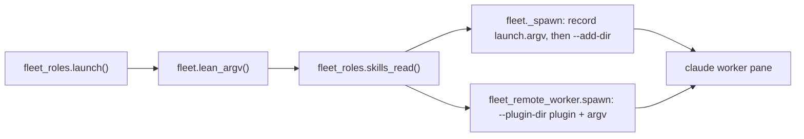
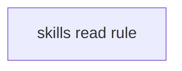

# B272: fleet workers read the plugin's skill files (#905)

**Goal:** a fleet worker (writer, implementer, fixer, reviewer, checker, researcher; local or remote) reads the plugin's own `skills/` folder without a permission dialog, read-only, so a brief that names a plugin skill file no longer ends BLOCKED.
**Architecture:** one pure helper `fleet_roles.skills_read(argv, skills, project)` adds the allow rule `Read(/<skills>/**)` to a worker's claude argv; `fleet._spawn` (local) and `fleet_remote_worker.spawn` (remote, with the machine's plugin path) apply it after `lean_argv`. The rule is stored in the record's `launch.argv`, so restore and rearm reuse it.
**Tech stack:** Python 3 stdlib; pytest via `sl run_tests`.
**Spec:** issue #905; main's ruling: Allow read-only plugin skill folders.
**Detail:** tests
**Wave0:** none
**Coverage:** off

## Global constraints

- The rule text is exactly `"Read(/" + <skills folder as posix, no trailing slash> + "/**)"`, so an absolute folder `/p/skills` gives `Read(//p/skills/**)` (Claude Code's `//` absolute-path form). Probed on Claude Code 2.1.329: with this rule `--permission-mode dontAsk` allows Read, Glob and Grep under the folder and still refuses `/p/README.md`; without it all three are refused.
- Read-only: never `--add-dir` for the plugin folder (an added dir is writable under acceptEdits); no Edit, Write or Bash rule for it.
- A worker argv has at most one `--allowedTools` flag: the rule joins an existing list (the writer's `Edit(//...)`, the researcher's `Read Grep Glob ...`); a list ends at the next argument that starts with `--`.
- `--add-dir <state dir>` stays the last two arguments of a local worker's argv (tests/scripts/test_fleet_lean_377.py:37).
- Files this batch may touch: docs/fleet.md, skills/subagent-driven-development/scripts/fleet.py, skills/subagent-driven-development/scripts/fleet_roles.py, plus skills/subagent-driven-development/scripts/fleet_remote_worker.py (no open batch lists it), new test files, and any existing test that pins a worker argv and breaks (name each in your report).
- Builds: the verdict is `sl run_tests` (the project's test command; a project with `.maxapp` runs `maxapp test`, which a build pool may place on another Mac, and a full run whose tree a green maxapp test stamp covers returns that result without a run); task trees build in <tree>/.build/DerivedData and any build of your own goes under .build/ of the worktree, never -derivedDataPath outside the worktree (your session scratchpad included; backlog cleanup removes scratchpad build folders when the worktree goes); a product, simulator or device build stays on this machine and runs only when an issue's acceptance asks for a running-app check; copy this sentence into every worker brief.
- Simulators: append the UDID of each simulator you or a worker creates (`xcrun simctl create` or `clone`; a checker's `Simulators:` line marks its created ones) as one line to /Users/max/github/superlite/.claude/worktrees/superlite-b272-worker-reads-plugin-skill-files/.superlite/simulators.txt; never list one you did not create; ship cleanup shuts down and deletes each listed one; copy this sentence into every worker brief.

Ruling: an allow rule only, never `--add-dir` (because an added dir is writable under acceptEdits, and a Read rule also covers Grep and Glob, as the probe showed) (lead's ruling).
Ruling: the rule is skipped when the skills folder resolves inside the worker's project, since the project is readable already and its edits follow the normal rules (lead's ruling).

## Main diagram



## File structure

- skills/subagent-driven-development/scripts/fleet_roles.py: `SKILLS` and `skills_read()`.
- skills/subagent-driven-development/scripts/fleet.py: `_spawn` applies `skills_read(argv, project=project)`.
- skills/subagent-driven-development/scripts/fleet_remote_worker.py: `spawn` applies `skills_read(argv, plugin + "/skills")`.
- docs/fleet.md: one bullet under the role table.
- tests/scripts/test_fleet_skills_read_905.py: helper and local spawn tests.
- tests/scripts/test_fleet_remote_skills_read_905.py: remote spawn test.

## Task graph

```mermaid
%% schedule
gantt
  title Predicted schedule (mm:ss)
  dateFormat X
  axisFormat %M:%S
  section lane 1
  T1 skills read rule :t1, 0, 612s
```





critical path: T1 (10.2 min) · peak width 1 · predicted build 10.2 min · predicted total ≈ 26.7 min

## Fleet launch

### T1 skills read rule · Complexity 3 (O-n) · Est. context 40k
**Owns:** skills/subagent-driven-development/scripts/fleet_roles.py, skills/subagent-driven-development/scripts/fleet.py, skills/subagent-driven-development/scripts/fleet_remote_worker.py, docs/fleet.md, tests/scripts/test_fleet_skills_read_905.py, tests/scripts/test_fleet_remote_skills_read_905.py
**Components:** 3
**LOC owned:** 140
**Tests:** fast
**Kind:** design
**Model:** sonnet
**Produces:** fleet_roles.skills_read(argv: list[str], skills: str | Path | None = None, project: str | Path | None = None) -> list[str] · fleet_roles.SKILLS: Path
e.g. skills_read(["--agent", "a", "--disallowedTools", "X"], "/p/skills") -> ["--agent", "a", "--allowedTools", "Read(//p/skills/**)", "--disallowedTools", "X"]
e.g. skills_read(["--allowedTools", "Edit(//r/x.md)", "--disallowedTools", "Bash"], "/p/skills") -> ["--allowedTools", "Edit(//r/x.md)", "Read(//p/skills/**)", "--disallowedTools", "Bash"]
e.g. skills_read(["--agent", "a"], "/p/skills") -> ["--agent", "a", "--allowedTools", "Read(//p/skills/**)"]
**Review Focus:** `test_rule_is_added_once`: a second call returns the argv unchanged; `test_skills_inside_the_project_add_nothing`: project = the folder's parent gives the argv unchanged; `test_spawn_writer_has_one_allow_list`: the writer keeps its `Edit(//...)` rule and gains the read rule in the same single list.
**Test code (verbatim):**
```python
# tests/scripts/test_fleet_skills_read_905.py
import json
import sys
import pytest
from test_plan_tools import SCRIPTS
sys.path.insert(0, str(SCRIPTS))
import fleet_roles as fr  # noqa: E402
from test_fleet import REAL, fleet, world  # noqa: F401,E402  (world is a fixture)

fake_only = pytest.mark.skipif(REAL, reason="argv is read from the in-process fake")


def _start(world, i=0):
    return [c for c in world.fh.calls if c[0] == "start_agent"][i][2]


def _rule():
    return "Read(/" + fr.SKILLS.as_posix() + "/**)"


def test_skills_is_the_plugin_skills_folder():
    assert (fr.SKILLS / "writing-plans" / "SKILL.md").is_file()


def test_rule_joins_the_existing_allow_list():
    argv = ["--permission-mode", "default", "--allowedTools", "Edit(//r/x.md)", "--disallowedTools", "Bash"]
    assert fr.skills_read(argv, "/p/skills") == ["--permission-mode", "default", "--allowedTools", "Edit(//r/x.md)",
                                                 "Read(//p/skills/**)", "--disallowedTools", "Bash"]
    assert argv == ["--permission-mode", "default", "--allowedTools", "Edit(//r/x.md)", "--disallowedTools", "Bash"]


def test_rule_gets_its_own_list_before_the_deny_list():
    assert fr.skills_read(["--agent", "a", "--disallowedTools", "X"], "/p/skills/") == [
        "--agent", "a", "--allowedTools", "Read(//p/skills/**)", "--disallowedTools", "X"]


def test_rule_goes_last_without_either_list():
    assert fr.skills_read(["--agent", "a"], "/p/skills") == ["--agent", "a", "--allowedTools", "Read(//p/skills/**)"]


def test_rule_is_added_once():
    once = fr.skills_read(["--agent", "a", "--disallowedTools", "X"], "/p/skills")
    assert fr.skills_read(once, "/p/skills") == once


def test_skills_inside_the_project_add_nothing(tmp_path):
    (tmp_path / "skills").mkdir()
    argv = ["--agent", "a", "--disallowedTools", "X"]
    assert fr.skills_read(argv, tmp_path / "skills", project=tmp_path) == argv
    assert "--allowedTools" in fr.skills_read(argv, tmp_path / "skills", project=tmp_path / "proj")


def test_default_skills_is_read_at_call_time(monkeypatch, tmp_path):
    monkeypatch.setattr(fr, "SKILLS", tmp_path / "plug" / "skills")
    assert fr.skills_read(["--agent", "a"]) == ["--agent", "a", "--allowedTools", "Read(/" + (tmp_path / "plug" / "skills").as_posix() + "/**)"]


@fake_only
def test_spawn_writer_has_one_allow_list(world):
    fleet.main(["on"])
    out = world.proj / "out.md"
    fleet.spawn(world.sd, world.plan, None, world.proj, role="writer", output=str(out))
    argv = _start(world)
    i = argv.index("--allowedTools")
    assert argv.count("--allowedTools") == 1
    assert argv[i + 1:i + 3] == ["Edit(/" + out.as_posix() + ")", _rule()]
    assert json.loads((world.sd / "fleet.json").read_text())["workers"]["W1"]["launch"]["argv"] == argv


@fake_only
def test_spawn_implementer_reads_plugin_skills(world):
    fleet.main(["on"])
    fleet.spawn(world.sd, world.plan, "sonnet", world.proj)
    argv = _start(world)
    i = argv.index("--allowedTools")
    assert argv[i + 1] == _rule() and i < argv.index("--disallowedTools")


@fake_only
def test_spawn_in_the_plugin_root_adds_no_rule(world, monkeypatch):
    (world.proj / "skills").mkdir()
    monkeypatch.setattr(fr, "SKILLS", (world.proj / "skills").resolve())
    fleet.main(["on"])
    fleet.spawn(world.sd, world.plan, None, world.proj, role="research")
    assert _rule() not in _start(world)
```
```python
# tests/scripts/test_fleet_remote_skills_read_905.py
import sys
from test_plan_tools import SCRIPTS
sys.path.insert(0, str(SCRIPTS))
import fleet_roles as fr  # noqa: E402
from test_fleet_remote_worker import record, started, world  # noqa: F401,E402  (world is a fixture)


def test_remote_worker_reads_its_machine_plugin_skills(world):
    started(world)
    argv = next(c for c in world.fh.calls if c[0] == "start_agent")[2]
    assert argv[0] == "--plugin-dir"
    i, j = argv.index("--allowedTools"), argv.index("--disallowedTools")
    assert "Read(/" + argv[1].rstrip("/") + "/skills/**)" in argv[i + 1:j]
    assert "Read(/" + fr.SKILLS.as_posix() + "/**)" not in argv
    assert argv.count("--allowedTools") == 1 and record(world)["launch"]["argv"] == argv
```
**Steps:** 1 write both test files, 2 run them: FAIL, 3 implement `SKILLS` and `skills_read` in fleet_roles.py, apply it in `fleet._spawn` right after the `lean_argv(...)` line (`argv = fleet_roles.skills_read(argv, project=project)`) and in `fleet_remote_worker.spawn` (`argv = ["--plugin-dir", plugin] + fleet_roles.skills_read(fleet.lean_argv(launch["argv"]), plugin.rstrip("/") + "/skills")`), add the docs bullet, 4 run them: PASS, 5 run every tests/scripts/test_fleet*.py file and fix each existing test that pins a worker argv and now fails (keep its intent; name the file in the report).
**Notes:** `SKILLS = Path(__file__).resolve().parents[2]` (scripts -> subagent-driven-development -> skills). `skills=None` means `SKILLS` read at call time (so a test can monkeypatch it). Never resolve `skills` when `project` is None (a remote path does not exist here); with `project`, compare `Path(skills).resolve()` against `Path(project).resolve()` with `relative_to` (or `is_relative_to`). The copy returned is a new list; the input is never mutated. Mirror test_fleet_remote_worker.py's module-level skip marks in the remote test file if it has any. Docs bullet, after the "Briefs live in `.superlite/briefs/`" bullet in docs/fleet.md: "- Every worker may read the plugin's own skill files: spawn adds `Read(//<plugin root>/skills/**)` to its `--allowedTools` list (fleet_roles.skills_read; a remote worker gets its machine's plugin path), unless that folder sits inside the worker's project. It is read-only: no `--add-dir`, so an edit there still asks and is refused. Any other file outside the project and the run folder (a spec in another repository) still asks: copy it into `.superlite/briefs/` first (#905)."

**Probe entry:** none (argv builders inside fleet spawn; the named tests above cover the cases)

## Review Focus

Package fleet launch: app type CLI (fleet spawn). Categories: protocol (claude argv shape: one `--allowedTools` list, rule format `Read(//abs/**)`), state (the record's `launch.argv` equals the started argv, so restore and rearm reuse it), file (inside-project check with resolved paths; remote path never resolved locally). Security: the rule grants read only; no `--add-dir` and no write rule for the plugin folder.

## Self-review

Coverage: #905's first expected outcome (read-only plugin skill folders, main's ruling) maps to T1; the second outcome (spawn refuses outside paths) was not chosen. Placeholders: none. Graph: one task. Fields: all filled. Limits: under 15k.
