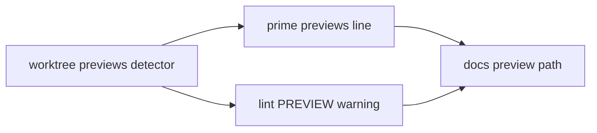

# Superlite: a worktree run says up front that RenderPreview cannot reach it, and plans route preview renders to the checker (#910)

**Goal:** in a run whose root is a linked git worktree of a project whose workers get the Xcode MCP server, the prime says preview rendering through RenderPreview is not reachable, the worker system note stops asking for it there, plan lint warns on a task step that renders a preview, and the docs name the checker's snapshot render (own build folder, `.superlite/render/`, per package) as the supported path (#910).
**Architecture:** one detector, `fleet_mcp.worktree_previews(root)` (linked worktree and the `xcode` server, else None), read by `build_prime` (a `- Previews:` rule line after the verify-command rule) and by plan lint (`WARNING: PREVIEW:` per task); `XCODE_NOTE` names the worktree exception; docs route preview renders to the checker.
**Tech stack:** Python 3.10+ stdlib; git; pytest through `sl run_tests`.
**Spec:** this file, section Design.
**Detail:** contracts
**Target-min:** 11
**Wave0:** none
**Coverage:** off

Global constraints:
- Every line of a Python script under `skills/**/scripts/` keeps the repo's `# O(...)` complexity comment; stdlib only; LF endings. Files under `tests/` carry no such comments.
- This repository is public: no host names, user names, home paths, other project or repository names in code, tests, docs or commit messages.
- The verdict is `sl run_tests` (never raw pytest); every new test sees a red run before the code it tests.
- An existing test that pins a changed text or output may be updated in the task that changes it; name each such file in your report.
- Builds: the verdict is `sl run_tests` (the project's test command; a project with `.maxapp` runs `maxapp test`, which a build pool may place on another Mac, and a full run whose tree a green maxapp test stamp covers returns that result without a run); task trees build in <tree>/.build/DerivedData and any build of your own goes under .build/ of the worktree, never -derivedDataPath outside the worktree (your session scratchpad included; backlog cleanup removes scratchpad build folders when the worktree goes); a product, simulator or device build stays on this machine and runs only when an issue's acceptance asks for a running-app check; copy this sentence into every worker brief.
- Simulators: append the UDID of each simulator you or a worker creates (`xcrun simctl create` or `clone`; a checker's `Simulators:` line marks its created ones) as one line to the worktree's `.superlite/simulators.txt`; never list one you did not create; ship cleanup shuts down and deletes each listed one; copy this sentence into every worker brief.

## Design

Issue #910: in a Swift app run inside a git worktree, implementers and package reviewers were told (fleet_mcp `XCODE_NOTE`, plan steps) to render previews with the Xcode MCP `RenderPreview`, which renders the workspace Xcode has open: the main checkout. No preview of the run's views rendered; the first look at the new UI was the final running-app check.

1. **Detector** (`fleet_mcp.worktree_previews(project)`): returns the main checkout's path when `state.linked_worktree(project)` is true and `"xcode"` is among `_names(project, quiet=True)` (test-cmd.json `"mcp"`, else the macOS Swift/Xcode default) and `_main_key(project)` finds it; None otherwise and on any error. `_names` gains `quiet: bool = False` (True: no `BAD_MCP` stderr line). The linked check runs first, so a main checkout or a folder outside git costs one file read.
2. **Worker note:** `XCODE_NOTE`'s render sentence becomes: `Render every Preview you add or change with RenderPreview before you report DONE, unless your checkout is a linked git worktree (its .git is a file): RenderPreview renders the workspace Xcode has open, the main checkout, so there skip it and never report a preview as unrendered.` The rest of the note is unchanged (no backticks, quotes, `$`, `!`, `#` or newline).
3. **Prime:** `build_prime.preview_line(root)` returns, when the detector gives `main`, `- Previews: RenderPreview cannot show this run's views: it renders the workspace Xcode has open, the main checkout <main as POSIX>, not this linked worktree. Never list or run it as a step and never report a preview as unrendered; the checker renders this run's previews into .superlite/render/ (plan section Running-app checks, reach: preview).`; "" otherwise and on any exception. `with_root` inserts the non-empty lines of `[verdict_line(root), preview_line(root)]` after the `FG` line, so full, slim and mini primes all carry it; a main-checkout prime is byte-identical to today.
4. **Lint:** `plan_tools.preview_warnings(plan, root)`: [] when root is None or the detector gives None (any exception: []). Otherwise, per non-draft task, the first unfenced line of its block (heading line, `**Owns:**` and `**Also-touches:**` lines skipped) that matches `PREVIEW_STEP_RE` (`\bRenderPreview\b`), or both `PREVIEW_RENDER_RE` (`\brender(?:s|ed|ing)?\b`) and `PREVIEW_WORD_RE` (`\bpreviews?\b|#Preview\b`), all case-insensitive, and not `PREVIEW_POINTER_RE` (`\bchecker\b|running-app checks?`), gives one line: `WARNING: PREVIEW: <Tn> names a preview render as a step ("<snippet>"), but this run is a linked worktree: RenderPreview renders the workspace Xcode has open, the main checkout <main>; drop the step and list the view under ## Running-app checks as - C<n>: <view>; reach: preview <name>; see: <what must show>, which the checker renders into .superlite/render/`. Snippet: the line's whitespace runs collapsed to one space, stripped; over 60 characters it is its first 57 plus `...`. `lint_plan` adds it right after `reach_warnings` in the #601 block.
5. **Supported path (docs):** the checker's throwaway `ImageRenderer` snapshot render already builds the worktree in its own folder (`<ROOT>/.build/CheckDerivedData`) and writes `.superlite/render/C<n>-<name>.png`; the docs make it the path for a worktree run and run preview checks per package.

Rejected: opening the worktree's workspace in the user's Xcode for RenderPreview (it builds in Xcode's own DerivedData outside the worktree, takes over the user's Xcode window and needs the GUI session; workers are denied XcodeOpenWorkspace for that reason).

### Rulings

- Ruling: [scope] the supported render path is the checker's existing snapshot render (own `.build/CheckDerivedData`, `.superlite/render/`), made the rule for worktree runs in skills/writing-plans/probe-plan.md and skills/subagent-driven-development/fleet.md (preview checks run per package once its tasks are committed); no new render tool (because the checker already builds in its own folder and writes the shots, and the Xcode route breaks the build-folder rule).
- Ruling: the prime line and the lint warning appear only for a linked worktree whose workers get the `xcode` server; a main-checkout prime stays byte-identical (because XCODE_NOTE already covers the reachable case).
- Ruling: XCODE_NOTE names the worktree exception in its own text, since `usage_note(names)` has no project argument and its caller fleet.py belongs to B273 (because package reviewers and fixers read no prime).
- Ruling: SDD SKILL.md and agents/checker.md stay unchanged (because the checker's snapshot rule already covers named views, fleet.md carries the per-package rule, and both files cost the evals layer).
- Ruling: lint's MISSED TARGET is accepted (because T2 and T3 run T1's detector in their tests and T4 quotes their texts; the chain is three short tasks).
- Ruling: B276 edits fleet_mcp.py, skills/writing-plans/probe-plan.md, skills/subagent-driven-development/fleet.md, docs/simulator-limits.md and docs/tools.md besides its two listed files (no open batch lists them).

## Task graph

```mermaid
%% schedule
gantt
  title Predicted schedule (mm:ss)
  dateFormat X
  axisFormat %M:%S
  section lane 1
  T1 worktree previews detector :t1, 0, 372s
  T3 lint PREVIEW warning :t3, 372, 380s
  T4 docs preview path :t4, 752, 371s
  section lane 2
  T2 prime previews line :t2, 372, 372s
```





critical path: T1 → T3 → T4 (18.7 min) · peak width 2 · predicted build 18.7 min · predicted total ≈ 31.2 min (target ✗ 11.0)

## Package: fleet_mcp

App type: library (git and config reads). Categories: file (linked worktree, main checkout, no git), protocol (note text constraints).
**Probe entry:** none (the cases need a temporary git repository with a linked worktree; they are named tests)

### T1 worktree previews detector · Complexity 2 · Est. context 28k
**Owns:** skills/subagent-driven-development/scripts/fleet_mcp.py, tests/scripts/test_fleet_mcp_worktree_910.py
**Components:** 1
**LOC owned:** 70
**Tests:** fast
**Model:** sonnet
**Covers:** Design
**Produces:** fleet_mcp.worktree_previews(project: str | Path) -> Path | None
  e.g. worktree_previews("<tmp>/wt") with `<tmp>/wt` a linked worktree of `<tmp>/main` and wt/.superlite/test-cmd.json {"test": "pytest", "mcp": ["xcode"]} -> Path("<tmp>/main").resolve()
  e.g. worktree_previews("<tmp>/main") with the same config -> None
  e.g. worktree_previews("<tmp>/wt") with {"test": "pytest", "mcp": []} -> None
**Review Focus:** file: `test_linked_worktree_with_xcode_gives_main`, `test_main_checkout_gives_none`, `test_no_git_gives_none`; protocol: `test_bad_mcp_is_quiet`, `test_note_names_worktree_rule`
**Test code (contracts):** in tests/scripts/test_fleet_mcp_worktree_910.py, copy the `private_home` autouse fixture of tests/scripts/test_fleet_mcp_576.py. Fixture `repos(tmp_path)`: `git init -q main`, set user.name/user.email locally, commit `a.txt`, `git -C main worktree add -q ../wt -b b276`; return (main, wt). `cfg(p, d)` writes `p/.superlite/test-cmd.json`.
- `test_linked_worktree_with_xcode_gives_main`: cfg(wt, {"test": "pytest", "mcp": ["xcode"]}) -> `worktree_previews(wt) == main.resolve()`; also with `str(wt)`.
- `test_main_checkout_gives_none`: cfg(main, same) -> `worktree_previews(main) is None`.
- `test_no_xcode_gives_none`: cfg(wt, {"test": "pytest", "mcp": []}) -> None.
- `test_no_git_gives_none`: a plain tmp folder with the xcode cfg -> None.
- `test_bad_mcp_is_quiet`: cfg(wt, {"test": "pytest", "mcp": "xcode"}), `monkeypatch.setattr(fleet_mcp.sys, "platform", "linux")` -> None and `capsys.readouterr().err == ""`.
- `test_git_failure_gives_none`: xcode cfg in wt, `monkeypatch.setattr(fleet_mcp, "_main_key", lambda p: (_ for _ in ()).throw(OSError("x")))` -> None.
- `test_note_names_worktree_rule`: `"unless your checkout is a linked git worktree" in fleet_mcp.XCODE_NOTE`, `"RenderPreview" in` it, and none of the characters of "`'\"$!#\n" in it.
**Steps:** 1 write the tests, 2 run: FAIL (no `worktree_previews`; note text), 3 implement Design 1-2, 4 run: PASS (tests/scripts/test_fleet_mcp_576.py and test_fleet_spawn_mcp_576.py stay green unchanged)
**Notes:** Verify with `sl run_tests --fast tests/scripts/test_fleet_mcp_worktree_910.py tests/scripts/test_fleet_mcp_576.py tests/scripts/test_fleet_spawn_mcp_576.py --task T1`. `import state` lazily inside `worktree_previews`. The module docstring's Library list gains `worktree_previews`.

## Package: build_prime

App type: CLI (prime text). Categories: protocol (exact line, its place, byte-identical primes elsewhere).
**Probe entry:** none (named tests cover the prime text)

### T2 prime previews line · Complexity 2 · Est. context 30k
**Owns:** skills/subagent-driven-development/scripts/build_prime.py, tests/scripts/test_build_prime_previews_910.py
**Components:** 1
**LOC owned:** 70
**Tests:** fast
**Model:** sonnet
**Covers:** Design
**Consumes:** fleet_mcp.worktree_previews(project: str | Path) -> Path | None (T1)
**Produces:** build_prime.preview_line(root: str | Path) -> str
  e.g. preview_line("/w/wt") with worktree_previews giving Path("/w/main") -> the Design 3 line with `/w/main`
  e.g. preview_line("/w/main") with worktree_previews giving None -> ""
**Review Focus:** protocol: `test_preview_line_text`, `test_line_follows_fg_in_every_kind`, `test_main_checkout_prime_unchanged`, `test_detector_error_adds_nothing`
**Test code (contracts):** in tests/scripts/test_build_prime_previews_910.py, reuse `make`, `slim` (tests/scripts/test_slim_prime.py) and the `cfg` style of tests/scripts/test_build_prime_verdict_627.py. `LINE(m)` is the Design 3 text with `m`. Fake the detector with `monkeypatch.setattr(fleet_mcp, "worktree_previews", lambda p: Path("/w/main"))`.
- `test_preview_line_text`: fake -> `build_prime.preview_line("/w/wt") == LINE("/w/main")`; fake giving None -> "".
- `test_line_follows_fg_in_every_kind`: fake on, python cfg; for the slim prime, `--prime full` and the mini prime (build_prime.build_mini as test_build_prime_mini.py calls it): LINE appears once, on the line after the one starting `- Run the verify command`.
- `test_after_verdict_line`: fake on, cfg language swift, test "maxapp test": the Verdict line follows FG and LINE follows the Verdict line.
- `test_main_checkout_prime_unchanged`: slim prime bytes with the fake giving None equal the bytes with `preview_line` monkeypatched to `lambda root: ""`; "Previews:" not in it.
- `test_detector_error_adds_nothing`: fake raises RuntimeError -> `preview_line(...) == ""` and the slim prime builds without "Previews:".
**Steps:** 1 write the tests, 2 run: FAIL (no `preview_line`), 3 implement Design 3, 4 run: PASS (test_build_prime_verdict_627.py, test_build_prime_launch_601.py and test_build_prime_mini.py stay green)
**Notes:** Verify with `sl run_tests --fast tests/scripts/test_build_prime_previews_910.py tests/scripts/test_build_prime_verdict_627.py tests/scripts/test_build_prime_mini.py tests/scripts/test_slim_prime.py --task T2`. Import fleet_mcp lazily in `preview_line` and call it as `fleet_mcp.worktree_previews(root)` so the fake applies.

## Package: plan lint

App type: library (lint warnings). Categories: state (fenced, draft, Owns lines), protocol (exact warning text).
**Probe entry:** none (named tests cover the warning)

### T3 lint PREVIEW warning · Complexity 3 · Est. context 36k
**Owns:** skills/subagent-driven-development/scripts/plan_tools.py, tests/scripts/test_lint_preview_910.py
**Components:** 1
**LOC owned:** 140
**Tests:** fast
**Model:** sonnet
**Covers:** Design
**Consumes:** fleet_mcp.worktree_previews(project: str | Path) -> Path | None (T1)
**Produces:** plan_tools.preview_warnings(plan: Plan, root: Path | None) -> list[str]
  e.g. a task T2 whose Steps line is `**Steps:** 4 render BadgeView previews with RenderPreview`, detector giving Path("/w/main") -> one `WARNING: PREVIEW: T2 names a preview render as a step ("**Steps:** 4 render BadgeView previews with RenderPreview"), but this run is ...` line
  e.g. the same plan, detector giving None -> []
**Review Focus:** state: `test_fenced_line_quiet`, `test_draft_task_quiet`, `test_owns_line_quiet`, `test_one_warning_per_task`; protocol: `test_step_warns_in_worktree`, `test_lint_prints_preview_warning`
**Test code (contracts):** in tests/scripts/test_lint_preview_910.py, build plans the way tests/scripts/test_lint_reach_owns_606.py does; fake the detector with `monkeypatch.setattr(fleet_mcp, "worktree_previews", lambda p: Path("/w/main"))`; `W(tid, snip)` is the Design 4 text with `/w/main`.
- `test_step_warns_in_worktree`: the e.g. plan -> exactly `[W("T2", "**Steps:** 4 render BadgeView previews with RenderPreview")]`.
- `test_renderpreview_word_alone_warns`: `**Notes:** check it in RenderPreview` -> one warning.
- `test_main_checkout_quiet`: detector None -> []; root None -> [].
- `test_draft_task_quiet`: the e.g. task with `**Status:** draft` -> [].
- `test_fenced_line_quiet`: `render the previews` only inside a ``` fence -> [].
- `test_owns_line_quiet`: `**Owns:** Sources/Previews/render.swift` and a heading `### T2 render previews` -> [].
- `test_checker_pointer_quiet`: `**Notes:** previews are rendered by the checker (C2)` -> [].
- `test_one_warning_per_task`: two matching lines in T2 and one in T3 -> two warnings, T2 first.
- `test_long_snippet_cut`: a 90-character matching line -> its snippet is the first 57 characters plus `...`.
- `test_detector_error_quiet`: the fake raises RuntimeError -> [].
- `test_lint_prints_preview_warning`: `lint_plan` (or `cmd_lint` as test_lint_reach_owns_606.py runs it) on the e.g. plan with the fake prints the warning line among its WARNING lines.
**Steps:** 1 write the tests, 2 run: FAIL (no `preview_warnings`), 3 implement Design 4, 4 run: PASS (test_lint_reach_owns_606.py and test_plan_tools.py stay green)
**Notes:** Verify with `sl run_tests --fast tests/scripts/test_lint_preview_910.py tests/scripts/test_lint_reach_owns_606.py tests/scripts/test_lint_platform_516.py --task T3`. A task's block lines are `plan.lines[t.line : t.line + len(t.text.split("\n"))]`, fenced flags `plan.fenced[i]`. Import fleet_mcp lazily (SCRIPT_DIR on sys.path, as `ui_file` does) and call `fleet_mcp.worktree_previews(root)`. Keep the edit to new constants, the new function and one line in lint_plan: B277 also edits plan_tools.py.

## Package: docs

App type: docs. Categories: protocol (quoted texts match the code).
**Probe entry:** none (docs)

### T4 docs preview path · Complexity 2 · Est. context 34k
**Owns:** skills/writing-plans/probe-plan.md, skills/subagent-driven-development/fleet.md, docs/simulator-limits.md, docs/tools.md, tests/scripts/test_docs_910.py
**Components:** 1
**LOC owned:** 60
**Tests:** fast
**Model:** sonnet
**Covers:** Design
**Review Focus:** protocol: `test_docs_910_clauses_once`, `test_quoted_texts_match_code`
**Test code (contracts):** in tests/scripts/test_docs_910.py: each new clause below appears exactly once in its file; the quoted prefixes `- Previews: RenderPreview cannot show this run's views` and `WARNING: PREVIEW:` appear in build_prime.py and plan_tools.py source.
**Steps:** 1 write the test, 2 run: FAIL, 3 edit the docs: (a) probe-plan.md: a new bullet right after the `An MCP-only check (Xcode RenderPreview)` bullet, which stays byte-identical: in a run whose root is a linked git worktree RenderPreview cannot reach the run's views (it renders the workspace Xcode has open, the main checkout), so a preview render is never a task step there but a `## Running-app checks` line with `reach: preview <name>`, which the checker renders; lint warns `WARNING: PREVIEW:` on such a step and the prime's `- Previews:` line tells workers; (b) skills/subagent-driven-development/fleet.md, the Checker bullet: one added sentence: in a linked-worktree run the checks whose reach is a preview or snapshot render run per package, by a checker with only those `C<n>` lines (brief `.superlite/briefs/check-<package>.md`) once that package's tasks are committed, so the first look at new views comes before the final checks; (c) docs/simulator-limits.md, section `SwiftUI previews: no command-line renderer`: one sentence that RenderPreview renders the workspace Xcode has open, so in a linked worktree it shows the main checkout, never the run's edits (#910), and the checker's snapshot render is the path there; (d) docs/tools.md: one line appended at the end (append-only) naming `fleet_mcp.worktree_previews`, the prime's `- Previews:` line and lint's `WARNING: PREVIEW:` (#910); 4 run: PASS
**Notes:** Verify with `sl run_tests --fast tests/scripts/test_docs_910.py tests/scripts/test_docs_checker_600.py tests/scripts/test_writing_plans_split_684.py tests/scripts/test_docs_contract.py --task T4`; then run every tests/scripts/test_docs_*fleet*.py and test_docs_*tools*.py once and keep pinned tails green (an appended docs/tools.md line may move a pinned tail: fix that pin in this task).

## Review Focus

- T1 file: only a linked worktree with the xcode server gives a path; main checkout, no git, no xcode and git errors give None; no stderr from a bad mcp setting.
- T2 protocol: the line sits right after the verify-command rule (after Verdict on Swift) in full, slim and mini primes; other primes are byte-identical.
- T3 state: fenced, draft, Owns and heading lines never warn; one warning per task; checker pointers stay quiet.
- T4 protocol: the probe-plan bullet and rules_684 fixture sentence stay intact; quoted texts match the code.

## Self-review

#910 item 1 maps to T1 and T2 (prime line, worker note), item 2 to T4 (checker snapshot render per package in docs, ruled), item 3 to T3 (lint PREVIEW). T2 and T3 run against T1's code (Wave0 none); T4 quotes their texts.
