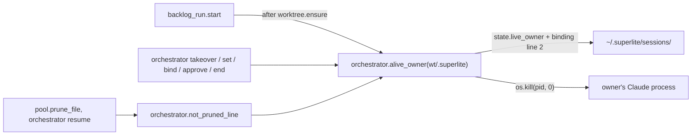
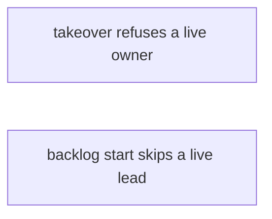

# B296: backlog starts no second lead for a batch whose lead session is alive (#1047)

**Goal:** a batch whose lead session still runs gets no second lead: `sl backlog start` refuses it, and a second session that reaches a live lead's run anyway is told to stop instead of to take the run over; `sl orchestrator takeover` refuses a run whose owner still runs unless `--force`.
**Architecture:** one liveness probe, `orchestrator.alive_owner(sd)`: the session that owns the run folder and is still bound to it (`state.live_owner`) and whose Claude process (binding line 2, CLAUDE_PID) answers `os.kill(pid, 0)`. `takeover`, the `set`/`bind`/`approve`/`end` refusals, the pool-prune line (pool.py and `orchestrator resume`) and `backlog_run.start` read it. Texts for an owner not proven alive stay byte-identical.
**Tech stack:** Python 3 stdlib; pytest via `sl run_tests`.
**Spec:** issue #1047 (B290's follow-up); Max's decision: Start no second lead (backlog skips a batch whose lead is alive; takeover stays explicit).
**Detail:** contracts
**Wave0:** none
**Coverage:** off

## Global constraints

- Every new or changed Python line in skills/**/scripts ends with its `# O(...)` complexity comment like its neighbours.
- Liveness rules (alive_owner): no owner, this session as owner, or a stale owner (`state.live_owner` None) -> None; `os.name == "nt"` -> None (never signal on Windows); binding line 2 not all digits or `<= 0` -> None (unknown is never alive); pid equal to this process's `CLAUDE_PID` (all digits) -> None (a /clear handoff in the same Claude process); `os.kill(pid, 0)` raising PermissionError -> alive; any other OSError, ValueError or OverflowError -> None.
- Texts for an owner that alive_owner does not prove alive stay byte-identical to today (pinned by test_orchestrator_takeover, test_pool_prune_384, test_orchestrator_resume_384, test_session_state, test_session_handover, test_finish_unblocked_375).
- Tests never depend on the session they run in: every subprocess env pops CLAUDE_PID and sets it explicitly where a test needs it; a live owner is a child `python -c "import time; time.sleep(60)"` killed in teardown; a dead pid is a child that has already been waited for.
- Files this batch may touch: skills/subagent-driven-development/scripts/orchestrator.py, skills/subagent-driven-development/scripts/pool.py, skills/subagent-driven-development/scripts/backlog_run.py, tests/scripts/test_orchestrator_takeover.py, the new tests/scripts/test_backlog_no_second_lead_1047.py, docs/fleet.md and this plan. An existing test that breaks: name it in the report; do not edit it without the lead's word.
- Builds: the verdict is `sl run_tests` (the project's test command; a project with `.maxapp` runs `maxapp test`, which a build pool may place on another Mac, and a full run whose tree a green maxapp test stamp covers returns that result without a run); task trees build in <tree>/.build/DerivedData and any build of your own goes under .build/ of the worktree, never -derivedDataPath outside the worktree (your session scratchpad included; backlog cleanup removes scratchpad build folders when the worktree goes); a product, simulator or device build stays on this machine and runs only when an issue's acceptance asks for a running-app check; copy this sentence into every worker brief.
- Simulators: append the UDID of each simulator you or a worker creates (`xcrun simctl create` or `clone`; a checker's `Simulators:` line marks its created ones) as one line to /Users/max/github/superlite/.claude/worktrees/superlite-b296-backlog-no-second-lead/.superlite/simulators.txt; never list one you did not create; ship cleanup shuts down and deletes each listed one; copy this sentence into every worker brief.

Ruling: cause (lead's reading of B290): B290 was parked and restarted while lead W10's Claude process still ran; `backlog start`'s only guard is the batch's Herdr agent name (`backlog_run._pick`), and the second lead's refused `orchestrator set` named `takeover`, which force-binds without a liveness check.
Ruling: [scope] #1047 also needs skills/subagent-driven-development/scripts/backlog_run.py (the start loop) and docs/fleet.md, outside the batch's file list; no open batch lists them; docs/tools.md (owned by B294's run) gets a follow-up instead (lead's ruling).
Ruling: liveness is the owner's recorded Claude pid; an owner with no pid recorded counts as not alive, so behaviour stays as today where CLAUDE_PID is unset (lead's ruling).
Ruling: no pid-reuse check (a recycled pid reads as alive); the backlog refusal names the pid and the owner file to delete when that pid is not the lead (lead's ruling).
Ruling: `_build_start` (planning lead -> build lead) is a planned succession and gets no liveness check; it stops the planning lead right after the build lead's brief (lead's ruling).

## Main diagram

## File structure

- skills/subagent-driven-development/scripts/orchestrator.py: alive_owner, not_pruned_line, takeover --force, live-owner refusal texts, docstring.
- skills/subagent-driven-development/scripts/pool.py: prune_file's refusal line comes from orchestrator.not_pruned_line.
- skills/subagent-driven-development/scripts/backlog_run.py: start refuses a batch whose worktree run has a live owner.
- tests/scripts/test_orchestrator_takeover.py: liveness, takeover, refusal and pool-line tests.
- tests/scripts/test_backlog_no_second_lead_1047.py: backlog start tests.
- docs/fleet.md: the new behaviour.

## Task graph

```mermaid
%% schedule
gantt
  title Predicted schedule (mm:ss)
  dateFormat X
  axisFormat %M:%S
  section lane 1
  T1 takeover refuses a live owner :t1, 0, 502s
  section lane 2
  T2 backlog start skips a live lead :t2, 0, 466s
```

critical path: T1 (8.4 min) · peak width 2 · predicted build 8.4 min · predicted total ≈ 22.9 min

## Orchestrator

**Probe entry:** none (orchestrator.py writes session bindings under the real home; its cases are named tests in T1)

### T1 takeover refuses a live owner · Complexity 4 (O-1) · Est. context 45k
**Owns:** skills/subagent-driven-development/scripts/orchestrator.py, skills/subagent-driven-development/scripts/pool.py, tests/scripts/test_orchestrator_takeover.py, docs/fleet.md
**Components:** 2
**LOC owned:** 190
**Tests:** fast
**Kind:** design
**Model:** sonnet
**Est. time:** 4 min (2 components, about 190 LOC, fast tests)
**Produces:** orchestrator.alive_owner(sd) -> tuple[str, int] | None · orchestrator.not_pruned_line(sd, other: str) -> str
  e.g. alive_owner(Path("/r/.superlite")) -> ("aaaaaaaa-0000-4000-8000-000000000001", 4242) (A bound with CLAUDE_PID=4242, process 4242 runs)
  e.g. alive_owner(Path("/r/.superlite")) -> None (process 4242 gone, or A's binding line 2 empty)
  e.g. not_pruned_line(Path("/r/.superlite"), "other") -> "pool: not pruned: /r/.superlite belongs to session other; take the run over first: sl orchestrator takeover --plan /r/.superlite" (other not alive)
**Review Focus:** state: the own-pid, PermissionError, non-digit and Windows rules of Global constraints; a test that kills the owner mid-test sees None next call.
**Test code (named, exact):** in tests/scripts/test_orchestrator_takeover.py; `sl()` pops CLAUDE_PID before env_extra; `{sd}` is the absolute run folder, `{P}` the live child's pid.
- `test_alive_owner_live_dead_and_unknown_1047`: A `set ai` with CLAUDE_PID={P}; in-process with CLAUDE_CODE_SESSION_ID=B and CLAUDE_PID unset, alive_owner(sd) == (A, P); after kill+wait of the child -> None; A bound with CLAUDE_PID unset -> None; B's CLAUDE_PID equal to {P} -> None.
- `test_takeover_refuses_a_live_owner_1047`: B `takeover --plan sd` exit 2, stdout empty, stderr exactly `orchestrator: {sd} belongs to session {A}, still running (pid {P}); not taken over: a second session never takes over a live run (a batch lead ends here with Status: BLOCKED second lead); once that session has ended rerun this, or take it over anyway: sl orchestrator takeover --force --plan {sd}`; sd/session still A.
- `test_takeover_force_takes_a_live_run_1047`: B `takeover --force --plan sd` exit 0, stdout exactly `orchestrator: run {sd} taken over from session {A}; this session owns it now; session {A} is still running (pid {P})`; sd/session is B.
- `test_takeover_after_the_owner_ended_1047`: A's pid already exited: B `takeover` exit 0 with today's line `orchestrator: run {sd} taken over from session {A}; this session owns it now`.
- `test_takeover_in_the_same_process_1047`: A and B both CLAUDE_PID={P}: B `takeover` exit 0, today's line.
- `test_set_refusal_names_a_live_owner_1047`: B `set ai --plan sd` exit 2, stderr exactly `orchestrator: {sd} belongs to session {A}, still running (pid {P}); not set: a second session never takes over a live run (a batch lead ends here with Status: BLOCKED second lead); pass --plan with your own worktree's plan, or once that session has ended: sl orchestrator takeover --plan {sd}`; `bind` says `not bound`, `approve` path keeps its own checks (no test).
- `test_end_refusal_names_a_live_owner_1047`: B `end --plan sd` exit 2, stderr exactly `orchestrator: {sd} belongs to session {A}, still running (pid {P}); not ended; end the run in that session, or once it has ended: sl orchestrator takeover --plan {sd}`.
- `test_pool_prune_names_a_live_owner_1047`: sd/pool.json `{"agents": []}`; B runs `pool.py prune --pool sd/pool.json`: stdout exactly `pool: not pruned: {sd} belongs to session {A}, still running (pid {P}); prune in that session, or once it has ended: sl orchestrator takeover --plan {sd}`; `orchestrator resume --plan sd` prints the same line first.
- `test_docs_name_takeover_force_1047`: docs/fleet.md holds the paragraph in Notes, as its own paragraph right after the pinned "Taking a run over:" one.
**Steps:** 1 write the tests, 2 run: FAIL, 3 implement, 4 run: PASS (also test_pool_prune_384, test_orchestrator_resume_384, test_session_state, test_session_handover, test_finish_unblocked_375, test_docs_b67_fleet)
**Notes:** `{sd}` in set/bind/approve and takeover texts is `state._abs(sd)` (as today); in the end and pool texts it is `sd` as today's lines print it. `not_pruned_line` returns today's text when alive_owner is None and the live text otherwise; pool.prune_file imports orchestrator lazily inside the function. The set/bind/approve live text uses `not set`, `not bound`, `not approved`. alive_owner uses the existing `state.live_owner(sd)` and reads line 2 of `state._binding(owner)`. Takeover parser gains `--force` (store_true, help: take over a run whose owner session still runs). Docstring usage line: `orchestrator.py takeover [--plan P] [--force]`, plus one sentence on the refusal. docs/fleet.md: a new paragraph right after the "Taking a run over:" paragraph (that paragraph stays byte-identical; test_docs_b67_fleet pins it): `A run whose owner session still runs (its Claude pid, line 2 of the session binding, answers) is never taken over by a second session (#1047): \`takeover\` exits 2 and names the pid, the \`set\`, \`bind\`, \`approve\` and \`end\` refusals and \`pool prune\` say the owner still runs, and a batch lead that meets one ends with \`Status: BLOCKED second lead\`; \`sl backlog start\` starts no lead for a batch whose worktree run has such an owner. \`takeover --force\` takes a live run over anyway.`

## Backlog

**Probe entry:** none (backlog_run start spawns Herdr panes; its cases are named tests in T2)

### T2 backlog start skips a live lead · Complexity 3 (O-1) · Est. context 40k
**Owns:** skills/subagent-driven-development/scripts/backlog_run.py, tests/scripts/test_backlog_no_second_lead_1047.py
**Components:** 1
**LOC owned:** 90
**Tests:** fast
**Kind:** design
**Model:** sonnet
**Est. time:** 2.5 min (1 component, about 90 LOC, fast tests)
**Consumes:** orchestrator.alive_owner(sd) -> tuple[str, int] | None (T1)
**Produces:** backlog_run.main(["start", ...]) refuses a batch whose worktree run has a live owner
**Review Focus:** state: the refusal comes before the brief is written and before spawn_lead; the batch keeps its state; other batches in the same call still start.
**Test code (named, exact):** in tests/scripts/test_backlog_no_second_lead_1047.py, reusing test_backlog_run.py's `bk` fixture and helpers (import them); fake `orchestrator.alive_owner` with monkeypatch (raising=False) returning the e.g. values.
- `test_start_refuses_a_batch_whose_lead_still_runs_1047`: a parked batch B1; alive_owner(wt/.superlite) -> ("aaaaaaaa-0000-4000-8000-000000000001", 4242): `start B1` returns 2, prints exactly `BLOCKED: B1 not started: lead session aaaaaaaa-0000-4000-8000-000000000001 is still running (pid 4242) in {wt}; no second lead: sl backlog wait; to restart it, stop that session first, then sl backlog start B1 (if pid 4242 is not that session, delete {wt}/.superlite/session first)`; spawn_lead not called; no brief written; B1 stays parked.
- `test_start_spawns_when_the_old_lead_is_gone_1047`: same batch, alive_owner -> None: spawn_lead called once, B1 running.
- `test_start_refusal_leaves_other_batches_starting_1047`: B1 refused as above, a disjoint B2 with alive_owner None for its worktree starts in the same call.
**Steps:** 1 write the tests, 2 run: FAIL, 3 implement, 4 run: PASS (also tests/scripts/test_backlog_run.py)
**Notes:** the check sits in `start` right after the "not a linked worktree" refusal and before `experiment.assign`; `import orchestrator` lazily there; `{wt}` is the worktree Path as the loop holds it; on refusal `code = 2` and `continue`.

## Review Focus

- orchestrator (CLI, state): own-pid handoff, PermissionError alive, unknown pid not alive, Windows None, exact texts; unchanged texts for not-alive owners.
- backlog_run (state): refusal before any side effect; a pid in the binding of a session that is gone never blocks.
