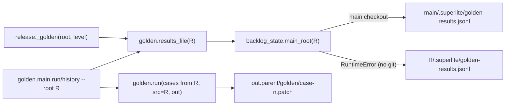

# B287: golden results and patches go to the main checkout (#925)

**Goal:** `sl golden run --root <linked worktree>` (and `history`, and `sl release`'s golden step) reads and writes `golden-results.jsonl` and the saved patches in the main checkout's `.superlite/`, so they outlive the worktree; `--root` still picks the cases and the plugin under test.
**Architecture:** one helper, `golden.results_file(root)`, returns `<main checkout>/.superlite/golden-results.jsonl`, the main checkout found with `backlog_state.main_root(root)` (the git common dir's parent, the helper release.py and the backlog already use); outside git it falls back to `<root>/.superlite/golden-results.jsonl`, today's path. `golden.main` (run and history) and `release._golden` call it instead of building the path themselves. The patch folder is already `Path(out).parent / "golden"`, so patches follow the results file with no change in `golden.run`.
**Tech stack:** Python 3 stdlib (pathlib, subprocess via backlog_state); pytest via `sl run_tests`.
**Spec:** issue #925, bullet "Results follow `--root`".
**Detail:** tests
**Wave0:** none
**Coverage:** off

## Global constraints

- Results path: `<main checkout>/.superlite/golden-results.jsonl`, where the main checkout is `backlog_state.main_root(Path(root))`; a root outside git (`RuntimeError` from `main_root`) keeps `Path(root).resolve() / ".superlite" / "golden-results.jsonl"`. Patches stay at `<results file's folder>/golden/<case>-<attempt>.patch`.
- `--root` keeps every other meaning: `golden_case.cases(root)` and the plugin under test (`golden.run(..., src=root, ...)`, `_plugin(src)`) still come from root, never from the main checkout.
- `golden.run`'s signature and rows are unchanged; only the `out` path its callers pass changes.
- Files this batch may touch: skills/subagent-driven-development/scripts/golden.py, skills/subagent-driven-development/scripts/release.py, docs/release.md, docs/tools.md, the new tests/scripts/test_golden_results_main_925.py and this plan. An existing test that breaks: name it in the report, do not edit it without the lead's word.
- Builds: the verdict is `sl run_tests` (the project's test command; a project with `.maxapp` runs `maxapp test`, which a build pool may place on another Mac, and a full run whose tree a green maxapp test stamp covers returns that result without a run); task trees build in <tree>/.build/DerivedData and any build of your own goes under .build/ of the worktree, never -derivedDataPath outside the worktree (your session scratchpad included; backlog cleanup removes scratchpad build folders when the worktree goes); a product, simulator or device build stays on this machine and runs only when an issue's acceptance asks for a running-app check; copy this sentence into every worker brief.
- Simulators: append the UDID of each simulator you or a worker creates (`xcrun simctl create` or `clone`; a checker's `Simulators:` line marks its created ones) as one line to /Users/max/github/superlite/.claude/worktrees/superlite-b287-golden-results-main-checkout/.superlite/simulators.txt; never list one you did not create; ship cleanup shuts down and deletes each listed one; copy this sentence into every worker brief.

Ruling: reuse `backlog_state.main_root` (release.py's `_ship_lock` already does) with a `RuntimeError` fallback to root, rather than a new git call in golden.py: one way to find the main checkout, and the existing history tests on a plain `tmp_path` keep today's path (lead's ruling).
Ruling: release.py's `_golden` calls `golden.results_file(root)` instead of its own copy of the path, so `sl release` and `sl golden run` cannot point at different files (lead's ruling; release.py is listed by no open batch).
Ruling: [scope] #925's other bullets ship no code here: the large-case pass and a patch saved in a paid run need a paid `sl golden run`, which a lead cannot start (golden refuses inside a lead), so they are a `Left undone` line for Max; a second-machine golden run needs a remote lead role #919 does not offer (about 300-500 lines), the shell-profile token needs herdr's pane shell and Claude settings env precedence settled first, and the first release notes' start tag is a choice of what 1.6.0's notes should span: each is a `Follow-up` line (lead's ruling).

## Main diagram



## File structure

- skills/subagent-driven-development/scripts/golden.py: new `results_file(root)`; `main` uses it for run and history.
- skills/subagent-driven-development/scripts/release.py: `_golden` uses `golden.results_file(root)`.
- docs/release.md, docs/tools.md: the results and patch sentences name the main checkout.
- tests/scripts/test_golden_results_main_925.py: helper, CLI run and history from a linked worktree, release's golden step.

## Task graph

```mermaid
%% schedule
gantt
  title Predicted schedule (mm:ss)
  dateFormat X
  axisFormat %M:%S
  section lane 1
  T1 golden results in main checkout :t1, 0, 218s
```




critical path: T1 (3.6 min) · peak width 1 · predicted build 3.6 min · predicted total ≈ 12.1 min

## Golden results path

**Probe entry:** none (the path depends on a git main checkout and linked worktree; its cases are named tests in T1)

### T1 golden results in main checkout · Complexity 2 (O-1) · Est. context 32k
**Owns:** skills/subagent-driven-development/scripts/golden.py, skills/subagent-driven-development/scripts/release.py, docs/release.md, docs/tools.md, tests/scripts/test_golden_results_main_925.py
**Components:** 2
**LOC owned:** 95
**Tests:** fast
**Kind:** mechanical
**Model:** haiku
**Produces:** golden.results_file(root: str | Path) -> Path
e.g. results_file("/r/superlite/.claude/worktrees/b1") -> Path("/r/superlite/.superlite/golden-results.jsonl") (b1 is a linked worktree of /r/superlite)
e.g. results_file("/r/superlite") -> Path("/r/superlite/.superlite/golden-results.jsonl")
e.g. results_file("/tmp/plain") -> Path("/tmp/plain/.superlite/golden-results.jsonl") (no git)
**Review Focus:** `test_results_file_linked_worktree_goes_to_main`; `test_results_file_outside_git_stays_at_root`; `test_run_from_worktree_keeps_root_for_cases_and_plugin`; `test_run_from_worktree_saves_rows_and_patch_in_main`; `test_history_from_worktree_reads_main`; `test_release_golden_writes_main_results`; every test in tests/scripts/test_golden.py and tests/scripts/test_release.py passes unchanged.
**Test code (verbatim):**
```python
# tests/scripts/test_golden_results_main_925.py
import json, os, subprocess, sys
from pathlib import Path
import pytest
from test_plan_tools import SCRIPTS
sys.path.insert(0, str(SCRIPTS))
import golden  # noqa: E402
import release  # noqa: E402
from test_golden import CASE, Fake  # noqa: E402

GIT_ENV = {k: v for k, v in os.environ.items() if k not in ("GIT_DIR", "GIT_INDEX_FILE", "GIT_WORK_TREE")}
GREEN = {"ok": True, "exit": 0, "passed": 1, "failed": 0, "skipped": 0, "errors": 0, "out": ""}


def git(cwd, *a):
    return subprocess.run(["git", *a], cwd=cwd, env=GIT_ENV, check=True, capture_output=True, text=True).stdout


@pytest.fixture
def checkouts(tmp_path):
    main = tmp_path / "main"
    main.mkdir()
    git(main, "init", "-q", "-b", "main")
    git(main, "config", "user.email", "t@t")
    git(main, "config", "user.name", "t")
    (main / "README.md").write_text("x\n")
    git(main, "add", ".")
    git(main, "commit", "-qm", "init")
    wt = tmp_path / "wt"
    git(main, "worktree", "add", "-q", "-b", "b1", str(wt))
    return main.resolve(), wt.resolve()


def test_results_file_main_checkout(checkouts):
    main, _ = checkouts
    assert golden.results_file(main) == main / ".superlite" / "golden-results.jsonl"


def test_results_file_linked_worktree_goes_to_main(checkouts):
    main, wt = checkouts
    assert golden.results_file(wt) == main / ".superlite" / "golden-results.jsonl"
    assert golden.results_file(str(wt)) == main / ".superlite" / "golden-results.jsonl"


def test_results_file_outside_git_stays_at_root(tmp_path):
    d = tmp_path / "plain"
    d.mkdir()
    assert golden.results_file(d) == d.resolve() / ".superlite" / "golden-results.jsonl"


def test_run_from_worktree_keeps_root_for_cases_and_plugin(checkouts, monkeypatch):
    main, wt = checkouts
    monkeypatch.delenv("SUPERLITE_FLEET_WORKER", raising=False)
    roots, seen = [], []
    monkeypatch.setattr(golden.golden_case, "cases", lambda root: roots.append(Path(root)) or [{**CASE, "id": "large"}])

    def fake_run(cases, src, out, rerun=True, timeout_s=5400, seal=None):
        seen.append((Path(src), Path(out)))
        return [{"case": "large", "passed": True, "why": []}]
    monkeypatch.setattr(golden, "run", fake_run)
    assert golden.main(["run", "--ids", "large", "--root", str(wt)]) == 0
    assert roots == [wt]
    assert seen == [(wt, main / ".superlite" / "golden-results.jsonl")]


def test_run_from_worktree_saves_rows_and_patch_in_main(checkouts, monkeypatch, capsys):
    main, wt = checkouts
    monkeypatch.delenv("SUPERLITE_FLEET_WORKER", raising=False)
    monkeypatch.setattr(golden.golden_case, "cases", lambda root: [{**CASE, "base": "abc"}])
    fake = Fake()
    fake.patch = lambda tree, base: "diff --git a/a b/a\n"
    monkeypatch.setattr(golden, "golden_seal", fake)
    monkeypatch.setattr(golden, "hidden_run", lambda case, tree: GREEN)
    monkeypatch.setattr(golden, "_run", lambda cmd, cwd=None, timeout=None: (0, "076a39a") if cmd[:2] == ["git", "rev-parse"] else (0, ""))
    assert golden.main(["run", "--ids", "small", "--no-rerun", "--root", str(wt)]) == 0
    rows = [json.loads(x) for x in (main / ".superlite" / "golden-results.jsonl").read_text().splitlines()]
    assert [(r["case"], r["passed"], r["patch"]) for r in rows] == [("small", True, "small-1.patch")]
    assert (main / ".superlite" / "golden" / "small-1.patch").read_text() == "diff --git a/a b/a\n"
    assert not (wt / ".superlite").exists()
    capsys.readouterr()
    assert golden.main(["history", "--root", str(wt)]) == 0
    assert capsys.readouterr().out.strip() == "small: runs 1 median lead $3.00 hidden 1.00 (noise from 5 runs)"


def test_history_from_worktree_reads_main(checkouts, capsys):
    main, wt = checkouts
    out = main / ".superlite" / "golden-results.jsonl"
    out.parent.mkdir()
    out.write_text("".join(json.dumps({"row": "golden", "case": "large", "lead_usd": v}) + "\n" for v in (2.0, 4.0)))
    (wt / ".superlite").mkdir()
    (wt / ".superlite" / "golden-results.jsonl").write_text(json.dumps({"row": "golden", "case": "large", "lead_usd": 9.0}) + "\n")
    assert golden.main(["history", "--root", str(wt)]) == 0
    assert capsys.readouterr().out.strip() == "large: runs 2 median lead $3.00 (noise from 5 runs)"


def test_release_golden_writes_main_results(checkouts, monkeypatch):
    main, wt = checkouts
    monkeypatch.setattr(release.golden_case, "cases", lambda root: [{"id": i} for i in ("small", "typical", "large")])
    seen = []

    def fake_gold(cases, src, out, rerun=True, timeout_s=5400, seal=None):
        seen.append((Path(src), Path(out)))
        return [{"case": c["id"], "passed": True, "why": []} for c in cases]
    monkeypatch.setattr(release.golden, "run", fake_gold)
    assert release._golden(wt, "minor") == 0
    assert seen == [(wt, main / ".superlite" / "golden-results.jsonl")]
```
**Steps:** 1 write the test file, 2 `sl run_tests --fast tests/scripts/test_golden_results_main_925.py --task T1`: FAIL (`results_file` missing; `test_results_file_outside_git_stays_at_root` too), 3 in golden.py add after `_count` (before `hidden_run`) `def results_file(root) -> Path:` with the comment `# the main checkout's results file, also for a linked worktree's root, so rows and patches outlive the worktree (#925); outside git root's own | O(1)`: lazily `import backlog_state` inside the function, `try: base = backlog_state.main_root(Path(root))` / `except RuntimeError: base = Path(root).resolve()`, return `base / ".superlite" / "golden-results.jsonl"`; in `main` replace `out = root / ".superlite" / "golden-results.jsonl"` with `out = results_file(root)`; in release.py `_golden` replace `out = root / ".superlite" / "golden-results.jsonl"` with `out = golden.results_file(root)`; keep each changed line's `# O(...)` comment in the file's style, 4 docs: docs/release.md step 3 becomes `3. Golden batches for the level; results go to the main checkout's `.superlite/golden-results.jsonl`.`; its Golden runs bullet `- Each attempt saves ...` becomes `- Each attempt saves the lead's change as `.superlite/golden/<case>-<attempt>.patch` beside the results file and, for red hidden tests, the end of their output in the row (`hidden_out`).`, followed by a new bullet `- `--root R` picks the cases and the plugin under test; the results file and the patches stay in the main checkout's `.superlite/` also when R is a linked worktree, so they outlive it (#925).`; in docs/tools.md's `golden` row replace `appends result rows to `.superlite/golden-results.jsonl`` with `appends result rows to the main checkout's `.superlite/golden-results.jsonl`, also from a linked worktree's `--root``, 5 run the new file plus tests/scripts/test_golden.py and tests/scripts/test_release.py: PASS.
**Notes:** `golden.run` and `_save_patch` stay unchanged (the patch folder is `Path(out).parent`). `backlog_state.main_root` raises only `RuntimeError`; catch nothing broader.

## Review Focus

- Package golden results path (CLI): file (a linked worktree's root writes nothing under its own `.superlite/`; a non-git root keeps today's path), protocol (`--root` still selects cases and the plugin; `run`, `history` and `sl release` agree on one file).
- Risks: cases or the plugin version read from the main checkout instead of root; history and run pointing at different files; a non-git root raising instead of falling back.

## Self-review

Coverage: #925's results bullet is T1; the other bullets are ruled above. No placeholders. One task, no edges. Produces matches the tests' calls (`golden.results_file(wt)`, `golden.results_file(str(wt))`).
