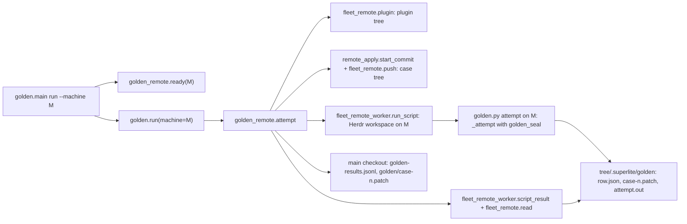
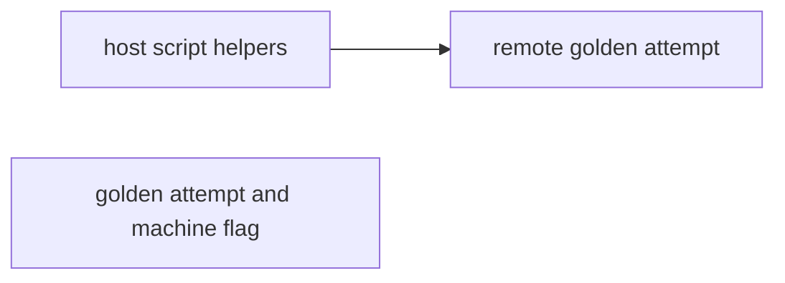
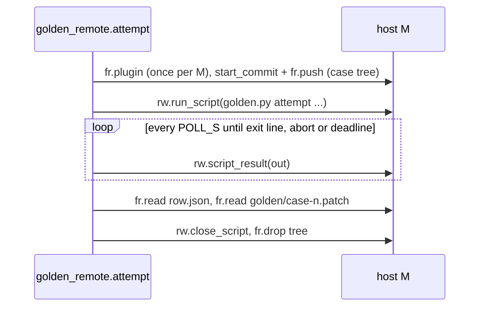

# B291: sl golden run --machine M starts golden leads on a remote machine (#1040)

**Goal:** `sl golden run --machine M` runs each golden attempt (seal, lead start, wait, row, suite, patch, hidden tests, cleanup) on Herdr machine M instead of this machine, and brings the result row and the saved patch home into the main checkout's `golden-results.jsonl` and `golden/` folder.
**Architecture:** the host runs the existing local attempt unchanged: a new hidden subcommand `golden.py attempt` runs one `golden._attempt` with `golden_seal` in a pushed tree on the host (the host's own herdr, accounts and paths) and writes the row to a file. This machine (new `golden_remote.py`) pushes this checkout's commit as the plugin tree (`fleet_remote.plugin`) and a start commit at the case base carrying the case JSON (`remote_apply.start_commit` + `fleet_remote.push`), starts `golden.py attempt` in a Herdr workspace on the host (new `fleet_remote_worker.run_script`), polls its output file (`fleet_remote_worker.script_result`, `fleet_remote.read`), reads the row and the patch back, then closes the workspace and drops the tree. `golden.run(..., machine=M)` sends every attempt there; `golden.main run --machine M` checks the machine first.
**Tech stack:** Python 3 stdlib (argparse, json, shlex, signal, subprocess, tempfile, threading); pytest via `sl run_tests`.
**Spec:** issue #1040 (body only; no linked spec); main's ruling: build the full remote lead path.
**Detail:** contracts
**Wave0:** none
**Read first:** skills/subagent-driven-development/scripts/golden.py

## Global constraints

- Host command (the seam between T2 and T3), run with cwd = the pushed tree: `python3 <plugin tree>/skills/subagent-driven-development/scripts/golden.py attempt --case <tree>/.superlite/golden/case.json --n <n> --timeout <timeout_s> --out-dir <tree>/.superlite --row <tree>/.superlite/golden/row.json [--earlier 0.5,1.0]`; every path through `shlex.quote`; `--earlier` only when the list is not empty, values joined with `,` as `str(float)`.
- The host row is the dict `golden._attempt` returns (`plugin` ""); this machine sets `plugin` to its own `golden._plugin(src)` string and adds `"machine": M`. The patch name in the row (`<case>-<n>.patch`) is read from `<tree>/.superlite/golden/<name>` and written to `<out_dir>/golden/<name>` here.
- A remote attempt that gives no host row is one NOT RUN row: `{"v": 1, "row": "golden", "case": id, "attempt": n, "passed": False, "why": ["machine M: <why>"], "warn": [], "lead_usd": 0.0, "total_usd": 0.0, "lead_turns": 0, "wall_min": 0.0, "started": False, "plugin": <local plugin>, "machine": M}`; `started: False` already stops the rerun in `golden._case` and prints `NOT RUN` in `main`.
- `golden.run(...)` and `golden.main` keep their old calls working: `main` passes `machine=` to `run` only when a machine is set (`tests/scripts/test_golden.py`, `test_golden_results_main_925.py` and `release._golden` call or fake `run(cases, src, out, rerun=True, timeout_s=5400, seal=None)`); `--machine local` means this machine. golden.py imports `golden_remote` lazily, only for a machine.
- Files this batch may touch: skills/subagent-driven-development/scripts/fleet_remote_worker.py, golden.py, the new golden_remote.py, docs/tools.md, tests/scripts/test_golden.py, the new tests/scripts/test_fleet_remote_script_1040.py and test_golden_remote_1040.py, this plan. Never edit fleet_lead.py, herdr_client.py (batch B292), fleet_remote.py, fleet_remote_collect.py or golden_seal.py. An existing test that breaks: name it in the report, do not edit it without the lead's word.
- Builds: the verdict is `sl run_tests` (the project's test command; a project with `.maxapp` runs `maxapp test`, which a build pool may place on another Mac, and a full run whose tree a green maxapp test stamp covers returns that result without a run); task trees build in <tree>/.build/DerivedData and any build of your own goes under .build/ of the worktree, never -derivedDataPath outside the worktree (your session scratchpad included; backlog cleanup removes scratchpad build folders when the worktree goes); a product, simulator or device build stays on this machine and runs only when an issue's acceptance asks for a running-app check; copy this sentence into every worker brief.
- Simulators: append the UDID of each simulator you or a worker creates (`xcrun simctl create` or `clone`; a checker's `Simulators:` line marks its created ones) as one line to /Users/max/github/superlite/.claude/worktrees/superlite-b291-golden-run-remote-machine/.superlite/simulators.txt; never list one you did not create; ship cleanup shuts down and deletes each listed one; copy this sentence into every worker brief.

Ruling: the host runs the whole attempt with its own local herdr (`backlog_run.py start/wait` there, unchanged), not a new remote lead role in `fleet_remote_worker.spawn` driven from here: the lead start, wait, cost row, suite and patch read host-local files and transcripts (R2: fleet_lead opens a local pane, batch_cost reads absolute host paths), so running them where they live reuses every sealed-lead rule with no path mapping (lead's ruling; cost if wrong: a later need to watch the host lead live from here needs that role after all).
Ruling: remote exec is a Herdr workspace on the host running `sh -c` with output to a file and a final `exit N` line, polled with `remote_tree read` (the pattern `fleet_remote_collect._retake` uses); `maxapp remote` runs in a CI container without herdr or accounts, and remote_tree has no exec verb (lead's ruling).
Ruling: abort and deadline close the host workspace; the hang-up reaches `golden.py attempt` as SIGHUP, which it turns into KeyboardInterrupt so `_attempt`'s finally stops the clone's fleet and removes the clone (lead's ruling; cost if wrong: an aborted host attempt leaves its lead running until the host's own wait ends).
Ruling: deadline here = `timeout_s + SLACK_S` (`SLACK_S = 2400`: clone, the 600 s start, the 900 s hidden tests, cleanup), polled every `POLL_S = 30` s; a read error is retried up to `READ_TRIES = 5` polls in a row (lead's ruling).
Ruling: the host lead loads the plugin installed on the host (fleet_lead passes no `--plugin-dir`, as on this machine); the host's scripts are this checkout's HEAD commit (`fleet_remote.plugin`). A `--plugin-dir` for sealed leads is a follow-up for fleet_lead.py, batch B292's file (lead's ruling).
Ruling: detail `contracts` (named tests with exact values): the fakes are small monkeypatched functions of `fleet_remote`, `herdr_client` and `remote_apply` (lead's ruling).

## Coverage

| Category | State | Basis |
|---|---|---|
| Scope and success criteria | settled | #1040: `sl golden run --machine M` starts golden leads on M with remote seal, wait, row, suite, patch and cleanup; main's ruling: the full path |
| Domain and data model | ruled | the golden row gains `"machine": M`; a NOT RUN row shape in Global constraints |
| Persistence and migration | ruled | rows and patches land in the main checkout as today (`golden.results_file`); old rows lack `machine`, history ignores it |
| Interfaces and contracts | ruled | host command flags in Global constraints; `run`/`main` keep old calls; T1-T3 Produces |
| UI states | n/a | CLI only; output lines unchanged |
| Concurrency and state ownership | ruled | cases run in parallel threads: one tree and workspace per attempt (`golden/<id>-<n>-<6 hex>`), the plugin tree pushed once per machine under a lock |
| Error handling and recovery | ruled | every remote failure is a NOT RUN row naming the machine; workspace closed and tree dropped in `finally`; a drop failure is one stderr line |
| Security and privacy | ruled | the host attempt uses `golden_seal`'s scrubbed env (no tokens, empty gh config); the case JSON rides in a start commit the host clone scrubs |
| Performance and limits | ruled | POLL_S 30, SLACK_S 2400, READ_TRIES 5, push timeout 600 s; patch read up to `golden.PATCH_CAP` |
| Observability | ruled | `machine` in the row; NOT RUN line names the machine and the cause |
| Testing strategy | ruled | unit tests with fakes per module; the wrapper script runs under real `sh` in T1; a paid live run is Left undone for Max |
| Compatibility | ruled | host needs python3, git, uv, herdr and signed-in Claude accounts (docs/tools.md) |
| Rollout | ruled | opt-in flag; without `--machine` nothing changes |
| Research unknowns | n/a | the remote exec pattern already runs in `fleet_remote_collect._retake` |

## Main diagram

## File structure

- skills/subagent-driven-development/scripts/fleet_remote_worker.py: `run_script`, `script_result`, `close_script` (a shell command on a Herdr machine).
- skills/subagent-driven-development/scripts/golden.py: `attempt` subcommand (host side), `_hangup`, `run(..., machine=)`, `run --machine M`.
- skills/subagent-driven-development/scripts/golden_remote.py (new): `ready`, `attempt` (this machine's side).
- docs/tools.md: the `golden` row names `--machine M`.
- tests/scripts/test_fleet_remote_script_1040.py, tests/scripts/test_golden.py, tests/scripts/test_golden_remote_1040.py.

## Task graph

```mermaid
%% schedule
gantt
  title Predicted schedule (mm:ss)
  dateFormat X
  axisFormat %M:%S
  section lane 1
  T2 golden attempt and machine flag :t2, 0, 596s
  section lane 2
  T1 host script helpers :t1, 0, 559s
  T3 remote golden attempt :t3, 559, 576s
```

critical path: T1 → T3 (18.9 min) · peak width 2 · predicted build 18.9 min · predicted total ≈ 35.4 min

## Host scripts

**Probe entry:** none (every call goes to herdr and remote_tree on a host; its cases are named tests in T1)

### T1 host script helpers · Complexity 3 (O-1) · Est. context 34k
**Owns:** skills/subagent-driven-development/scripts/fleet_remote_worker.py, tests/scripts/test_fleet_remote_script_1040.py
**Components:** 1
**LOC owned:** 130
**Tests:** fast
**Model:** sonnet
**Produces:** fleet_remote_worker.run_script(label: str, cwd: str, script: str, out: str, title: str) -> str
e.g. run_script("mxn", "/h/t", "echo hi", "/h/t/.superlite/golden/attempt.out", "sl:golden small-1") -> "w1" (inside hc.on("mxn"): create_workspace("sl:golden small-1", "/h/t", {}) -> ("w1", "p1"), then run_in_pane("p1", "sh -c " + shlex.quote(FULL)))
e.g. FULL for that call = `mkdir -p /h/t/.superlite/golden; { cd /h/t && echo hi; } > /h/t/.superlite/golden/attempt.out.tmp 2>&1; echo "exit $?" >> /h/t/.superlite/golden/attempt.out.tmp; mv /h/t/.superlite/golden/attempt.out.tmp /h/t/.superlite/golden/attempt.out` (each path through shlex.quote; the script itself is not quoted)
**Produces:** fleet_remote_worker.script_result(label: str, out: str) -> tuple[int, str] | None
e.g. script_result("mxn", OUT) -> None (fr.read("mxn", OUT) returned b"": no file yet)
e.g. script_result("mxn", OUT) -> (0, "row written") (file "row written\nexit 0\n")
e.g. script_result("mxn", OUT) -> (2, "golden: cannot read case x") (file "golden: cannot read case x\nexit 2\n"); file "partial\n" -> None
**Produces:** fleet_remote_worker.close_script(label: str, ws: str) -> None
e.g. close_script("mxn", "w1") -> None (hc.close_workspace("w1") inside hc.on("mxn"); a HerdrError is swallowed)
**Review Focus:** protocol (shell quoting of cwd and out with spaces), state (no `.tmp` left after the wrapper); `test_run_script_opens_workspace_and_runs_sh`: the e.g. above, every herdr call inside `on("mxn")`; `test_run_script_wrapper_runs_under_sh`: run the captured `sh -c ...` command with `subprocess.run(cmd, shell=True)` for cwd `tmp_path/"a dir"` (created) and script `echo hi; exit 3`, out `tmp_path/"o d"/"attempt.out"` -> that file reads `"hi\nexit 3\n"` and `attempt.out.tmp` does not exist; `test_run_script_closes_workspace_when_run_fails`: run_in_pane raises `hc.HerdrError("exit", "x")` -> close_workspace("w1") called, the HerdrError propagates; `test_script_result_none_while_absent`; `test_script_result_exit_line` (the three e.g. files above); `test_script_result_remote_error_propagates`: fr.read raises `fr.RemoteError("mxn unreachable: ssh")` -> raised; `test_close_script_swallows_herdr_error`.
**Steps:** 1 write the named tests (fake `rw.hc` with a small object whose `on(m)` is a contextmanager recording ("on", m)/("off", m) and whose create_workspace, run_in_pane, close_workspace record calls; fake `rw.fr.read`), 2 `run_tests --fast tests/scripts/test_fleet_remote_script_1040.py --task T1`: FAIL, 3 implement the three functions after `stop` in fleet_remote_worker.py (add `import shlex`; `script_result` reads with `fr.read(label, out)`, strips trailing newlines, matches the last line with `re.fullmatch(r"exit (\d+)", ...)`), each line with the file's `# O(...)` comment style, 4 PASS, plus tests/scripts/test_fleet_remote_worker.py unchanged and green.
**Notes:** the same wrapper shape as `fleet_remote_collect._retake` (do not edit that file). `run_script` closes its workspace itself only when `run_in_pane` fails; otherwise the caller closes it with `close_script`.

## Golden CLI

**Probe entry:** none (the attempt starts a sealed lead and `--machine` reaches a host; its cases are named tests in T2)

### T2 golden attempt and machine flag · Complexity 4 (O-1) · Est. context 44k
**Owns:** skills/subagent-driven-development/scripts/golden.py, tests/scripts/test_golden.py, docs/tools.md
**Components:** 2
**LOC owned:** 230
**Tests:** fast
**Model:** sonnet
**Consumes:** golden_remote.ready(label: str) -> str (T3) · golden_remote.attempt(label: str, case: dict, src: Path, timeout_s: int, n: int, plugin: str, out_dir: Path | None, earlier: list, abort: threading.Event) -> dict (T3)
**Produces:** golden._hangup(signum: int, frame: object) -> None
e.g. _hangup(signal.SIGHUP, None) raises KeyboardInterrupt
**Review Focus:** protocol (`attempt` flags exactly as Global constraints; `--machine local`; old `run` fakes keep working), state (signal handlers restored, temp work folder removed, row file written whole via `.tmp` + `os.replace`), file. Named tests in tests/scripts/test_golden.py (fake `golden_remote` with `monkeypatch.setitem(sys.modules, "golden_remote", types.SimpleNamespace(ready=..., attempt=...))`; reuse `CASE`, `Fake`, `env`):
`test_attempt_cli_writes_row`: case file `{**CASE, "base": "abc"}`, `golden.golden_seal` = a `Fake()` with `patch = lambda wt, base: "diff --git a/a b/a\n"`, `hidden_run` green, `main(["attempt", "--case", F, "--n", "2", "--timeout", "60", "--out-dir", D, "--row", R, "--earlier", "0.5,1.0", "--src", repo])` == 0; R holds one JSON object with `case` "small", `attempt` 2, `passed` True, `plugin` "", `patch` "small-2.patch"; `D/golden/small-2.patch` exists; one clone cleaned; the clone's temp parent folder is gone; no `R.tmp`.
`test_attempt_cli_bad_case_exits_2`: missing case file -> 2, stderr starts `golden: cannot read case`.
`test_attempt_cli_interrupt_cleans_clone`: Fake whose `wait` raises KeyboardInterrupt -> 130, the clone cleaned, no row file, `signal.getsignal(signal.SIGHUP)` and SIGTERM equal to what they were before the call.
`test_attempt_cli_sets_hangup_handler`: Fake whose `wait` records `signal.getsignal(signal.SIGHUP)` -> it is `golden._hangup`.
`test_hangup_raises_keyboard_interrupt`.
`test_run_machine_sends_attempts_to_remote`: fake attempt returns `{"v": 1, "row": "golden", "case": "small", "attempt": n, "passed": True, "why": [], "warn": [], "started": True, "lead_usd": 3.0, "total_usd": 3.5, "lead_turns": 60, "wall_min": 30.0, "plugin": "1.5.244+076a39a", "machine": "mxn"}`; `golden.run([CASE], env.repo, env.out, rerun=False, machine="mxn")` == [that row]; the fake got `("mxn", CASE, env.repo, 5400, 1, "1.5.244+076a39a", env.out.parent, [], golden.ABORT)`; env.out holds that row.
`test_run_machine_reruns_a_failed_attempt`: first row `passed` False, `started` True -> two calls, n 1 then 2.
`test_run_machine_not_run_stops_rerun`: row `started` False -> one call.
`test_main_machine_refused_when_not_ready`: ready returns "unreachable: timeout" -> `main(["run", "--ids", "small", "--machine", "mxn", "--root", repo])` == 2, stderr `golden: machine mxn: unreachable: timeout`, `run` never called.
`test_main_machine_passes_machine_to_run`: ready "" and a fake `run(cases, src, out, rerun=True, timeout_s=5400, seal=None, machine=None)` records "mxn".
`test_main_machine_local_runs_here`: `--machine local` with a fake `run(cases, src, out, rerun=True, timeout_s=5400, seal=None)` (no machine parameter) -> called, exit 0; ready never called.
**Steps:** 1 write the named tests, 2 `run_tests --fast tests/scripts/test_golden.py --task T2`: FAIL, 3 implement: `_hangup` (raise KeyboardInterrupt); `attempt` subparser (`--case` and `--out-dir` and `--row` required, `--n` int 1, `--timeout` int 5400, `--earlier` "", `--src` "."); `_host_attempt(a) -> int`: read the case JSON and the floats of `--earlier` (OSError or ValueError: `golden: cannot read case <path>: <e>` on stderr, 2), set SIGHUP and SIGTERM to `_hangup` (old handlers back in `finally`), `work = tempfile.mkdtemp(prefix="golden-")`, `row = _attempt(case, Path(a.src).resolve(), work / f"{id}-{n}", a.timeout, golden_seal, a.n, "", Path(a.out_dir), earlier)`, KeyboardInterrupt -> 130, `finally` rmtree work; write `json.dumps(row) + "\n"` to `<row>.tmp`, `os.replace` to `--row` (parents made), print the JSON, 0. `run --machine M`: `machine = None` for absent, "" or "local"; with one, `import golden_remote` (lazy), `why = golden_remote.ready(machine)`, non-empty: `golden: machine M: <why>` on stderr, 2; call `run(..., **({"machine": machine} if machine else {}))`. `run(..., seal=None, machine=None)` passes machine to `_case(..., machine=None)`, which with a machine appends `golden_remote.attempt(machine, case, src, timeout_s, n, plugin, out_dir, earlier or [], ABORT)` instead of `_attempt(...)` (same rerun rule). Module docstring: add `golden.py run ... [--machine M]` and `golden.py attempt --case F --out-dir D --row R [--n N] [--timeout S] [--earlier a,b] [--src S]` (the host side of --machine). docs/tools.md `golden` row: after `[--root R]` add ` [--machine M]`, and after the results clause add `; `--machine M` runs each attempt (seal, lead, hidden tests, cleanup) on Herdr machine M, which needs python3, git, uv, herdr and signed-in Claude accounts, and brings its row and patch home`, 4 PASS, plus tests/scripts/test_golden_results_main_925.py and tests/scripts/test_doc_contract.py green.
**Notes:** keep `_attempt`, `score` and the existing `run` path byte-identical apart from the new parameter; the attempt subcommand is refused inside a fleet worker like every golden command (the existing check at the top of `main`).

## Remote golden attempt

**Probe entry:** none (every call pushes to and runs on a Herdr host; its cases are named tests in T3)

### T3 remote golden attempt · Complexity 5 (O-1) · Est. context 48k

**Owns:** skills/subagent-driven-development/scripts/golden_remote.py, tests/scripts/test_golden_remote_1040.py
**Components:** 1
**LOC owned:** 300
**Tests:** fast
**Model:** sonnet
**Consumes:** fleet_remote_worker.run_script(label: str, cwd: str, script: str, out: str, title: str) -> str (T1) · fleet_remote_worker.script_result(label: str, out: str) -> tuple[int, str] | None (T1) · fleet_remote_worker.close_script(label: str, ws: str) -> None (T1)
**Produces:** golden_remote.ready(label: str) -> str
e.g. ready("mxn") -> "" (fr.tree_argv() is a list, fr.target("mxn") returns, fr.check("mxn") == "")
e.g. ready("nope") -> "no enabled Herdr machine nope (herdr machine list)" (the text of the fr.RemoteError fr.target raised)
e.g. ready("down") -> "unreachable: ssh timeout" (fr.check's text); fr.tree_argv() None -> f"no remote_tree command in {state.home() / 'machine.json'}"
**Produces:** golden_remote.attempt(label: str, case: dict, src: Path, timeout_s: int, n: int, plugin: str, out_dir: Path | None, earlier: list, abort: threading.Event) -> dict
e.g. attempt("mxn", {**CASE, "base": "abc"}, src, 60, 1, "1.5.244+076a39a", out_dir, [0.5], Event()) -> {**HOST_ROW, "plugin": "1.5.244+076a39a", "machine": "mxn"}, HOST_ROW = {"v": 1, "row": "golden", "case": "small", "attempt": 1, "passed": True, "why": [], "warn": [], "started": True, "lead_usd": 3.0, "total_usd": 3.5, "lead_turns": 60, "wall_min": 30.0, "patch": "small-1.patch", "plugin": ""}; out_dir/golden/small-1.patch holds the host's patch bytes
e.g. the case push raising fr.RemoteError("mxn unreachable: ssh") -> {"v": 1, "row": "golden", "case": "small", "attempt": 1, "passed": False, "why": ["machine mxn: mxn unreachable: ssh"], "warn": [], "lead_usd": 0.0, "total_usd": 0.0, "lead_turns": 0, "wall_min": 0.0, "started": False, "plugin": "1.5.244+076a39a", "machine": "mxn"}
**Review Focus:** protocol (the host command exactly as Global constraints), state (plugin tree once per machine under a lock; workspace closed, tree dropped and local ref deleted in `finally` on every path), file (a host patch name with a `/` or not ending `.patch` is never written), concurrency. Fixture: monkeypatch `golden_remote.fr` (tree_argv, target, check, plugin -> "/h/plugin", push -> TREE = "/h/trees/superlite/golden/small-1-abc123", read from a dict path -> list of byte chunks, drop), `golden_remote.rw` (run_script -> "w1", script_result from a list, close_script), `golden_remote.ra.start_commit` -> "c0ffee", `golden_remote._token` -> "abc123", `golden_remote._drop_ref` recorder, `POLL_S` 0, and clear `golden_remote._PLUGINS`. Named tests in tests/scripts/test_golden_remote_1040.py:
`test_ready_ok`, `test_ready_no_remote_tree`, `test_ready_unknown_machine`, `test_ready_unreachable` (the ready e.g. lines).
`test_attempt_round_trip`: script_result None then (0, "ok"); row.json bytes = json of HOST_ROW; the patch path yields b"diff --git a/a b/a\n" then b"" -> the attempt e.g.; start_commit got `(str(src), "abc", [], {".superlite/golden/case.json": json.dumps(case).encode("utf-8")}, "refs/superlite/golden/small-1-abc123")`; push got `("mxn", str(src), "golden/small-1-abc123", "c0ffee", [], 600)`; run_script got `("mxn", TREE, SCRIPT, TREE + "/.superlite/golden/attempt.out", "sl:golden small-1")` with SCRIPT = `python3 /h/plugin/skills/subagent-driven-development/scripts/golden.py attempt --case TREE/.superlite/golden/case.json --n 1 --timeout 60 --out-dir TREE/.superlite --row TREE/.superlite/golden/row.json --earlier 0.5`; close_script ("mxn", "w1"); drop ("mxn", str(src), "golden/small-1-abc123"); _drop_ref (src, "refs/superlite/golden/small-1-abc123").
`test_attempt_no_earlier_flag`: earlier [] -> SCRIPT has no `--earlier`.
`test_attempt_test_cmd_rides_along`: src/.superlite/test-cmd.json exists -> its bytes in the blobs under ".superlite/test-cmd.json".
`test_attempt_push_error_is_not_run`: the second e.g.; run_script and drop never called.
`test_attempt_host_exit_is_not_run`: script_result (2, "x\ngolden: cannot read case y") -> why ["machine mxn: host attempt exit 2: golden: cannot read case y"]; close and drop called.
`test_attempt_abort_is_not_run`: abort set, script_result None -> why ["machine mxn: aborted"]; close_script called.
`test_attempt_deadline_is_not_run`: SLACK_S 0, timeout_s 0, script_result always None -> why ["machine mxn: no result within 0 s"].
`test_attempt_read_errors_retried`: script_result raises fr.RemoteError twice, then (0, "ok") -> the host row comes back.
`test_attempt_read_errors_give_up`: script_result always raises fr.RemoteError("mxn unreachable: x") -> why ["machine mxn: cannot read the host result: mxn unreachable: x"] after READ_TRIES (5) calls.
`test_attempt_row_unreadable_is_not_run`: row.json b"not json" -> why[0] starts "machine mxn: host row unreadable: ".
`test_attempt_patch_unreadable_warns`: the patch read raises fr.RemoteError("gone") -> row["patch"] == "" and row["warn"][-1] == "no patch saved: cannot read it from mxn: gone"; other fields as the host row.
`test_attempt_patch_bad_name_ignored`: host row patch "../x.patch" -> row["patch"] == "", warn "no patch saved: bad name ../x.patch", no file outside out_dir/golden.
`test_attempt_drop_failure_is_one_stderr_line`: drop raises fr.RemoteError("busy") -> the row still returns; stderr == "golden: tree golden/small-1-abc123 kept on mxn: busy\n".
`test_plugin_tree_pushed_once_per_label`: two attempts on "mxn" -> fr.plugin called once with ("mxn", rw.SUPERLITE_ROOT, 600).
**Steps:** 1 write the named tests, 2 `run_tests --fast tests/scripts/test_golden_remote_1040.py --task T3`: FAIL, 3 implement golden_remote.py: module docstring (what it does, the host needs: python3, git, uv, herdr, signed-in Claude accounts and the superlite plugin installed); imports `fleet_remote as fr`, `fleet_remote_worker as rw`, `remote_apply as ra`, `state` with the scripts folder on sys.path like golden.py (never import golden: it may run as `__main__`); constants `POLL_S = 30`, `SLACK_S = 2400`, `READ_TRIES = 5`, `PUSH_S = 600`, `PATCH_CAP = 2 * 1024 * 1024`, `SCRIPTS_REL = "skills/subagent-driven-development/scripts"`; `_token()` (`secrets.token_hex(3)`); `_PLUGINS` dict and `_LOCK` (`threading.Lock`) for `_plugin_tree(label)` = cached `fr.plugin(label, rw.SUPERLITE_ROOT, PUSH_S)`; `_drop_ref(src, ref)` (`git -C src update-ref -d ref`, errors ignored); `_read_all(label, path, cap)` (fr.read from growing offsets until b"" or past cap); `ready`; `attempt`: name `golden/<id>-<n>-<token>`, ref `refs/superlite/<name>`, blobs, `ra.start_commit`, `fr.push(label, str(src), name, start, [], PUSH_S)`, the script, `rw.run_script`, the poll loop (`script_result`; a fr.RemoteError counts toward READ_TRIES and resets on a good read; returns at a result, `abort.is_set()` -> "aborted", past `timeout_s + SLACK_S` -> "no result within <that> s", else `abort.wait(POLL_S)`), then exit code, row read (`json.loads`, must be a dict), plugin and machine set, patch copied; every fr.RemoteError, hc.HerdrError, RuntimeError, OSError, ValueError or KeyError before the row is a NOT RUN row (Global constraints) with `why` `machine M: <str(e)>`; `finally`: close_script when a workspace opened, drop the tree when pushed (fr.RemoteError: the stderr line), `_drop_ref` when the start commit was made, 4 PASS.
**Notes:** `str(hc.HerdrError(code, msg))` is `"code: msg"`. `fr.read` returns b"" for a missing file. The deadline uses `time.monotonic()`.

## Review Focus

- Package host scripts (remote exec helper): protocol (shell quoting, `exit N` line), state (atomic `mv`, workspace closed on failure).
- Package remote golden attempt (concurrency, remote calls): protocol, state, file, concurrency (parallel cases share one plugin tree push).
- Package golden CLI: protocol (host flags, `--machine local`, old `run` fakes), state (signals, temp folders, atomic row file), file (patch path).
- Risks: the host and this machine disagreeing on a flag or a path; an aborted host attempt leaving its lead running; a remote failure raising instead of a NOT RUN row; a second case pushing the plugin tree at the same time.
