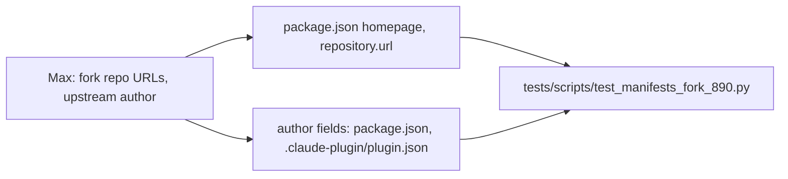
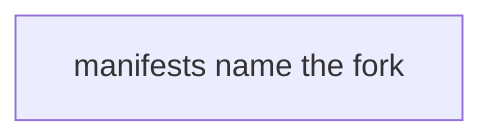

# B288: package.json names the fork's repository, authors stay upstream (#890)

**Goal:** package.json's `homepage` and `repository.url` name this fork, maxboettinger/superlite, as LICENSE and SECURITY.md (#842) do; every author field (package.json `author`, .claude-plugin/plugin.json `author`) keeps upstream's CWogu.
**Architecture:** two JSON values in package.json change; .claude-plugin/plugin.json is read, not edited; one new pytest file pins the manifest fields so a later edit cannot drift back to upstream's URLs or drop upstream's author.
**Tech stack:** JSON manifests; Python 3 stdlib (json, pathlib); pytest via `sl run_tests`.
**Spec:** issue #890 (B221's follow-up of #842); Max's decision: "Fork repo URLs, upstream author".
**Detail:** tests
**Wave0:** none
**Coverage:** off

## Global constraints

- package.json `homepage` is exactly `https://github.com/maxboettinger/superlite`; `repository` is exactly `{"type": "git", "url": "git+https://github.com/maxboettinger/superlite.git"}`.
- package.json `author` stays the string `CWogu`; .claude-plugin/plugin.json `author` stays `{"name": "CWogu"}`; .claude-plugin/plugin.json and .claude-plugin/marketplace.json are not edited.
- Every other package.json key, its order, its 2-space indent and its trailing newline stay as they are (scripts/bump-version.sh edits the `version` line in place).
- Files this batch may touch: package.json, .claude-plugin/plugin.json, the new tests/scripts/test_manifests_fork_890.py and this plan. An existing test that breaks: name it in the report, do not edit it without the lead's word.
- Builds: the verdict is `sl run_tests` (the project's test command; a project with `.maxapp` runs `maxapp test`, which a build pool may place on another Mac, and a full run whose tree a green maxapp test stamp covers returns that result without a run); task trees build in <tree>/.build/DerivedData and any build of your own goes under .build/ of the worktree, never -derivedDataPath outside the worktree (your session scratchpad included; backlog cleanup removes scratchpad build folders when the worktree goes); a product, simulator or device build stays on this machine and runs only when an issue's acceptance asks for a running-app check; copy this sentence into every worker brief.
- Simulators: append the UDID of each simulator you or a worker creates (`xcrun simctl create` or `clone`; a checker's `Simulators:` line marks its created ones) as one line to /Users/max/github/superlite/.claude/worktrees/superlite-b288-manifests-name-fork/.superlite/simulators.txt; never list one you did not create; ship cleanup shuts down and deletes each listed one; copy this sentence into every worker brief.

Ruling: .claude-plugin/plugin.json gains no `homepage` or `repository` key: #890 asks whether the manifests' existing fields name the fork, and plugin.json carries only an author, which Max's decision keeps upstream (lead's ruling).
Ruling: the other harness manifests (.codex-plugin, .cursor-plugin, .devin-plugin, .kimi-plugin, .hermes-plugin), .opencode/INSTALL.md and README.md's install lines still name iha2/superlite and stay untouched: #890 names only package.json and plugin.json; they go into one follow-up (lead's ruling).
Ruling: sized trivial (two values), the lead brief's plan and fleet path still runs, as one mechanical haiku task (lead's ruling).

## Main diagram



## File structure

- package.json: `homepage` and `repository.url` name maxboettinger/superlite.
- tests/scripts/test_manifests_fork_890.py: pins the fork URLs, the upstream authors and that neither Claude Code manifest names iha2/superlite.

## Task graph

```mermaid
%% schedule
gantt
  title Predicted schedule (mm:ss)
  dateFormat X
  axisFormat %M:%S
  section lane 1
  T1 manifests name the fork :t1, 0, 188s
```





critical path: T1 (3.1 min) · peak width 1 · predicted build 3.1 min · predicted total ≈ 9.6 min

## Manifests

**Probe entry:** none (static JSON; the named tests read the files)

### T1 manifests name the fork · Complexity 1 (O-1) · Est. context 22k
**Owns:** package.json, tests/scripts/test_manifests_fork_890.py
**Components:** 1
**LOC owned:** 25
**Tests:** fast
**Kind:** mechanical
**Model:** haiku
**Produces:** package.json `homepage` == "https://github.com/maxboettinger/superlite"
**Review Focus:** `test_package_json_urls_name_the_fork`; `test_authors_stay_upstream`; `test_claude_manifests_name_no_upstream_repo`; scripts/bump-version.sh --audit stays clean.
**Test code (verbatim):**
```python
# tests/scripts/test_manifests_fork_890.py (#890)
import json
from pathlib import Path

ROOT = Path(__file__).resolve().parents[2]
FORK = "https://github.com/maxboettinger/superlite"


def _load(rel):
    return json.loads((ROOT / rel).read_text(encoding="utf-8"))


def test_package_json_urls_name_the_fork():
    pkg = _load("package.json")
    assert pkg["homepage"] == FORK
    assert pkg["repository"] == {"type": "git", "url": f"git+{FORK}.git"}


def test_authors_stay_upstream():
    assert _load("package.json")["author"] == "CWogu"
    assert _load(".claude-plugin/plugin.json")["author"] == {"name": "CWogu"}


def test_claude_manifests_name_no_upstream_repo():
    for rel in ("package.json", ".claude-plugin/plugin.json"):
        assert "iha2/superlite" not in (ROOT / rel).read_text(encoding="utf-8"), rel
```
**Steps:** 1 write the test file as given, 2 `sl run_tests --fast tests/scripts/test_manifests_fork_890.py --task T1`: FAIL (`test_package_json_urls_name_the_fork`, `test_claude_manifests_name_no_upstream_repo`), 3 in package.json replace `https://github.com/iha2/superlite` with `https://github.com/maxboettinger/superlite` on the `homepage` line and `git+https://github.com/iha2/superlite.git` with `git+https://github.com/maxboettinger/superlite.git` on the `url` line, nothing else, 4 rerun the file: PASS, then `scripts/bump-version.sh --audit`: no new finding.
**Notes:** do not edit .claude-plugin/plugin.json or .claude-plugin/marketplace.json; do not reformat package.json.

## Review Focus

- Package manifests (static config): file (exact URL strings, JSON stays valid, key order and format unchanged), compatibility (`version` untouched so bump-version.sh keeps working; npm and Pi read `pi`, `main` and `keywords` unchanged).
- Risks: a URL typo (`.git` suffix, `git+` prefix); an author changed against Max's decision; package.json reformatted.

## Self-review

Coverage: #890's one decision (fork URLs, upstream author) is T1. No placeholders. One task, no edges. Produces matches the test's `FORK` value.
