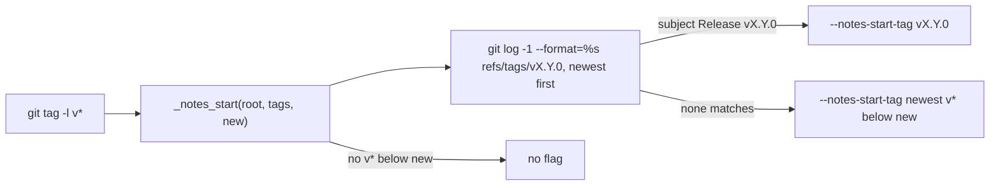
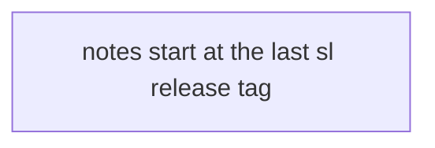

# B293: a minor release's generated notes start at the last `sl release` tag, else the latest v* tag (#1042)

**Goal:** `sl release minor|major` passes `gh release create --notes-start-tag` the newest tag below the new version that `sl release` itself made (its commit subject is `Release vX.Y.0`); with none, the newest `v*` tag below the new version; with no `v*` tag, no flag. 1.6.0 then starts at v1.5.309 (upstream's v1.1.0, 373 commits back, is not an sl release tag), 1.7.0 at v1.6.0.
**Architecture:** one function in release.py, `_notes_start`, gains the repository root and reads the subject of each candidate X.Y.0 tag's commit with one `git log` call, newest first; the caller passes `root`. The test fixture answers that `git log` call from a subjects map; one new test runs the real git commands on the tmp repository. docs/release.md step 6 and the lean-release plan's `test_notes_start_tag` contract name the new rule.
**Tech stack:** Python 3 stdlib (re, pathlib, subprocess through `release._run`); pytest via `sl run_tests`.
**Spec:** issue #1042 (B287's follow-up of #925); main's rulings: "Latest v* tag", then, after the lead's question that every ship tags its own merge so the latest v* tag lists no pull request, "Last sl release tag, else latest v*".
**Detail:** full
**Wave0:** none
**Coverage:** off

## Global constraints

- `_notes_start(root: Path, tags: list, new: str) -> str | None`: candidates are the tags that fully match `v(\d+\.\d+\.\d+)` with a version below `new` (by `_ver`); among candidates whose patch is 0, newest first, the first whose `git log -1 --format=%s refs/tags/v<X.Y.0>` output, stripped, equals `Release v<X.Y.0>` wins; else the newest candidate; else None.
- The `Release v<version>` subject is the commit message release.py writes (`git commit -am "Release {v}"`, line 172); do not change that line.
- The gh call, the dry-run line `release notes start at <tag>` and every other release step stay unchanged.
- Files this batch may touch: skills/subagent-driven-development/scripts/release.py, tests/scripts/test_release.py, docs/release.md, docs/plans/2026-11-15-lean-release-pipeline.md and this plan. An existing test that breaks: name it in the report, do not edit it without the lead's word.
- Builds: the verdict is `sl run_tests` (the project's test command; a project with `.maxapp` runs `maxapp test`, which a build pool may place on another Mac, and a full run whose tree a green maxapp test stamp covers returns that result without a run); task trees build in <tree>/.build/DerivedData and any build of your own goes under .build/ of the worktree, never -derivedDataPath outside the worktree (your session scratchpad included; backlog cleanup removes scratchpad build folders when the worktree goes); a product, simulator or device build stays on this machine and runs only when an issue's acceptance asks for a running-app check; copy this sentence into every worker brief.
- Simulators: append the UDID of each simulator you or a worker creates (`xcrun simctl create` or `clone`; a checker's `Simulators:` line marks its created ones) as one line to /Users/max/github/superlite/.claude/worktrees/superlite-b293-minor-release-notes-span/.superlite/simulators.txt; never list one you did not create; ship cleanup shuts down and deletes each listed one; copy this sentence into every worker brief.

Ruling: an sl release tag is recognised by its commit subject `Release vX.Y.0`, read with `git log -1 --format=%s refs/tags/<tag>` per X.Y.0 candidate, newest first (no `gh release list` call: it needs the network and a release entry may be edited by hand; release_tag's annotation `Version X.Y.Z` is the same for patch tags, so it cannot tell them apart) (lead's ruling).
Ruling: tags that are not plain `vX.Y.Z` (such as `v1.6.0-rc1`) and tags at or above the new version are never a start tag (lead's ruling).
Ruling: sized bounded (one function, its test, two doc lines): one mechanical haiku task with the code given in full (lead's ruling).

## Main diagram



## File structure

- skills/subagent-driven-development/scripts/release.py: `_notes_start` picks the start tag by the rule above; `main` passes `root`.
- tests/scripts/test_release.py: the `fx` fake answers `git log -1` from `s["subjects"]`; `test_notes_start_tag` covers the rule through `main`; `test_notes_start_real_git` runs it on real tags.
- docs/release.md: step 6 names the rule.
- docs/plans/2026-11-15-lean-release-pipeline.md: the `test_notes_start_tag` contract names the rule.

## Task graph

```mermaid
%% schedule
gantt
  title Predicted schedule (mm:ss)
  dateFormat X
  axisFormat %M:%S
  section lane 1
  T1 notes start at the last sl release ta :t1, 0, 189s
```





critical path: T1 (3.2 min) · peak width 1 · predicted build 3.2 min · predicted total ≈ 11.7 min

## Release notes

**Probe entry:** none (release.py publishes only in Max's session; the named tests fake gh and run git on a tmp repository)

### T1 notes start at the last sl release tag · Complexity 2 (O-tags) · Est. context 30k
**Owns:** skills/subagent-driven-development/scripts/release.py, tests/scripts/test_release.py, docs/release.md, docs/plans/2026-11-15-lean-release-pipeline.md
**Components:** 1
**LOC owned:** 60
**Tests:** fast
**Kind:** mechanical
**Model:** haiku
**Produces:** release._notes_start(root: Path, tags: list, new: str) -> str | None
**Review Focus:** `test_notes_start_tag`: v1.5.0 with subject `Release v1.5.0` plus v1.5.3 gives `--notes-start-tag v1.5.0`; v1.1.0 with subject `Bump version to 1.1.0` plus v1.5.248 and v1.5.309 gives v1.5.309 and the dry run prints `release notes start at v1.5.309`; v1.4.0 and v1.5.0 both sl release tags plus v1.5.7 give v1.5.0; v1.5.3, v1.6.0-rc1 and v2.0.0 give v1.5.3; no tags give no flag. `test_notes_start_real_git`: real annotated tags give v1.5.0, and v1.5.3 when the X.Y.0 tag's commit is not a release commit.
**Test code (verbatim):**

In the `fx` fixture of tests/scripts/test_release.py, add `"subjects": {}` to the dict `s`, and add these two lines in `fake_run` right after the `git tag -l` branch:
```python
        if cmd[:3] == ["git", "log", "-1"]:
            return 0, s["subjects"].get(cmd[-1], "")
```
Replace the whole `test_notes_start_tag` function with these two tests:
```python
def test_notes_start_tag(fx, capsys):
    """#1042: notes start at the newest tag `sl release` made (commit `Release vX.Y.0`), else at the newest v* tag."""
    fx["tags"] = "v1.5.0\nv1.5.3\n"
    fx["subjects"] = {"refs/tags/v1.5.0": "Release v1.5.0\n"}
    assert go(fx, "minor") == 0
    assert kinds(fx, "gh")[0][-2:] == ["--notes-start-tag", "v1.5.0"]
    fx["tags"] = "v1.1.0\nv1.5.248\nv1.5.309\n"
    fx["subjects"] = {"refs/tags/v1.1.0": "Bump version to 1.1.0\n"}
    fx["cmds"].clear()
    assert go(fx, "minor") == 0
    assert kinds(fx, "gh")[0][-2:] == ["--notes-start-tag", "v1.5.309"]
    capsys.readouterr()
    assert go(fx, "minor", "--dry-run") == 0
    assert "release notes start at v1.5.309" in capsys.readouterr().out
    fx["tags"] = "v1.4.0\nv1.5.0\nv1.5.7\n"
    fx["subjects"] = {"refs/tags/v1.4.0": "Release v1.4.0", "refs/tags/v1.5.0": "Release v1.5.0"}
    fx["cmds"].clear()
    assert go(fx, "minor") == 0
    assert kinds(fx, "gh")[0][-2:] == ["--notes-start-tag", "v1.5.0"]
    fx["tags"] = "v1.5.3\nv1.6.0-rc1\nv2.0.0\n"
    fx["subjects"] = {}
    fx["cmds"].clear()
    assert go(fx, "minor") == 0
    assert kinds(fx, "gh")[0][-2:] == ["--notes-start-tag", "v1.5.3"]
    fx["tags"] = ""
    fx["cmds"].clear()
    assert go(fx, "minor") == 0
    assert "--notes-start-tag" not in kinds(fx, "gh")[0]


def test_notes_start_real_git(repo):
    """#1042: the commit subject is read through the annotated tag, as release_tag makes it."""
    git(repo, "tag", "-a", "v1.1.0", "-m", "superlite 1.1.0")
    git(repo, "commit", "-q", "--allow-empty", "-m", "Release v1.5.0")
    git(repo, "tag", "-a", "v1.5.0", "-m", "Version 1.5.0")
    git(repo, "commit", "-q", "--allow-empty", "-m", "fix: a patch; 1.5.3 (B1) (#7)")
    git(repo, "tag", "-a", "v1.5.3", "-m", "Version 1.5.3")
    assert release._notes_start(repo, ["v1.1.0", "v1.5.0", "v1.5.3"], "1.6.0") == "v1.5.0"
    assert release._notes_start(repo, ["v1.1.0", "v1.5.3"], "1.6.0") == "v1.5.3"
    assert release._notes_start(repo, [], "1.6.0") is None
```
**Code (verbatim):** in release.py replace the whole `_notes_start` function with:
```python
def _notes_start(root: Path, tags: list, new: str) -> str | None:  # O(tags)
    """Tag the generated notes start at (#1042): the newest tag below `new` that `sl release` made
    (its commit subject is `Release vX.Y.0`), else the newest vX.Y.Z tag below `new`, else None."""
    below = []  # O(1)
    for t in tags:  # O(tags)
        m = re.fullmatch(r"v(\d+\.\d+\.\d+)", t)  # O(1)
        if m and _ver(m.group(1)) < _ver(new):  # O(1)
            below.append(m.group(1))  # O(1)
    below.sort(key=_ver, reverse=True)  # O(tags log tags)
    for x in below:  # O(tags) one git call per X.Y.0 candidate, newest first
        if _ver(x)[2] == 0:  # O(1)
            rc, subj = _run(["git", "log", "-1", "--format=%s", f"refs/tags/v{x}"], cwd=root)  # O(1)
            if rc == 0 and subj.strip() == f"Release v{x}":  # O(1)
                return f"v{x}"  # O(1)
    return f"v{below[0]}" if below else None  # O(1)
```
and in `main` change `notes = _notes_start(tags, new)  # O(tags)` to `notes = _notes_start(root, tags, new)  # O(tags)`.

**Docs (verbatim):** docs/release.md: replace the line ``6. `gh release create` with generated notes, starting at the last `X.Y.0` tag.`` with ``6. `gh release create` with generated notes, starting at the newest tag below the new version that `sl release` made (its commit is `Release vX.Y.0`); with none yet, at the newest `v*` tag below it.``
docs/plans/2026-11-15-lean-release-pipeline.md: in the `**Test code (contracts):**` line, replace ``with tags v1.5.0 and v1.5.3 present the release command adds `--notes-start-tag v1.5.0` (the last tag whose patch is 0), with none it adds nothing`` with ``with tags v1.5.0 (commit `Release v1.5.0`) and v1.5.3 present the release command adds `--notes-start-tag v1.5.0` (the newest tag `sl release` made); with no such tag it starts at the newest `v*` tag below the new version (v1.5.309 for 1.6.0); with no `v*` tag it adds nothing (#1042)``.
**Steps:** 1 apply the test edits as given, 2 `sl run_tests --fast tests/scripts/test_release.py --task T1`: FAIL (`test_notes_start_tag`, `test_notes_start_real_git`), 3 apply the code and both doc edits as given, 4 rerun the file: PASS.
**Notes:** change nothing else in release.py; keep the `# O(...)` comment on every code line, as the file does.

## Review Focus

- Release command (CLI, publishes in Max's session only): numeric (version compare by `_ver`, not by string: v1.5.248 vs v1.5.30; the patch-0 check by number), state (the start tag never at or above the new version), compatibility (the `gh release create` argv and the dry-run line keep their shape; `fx` tests that never set `subjects` keep passing), error handling (a failing `git log` is not a release tag, never a crash).
- Risks: an annotated tag's own message (`Version X.Y.Z`) read instead of its commit's subject; a tag name like `v1.6.0-rc1` crashing `_ver`.

## Self-review

Coverage: #1042 asks for the rule (T1 code), docs/release.md step 6, `test_notes_start_tag` and the lean-release plan line: all in T1. No placeholders. One task, no edges. Produces matches the signature both tests call.
