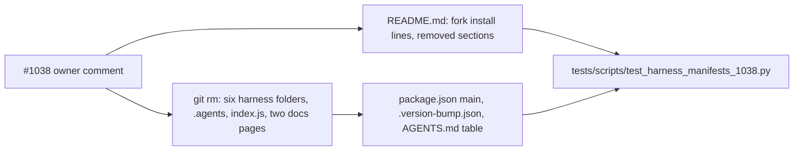
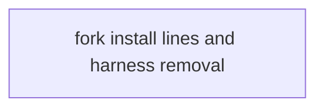

# B290: README installs Claude Code and Pi from the fork; the other harness manifests go (#1038)

**Goal:** README.md's Claude Code and Pi install lines name this fork, maxboettinger/superlite, instead of upstream iha2/superlite; the Codex, Cursor, Devin, Kimi, Hermes and OpenCode manifests and everything that only serves them leave the repository, since only Claude Code and Pi are used.
**Architecture:** file deletions plus edits to four root files (README.md, AGENTS.md, package.json, .version-bump.json); one new pytest file pins the result so no removed harness file or upstream install line comes back.
**Tech stack:** Markdown and JSON; Python 3 stdlib (json, re, pathlib); pytest via `sl run_tests`.
**Spec:** issue #1038 (B288's follow-up of #890) and its 2026-11-23 owner comment: "README install lines for Claude Code and Pi name the fork maxboettinger/superlite. Remove the other harness manifests (.codex, .cursor, .devin, .kimi, .hermes, .opencode): only Claude Code and Pi are used."
**Detail:** tests
**Wave0:** none
**Coverage:** off

## Global constraints

- The fork is exactly `maxboettinger/superlite`: Claude Code `/plugin marketplace add maxboettinger/superlite` (README.md, 2 places), Pi `pi install git:github.com/maxboettinger/superlite`. The marketplace name `superlite-dev` and every `/plugin install superlite@superlite-dev` line stay.
- Removed (git rm): .codex-plugin/plugin.json, .cursor-plugin/plugin.json, .devin-plugin/plugin.json, .kimi-plugin/plugin.json, .hermes-plugin/__init__.py, .hermes-plugin/plugin.yaml, .opencode/INSTALL.md, .opencode/plugins/superlite.js, .agents/plugins/marketplace.json (Codex repo marketplace), index.js (re-exports .opencode), docs/README.opencode.md, docs/README.kimi.md.
- Kept unchanged: skills/** (codex-tools.md, hermes-tools.md included), hooks/** (hooks-cursor.json included), scripts/**, .claude-plugin/**, .pi/**, .muse-plugin/**, gemini-extension.json, GEMINI.md, docs/plans/**, and README's Antigravity, Factory Droid, Gemini CLI, Copilot CLI, Grok, Qwen and Muse sections.
- package.json loses only its `"main"` line; every other key, its order, its 2-space indent and trailing newline stay (scripts/bump-version.sh edits the `version` line in place). .version-bump.json loses only its five entries for removed files; its other entries and the `audit` block stay byte for byte.
- Files this batch may touch: the files named above, README.md, AGENTS.md, package.json, .version-bump.json, the new tests/scripts/test_harness_manifests_1038.py and this plan. An existing test that breaks: name it in the report, do not edit it without the lead's word.
- Builds: the verdict is `sl run_tests` (the project's test command; a project with `.maxapp` runs `maxapp test`, which a build pool may place on another Mac, and a full run whose tree a green maxapp test stamp covers returns that result without a run); task trees build in <tree>/.build/DerivedData and any build of your own goes under .build/ of the worktree, never -derivedDataPath outside the worktree (your session scratchpad included; backlog cleanup removes scratchpad build folders when the worktree goes); a product, simulator or device build stays on this machine and runs only when an issue's acceptance asks for a running-app check; copy this sentence into every worker brief.
- Simulators: append the UDID of each simulator you or a worker creates (`xcrun simctl create` or `clone`; a checker's `Simulators:` line marks its created ones) as one line to /Users/max/github/superlite/.claude/worktrees/superlite-b290-decide-whether-readme-install-lines/.superlite/simulators.txt; never list one you did not create; ship cleanup shuts down and deletes each listed one; copy this sentence into every worker brief.

Ruling: .agents/plugins/marketplace.json goes with Codex (README calls it the Codex repo marketplace), index.js and package.json `main` go with .opencode (index.js only re-exports .opencode/plugins/superlite.js; Pi reads package.json's `pi` block), docs/README.opencode.md and docs/README.kimi.md go as install docs of removed harnesses (lead's ruling).
Ruling: skills/using-superlite/references/codex-tools.md and hermes-tools.md and hooks/hooks-cursor.json stay: the decision names manifests, hooks-cursor.json is pinned by tests/scripts/test_hooks_contract.py, and skills or hooks edits cost the headless and evals layers; they become a follow-up, so README.md line 121 (tool-mapping files list) stays true and unchanged (lead's ruling).
Ruling: README sections of harnesses not named in the decision (Antigravity, Factory Droid, Gemini CLI, Copilot CLI, Grok, Qwen, Muse) keep upstream's iha2 lines and their manifests (gemini-extension.json, GEMINI.md, .muse-plugin) stay; whether they go too is a follow-up (lead's ruling).
Ruling: package.json `"type": "module"` stays: .pi/extensions/superlite.ts is still loaded as a module (lead's ruling).

## Main diagram



## File structure

- README.md: Claude Code and Pi install lines name the fork; the Codex App, Codex CLI, Cursor, Devin CLI, Kimi Code, OpenCode and Hermes Agent sections are gone; the Install paragraph names Pi and Gemini CLI.
- AGENTS.md: the Harness files table keeps Claude Code (with Droid, Copilot, Qwen), Gemini CLI, Muse and Pi.
- package.json: no `main`. .version-bump.json: lists only files that exist.
- tests/scripts/test_harness_manifests_1038.py: pins all of the above.

## Task graph

```mermaid
%% schedule
gantt
  title Predicted schedule (mm:ss)
  dateFormat X
  axisFormat %M:%S
  section lane 1
  T1 fork install lines and harness remova :t1, 0, 307s
```





critical path: T1 (5.1 min) · peak width 1 · predicted build 5.1 min · predicted total ≈ 15.6 min

## Manifests and docs

**Probe entry:** none (static files; the named tests read them)

### T1 fork install lines and harness removal · Complexity 2 (O-1) · Est. context 30k
**Owns:** README.md, AGENTS.md, package.json, .version-bump.json, tests/scripts/test_harness_manifests_1038.py, .codex-plugin/plugin.json, .cursor-plugin/plugin.json, .devin-plugin/plugin.json, .kimi-plugin/plugin.json, .hermes-plugin/__init__.py, .hermes-plugin/plugin.yaml, .opencode/INSTALL.md, .opencode/plugins/superlite.js, .agents/plugins/marketplace.json, index.js, docs/README.opencode.md, docs/README.kimi.md
**Components:** 2
**LOC owned:** 70
**Tests:** fast
**Kind:** mechanical
**Model:** haiku
**Produces:** README.md line `/plugin marketplace add maxboettinger/superlite` (2 places) and `pi install git:github.com/maxboettinger/superlite`
**Review Focus:** `test_removed_harness_files_are_gone`; `test_version_bump_lists_only_existing_files`; `test_package_json_has_no_main_and_keeps_pi`; `test_claude_code_and_pi_install_from_the_fork`; `test_readme_drops_removed_harness_sections`; `test_agents_md_names_no_removed_harness_file`; `scripts/bump-version.sh --check` and `--audit` report no MISSING file.
**Test code (verbatim):**
```python
# tests/scripts/test_harness_manifests_1038.py (#1038)
import json
import re
from pathlib import Path

ROOT = Path(__file__).resolve().parents[2]
REMOVED = (
    ".codex-plugin", ".cursor-plugin", ".devin-plugin", ".kimi-plugin", ".hermes-plugin",
    ".opencode", ".agents/plugins/marketplace.json", "index.js",
    "docs/README.opencode.md", "docs/README.kimi.md",
)
GONE_SECTIONS = ("Codex App", "Codex CLI", "Cursor", "Devin CLI", "Kimi Code", "OpenCode", "Hermes Agent")


def _read(rel):
    return (ROOT / rel).read_text(encoding="utf-8")


def test_removed_harness_files_are_gone():
    assert [rel for rel in REMOVED if (ROOT / rel).exists()] == []


def test_version_bump_lists_only_existing_files():
    files = json.loads(_read(".version-bump.json"))["files"]
    assert [f["path"] for f in files if not (ROOT / f["path"]).is_file()] == []
    assert [f["path"] for f in files] == [
        "package.json", ".claude-plugin/plugin.json", ".muse-plugin/plugin.json",
        ".claude-plugin/marketplace.json", ".muse-plugin/marketplace.json", "gemini-extension.json",
    ]


def test_package_json_has_no_main_and_keeps_pi():
    pkg = json.loads(_read("package.json"))
    assert "main" not in pkg
    assert pkg["type"] == "module"
    assert pkg["pi"] == {"extensions": ["./.pi/extensions/superlite.ts"], "skills": ["./skills"]}


def test_claude_code_and_pi_install_from_the_fork():
    readme = _read("README.md")
    assert readme.count("/plugin marketplace add maxboettinger/superlite") == 2
    assert readme.count("pi install git:github.com/maxboettinger/superlite") == 1
    assert "/plugin marketplace add iha2/superlite" not in readme
    assert "pi install git:github.com/iha2/superlite" not in readme
    assert readme.count("/plugin install superlite@superlite-dev") >= 3


def test_readme_drops_removed_harness_sections():
    readme = _read("README.md")
    headings = re.findall(r"^### (.+)$", readme, re.M)
    assert [h for h in headings if h in GONE_SECTIONS] == []
    for kept in ("Claude Code", "Antigravity", "Factory Droid", "Gemini CLI", "Pi", "Muse"):
        assert kept in headings, kept
    for ref in (".agents/plugins", ".cursor-plugin", ".opencode", "README.kimi.md", "README.opencode.md"):
        assert ref not in readme, ref
    assert "Installs for Pi, Gemini CLI and the other harnesses are in [Installation](#installation) below." in readme


def test_agents_md_names_no_removed_harness_file():
    text = _read("AGENTS.md")
    for ref in REMOVED + ("hooks-cursor.json",):
        assert ref not in text, ref
    assert "| Pi | `.pi/extensions/superlite.ts`, `package.json` |" in text
```
**Steps:** 1 write the test file as given, 2 `sl run_tests --fast tests/scripts/test_harness_manifests_1038.py --task T1`: FAIL (all 6 tests), 3 `git rm` the 12 removed files (Global constraints), 4 package.json: delete the one line `  "main": ".opencode/plugins/superlite.js",`, 5 .version-bump.json: delete the five lines for `.hermes-plugin/plugin.yaml`, `.cursor-plugin/plugin.json`, `.codex-plugin/plugin.json`, `.devin-plugin/plugin.json`, `.kimi-plugin/plugin.json`, 6 README.md: in both `/plugin marketplace add iha2/superlite` lines (Install block and `### Claude Code`) and in `pi install git:github.com/iha2/superlite` replace `iha2` with `maxboettinger`; replace `Installs for Codex, Cursor, Gemini CLI, OpenCode and the other harnesses are in` with `Installs for Pi, Gemini CLI and the other harnesses are in`; delete each whole section from its heading through the blank line before the next `###` heading: `### Codex App`, `### Codex CLI`, `### Cursor`, `### Devin CLI` (the next kept heading is `### Factory Droid`), `### Kimi Code`, `### OpenCode` (next kept: `### Pi`), `### Hermes Agent` (next kept: `### Muse`), 7 AGENTS.md: delete the six Harness files table rows that start `| Codex |`, `| Cursor |`, `| Devin |`, `| Kimi Code |`, `| Hermes Agent |`, `| OpenCode |`, 8 rerun the test file: PASS, then `scripts/bump-version.sh --check` and `scripts/bump-version.sh --audit`: no MISSING line.
**Notes:** leave README.md line `Each harness has a tool-mapping file in ...` (Installation intro) unchanged; do not touch skills/, hooks/, scripts/, .claude-plugin/; do not reformat package.json or .version-bump.json.

## Review Focus

- Root docs and manifests (static config): file (fork strings exact, kept sections intact, JSON valid with order and format unchanged), compatibility (bump-version.sh `--check`/`--audit` clean with the shorter list; Pi still reads `pi`; Claude Code reads .claude-plugin unchanged).
- Risks: a kept README section cut with a removed one; a removed file left on disk or still named; package.json reformatted.

## Self-review

Coverage: #1038's two decisions (fork install lines, removed manifests) are T1; the files that only served removed harnesses go with them by ruling. No placeholders. One task, no edges.
