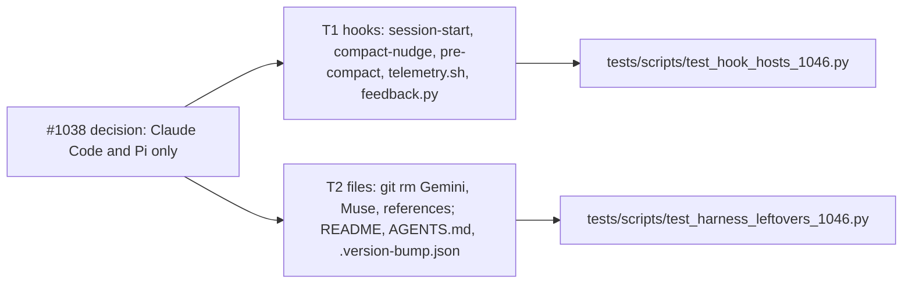
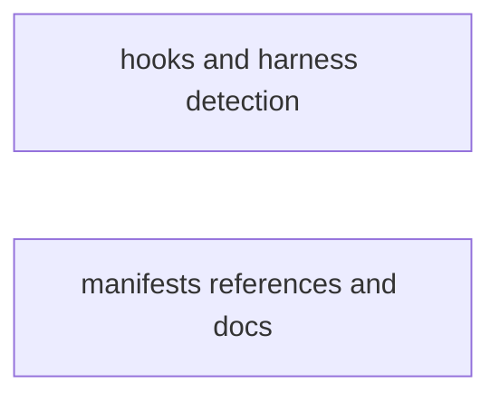

# B297: only Claude Code and Pi remain; the other harnesses' leftovers go (#1046)

**Goal:** remove every remaining trace of the harnesses other than Claude Code and Pi: README install sections (Antigravity, Factory Droid, Gemini CLI, Copilot CLI, Grok, Qwen Code, Muse), the Gemini and Muse manifests, hooks/hooks-cursor.json, the Antigravity, Codex, Gemini, Hermes and Muse tool-mapping references, the Cursor, Copilot and Muse branches in hooks/session-start and hooks/compact-nudge, and Codex and Gemini detection in hooks/telemetry.sh and feedback.py.
**Architecture:** two parallel tasks with disjoint files: T1 hooks and harness detection (bash hooks, one Python module, their tests); T2 manifests, references and docs (git rm plus edits to root docs and two doc tests). Each adds one pytest file that pins its half.
**Tech stack:** bash hooks, Python 3.10 stdlib, Markdown, JSON; pytest via `sl run_tests`.
**Spec:** issue #1046 (B290's follow-ups) under Max's #1038 owner decision: "only Claude Code and Pi are used; remove the other harnesses."
**Detail:** tests
**Wave0:** none
**Coverage:** off

## Global constraints

- Claude Code keeps `.claude-plugin/` and `hooks/hooks.json`; Pi keeps `.pi/extensions/superlite.ts`, `package.json` and `skills/using-superlite/references/pi-tools.md`; `skills/using-superlite/references/claude-code-tools.md` stays. Never touch `skills/*/SKILL.md`, `agents/**`, `commands/**`, `bench/**`, `docs/plans/**` (other than this plan), `scripts/test_layers.py` or `tests/scripts/test_test_layers.py`.
- Hook output after the change: `CLAUDE_PLUGIN_ROOT` set (non-empty) gives the nested `{"hookSpecificOutput":{"hookEventName":"<event>","additionalContext":"..."}}`; unset gives the top-level `{"additionalContext":"..."}` fallback. No hook reads `CURSOR_PLUGIN_ROOT`, `COPILOT_CLI` or `MUSE_PLUGIN_ROOT` any more. Keep `printf` (no heredoc) and LF endings.
- Harness detection: `SUPERLITE_HARNESS` (any value) wins, else `CLAUDECODE` gives `claude-code`, else none (telemetry.sh: empty; feedback.py: `unknown`).
- Files: only the task's Owns. An existing test outside Owns that breaks: name it in the report, do not edit it.
- Builds: the verdict is `sl run_tests` (the project's test command; a project with `.maxapp` runs `maxapp test`, which a build pool may place on another Mac, and a full run whose tree a green maxapp test stamp covers returns that result without a run); task trees build in <tree>/.build/DerivedData and any build of your own goes under .build/ of the worktree, never -derivedDataPath outside the worktree (your session scratchpad included; backlog cleanup removes scratchpad build folders when the worktree goes); a product, simulator or device build stays on this machine and runs only when an issue's acceptance asks for a running-app check; copy this sentence into every worker brief.
- Simulators: append the UDID of each simulator you or a worker creates (`xcrun simctl create` or `clone`; a checker's `Simulators:` line marks its created ones) as one line to /Users/max/github/superlite/.claude/worktrees/superlite-b297-remove-other-harness-leftovers/.superlite/simulators.txt; never list one you did not create; ship cleanup shuts down and deletes each listed one; copy this sentence into every worker brief.

Ruling: [scope] #1046 also removes what serves only the harnesses its item 1 names: skills/using-superlite/references/antigravity-tools.md and muse-tools.md, .muse-plugin/marketplace.json, the Antigravity, Factory Droid, Copilot CLI, Grok and Qwen Code README sections, and hooks/pre-compact's paragraph on Factory Droid, Copilot CLI and Qwen Code (lead's ruling).
Ruling: session-start and compact-nudge keep two output forms: nested hookSpecificOutput when CLAUDE_PLUGIN_ROOT is set, else the top-level additionalContext fallback (a hand run, a test without the variable); Claude Code reads both, so the fallback costs nothing (lead's ruling).
Ruling: skills/subagent-driven-development/scripts/machine_load.py AGENTS (process names counted for machine load) and tests/scripts/test_hooks_bash32.py's CURSOR_PROJECT_DIR syntax sample stay: they measure or parse, they serve no harness; test_feedback.py's SUPERLITE_HARNESS=codex case stays (the override takes any value) (lead's ruling).
Ruling: scripts/bump-version.sh keeps its generic `.yaml` field reader and writer; only its comment stops naming Hermes (no versioned yaml remains; the ship step runs this script) (lead's ruling).
Ruling: docs/testing.md drops gemini-extension.json from its manifest list; scripts/test_layers.py MANIFESTS (B298's file) keeps the dead glob until a follow-up (lead's ruling).

## Main diagram



## File structure

- hooks/session-start, hooks/compact-nudge: Claude Code nested output or top-level fallback only. hooks/pre-compact: header comment names Claude Code only. hooks/telemetry.sh, feedback.py: detect Claude Code only. hooks/hooks-cursor.json: removed; tests/scripts/test_hooks_contract.py reads hooks.json only; docs/hooks.md drops its mention.
- README.md: Installation holds Claude Code, Pi and Keeping versions in sync. AGENTS.md: Harness files table rows Claude Code and Pi. .version-bump.json: three files.

## Task graph

```mermaid
%% schedule
gantt
  title Predicted schedule (mm:ss)
  dateFormat X
  axisFormat %M:%S
  section lane 1
  T1 hooks and harness detection :t1, 0, 227s
  section lane 2
  T2 manifests references and docs :t2, 0, 219s
```





critical path: T1 (3.8 min) · peak width 2 · predicted build 3.8 min · predicted total ≈ 12.3 min

## Hooks

**Probe entry:** none (hooks run under the host; the named tests run them)

### T1 hooks and harness detection · Complexity 3 (O-1) · Est. context 40k
**Owns:** hooks/session-start, hooks/compact-nudge, hooks/pre-compact, hooks/telemetry.sh, hooks/hooks-cursor.json, docs/hooks.md, skills/subagent-driven-development/scripts/feedback.py, tests/scripts/test_hooks_contract.py, tests/scripts/test_compact_due.py, tests/scripts/test_session_start_noforks_941.py, tests/scripts/test_telemetry_set_eu_1036.py, tests/scripts/test_hook_hosts_1046.py
**Components:** 2
**LOC owned:** 130
**Tests:** fast
**Kind:** design
**Model:** sonnet
**Produces:** feedback.HARNESS_ENV == [("CLAUDECODE", "claude-code")]
**Review Focus:** protocol: `test_session_start_under_claude_code_ignores_removed_host_vars[CURSOR_PLUGIN_ROOT]` (nested JSON, not `additional_context`); `test_compact_nudge_without_claude_plugin_root_keeps_top_level_fallback`; file: `test_hooks_name_no_removed_host`; test_hooks_contract.py still runs every hooks.json entry through its fail-open cases.
**Steps:**
1. Write tests/scripts/test_hook_hosts_1046.py (below); run it: FAIL.
2. hooks/session-start: header line 4 names Claude Code only; the output block becomes `if [ -n "${CLAUDE_PLUGIN_ROOT:-}" ]; then` nested `emit_json` `else` top-level `emit_json` `fi`, its comment two lines (Claude Code: nested; it reads both forms, never emit both; no CLAUDE_PLUGIN_ROOT: top-level). hooks/compact-nudge: the same two branches with its `printf` lines.
3. hooks/pre-compact: drop the comment paragraph "The other harnesses that read hooks/hooks.json ... stays in the shared hooks file." hooks/telemetry.sh: drop the CODEX and GEMINI_CLI `elif` lines. feedback.py: `HARNESS_ENV = [("CLAUDECODE", "claude-code")]`; the entry's `session` drops the `CODEX_THREAD_ID` fallback.
4. `git rm hooks/hooks-cursor.json`; test_hooks_contract.py: drop CURSOR_EVENTS, the cursor COMMAND and PLUGIN_ROOT_VAR entries, the Cursor branch of `registered`, the CURSOR list and the hooks-cursor.json lines in its tests and docstring (keep every Claude case; if PLUGIN_ROOT_VAR has one key left, keep the dict). docs/hooks.md line 36: drop "Not in `hooks-cursor.json`." test_compact_due.py, test_session_start_noforks_941.py, test_telemetry_set_eu_1036.py: drop `CURSOR_PLUGIN_ROOT`, `CURSOR_AGENT`, `CURSOR_TRACE_ID`, `COPILOT_CLI`, `MUSE_PLUGIN_ROOT` from their env drop lists.
5. Run: `<abs sl> run_tests --fast tests/scripts/test_hook_hosts_1046.py tests/scripts/test_hooks_contract.py tests/scripts/test_compact_due.py tests/scripts/test_session_start_noforks_941.py tests/scripts/test_telemetry_set_eu_1036.py tests/scripts/test_feedback.py tests/scripts/test_session_start.py tests/scripts/test_lead_hooks.py --task T1 --background`, then its `wait:` line: PASS.
**Test code (verbatim):**
```python
"""#1046: hooks speak Claude Code (nested) or the top-level fallback; no Cursor, Copilot, Muse, Codex or Gemini branch."""
import json
import os
import shutil
import subprocess
import sys
from pathlib import Path

import pytest

ROOT = Path(__file__).resolve().parents[2]
HOOKS = ROOT / "hooks"
SCRIPTS = ROOT / "skills" / "subagent-driven-development" / "scripts"
BASH = shutil.which("bash")
needs_bash = pytest.mark.skipif(not BASH, reason="bash not available")
GONE_VARS = ("CURSOR_PLUGIN_ROOT", "COPILOT_CLI", "MUSE_PLUGIN_ROOT")
HOST_ENV = GONE_VARS + ("CLAUDE_PLUGIN_ROOT", "CLAUDE_ENV_FILE", "CLAUDE_PID", "CURSOR_AGENT", "CURSOR_TRACE_ID")
MODE_FILE = "orchestrator" + ".json"

sys.path.insert(0, str(SCRIPTS))
import feedback  # noqa: E402


def _env(tmp_path, **extra):
    env = {k: v for k, v in os.environ.items() if not k.startswith("SUPERLITE_") and k not in HOST_ENV}
    env.update({"CLAUDE_PROJECT_DIR": str(tmp_path), "SUPERLITE_HOME": str(tmp_path / "home"), "HOME": str(tmp_path)})
    env.update(extra)
    return env


def _hook(tmp_path, name, inp, **extra):
    r = subprocess.run([BASH, str(HOOKS / name)], input=json.dumps(inp), capture_output=True, text=True,
                       encoding="utf-8", env=_env(tmp_path, **extra), cwd=str(tmp_path))
    assert r.returncode == 0, r.stderr
    return json.loads(r.stdout)


def _session_start(tmp_path, **extra):
    inp = {"hook_event_name": "SessionStart", "source": "startup", "session_id": "s1046", "cwd": str(tmp_path)}
    return _hook(tmp_path, "session-start", inp, **extra)


def _nudge(tmp_path, **extra):
    sl = tmp_path / ".superlite"
    sl.mkdir(exist_ok=True)
    (sl / MODE_FILE).write_text("{}", encoding="utf-8")
    usage = {"input_tokens": 2, "cache_creation_input_tokens": 1000, "cache_read_input_tokens": 650000 - 1002,
             "output_tokens": 70000}
    t = tmp_path / "transcript.jsonl"
    t.write_text(json.dumps({"type": "assistant", "isSidechain": False,
                             "message": {"role": "assistant", "usage": usage}}) + "\n", encoding="utf-8")
    inp = {"hook_event_name": "UserPromptSubmit", "prompt": "go on", "session_id": "s1046", "transcript_path": str(t)}
    return _hook(tmp_path, "compact-nudge", inp, **extra)


@needs_bash
@pytest.mark.parametrize("var", GONE_VARS)
def test_session_start_under_claude_code_ignores_removed_host_vars(tmp_path, var):
    out = _session_start(tmp_path, CLAUDE_PLUGIN_ROOT=str(ROOT), **{var: "1"})
    assert list(out) == ["hookSpecificOutput"]
    assert out["hookSpecificOutput"]["hookEventName"] == "SessionStart"
    assert "superlite:using-superlite" in out["hookSpecificOutput"]["additionalContext"]


@needs_bash
def test_session_start_without_claude_plugin_root_keeps_top_level_fallback(tmp_path):
    out = _session_start(tmp_path, CURSOR_PLUGIN_ROOT=str(ROOT))
    assert list(out) == ["additionalContext"]
    assert "superlite:using-superlite" in out["additionalContext"]


@needs_bash
@pytest.mark.parametrize("var", GONE_VARS)
def test_compact_nudge_under_claude_code_ignores_removed_host_vars(tmp_path, var):
    out = _nudge(tmp_path, CLAUDE_PLUGIN_ROOT=str(ROOT), **{var: "1"})
    assert list(out) == ["hookSpecificOutput"]
    assert out["hookSpecificOutput"]["hookEventName"] == "UserPromptSubmit"
    assert "650k" in out["hookSpecificOutput"]["additionalContext"]


@needs_bash
def test_compact_nudge_without_claude_plugin_root_keeps_top_level_fallback(tmp_path):
    out = _nudge(tmp_path, CURSOR_PLUGIN_ROOT=str(ROOT))
    assert list(out) == ["additionalContext"]
    assert "650k" in out["additionalContext"]


def test_hooks_name_no_removed_host():
    assert not (HOOKS / "hooks-cursor.json").exists()
    for name in ("session-start", "compact-nudge", "pre-compact", "telemetry.sh"):
        text = (HOOKS / name).read_text(encoding="utf-8")
        for word in GONE_VARS + ("CODEX_", "GEMINI_CLI", "Cursor", "Copilot", "Muse", "Factory Droid", "Qwen"):
            assert word not in text, (name, word)
    assert "hooks-cursor.json" not in (ROOT / "docs" / "hooks.md").read_text(encoding="utf-8")


def test_feedback_detects_only_claude_code(monkeypatch):
    assert feedback.HARNESS_ENV == [("CLAUDECODE", "claude-code")]
    for var in ("SUPERLITE_HARNESS", "CLAUDECODE", "CODEX_THREAD_ID", "CODEX_SANDBOX", "GEMINI_CLI"):
        monkeypatch.delenv(var, raising=False)
    monkeypatch.setenv("CODEX_THREAD_ID", "t1")
    monkeypatch.setenv("GEMINI_CLI", "1")
    assert feedback.harness() == "unknown"
    monkeypatch.setenv("CLAUDECODE", "1")
    assert feedback.harness() == "claude-code"


def test_feedback_session_ignores_codex_thread(monkeypatch, tmp_path):
    for var in ("SUPERLITE_SESSION_ID", "CLAUDE_CODE_SESSION_ID"):
        monkeypatch.delenv(var, raising=False)
    monkeypatch.setenv("CODEX_THREAD_ID", "t1")
    monkeypatch.chdir(tmp_path)
    assert feedback.new_entry("bug", "x y z", ver="1.0.0")["session"] == ""
```

## Manifests, references and docs

**Probe entry:** none (static files; the named tests read them)

### T2 manifests references and docs · Complexity 2 (O-1) · Est. context 32k
**Owns:** GEMINI.md, gemini-extension.json, .muse-plugin/plugin.json, .muse-plugin/marketplace.json, skills/using-superlite/references/antigravity-tools.md, skills/using-superlite/references/codex-tools.md, skills/using-superlite/references/gemini-tools.md, skills/using-superlite/references/hermes-tools.md, skills/using-superlite/references/muse-tools.md, .version-bump.json, AGENTS.md, README.md, docs/testing.md, scripts/bump-version.sh, tests/scripts/test_harness_manifests_1038.py, tests/scripts/test_docs_941_finishing.py, tests/scripts/test_harness_leftovers_1046.py
**Components:** 2
**LOC owned:** 80
**Tests:** fast
**Kind:** mechanical
**Model:** haiku
**Produces:** README.md line `Open a fresh session and send \`Let's make a react todo list\`. A working install starts \`brainstorming\` before any code is written. The Pi install is in [Installation](#installation) below.`
**Review Focus:** file: `test_removed_harness_files_are_gone`, `test_readme_installs_only_claude_code_and_pi`, `test_version_bump_lists_three_files`; `scripts/bump-version.sh --check` and `--audit` report no missing file.
**Steps:**
1. Write tests/scripts/test_harness_leftovers_1046.py (below); run it: FAIL.
2. `git rm` GEMINI.md, gemini-extension.json, .muse-plugin/plugin.json, .muse-plugin/marketplace.json and the five references (antigravity, codex, gemini, hermes, muse `-tools.md`).
3. .version-bump.json: delete the three entries for .muse-plugin/plugin.json, .muse-plugin/marketplace.json and gemini-extension.json; the last kept entry has no trailing comma; the `audit` block stays byte for byte. AGENTS.md Harness files table: row 1 becomes `| Claude Code | \`.claude-plugin/\`, \`hooks/hooks.json\` |`; delete the Gemini CLI and Muse rows; the Pi row stays.
4. README.md: (a) the Install paragraph's last sentence `Installs for Pi, Gemini CLI and the other harnesses are in [Installation](#installation) below.` becomes `The Pi install is in [Installation](#installation) below.`; (b) in `## More`, `Installation for other harnesses,` becomes `Installation for Pi,`; (c) `## Installation`'s first sentence `Installation differs by harness.` becomes `superlite runs on Claude Code and Pi.` and `If you use more than one,` becomes `If you use both,`; (d) `(Antigravity, Codex, Gemini, Hermes, Muse, Pi, plus Claude Code notes)` becomes `(Pi, plus Claude Code notes)`; (e) delete the whole sections `### Antigravity`, `### Factory Droid`, `### Gemini CLI`, `### GitHub Copilot CLI`, `### Grok Build CLI`, `### Qwen Code` and `### Muse` (each from its heading to the next `### `), keeping one blank line before each remaining heading.
5. docs/testing.md line 29: `and \`package.json\` and \`gemini-extension.json\` at the root` becomes `and \`package.json\` at the root`. scripts/bump-version.sh line 13: `# the Hermes plugin.yaml is a plain \`version:\` line handled with sed.` becomes `# a .yaml file's plain \`version:\` line is handled with sed.`
6. tests/scripts/test_harness_manifests_1038.py: `test_version_bump_lists_only_existing_files` expects `["package.json", ".claude-plugin/plugin.json", ".claude-plugin/marketplace.json"]`; `test_readme_drops_removed_harness_sections` keeps `("Claude Code", "Pi")` and asserts the new sentence of 4(a). tests/scripts/test_docs_941_finishing.py: delete its two Antigravity lines (`_has_once(r, "Antigravity has no session-start hook event")` and the `assert "Antigravity runs ..." not in r` line) and the now unused `r = _read("README.md")`.
7. Run `bash scripts/bump-version.sh --check` and `bash scripts/bump-version.sh --audit`: no MISSING line. Run: `<abs sl> run_tests --fast tests/scripts/test_harness_leftovers_1046.py tests/scripts/test_harness_manifests_1038.py tests/scripts/test_docs_941_finishing.py tests/scripts/test_manifests_fork_890.py tests/scripts/test_doc_contract.py --task T2 --background`, then its `wait:` line: PASS.
**Test code (verbatim):**
```python
"""#1046: only Claude Code and Pi remain: no Gemini, Muse, Antigravity, Codex or Hermes file, README section or AGENTS.md row."""
import json
import re
from pathlib import Path

ROOT = Path(__file__).resolve().parents[2]
REFS = ROOT / "skills" / "using-superlite" / "references"
REMOVED = ("GEMINI.md", "gemini-extension.json", ".muse-plugin",
           *(f"skills/using-superlite/references/{h}-tools.md" for h in ("antigravity", "codex", "gemini", "hermes", "muse")))
GONE_WORDS = ("Antigravity", "Factory Droid", "Gemini", "Copilot", "Grok", "Qwen", "Muse", "Codex", "Hermes",
              "iha2/superlite")


def _read(rel):
    return (ROOT / rel).read_text(encoding="utf-8")


def test_removed_harness_files_are_gone():
    assert [rel for rel in REMOVED if (ROOT / rel).exists()] == []


def test_only_claude_code_and_pi_tool_mappings_remain():
    assert sorted(p.name for p in REFS.glob("*-tools.md")) == ["claude-code-tools.md", "pi-tools.md"]


def test_version_bump_lists_three_files():
    data = json.loads(_read(".version-bump.json"))
    assert [f["path"] for f in data["files"]] == ["package.json", ".claude-plugin/plugin.json",
                                                   ".claude-plugin/marketplace.json"]
    assert "scripts/bump-version.sh" in data["audit"]["exclude"]


def test_readme_installs_only_claude_code_and_pi():
    readme = _read("README.md")
    install = readme.split("\n## Installation\n", 1)[1].split("\n## ", 1)[0]
    assert re.findall(r"^### (.+)$", install, re.M) == ["Claude Code", "Pi", "Keeping versions in sync"]
    assert [w for w in GONE_WORDS if w in readme] == []
    assert "The Pi install is in [Installation](#installation) below." in readme
    assert "superlite runs on Claude Code and Pi. If you use both," in readme
    assert "(Pi, plus Claude Code notes)" in readme


def test_agents_md_harness_table_is_claude_code_and_pi():
    text = _read("AGENTS.md")
    table = text.split("## Harness files", 1)[1].split("\n## ", 1)[0]
    rows = [ln.split("|")[1].strip() for ln in table.splitlines() if ln.startswith("| ") and "---" not in ln]
    assert rows == ["Harness", "Claude Code", "Pi"]
    assert [w for w in GONE_WORDS if w in text] == []


def test_docs_name_no_removed_manifest():
    assert "gemini-extension.json" not in _read("docs/testing.md")
    assert "Hermes" not in _read("scripts/bump-version.sh")
```

## Review Focus

- Hooks package (hook protocol, file): output JSON shape per host variable; fail-open contract cases still generated from hooks.json; no reader of a removed host variable.
- Files package (file): no dangling link to a removed file (README anchors, AGENTS.md, .version-bump.json, `bump-version.sh --audit`).
- Layers: unit (`run_tests --full`), headless (hooks/**, skills references) and tui (hooks/session-start) run once by the lead after the build; evals untouched (no SKILL.md, agents or commands change).

## Self-review

Every #1046 item maps to T1 (CURSOR branches, hooks-cursor.json, test_hooks_contract.py, docs/hooks.md, Codex detection) or T2 (README sections, gemini-extension.json, GEMINI.md, .muse-plugin, codex-tools.md, hermes-tools.md); the two tasks share no file; no edge.
