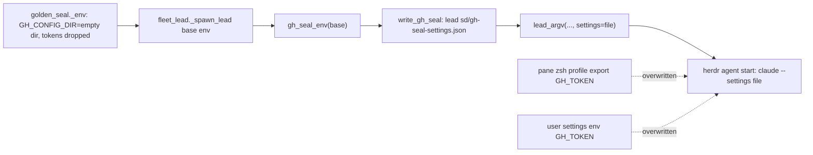

# B292: a sealed golden lead starts with its GitHub tokens cleared by `--settings` (#1041)

**Goal:** a lead whose spawner pins `GH_CONFIG_DIR` (a sealed golden run: golden_seal._env sets it to an empty folder and drops the tokens) gets `GH_TOKEN`, `GITHUB_TOKEN`, `GH_ENTERPRISE_TOKEN` and `GITHUB_ENTERPRISE_TOKEN` forced empty and `GH_CONFIG_DIR` forced to that folder, so neither its herdr pane's shell profile nor a Claude settings `env` can hand it a GitHub token.
**Architecture:** fleet_lead.py writes `<lead state dir>/gh-seal-settings.json` (`{"env": {...}}`) and adds `--settings <that file>` to the lead's claude argv; the herdr `--env` pass-through of `GH_CONFIG_DIR` (fleet.PASS_THROUGH) stays. An unsealed lead's argv and files are unchanged.
**Tech stack:** Python 3 stdlib (json, pathlib); pytest via `sl run_tests`.
**Spec:** issue #1041 (B287's follow-up of #925).
**Detail:** tests
**Wave0:** none
**Coverage:** off

## Settled precedence (lead's research, 2026-11-23)

- herdr 0.9.5 pane: a probe workspace with `--env SL_B292_PROBE=pane` printed `shell=zsh login=on interactive=on probe=pane` and no `SUPERLITE_FLEET_WORKER` (set in the caller): a pane gets the herdr server's environment plus `--env`, then zsh runs .zshenv, .zprofile, .zshrc and .zlogin, so a profile `export GH_TOKEN=...` beats any `--env` value; `herdr_client._env_flags` drops empty values and herdr has no unset flag, so `--env` cannot clear a token.
- Claude Code 2.1.330 docs (settings-reference `env`, "How `env` values interact with your shell"): "A value here overwrites the same variable exported in your shell"; "To cancel a shell export, set the variable to `""`"; subprocesses inherit the empty value; `--settings <file-or-json>` ranks above user, project and local settings (a key it sets wins, keys it leaves out keep their values) and below managed settings; `--settings` env applies at startup. The Bash tool's shell snapshot re-exports only `PATH` (binary strings: "Add PATH to the file").
- gh 2.103.3: with `GH_TOKEN=` and `GITHUB_TOKEN=` empty and an empty `GH_CONFIG_DIR`, `gh api rate_limit` and `gh issue list` exit 4 ("To get started with GitHub CLI, please run: gh auth login"): an empty token variable counts as unset.

## Global constraints

- `fleet_lead.GH_TOKENS == ("GH_TOKEN", "GITHUB_TOKEN", "GH_ENTERPRISE_TOKEN", "GITHUB_ENTERPRISE_TOKEN")`; `fleet_lead.GH_SEAL_FILE == "gh-seal-settings.json"`.
- The seal file holds only empty strings and the `GH_CONFIG_DIR` path: a token the spawner carries is never written to disk (it is left out of the file, so the pane's value stands).
- An unsealed lead (spawner env without a non-empty `GH_CONFIG_DIR`) starts with exactly today's argv and writes no seal file.
- Files this batch may touch: skills/subagent-driven-development/scripts/fleet_lead.py, skills/subagent-driven-development/scripts/herdr_client.py, tests/scripts/test_fleet_lead.py and this plan. An existing test that breaks: name it in the report, do not edit it without the lead's word.
- Every new code line carries the file's trailing `# O(...)` complexity comment, as the lines around it do.
- Builds: the verdict is `sl run_tests` (the project's test command; a project with `.maxapp` runs `maxapp test`, which a build pool may place on another Mac, and a full run whose tree a green maxapp test stamp covers returns that result without a run); task trees build in <tree>/.build/DerivedData and any build of your own goes under .build/ of the worktree, never -derivedDataPath outside the worktree (your session scratchpad included; backlog cleanup removes scratchpad build folders when the worktree goes); a product, simulator or device build stays on this machine and runs only when an issue's acceptance asks for a running-app check; copy this sentence into every worker brief.
- Simulators: append the UDID of each simulator you or a worker creates (`xcrun simctl create` or `clone`; a checker's `Simulators:` line marks its created ones) as one line to /Users/max/github/superlite/.claude/worktrees/superlite-b292-scrub-shell-profile-gh-tokens/.superlite/simulators.txt; never list one you did not create; ship cleanup shuts down and deletes each listed one; copy this sentence into every worker brief.

Ruling: the scrub is a Claude `--settings` env file, not a shell line sent before `herdr agent start` (because a settings env value overwrites both a profile export and a user-settings `env` value, while a shell `unset` misses the settings `env`; it also needs no extra herdr round trip) (lead's ruling).
Ruling: the seal keys on the spawner's non-empty `GH_CONFIG_DIR` and clears only the token variables the spawner lacks (unset or empty), so a user who pins `GH_CONFIG_DIR` and carries a token keeps it, and no token value is ever written (lead's ruling).
Ruling: [scope] lead only: workers of a sealed lead open fresh herdr panes through fleet.py spawn and keep the same profile hole; that is a follow-up for fleet.py, outside this batch's files and #1041's text (lead's ruling).
Ruling: herdr_client.py stays unedited: herdr cannot clear a variable, so the fix lives in the claude argv (lead's ruling).
Ruling: managed settings rank above `--settings`; a managed `env` token still wins and is out of a lead's reach (lead's ruling).

## Main diagram



## File structure

- skills/subagent-driven-development/scripts/fleet_lead.py: `GH_TOKENS`, `GH_SEAL_FILE`, `gh_seal_env`, `write_gh_seal`, `lead_argv(..., settings=None)`, `_spawn_lead` passes the seal file; module docstring names #1041.
- tests/scripts/test_fleet_lead.py: five new tests pin the seal env, the file, the argv position and both spawns.

## Task graph

```mermaid
%% schedule
gantt
  title Predicted schedule (mm:ss)
  dateFormat X
  axisFormat %M:%S
  section lane 1
  T1 sealed lead gh seal settings :t1, 0, 553s
```




critical path: T1 (9.2 min) · peak width 1 · predicted build 9.2 min · predicted total ≈ 25.7 min

## Lead launch

**Probe entry:** none (launch helpers with no runnable entry; the named tests drive spawn_lead through the in-process herdr fake)

### T1 sealed lead gh seal settings · Complexity 2 (O-1) · Est. context 30k
**Owns:** skills/subagent-driven-development/scripts/fleet_lead.py, tests/scripts/test_fleet_lead.py
**Components:** 1
**LOC owned:** 70
**Tests:** fast
**Kind:** design
**Model:** sonnet
**Produces:** fleet_lead.gh_seal_env(base_env: dict) -> dict · fleet_lead.write_gh_seal(lead_sd: Path, base_env: dict) -> Path | None · fleet_lead.lead_argv(sl_path, model, window=None, effort=None, deny=None, mcp_config=None, ship=True, settings=None) -> list
e.g. gh_seal_env({"HOME": "/u"}) -> {}
e.g. gh_seal_env({"GH_CONFIG_DIR": "/e", "GH_TOKEN": "t"}) -> {"GITHUB_TOKEN": "", "GH_ENTERPRISE_TOKEN": "", "GITHUB_ENTERPRISE_TOKEN": "", "GH_CONFIG_DIR": "/e"}
e.g. lead_argv("/p/sl", "opus", settings="/w/s.json")[:6] -> ["--model", "opus", "--permission-mode", "auto", "--settings", "/w/s.json"]
**Review Focus:** `test_gh_seal_env_clears_the_tokens_the_spawner_lacks`; `test_write_gh_seal_writes_the_settings_file_only_when_sealed`; `test_lead_argv_puts_settings_after_the_permission_mode`; `test_sealed_lead_starts_with_the_gh_seal_settings`; `test_unsealed_lead_starts_without_settings`; existing lead argv pins (test_fleet_lead_config_681.py, test_fleet_lead_b87.py, test_fleet_plan_lead_906.py) stay green unedited.
**Test code (verbatim):**
```python
# appended to tests/scripts/test_fleet_lead.py (#1041)
SEALED = {"GH_TOKEN": "", "GITHUB_TOKEN": "", "GH_ENTERPRISE_TOKEN": "", "GITHUB_ENTERPRISE_TOKEN": ""}


def test_gh_seal_env_clears_the_tokens_the_spawner_lacks():
    assert fl.GH_TOKENS == ("GH_TOKEN", "GITHUB_TOKEN", "GH_ENTERPRISE_TOKEN", "GITHUB_ENTERPRISE_TOKEN")
    assert fl.gh_seal_env({"HOME": "/u"}) == {} and fl.gh_seal_env({"GH_CONFIG_DIR": "", "GH_TOKEN": ""}) == {}
    assert fl.gh_seal_env({"HOME": "/u", "GH_CONFIG_DIR": "/e"}) == {**SEALED, "GH_CONFIG_DIR": "/e"}
    kept = fl.gh_seal_env({"GH_CONFIG_DIR": "/e", "GH_TOKEN": "t", "GITHUB_TOKEN": ""})
    assert kept == {"GITHUB_TOKEN": "", "GH_ENTERPRISE_TOKEN": "", "GITHUB_ENTERPRISE_TOKEN": "", "GH_CONFIG_DIR": "/e"}
    assert "t" not in kept.values()


def test_write_gh_seal_writes_the_settings_file_only_when_sealed(tmp_path):
    assert fl.write_gh_seal(tmp_path, {"HOME": "/u"}) is None and not (tmp_path / fl.GH_SEAL_FILE).exists()
    p = fl.write_gh_seal(tmp_path, {"GH_CONFIG_DIR": "/e"})
    assert p == tmp_path / fl.GH_SEAL_FILE == tmp_path / "gh-seal-settings.json"
    assert json.loads(p.read_text(encoding="utf-8")) == {"env": {**SEALED, "GH_CONFIG_DIR": "/e"}}


def test_lead_argv_puts_settings_after_the_permission_mode():
    base = fl.lead_argv("/p/sl", "opus")
    assert fl.lead_argv("/p/sl", "opus", settings=None) == base and "--settings" not in base
    assert fl.lead_argv("/p/sl", "opus", settings="/w/s.json") == base[:4] + ["--settings", "/w/s.json"] + base[4:]


def test_sealed_lead_starts_with_the_gh_seal_settings(world, tmp_path, monkeypatch):
    monkeypatch.setenv("SUPERLITE_HOME", str(tmp_path / "home"))
    wt, gh = tmp_path / "wt", tmp_path / "gh"
    wt.mkdir(); gh.mkdir()
    fleet.main(["on", "--accounts", "claude1,claude3"])
    r = fl.spawn_lead(world.sd, wt, "opus", env={"HOME": "/u", "GH_CONFIG_DIR": str(gh)}, rc=fl.run_config.resolve())
    argv = next(c[2] for c in world.fh.calls if c[0] == "start_agent" and c[1] == r["name"])
    f = (wt / ".superlite").resolve() / fl.GH_SEAL_FILE
    assert argv[argv.index("--settings") + 1] == str(f)
    assert json.loads(f.read_text(encoding="utf-8")) == {"env": {**SEALED, "GH_CONFIG_DIR": str(gh)}}
    env = next(c for c in world.fh.calls if c[0] == "create_workspace")[2]
    assert env["GH_CONFIG_DIR"] == str(gh) and not set(SEALED) & set(env)
    assert json.loads((world.sd / "fleet.json").read_text())["workers"][r["id"]]["launch"]["argv"] == argv


def test_unsealed_lead_starts_without_settings(world, tmp_path, monkeypatch):
    monkeypatch.setenv("SUPERLITE_HOME", str(tmp_path / "home"))
    wt = tmp_path / "wt"; wt.mkdir()
    fleet.main(["on", "--accounts", "claude1,claude3"])
    r = fl.spawn_lead(world.sd, wt, "opus", env={"HOME": "/u", "GH_TOKEN": "t"}, rc=fl.run_config.resolve())
    argv = next(c[2] for c in world.fh.calls if c[0] == "start_agent" and c[1] == r["name"])
    assert "--settings" not in argv and not (wt / ".superlite" / fl.GH_SEAL_FILE).exists()
```
**Steps:** 1 append the tests as given, 2 `sl run_tests --fast tests/scripts/test_fleet_lead.py --task T1`: FAIL (AttributeError on `GH_TOKENS`, `gh_seal_env`, `write_gh_seal`, `GH_SEAL_FILE`; TypeError on `settings=`), 3 implement in fleet_lead.py: `GH_TOKENS` and `GH_SEAL_FILE` module constants below the imports; `gh_seal_env(base_env)` returns `{}` unless `base_env.get("GH_CONFIG_DIR")` is non-empty, else `{k: "" for k in GH_TOKENS if not base_env.get(k)}` plus `"GH_CONFIG_DIR": base_env["GH_CONFIG_DIR"]` (last key); `write_gh_seal(lead_sd, base_env)` returns None when `gh_seal_env` is `{}`, else writes `json.dumps({"env": env}, indent=2) + "\n"` (utf-8) to `Path(lead_sd) / GH_SEAL_FILE` and returns that path; `lead_argv` gains a last keyword `settings=None` and, when truthy, inserts `["--settings", str(settings)]` right after `["--permission-mode", "auto"]`; in `_spawn_lead`, after `lead = rc["lead"]`, `seal = write_gh_seal(Path(lsd_s), base)` and pass `settings=seal` to `lead_argv`; add one docstring sentence after the `launch` sentence: "A lead whose spawner pins GH_CONFIG_DIR (a sealed golden run) starts with `--settings <lead state>/gh-seal-settings.json`, whose env clears each GitHub token variable the spawner lacks and pins GH_CONFIG_DIR, since a pane's shell profile or a Claude settings env would beat the herdr --env value (#1041).", 4 rerun the file: PASS, then `sl run_tests --fast tests/scripts/test_fleet_lead_config_681.py tests/scripts/test_fleet_lead_b87.py tests/scripts/test_fleet_plan_lead_906.py tests/scripts/test_fleet.py --task T1`: PASS.
**Notes:** keep `lead_env` and fleet.PASS_THROUGH unchanged (the pane keeps the `--env GH_CONFIG_DIR` value too). `fleet restore` replays the recorded `launch.argv`, so a restored sealed lead keeps `--settings`; nothing to add there.

## Review Focus

- Lead launch (library, in-process herdr fake): security (no token value written; empty string, not omission, for each cleared variable; only when `GH_CONFIG_DIR` is pinned), compatibility (unsealed argv byte-identical; `lead_argv` positional callers unchanged), file (seal file in the lead's resolved state folder, valid JSON).
- Risks: `--settings` placed inside the variadic `--allowedTools` or `--disallowedTools` value lists; the seal file written for an unsealed lead; a token value copied into the file.

## Self-review

Coverage: #1041's "settle precedence" is the section above, "scrub at launch, with a test" is T1. No placeholders. One task, no edges. Produces matches the tests' names and values.
