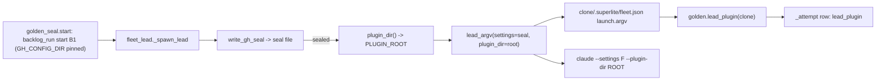
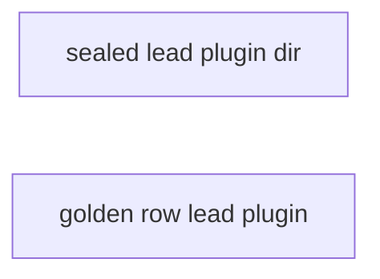

# B294: a sealed golden lead loads the plugin of the commit under test and the golden row names it (#1051)

**Goal:** a sealed lead (its spawner pins `GH_CONFIG_DIR`: a golden run, local or on `--machine M`) starts `claude --plugin-dir <checkout whose scripts spawned it>`, so it runs the commit under test instead of the plugin installed on the machine, and every started golden row names the plugin its lead loaded as `lead_plugin`.
**Architecture:** fleet_lead.py gains `PLUGIN_ROOT` (its own checkout) and `plugin_dir()`; `_spawn_lead` passes `plugin_dir=` to `lead_argv` only when `write_gh_seal` returned a seal file. golden.py gains `lead_plugin(clone)`, which reads the lead's recorded `launch.argv` from `<clone>/.superlite/fleet.json`, and `_attempt` puts it into the row. On `--machine M` the host's `_attempt` computes it and golden_remote keeps it (it overwrites only `plugin` and `machine`).
**Tech stack:** Python 3 stdlib (json, pathlib); pytest via `sl run_tests`.
**Spec:** issue #1051 (B291's follow-up of #1040).
**Detail:** tests
**Wave0:** none
**Coverage:** off

## Global constraints

- `fleet_lead.PLUGIN_ROOT == Path(fleet_lead.__file__).resolve().parents[3]` (the checkout holding `.claude-plugin/plugin.json`, as `fleet_remote_worker.SUPERLITE_ROOT`).
- Only a sealed lead (`write_gh_seal` returned a path) gets `--plugin-dir`; an unsealed lead's argv is byte-identical to today's. The pair `["--plugin-dir", str(dir)]` sits right after the `--settings <file>` pair.
- Golden row key `lead_plugin`: `golden._plugin(<--plugin-dir path>)` (`"<version>+<sha>"`, or the version alone when git fails), `"installed"` when the lead's argv has no `--plugin-dir`, and absent when no lead record could be read (no fleet.json, torn JSON, no `role: "lead"` record with a list `launch.argv`) and on unstarted rows. The existing `plugin` key keeps its meaning (`_plugin(src)`).
- Files this batch may touch: skills/subagent-driven-development/scripts/fleet_lead.py, skills/subagent-driven-development/scripts/golden.py, tests/scripts/test_fleet_lead.py, tests/scripts/test_golden.py, docs/tools.md and this plan. golden_seal.py, golden_remote.py and fleet.py stay unedited. An existing test that breaks: name it in the report, do not edit it without the lead's word.
- Every new code line carries the file's trailing `# O(...)` complexity comment, as the lines around it do.
- Builds: the verdict is `sl run_tests` (the project's test command; a project with `.maxapp` runs `maxapp test`, which a build pool may place on another Mac, and a full run whose tree a green maxapp test stamp covers returns that result without a run); task trees build in <tree>/.build/DerivedData and any build of your own goes under .build/ of the worktree, never -derivedDataPath outside the worktree (your session scratchpad included; backlog cleanup removes scratchpad build folders when the worktree goes); a product, simulator or device build stays on this machine and runs only when an issue's acceptance asks for a running-app check; copy this sentence into every worker brief.
- Simulators: append the UDID of each simulator you or a worker creates (`xcrun simctl create` or `clone`; a checker's `Simulators:` line marks its created ones) as one line to /Users/max/github/superlite/.claude/worktrees/superlite-b294-sealed-golden-lead-plugin-dir/.superlite/simulators.txt; never list one you did not create; ship cleanup shuts down and deletes each listed one; copy this sentence into every worker brief.

Ruling: "sealed" keeps B292's definition (the spawner pins `GH_CONFIG_DIR`, so `write_gh_seal` returns a file) because golden_seal.py belongs to open batch B295 and cannot gain a golden-only signal here (lead's ruling).
Ruling: `--plugin-dir` names `PLUGIN_ROOT` only when it holds `.claude-plugin/plugin.json`; otherwise the sealed lead loads the installed plugin as before (a scripts folder outside a plugin checkout is no plugin) (lead's ruling).
Ruling: precedence: `--plugin-dir` loads the plugin for the session (`claude --help`); remote workers already start `--plugin-dir <tree>` on hosts that have superlite installed (fleet_remote_worker.py:99, B291), so the repo already relies on it beside an installed copy; the live check rides on B291's Left undone paid run (lead's ruling).
Ruling: no `skills_read` rule for the lead: leads read the installed plugin's skills outside their worktree in auto mode today without one (lead's ruling).
Ruling: the row names the plugin from the lead's recorded launch argv (what it really started with), in a new key `lead_plugin`; `plugin` keeps the src commit so old rows stay comparable; an unreadable record omits the key, so existing exact-row tests and readers (history, release._golden read neither) hold (lead's ruling).
Ruling: [scope] lead only: a sealed lead's local workers (fleet.py `_spawn`) still start without `--plugin-dir` and load the installed plugin; fleet.py belongs to open batch B295, so that is a follow-up (lead's ruling).

## Main diagram



## File structure

- skills/subagent-driven-development/scripts/fleet_lead.py: `PLUGIN_ROOT`, `plugin_dir(root=None)`, `lead_argv(..., plugin_dir=None)`, `_spawn_lead` passes it for a sealed lead; docstring sentence (#1051).
- tests/scripts/test_fleet_lead.py: five new tests.
- skills/subagent-driven-development/scripts/golden.py: `lead_plugin(clone)`, `_attempt` row key; docstring sentence.
- tests/scripts/test_golden.py: six new tests.
- docs/tools.md: the `golden` row names the sealed lead's plugin.

## Task graph

```mermaid
%% schedule
gantt
  title Predicted schedule (mm:ss)
  dateFormat X
  axisFormat %M:%S
  section lane 1
  T2 golden row lead plugin :t2, 0, 285s
  section lane 2
  T1 sealed lead plugin dir :t1, 0, 283s
```





critical path: T2 (4.7 min) · peak width 2 · predicted build 4.7 min · predicted total ≈ 15.2 min

## Lead launch

**Probe entry:** none (launch helpers with no runnable entry; the named tests drive spawn_lead through the in-process herdr fake)

### T1 sealed lead plugin dir · Complexity 2 (O-1) · Est. context 30k
**Owns:** skills/subagent-driven-development/scripts/fleet_lead.py, tests/scripts/test_fleet_lead.py
**Components:** 1
**LOC owned:** 55
**Tests:** fast
**Kind:** design
**Model:** sonnet
**Produces:** fleet_lead.PLUGIN_ROOT: Path · fleet_lead.plugin_dir(root=None) -> Path | None · fleet_lead.lead_argv(sl_path, model, window=None, effort=None, deny=None, mcp_config=None, ship=True, settings=None, plugin_dir=None) -> list
e.g. plugin_dir() -> PLUGIN_ROOT (this checkout has .claude-plugin/plugin.json)
e.g. lead_argv("/p/sl", "opus", settings="/w/s.json", plugin_dir="/src")[:8] -> ["--model", "opus", "--permission-mode", "auto", "--settings", "/w/s.json", "--plugin-dir", "/src"]
**Review Focus:** `test_plugin_dir_is_the_checkout_with_a_plugin_manifest`; `test_lead_argv_puts_plugin_dir_after_the_settings`; `test_sealed_lead_loads_the_plugin_of_its_scripts_checkout`; `test_unsealed_lead_loads_the_installed_plugin`; `test_sealed_lead_without_a_plugin_manifest_loads_the_installed_plugin`; existing lead argv pins (test_fleet_lead.py, test_fleet_lead_config_681.py, test_fleet_lead_b87.py, test_fleet_plan_lead_906.py) stay green unedited.
**Test code (verbatim):**
```python
# appended to tests/scripts/test_fleet_lead.py (#1051)
def test_plugin_dir_is_the_checkout_with_a_plugin_manifest(tmp_path):
    assert fl.PLUGIN_ROOT == Path(fl.__file__).resolve().parents[3]
    assert (fl.PLUGIN_ROOT / ".claude-plugin" / "plugin.json").is_file() and fl.plugin_dir() == fl.PLUGIN_ROOT
    assert fl.plugin_dir(tmp_path) is None
    (tmp_path / ".claude-plugin").mkdir(); (tmp_path / ".claude-plugin" / "plugin.json").write_text("{}")
    assert fl.plugin_dir(tmp_path) == tmp_path


def test_lead_argv_puts_plugin_dir_after_the_settings():
    base = fl.lead_argv("/p/sl", "opus")
    assert fl.lead_argv("/p/sl", "opus", plugin_dir=None) == base and "--plugin-dir" not in base
    assert fl.lead_argv("/p/sl", "opus", settings="/w/s.json", plugin_dir="/src") == base[:4] + ["--settings", "/w/s.json", "--plugin-dir", "/src"] + base[4:]
    assert fl.lead_argv("/p/sl", "opus", plugin_dir=Path("/src")) == base[:4] + ["--plugin-dir", "/src"] + base[4:]


def test_sealed_lead_loads_the_plugin_of_its_scripts_checkout(world, tmp_path, monkeypatch):
    monkeypatch.setenv("SUPERLITE_HOME", str(tmp_path / "home"))
    wt, gh = tmp_path / "wt", tmp_path / "gh"
    wt.mkdir(); gh.mkdir()
    fleet.main(["on", "--accounts", "claude1,claude3"])
    r = fl.spawn_lead(world.sd, wt, "opus", env={"HOME": "/u", "GH_CONFIG_DIR": str(gh)}, rc=fl.run_config.resolve())
    argv = next(c[2] for c in world.fh.calls if c[0] == "start_agent" and c[1] == r["name"])
    assert argv.count("--plugin-dir") == 1 and argv[argv.index("--plugin-dir") + 1] == str(fl.PLUGIN_ROOT)
    assert argv.index("--plugin-dir") == argv.index("--settings") + 2
    assert json.loads((world.sd / "fleet.json").read_text())["workers"][r["id"]]["launch"]["argv"] == argv


def test_unsealed_lead_loads_the_installed_plugin(world, tmp_path, monkeypatch):
    monkeypatch.setenv("SUPERLITE_HOME", str(tmp_path / "home"))
    wt = tmp_path / "wt"; wt.mkdir()
    fleet.main(["on", "--accounts", "claude1,claude3"])
    r = fl.spawn_lead(world.sd, wt, "opus", env={"HOME": "/u"}, rc=fl.run_config.resolve())
    argv = next(c[2] for c in world.fh.calls if c[0] == "start_agent" and c[1] == r["name"])
    assert "--plugin-dir" not in argv


def test_sealed_lead_without_a_plugin_manifest_loads_the_installed_plugin(world, tmp_path, monkeypatch):
    monkeypatch.setenv("SUPERLITE_HOME", str(tmp_path / "home"))
    monkeypatch.setattr(fl, "PLUGIN_ROOT", tmp_path / "bare")
    wt, gh = tmp_path / "wt", tmp_path / "gh"
    wt.mkdir(); gh.mkdir()
    fleet.main(["on", "--accounts", "claude1,claude3"])
    r = fl.spawn_lead(world.sd, wt, "opus", env={"HOME": "/u", "GH_CONFIG_DIR": str(gh)}, rc=fl.run_config.resolve())
    argv = next(c[2] for c in world.fh.calls if c[0] == "start_agent" and c[1] == r["name"])
    assert "--settings" in argv and "--plugin-dir" not in argv
```
**Steps:** 1 append the tests as given, 2 `sl run_tests --fast tests/scripts/test_fleet_lead.py --task T1`: FAIL (AttributeError on `PLUGIN_ROOT`, `plugin_dir`; TypeError on `plugin_dir=`), 3 implement in fleet_lead.py: `PLUGIN_ROOT = Path(__file__).resolve().parents[3]` beside `GH_SEAL_FILE`; `plugin_dir(root=None)` takes `Path(root)` when root is not None, else the module global `PLUGIN_ROOT` read at call time (the test monkeypatches it), and returns that path when `<path>/.claude-plugin/plugin.json` is a file, else None; `lead_argv` gains a last keyword `plugin_dir=None` and, when truthy, appends `["--plugin-dir", str(plugin_dir)]` right after the `--settings` block (so after `--permission-mode auto` when there is no seal); in `_spawn_lead` pass `plugin_dir=plugin_dir() if seal else None` to `lead_argv`; one docstring sentence after the #1041 one: "A sealed lead also starts with `--plugin-dir <the checkout whose scripts spawn it>` (when it holds .claude-plugin/plugin.json), so a golden run, also on `--machine M`, runs the commit under test rather than the plugin installed on the machine (#1051).", 4 rerun the file: PASS, then `sl run_tests --fast tests/scripts/test_fleet_lead_config_681.py tests/scripts/test_fleet_lead_b87.py tests/scripts/test_fleet_plan_lead_906.py tests/scripts/test_fleet.py --task T1`: PASS.
**Notes:** the keyword is named `plugin_dir` like the module function; inside `lead_argv` the parameter shadows it, which is fine (lead_argv never calls the function). `fleet restore` replays the recorded `launch.argv`, so a restored sealed lead keeps `--plugin-dir`; nothing to add there.

## Golden row

**Probe entry:** none (library; the named tests drive `golden.run` with the in-process `Fake` seal)

### T2 golden row lead plugin · Complexity 2 (O-1) · Est. context 32k
**Owns:** skills/subagent-driven-development/scripts/golden.py, tests/scripts/test_golden.py, docs/tools.md
**Components:** 1
**LOC owned:** 75
**Tests:** fast
**Kind:** design
**Model:** sonnet
**Produces:** golden.lead_plugin(clone: Path) -> str | None
e.g. lead_plugin(<clone whose lead argv has --plugin-dir P, P's plugin.json version 9.9.9, git sha 076a39a>) -> "9.9.9+076a39a"
e.g. lead_plugin(<clone whose lead argv has no --plugin-dir>) -> "installed"
e.g. lead_plugin(<clone without .superlite/fleet.json>) -> None
**Review Focus:** `test_lead_plugin_names_the_plugin_dir_of_the_lead`; `test_lead_plugin_says_installed_without_a_plugin_dir`; `test_lead_plugin_none_without_a_lead_record`; `test_run_row_names_the_lead_plugin`; `test_run_row_without_a_lead_record_has_no_lead_plugin`; `test_unstarted_row_has_no_lead_plugin`; existing exact-row tests (`test_run_example` and the golden tests in test_golden_results_main_925.py, test_golden_remote_1040.py, test_fleet_remote_script_1040.py) stay green unedited.
**Test code (verbatim):**
```python
# appended to tests/scripts/test_golden.py (#1051)
def write_fleet(clone, workers):
    (clone / ".superlite").mkdir(parents=True, exist_ok=True)
    (clone / ".superlite" / "fleet.json").write_text(json.dumps({"workers": workers}))


def plugin_tree(tmp_path, version="9.9.9"):
    p = tmp_path / "plug"
    (p / ".claude-plugin").mkdir(parents=True)
    (p / ".claude-plugin" / "plugin.json").write_text(json.dumps({"version": version}))
    return p


def test_lead_plugin_names_the_plugin_dir_of_the_lead(env, tmp_path):
    p = plugin_tree(tmp_path)
    clone = tmp_path / "clone"
    write_fleet(clone, {"W1": {"role": "lead", "state": "blocked", "launch": {"argv": ["--model", "opus"]}},
                        "W2": {"role": "lead", "launch": {"argv": ["--model", "opus", "--plugin-dir", str(p), "--allowedTools", "x"]}},
                        "W3": {"role": "research", "launch": {"argv": ["--agent", "superlite:researcher"]}}})
    assert golden.lead_plugin(clone) == "9.9.9+076a39a"


def test_lead_plugin_says_installed_without_a_plugin_dir(tmp_path):
    clone = tmp_path / "clone"
    write_fleet(clone, {"W1": {"role": "lead", "launch": {"argv": ["--model", "opus", "--permission-mode", "auto"]}}})
    assert golden.lead_plugin(clone) == "installed"


def test_lead_plugin_none_without_a_lead_record(tmp_path):
    clone = tmp_path / "clone"
    assert golden.lead_plugin(clone) is None
    write_fleet(clone, {"W1": {"role": "research", "launch": {"argv": []}}})
    assert golden.lead_plugin(clone) is None
    write_fleet(clone, {"W1": {"role": "lead"}})
    assert golden.lead_plugin(clone) is None
    (clone / ".superlite" / "fleet.json").write_text("{torn")
    assert golden.lead_plugin(clone) is None
    (clone / ".superlite" / "fleet.json").write_text("[]")
    assert golden.lead_plugin(clone) is None


def test_run_row_names_the_lead_plugin(env, tmp_path):
    flaky(env, [True])
    p = plugin_tree(tmp_path)

    class Sealed(Fake):
        def start(self, clone, config=None):
            write_fleet(clone, {"W1": {"role": "lead", "launch": {"argv": ["--plugin-dir", str(p)]}}})
            return super().start(clone, config)
    rows = golden.run([CASE], env.repo, env.out, seal=Sealed())
    assert rows[0]["lead_plugin"] == "9.9.9+076a39a" and rows[0]["plugin"] == "1.5.244+076a39a"
    assert json.loads(env.out.read_text().splitlines()[0])["lead_plugin"] == "9.9.9+076a39a"


def test_run_row_without_a_lead_record_has_no_lead_plugin(env):
    flaky(env, [True])
    rows = golden.run([CASE], env.repo, env.out, seal=Fake())
    assert rows[0]["passed"] is True and "lead_plugin" not in rows[0]


def test_unstarted_row_has_no_lead_plugin(env):
    rows = golden.run([CASE], env.repo, env.out, rerun=False, seal=Fake(start_ok=False))
    assert rows[0]["started"] is False and "lead_plugin" not in rows[0]
```
**Steps:** 1 append the tests as given, 2 `sl run_tests --fast tests/scripts/test_golden.py --task T2`: FAIL (AttributeError on `lead_plugin`; KeyError `lead_plugin`), 3 implement in golden.py: `lead_plugin(clone)` reads `Path(clone) / ".superlite" / "fleet.json"` (utf-8; it may be a symlink), returns None on OSError, ValueError or a non-dict top level or `workers`, takes the `launch.argv` of the LAST record (dict order) whose `role == "lead"` and whose `launch.argv` is a list (a retried start's record comes after the blocked one), None when there is none; with `"--plugin-dir"` followed by a value it returns `_plugin(Path(value))`, else `"installed"`; in `_attempt`, in the started branch, call `lp = lead_plugin(clone)` right after the start succeeded (before `_await`) and after `res` is built add `res["lead_plugin"] = lp` when `lp` is not None; add one module docstring sentence: "A started row names the plugin its lead loaded as `lead_plugin` (`<version>+<sha>` of the lead's `--plugin-dir`, or `installed`), read from the clone's fleet.json (#1051)."; in docs/tools.md's `golden` row, after the `--machine M` clause, add: "; a sealed lead loads the plugin of the checkout whose scripts run it (`--plugin-dir`, also on M) and each started row names it as `lead_plugin` (`<version>+<sha>`, or `installed`)", 4 rerun the file: PASS, then `sl run_tests --fast tests/scripts/test_golden_results_main_925.py tests/scripts/test_golden_remote_1040.py tests/scripts/test_fleet_remote_script_1040.py tests/scripts/test_golden_seal.py --task T2`: PASS.
**Notes:** `lead_plugin` never raises (a golden row is never lost to it). golden_remote.py stays unedited: the host's `_attempt` writes `lead_plugin` into row.json and `golden_remote.attempt` overwrites only `plugin` and `machine`.

## Review Focus

- Lead launch (library, in-process herdr fake): compatibility (unsealed argv byte-identical; positional `lead_argv` callers unchanged; `--plugin-dir` never inside the variadic `--allowedTools` or `--disallowedTools` lists), file (path is the resolved checkout root with a plugin manifest).
- Golden row (library, Fake seal): data (key present only when a lead record was read; the last lead record wins; `plugin` unchanged), error handling (missing, torn or odd-shaped fleet.json gives None, never an exception).
- Risks: `--plugin-dir` added for an unsealed lead; `lead_plugin` raising on a torn fleet.json and losing the row; the key added to unstarted rows.

## Self-review

Coverage: #1051's "pass --plugin-dir <scripts' checkout> for a sealed lead" is T1; "name the loaded plugin in the golden row" is T2. No placeholders. Two tasks, no edges, no shared files. Produces match the tests' names and values.
