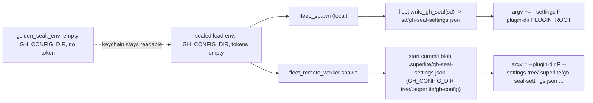

# B295: workers of a sealed golden lead start sealed too; the gh keychain stays readable (#1049)

**Goal:** a worker spawned by a sealed lead (its spawner pins `GH_CONFIG_DIR`) starts like the lead since B292 and B294: `claude ... --settings <seal file> --plugin-dir <checkout under test>`, on this Mac (fleet.py `_spawn`) and on a remote Herdr machine (fleet_remote_worker.py `spawn`); the keychain decision (leave it readable) is pinned in test_golden_seal.py.
**Architecture:** the seal helpers move from fleet_lead.py into fleet.py beside `PASS_THROUGH` (`GH_TOKENS`, `GH_SEAL_FILE`, `PLUGIN_ROOT`, `gh_seal_env`, `write_gh_seal`, `plugin_dir`); fleet_lead.py keeps them as aliases of fleet's, so `_spawn_lead` and its tests run unchanged. `fleet._spawn` writes `<sd>/gh-seal-settings.json` for a sealed spawner and appends `--settings` and `--plugin-dir` to the worker argv. `fleet_remote_worker.spawn` puts the seal file into the remote start commit (`.superlite/gh-seal-settings.json`, `GH_CONFIG_DIR` set to a host path) and appends `--settings <tree>/.superlite/gh-seal-settings.json` after its existing `--plugin-dir`.
**Tech stack:** Python 3 stdlib (json, os, pathlib); pytest via `sl run_tests`.
**Spec:** issue #1049 (B292's two follow-ups of #1041, plus B294's follow-up of #1051).
**Detail:** tests
**Wave0:** none
**Coverage:** off

## Global constraints

- "Sealed" keeps B292's definition: the spawner env has a non-empty `GH_CONFIG_DIR`. An unsealed spawn's argv, env and start commit stay byte-identical to today's.
- Seal file name `gh-seal-settings.json` (`fleet.GH_SEAL_FILE`), content `{"env": {...}}` written as `json.dumps(obj, indent=2) + "\n"`; the env maps each of `GH_TOKEN`, `GITHUB_TOKEN`, `GH_ENTERPRISE_TOKEN`, `GITHUB_ENTERPRISE_TOKEN` that the spawner lacks (missing or empty) to `""` and pins `GH_CONFIG_DIR`.
- Local worker argv: the pair `["--settings", str(<sd resolved>/gh-seal-settings.json)]`, then `["--plugin-dir", str(fleet.PLUGIN_ROOT)]` only when `plugin_dir()` is not None, both appended right after `fleet_roles.skills_read(...)` and before `--append-system-prompt` / `--add-dir`.
- Remote worker argv: `["--plugin-dir", plugin, "--settings", f"{tree}/.superlite/gh-seal-settings.json"] + <today's rest>`; the remote seal's `GH_CONFIG_DIR` is `f"{tree}/.superlite/gh-config"` (a folder that does not exist on the host: gh 2.103.3 then has no login, `gh api user` exit 4, measured by the lead); the remote pane env stays without `GH_CONFIG_DIR`.
- The keychain stays readable: no seal sets a token variable to a non-empty or invalid value (Max's decision on #1049).
- Files this batch may touch: skills/subagent-driven-development/scripts/fleet.py, fleet_lead.py, fleet_remote_worker.py, golden_seal.py; tests/scripts/test_fleet_lead.py, test_fleet.py (world fixture only), test_fleet_remote_worker.py, test_golden_seal.py; this plan. Never touch orchestrator.py, pool.py, feedback.py, scripts/test_layers.py or any file of open batches B296, B297, B298. An existing test that breaks: name it in the report, do not edit it without the lead's word, except the one named in T1's steps.
- Every new code line carries the file's trailing `# O(...)` complexity comment, as the lines around it do.
- Builds: the verdict is `sl run_tests` (the project's test command; a project with `.maxapp` runs `maxapp test`, which a build pool may place on another Mac, and a full run whose tree a green maxapp test stamp covers returns that result without a run); task trees build in <tree>/.build/DerivedData and any build of your own goes under .build/ of the worktree, never -derivedDataPath outside the worktree (your session scratchpad included; backlog cleanup removes scratchpad build folders when the worktree goes); a product, simulator or device build stays on this machine and runs only when an issue's acceptance asks for a running-app check; copy this sentence into every worker brief.
- Simulators: append the UDID of each simulator you or a worker creates (`xcrun simctl create` or `clone`; a checker's `Simulators:` line marks its created ones) as one line to /Users/max/github/superlite/.claude/worktrees/superlite-b295-seal-golden-workers-and-keychain/.superlite/simulators.txt; never list one you did not create; ship cleanup shuts down and deletes each listed one; copy this sentence into every worker brief.

Ruling: the keychain stays readable (Max's decision): golden_seal.py gains only a comment at `_env`, and test_golden_seal.py pins that the seal clears tokens to `""` and sets none to a placeholder (Max).
Ruling: [scope] #1049 also takes B294's follow-up (sealed workers load the installed plugin): the worker argv gains `--plugin-dir` beside `--settings`, because the same argv and the same file change and B294 pointed it here (lead's ruling).
Ruling: the helpers move into fleet.py with fleet_lead.py aliases (`gh_seal_env = fleet.gh_seal_env`, ...), so fleet_lead's callers and the B292/B294 tests keep their names; fleet.py never imports fleet_lead (no cycle) (lead's ruling).
Ruling: `write_gh_seal` writes through a temp file and `os.replace`, since a lead and its local workers share `<lead state>/gh-seal-settings.json` and several spawns can write it at once with the same content (lead's ruling).
Ruling: a remote worker is sealed from the spawner's `os.environ` (frw.spawn has no env parameter; `fra.pick` reads it the same way); its seal rides in the start commit, so no extra remote write (lead's ruling).
Ruling: the world fixtures of test_fleet.py and test_fleet_remote_worker.py clear `GH_CONFIG_DIR`, because golden runs the project suite with it pinned and a spawn with `env=None` would then be sealed (lead's ruling).
Ruling: fleet_layer.py (test-layer panes) is no worker of a golden lead's build and stays as it is (lead's ruling).

## Main diagram



## File structure

- skills/subagent-driven-development/scripts/fleet.py: seal helpers beside `PASS_THROUGH`; `_spawn` seals a worker; docstring line (#1049).
- skills/subagent-driven-development/scripts/fleet_lead.py: the six names become aliases of fleet's.
- tests/scripts/test_fleet_lead.py: four new tests; one monkeypatch target changes.
- tests/scripts/test_fleet.py: `world` fixture clears `GH_CONFIG_DIR`.
- skills/subagent-driven-development/scripts/fleet_remote_worker.py: remote seal blob and argv; docstring sentence.
- tests/scripts/test_fleet_remote_worker.py: two new tests; `world` fixture clears the gh variables.
- skills/subagent-driven-development/scripts/golden_seal.py: comment at `_env`.
- tests/scripts/test_golden_seal.py: one new test.

## Task graph

```mermaid
%% schedule
gantt
  title Predicted schedule (mm:ss)
  dateFormat X
  axisFormat %M:%S
  section lane 1
  T1 local worker seal :t1, 0, 464s
  T2 remote worker seal and keychain pin :t2, 464, 463s
```




critical path: T1 → T2 (15.4 min) · peak width 1 · predicted build 15.4 min · predicted total ≈ 29.9 min

## Local workers

**Probe entry:** none (spawn helpers with no runnable entry; the named tests drive fleet.spawn through the in-process herdr fake)

### T1 local worker seal · Complexity 3 (O-1) · Est. context 34k
**Owns:** skills/subagent-driven-development/scripts/fleet.py, skills/subagent-driven-development/scripts/fleet_lead.py, tests/scripts/test_fleet_lead.py, tests/scripts/test_fleet.py
**Components:** 1
**LOC owned:** 70
**Tests:** fast
**Kind:** design
**Model:** sonnet
**Produces:** fleet.GH_TOKENS: tuple · fleet.GH_SEAL_FILE: str · fleet.PLUGIN_ROOT: Path · fleet.gh_seal_env(base_env: dict, gh_dir: str | None = None) -> dict · fleet.write_gh_seal(sd, base_env: dict) -> Path | None · fleet.plugin_dir(root=None) -> Path | None
e.g. gh_seal_env({"HOME": "/u"}) -> {}
e.g. gh_seal_env({"GH_CONFIG_DIR": "/e", "GH_TOKEN": "t"}, gh_dir="/r/gh") -> {"GITHUB_TOKEN": "", "GH_ENTERPRISE_TOKEN": "", "GITHUB_ENTERPRISE_TOKEN": "", "GH_CONFIG_DIR": "/r/gh"}
e.g. gh_seal_env({"GH_CONFIG_DIR": "/e"}) -> {"GH_TOKEN": "", "GITHUB_TOKEN": "", "GH_ENTERPRISE_TOKEN": "", "GITHUB_ENTERPRISE_TOKEN": "", "GH_CONFIG_DIR": "/e"}
**Review Focus:** state: two spawns writing the shared seal file never leave a torn file (temp file + `os.replace`); protocol: an unsealed worker's argv is unchanged (`test_unsealed_worker_starts_without_settings_or_plugin_dir`); the B292/B294 lead tests stay green.
**Test code (verbatim):**
```python
# appended to tests/scripts/test_fleet_lead.py (#1049)
def test_gh_seal_lives_in_fleet_beside_pass_through():
    assert fl.gh_seal_env is fleet.gh_seal_env and fl.write_gh_seal is fleet.write_gh_seal and fl.plugin_dir is fleet.plugin_dir
    assert (fl.GH_TOKENS, fl.GH_SEAL_FILE, fl.PLUGIN_ROOT) == (fleet.GH_TOKENS, fleet.GH_SEAL_FILE, fleet.PLUGIN_ROOT)
    assert fleet.gh_seal_env({"GH_CONFIG_DIR": "/e", "GH_TOKEN": "t"}, gh_dir="/r/gh") == {
        "GITHUB_TOKEN": "", "GH_ENTERPRISE_TOKEN": "", "GITHUB_ENTERPRISE_TOKEN": "", "GH_CONFIG_DIR": "/r/gh"}
    assert fleet.gh_seal_env({"HOME": "/u"}, gh_dir="/r/gh") == {}


def test_sealed_lead_worker_starts_with_the_gh_seal_settings(world, tmp_path):
    gh = tmp_path / "gh"; gh.mkdir()
    fleet.main(["on", "--accounts", "claude1,claude3"])
    r = fleet.spawn(world.sd, world.plan, "sonnet", world.proj, env={"HOME": "/u", "GH_CONFIG_DIR": str(gh), **SEALED})
    argv = next(c[2] for c in world.fh.calls if c[0] == "start_agent")
    f = world.sd.resolve() / fleet.GH_SEAL_FILE
    assert argv[argv.index("--settings") + 1] == str(f)
    assert json.loads(f.read_text(encoding="utf-8")) == {"env": {**SEALED, "GH_CONFIG_DIR": str(gh)}}
    assert not list(world.sd.glob(fleet.GH_SEAL_FILE + ".*"))
    assert json.loads((world.sd / "fleet.json").read_text())["workers"][r["id"]]["launch"]["argv"] == argv


def test_sealed_lead_worker_loads_the_plugin_of_its_scripts_checkout(world, tmp_path):
    gh = tmp_path / "gh"; gh.mkdir()
    fleet.main(["on", "--accounts", "claude1,claude3"])
    fleet.spawn(world.sd, world.plan, "sonnet", world.proj, env={"HOME": "/u", "GH_CONFIG_DIR": str(gh)})
    argv = next(c[2] for c in world.fh.calls if c[0] == "start_agent")
    assert argv.count("--plugin-dir") == 1 and argv[argv.index("--plugin-dir") + 1] == str(fleet.PLUGIN_ROOT)
    assert argv.index("--plugin-dir") == argv.index("--settings") + 2


def test_unsealed_worker_starts_without_settings_or_plugin_dir(world):
    fleet.main(["on", "--accounts", "claude1,claude3"])
    fleet.spawn(world.sd, world.plan, "sonnet", world.proj, env={"HOME": "/u", "GH_TOKEN": "t"})
    argv = next(c[2] for c in world.fh.calls if c[0] == "start_agent")
    assert "--settings" not in argv and "--plugin-dir" not in argv and not (world.sd / fleet.GH_SEAL_FILE).exists()


def test_sealed_worker_without_a_plugin_manifest_loads_the_installed_plugin(world, tmp_path, monkeypatch):
    monkeypatch.setattr(fleet, "PLUGIN_ROOT", tmp_path / "bare")
    gh = tmp_path / "gh"; gh.mkdir()
    fleet.main(["on", "--accounts", "claude1,claude3"])
    fleet.spawn(world.sd, world.plan, "sonnet", world.proj, env={"HOME": "/u", "GH_CONFIG_DIR": str(gh)})
    argv = next(c[2] for c in world.fh.calls if c[0] == "start_agent")
    assert "--settings" in argv and "--plugin-dir" not in argv
```
**Steps:** 1 append the tests as given, 2 `sl run_tests --fast tests/scripts/test_fleet_lead.py --task T1`: FAIL (AttributeError on `fleet.gh_seal_env`; no `--settings` in the worker argv), 3 implement: in fleet.py right below `PASS_THROUGH` add `GH_TOKENS`, `GH_SEAL_FILE`, `PLUGIN_ROOT = Path(__file__).resolve().parents[3]`, `gh_seal_env(base_env, gh_dir=None)` (B292's body; `GH_CONFIG_DIR` is `gh_dir` when given, else the spawner's), `write_gh_seal(sd, base_env)` (B292's contract, but written to `<path>.<pid>.tmp` then `os.replace`d onto `Path(sd) / GH_SEAL_FILE`), `plugin_dir(root=None)` (reads the module global `PLUGIN_ROOT` at call time); in fleet_lead.py replace the six definitions by `GH_TOKENS = fleet.GH_TOKENS`, `GH_SEAL_FILE = fleet.GH_SEAL_FILE`, `PLUGIN_ROOT = fleet.PLUGIN_ROOT`, `gh_seal_env = fleet.gh_seal_env`, `write_gh_seal = fleet.write_gh_seal`, `plugin_dir = fleet.plugin_dir`; in `fleet._spawn` after the `skills_read` line: `seal = write_gh_seal(sd.resolve(), base)`, and when it is not None `argv += ["--settings", str(seal)]` then, when `plugin_dir()` is not None, `argv += ["--plugin-dir", str(<it>)]`; add one line to fleet.py's module docstring: "A worker whose spawner pins GH_CONFIG_DIR (a sealed golden lead) starts with the lead's `--settings <state>/gh-seal-settings.json` and `--plugin-dir <this checkout>` (#1049)."; in test_fleet_lead.py change the existing `test_sealed_lead_without_a_plugin_manifest_loads_the_installed_plugin` to `monkeypatch.setattr(fleet, "PLUGIN_ROOT", tmp_path / "bare")` (the only allowed edit of an existing test); in test_fleet.py's `world` fixture add `monkeypatch.delenv("GH_CONFIG_DIR", raising=False)` beside the `SUPERLITE_STATE_DIR` delenv, 4 rerun: PASS, then `sl run_tests --fast tests/scripts/test_fleet.py tests/scripts/test_fleet_lead_config_681.py tests/scripts/test_fleet_lead_b87.py tests/scripts/test_fleet_plan_lead_906.py tests/scripts/test_fleet_restore.py --task T1` (drop a path that does not exist): PASS.
**Notes:** `_spawn`'s `sd` is the lead's state folder when a lead spawns, so the worker reuses the lead's seal path (same content). `fleet restore` replays the recorded `launch.argv`, so a restored worker keeps the seal.

## Remote workers and the keychain pin

**Probe entry:** none (remote spawn needs the herdr and remote-tree fakes; the named tests drive it)

### T2 remote worker seal and keychain pin · Complexity 3 (O-1) · Est. context 36k
**Owns:** skills/subagent-driven-development/scripts/fleet_remote_worker.py, tests/scripts/test_fleet_remote_worker.py, skills/subagent-driven-development/scripts/golden_seal.py, tests/scripts/test_golden_seal.py
**Components:** 1
**LOC owned:** 60
**Tests:** fast
**Kind:** design
**Model:** sonnet
**Consumes:** fleet.gh_seal_env(base_env: dict, gh_dir: str | None = None) -> dict (T1) · fleet.GH_SEAL_FILE: str (T1) · fleet.GH_TOKENS: tuple (T1)
**Review Focus:** encoding: the start-commit blob is the exact JSON bytes of the constraint, not passed through the path mapper; protocol: an unsealed remote spawn's argv and start commit are unchanged (`test_unsealed_spawner_starts_the_remote_worker_without_settings`); state: `GH_CONFIG_DIR` never reaches the remote pane env.
**Test code (verbatim):**
```python
# appended to tests/scripts/test_fleet_remote_worker.py (#1049)
def test_sealed_spawner_seals_the_remote_worker(world, monkeypatch):
    monkeypatch.setenv("GH_CONFIG_DIR", str(world.tmp / "gh"))
    started(world)
    tree = str(world.trees / fr.tree_name(world.sd, "W1"))
    s = f"{tree}/.superlite/{fleet.GH_SEAL_FILE}"
    argv = next(c for c in world.fh.calls if c[0] == "start_agent")[2]
    assert argv[0] == "--plugin-dir" and argv[2:4] == ["--settings", s] and argv.count("--settings") == 1
    names, ref = start_files(world)
    assert f".superlite/{fleet.GH_SEAL_FILE}" in names
    want = {"env": {**{k: "" for k in fleet.GH_TOKENS}, "GH_CONFIG_DIR": f"{tree}/.superlite/gh-config"}}
    assert json.loads(show(world, ref, f".superlite/{fleet.GH_SEAL_FILE}")) == want
    assert "GH_CONFIG_DIR" not in world.panes[0]["env"] and record(world)["launch"]["argv"] == argv


def test_unsealed_spawner_starts_the_remote_worker_without_settings(world):
    started(world)
    argv = next(c for c in world.fh.calls if c[0] == "start_agent")[2]
    names, _ = start_files(world)
    assert "--settings" not in argv and f".superlite/{fleet.GH_SEAL_FILE}" not in names
```
```python
# appended to tests/scripts/test_golden_seal.py (#1049)
def test_seal_leaves_the_gh_keychain_login_readable(monkeypatch, tmp_path):
    """Max's decision on #1049: a sealed golden run keeps the macOS keychain login readable to `gh auth token`.
    The seal is an empty GH_CONFIG_DIR plus empty token variables (gh treats "" as unset), never an invalid token."""
    import fleet
    for k in fleet.GH_TOKENS:
        monkeypatch.delenv(k, raising=False)
    env = gs._env()
    assert not any(k in env for k in fleet.GH_TOKENS) and Path(env["GH_CONFIG_DIR"]).is_dir()
    assert fleet.gh_seal_env(env) == {**{k: "" for k in fleet.GH_TOKENS}, "GH_CONFIG_DIR": env["GH_CONFIG_DIR"]}
    gs.cleanup(tmp_path / "none")
```
**Steps:** 1 append the tests as given; in test_fleet_remote_worker.py's `world` fixture add `for k in ("GH_CONFIG_DIR", "GH_TOKEN", "GITHUB_TOKEN", "GH_ENTERPRISE_TOKEN", "GITHUB_ENTERPRISE_TOKEN"): monkeypatch.delenv(k, raising=False)` beside the `SUPERLITE_STATE_DIR` delenv, 2 `sl run_tests --fast tests/scripts/test_fleet_remote_worker.py tests/scripts/test_golden_seal.py --task T2`: FAIL (no `--settings` in the remote argv; the keychain test may already pass: it pins today's behaviour), 3 implement in fleet_remote_worker.py `spawn`: after `tree` is known, `seal = fleet.gh_seal_env(dict(os.environ), gh_dir=f"{tree}/.superlite/gh-config")`; when `seal`, `blobs[f".superlite/{fleet.GH_SEAL_FILE}"] = (json.dumps({"env": seal}, indent=2) + "\n").encode("utf-8")` (unmapped); the argv line becomes `["--plugin-dir", plugin] + (["--settings", f"{tree}/.superlite/{fleet.GH_SEAL_FILE}"] if seal else []) + <today's rest>`; add `import json`; one docstring sentence: "A worker of a sealed spawner (GH_CONFIG_DIR pinned) also starts with `--settings <tree>/.superlite/gh-seal-settings.json`, carried in its start commit, whose env clears the GitHub token variables and points GH_CONFIG_DIR at a folder the host does not have (#1049)."; in golden_seal.py `_env` add a comment on the `GH_CONFIG_DIR` line: the macOS keychain login stays readable to `gh auth token`; the seal sets no invalid token (Max's decision, #1049), 4 rerun: PASS, then `sl run_tests --fast tests/scripts/test_fleet_remote_script_1040.py tests/scripts/test_golden_remote_1040.py tests/scripts/test_fleet_remote_skills_read_905.py --task T2` (drop a path that does not exist): PASS.
**Notes:** `seal` must be computed inside the existing `try` (it needs `tree`) and stay defined for the argv line after it; when the spawner is unsealed nothing changes.

## Review Focus

- Package local workers (library, spawn path): state (shared seal file written by concurrent spawns), protocol (argv order, unsealed unchanged).
- Package remote workers (library, remote spawn): encoding (blob bytes), protocol (argv), state (pane env).
- Specific risk: a test run inside a sealed golden suite (`GH_CONFIG_DIR` pinned) must still see unsealed spawns in the fixtures that do not ask for a seal.
