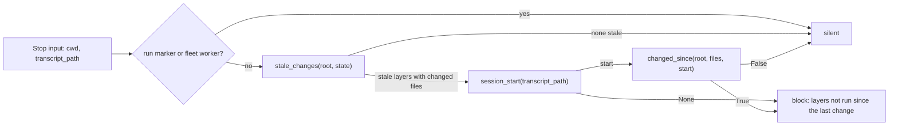
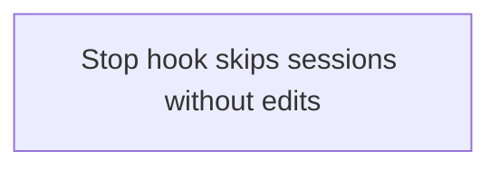

# B298: the test-layer Stop hook skips a session that changed no file of a stale layer (#914)

**Goal:** `scripts/test_layers.py check --hook` stays silent when no file of a stale layer changed since the session started, so a reviewer (or any session that edited nothing) is not re-prompted for the lead's earlier changes. A file changed during the session, or a session whose start is unknown, keeps the gate as today.
**Architecture:** three helpers in scripts/test_layers.py. `session_start` reads the epoch of the first `timestamp` in the Stop input's `transcript_path`. `stale_changes` returns each stale layer's files that differ from this checkout's last green manifest. `changed_since` says whether any of those files was written, moved or removed at or after that start (max of mtime and ctime; a removed file is checked through its nearest existing folder). `hook_check` blocks only when `changed_since` is true or the start is unknown. `stale_layers` becomes `list(stale_changes(...))`, so the stale rule lives in one place for the hook.
**Tech stack:** Python 3.10+ stdlib (json, os, datetime, pathlib); pytest via `sl run_tests`.
**Spec:** issue #914, its owner comment's open item "The repository's own test-layer Stop hook: 59 blocks in 33 sessions, 16 of them in sessions that edited nothing (reviewers)"; Max's decision: "Skip the gate when no edit was made".
**Detail:** full
**Wave0:** none
**Coverage:** off

## Global constraints

- `session_start(transcript) -> float | None`: `transcript` is the raw `transcript_path` value; the first JSON-object line, among at most `SESSION_LINES` = 200 lines and `SESSION_BYTES` = 1,000,000 characters, whose `timestamp` is a string gives the start: ISO 8601, a trailing `Z` read as UTC, no zone read as UTC; an unparsable first timestamp, a missing, unreadable or non-string path, or no timestamp within the caps gives None.
- `changed_since(root: Path, paths: list[str], start: float) -> bool`: True as soon as one repo-relative path has max(st_mtime, st_ctime) >= start; a path that does not exist is checked through its nearest existing parent folder (up to `root`); a stat error gives True.
- `stale_changes(root: Path, state: Path) -> dict[str, list[str]]`: in LAYERS order, each layer that has files, is not green and has no live run maps to `layer_store.changed_files(...)` for this checkout when it has a manifest, else (or when that list is empty) to every file of the layer, sorted.
- The block reason, the markers check, `stop_hook_active`, `SUPERLITE_TEST_LAYERS=off` and the `SUPERLITE_FLEET_WORKER` skip stay unchanged; an input without `transcript_path` blocks exactly as today, so every existing test keeps passing unedited.
- Files this batch may touch: scripts/test_layers.py, tests/scripts/test_test_layers.py and this plan. An existing test that breaks: name it in the report, do not edit it without the lead's word.
- Builds: the verdict is `sl run_tests` (the project's test command; a project with `.maxapp` runs `maxapp test`, which a build pool may place on another Mac, and a full run whose tree a green maxapp test stamp covers returns that result without a run); task trees build in <tree>/.build/DerivedData and any build of your own goes under .build/ of the worktree, never -derivedDataPath outside the worktree (your session scratchpad included; backlog cleanup removes scratchpad build folders when the worktree goes); a product, simulator or device build stays on this machine and runs only when an issue's acceptance asks for a running-app check; copy this sentence into every worker brief.
- Simulators: append the UDID of each simulator you or a worker creates (`xcrun simctl create` or `clone`; a checker's `Simulators:` line marks its created ones) as one line to /Users/max/github/superlite/.claude/worktrees/superlite-b298-token-audit-stop-hook-reviewers/.superlite/simulators.txt; never list one you did not create; ship cleanup shuts down and deletes each listed one; copy this sentence into every worker brief.

Ruling: "an edit" is a change to a file of a stale layer since the session's start, read from the files' mtime and ctime, not a scan of the transcript's tool names: a lead's edits made by its subagents (their own transcripts), its fleet workers, Bash (`sed -i`, `git apply`) or a human editor never show as an Edit call in the lead's transcript, so a tool-name scan would drop the gate for every lead that delegates (lead's ruling).
Ruling: ctime counts beside mtime, because `cp -p`, `tar -x`, `rsync -a` and `mv` keep an old mtime but set the ctime; a change only to files no stale layer holds (docs/, README) does not count (lead's ruling).
Ruling: the session start is the first `timestamp` of the Stop input's `transcript_path` (a Claude Code transcript's first timestamped line, a `queue-operation` written as the session starts); a resumed session's copied older lines only move the start earlier, which keeps the gate; an unknown start keeps the gate (lead's ruling).
Ruling: sized bounded (three helpers, the hook branch, their tests): one mechanical haiku task with code and tests given in full (lead's ruling).

## Main diagram



## File structure

- scripts/test_layers.py: `SESSION_LINES`, `SESSION_BYTES`, `session_start`, `changed_since`, `stale_changes`; `stale_layers` and `hook_check` use `stale_changes`.
- tests/scripts/test_test_layers.py: unit tests of the three helpers and two hook tests (silent when no stale file changed in the session, gate kept when the start is unknown or a stale file changed in it).

## Task graph

```mermaid
%% schedule
gantt
  title Predicted schedule (mm:ss)
  dateFormat X
  axisFormat %M:%S
  section lane 1
  T1 Stop hook skips sessions without edit :t1, 0, 582s
```





critical path: T1 (9.7 min) · peak width 1 · predicted build 9.7 min · predicted total ≈ 26.2 min

## Stop hook

**Probe entry:** none (a Stop hook read from stdin; the named tests run it through the CLI with real files and transcripts)

### T1 Stop hook skips sessions without edits · Complexity 3 (O-n) · Est. context 34k
**Owns:** scripts/test_layers.py, tests/scripts/test_test_layers.py
**Components:** 2
**LOC owned:** 140
**Tests:** fast
**Kind:** mechanical
**Model:** haiku
**Produces:** test_layers.session_start(transcript: object) -> float | None · test_layers.changed_since(root: Path, paths: list[str], start: float) -> bool · test_layers.stale_changes(root: Path, state: Path) -> dict[str, list[str]]
**Review Focus:** `test_hook_silent_when_the_session_changed_no_stale_file`: agents/a.md changed and hooks/x removed before a session starting 60 s from now gives no output; the same input with a start 60 s ago blocks with `unit headless evals not run since the last change: `. `test_hook_ignores_changes_outside_stale_layers_in_the_session`: a new docs/notes.md written after the start gives no output; commands/a.md written after it blocks. `test_changed_since_reads_mtime_ctime_and_removed_files`: a file whose mtime was set an hour back still counts from a start 60 s ago (ctime).
**Test code (verbatim):** in tests/scripts/test_test_layers.py add `import time` right after `import sys`, and `from datetime import datetime, timezone` right above `from pathlib import Path`. Then append at the end of the file:
```python
def session_log(tmp_path, start, name="t.jsonl"):
    """A Claude Code transcript whose first timestamped line starts the session at epoch `start` (#914)."""
    ts = datetime.fromtimestamp(start, timezone.utc).isoformat(timespec="milliseconds").replace("+00:00", "Z")
    path = tmp_path / name
    path.write_text("\n".join([json.dumps({"type": "agent-setting"}), "{not json",
                               json.dumps({"type": "queue-operation", "timestamp": ts}),
                               json.dumps({"type": "user", "timestamp": "2000-01-01T00:00:00Z"})]) + "\n")
    return path


def stop_input(repo, transcript):
    return json.dumps({"stop_hook_active": False, "cwd": str(repo), "transcript_path": str(transcript)})


def test_session_start_reads_the_first_timestamp(tmp_path):
    """#914: the first line holding a string `timestamp` starts the session; lines before it without one are skipped."""
    want = datetime(2026, 11, 18, 12, 29, 59, 168000, tzinfo=timezone.utc).timestamp()
    path = tmp_path / "t.jsonl"
    path.write_text('{"type": "agent-setting"}\n{not json\n[1, 2]\n{"timestamp": 5}\n'
                    '{"type": "queue-operation", "timestamp": "2026-11-18T12:29:59.168Z"}\n'
                    '{"timestamp": "2026-11-19T00:00:00Z"}\n')
    assert tl.session_start(str(path)) == pytest.approx(want)
    path.write_text('{"timestamp": "2026-11-18T12:29:59.168"}\n')
    assert tl.session_start(str(path)) == pytest.approx(want)
    path.write_text('{"timestamp": "2026-11-18T13:29:59.168+01:00"}\n')
    assert tl.session_start(str(path)) == pytest.approx(want)


def test_session_start_unknown_gives_none(tmp_path):
    """#914: no path, an unreadable one, an unparsable first timestamp or none within the caps: the start is unknown."""
    path = tmp_path / "t.jsonl"
    for value in (None, 5, "", str(tmp_path / "missing.jsonl"), str(tmp_path)):
        assert tl.session_start(value) is None
    path.write_text('{"timestamp": "yesterday"}\n{"timestamp": "2026-11-18T12:29:59Z"}\n')
    assert tl.session_start(str(path)) is None
    path.write_text('{"type": "x"}\n' * tl.SESSION_LINES + '{"timestamp": "2026-11-18T12:29:59Z"}\n')
    assert tl.session_start(str(path)) is None
    path.write_text(json.dumps({"type": "user", "text": "x" * tl.SESSION_BYTES}) + '\n{"timestamp": "2026-11-18T12:29:59Z"}\n')
    assert tl.session_start(str(path)) is None


def test_changed_since_reads_mtime_ctime_and_removed_files(tmp_path):
    """#914: a write, a move or copy that keeps an old mtime (ctime) and a removal (its nearest existing folder) count."""
    root = tmp_path / "r"
    (root / "a").mkdir(parents=True)
    (root / "a" / "f").write_text("x")
    old = time.time() - 3600
    os.utime(root / "a" / "f", (old, old))
    now = time.time()
    assert tl.changed_since(root, ["a/f"], now - 60) is True
    assert tl.changed_since(root, ["a/f"], now + 60) is False
    assert tl.changed_since(root, ["a/gone", "b/c/gone"], now + 60) is False
    assert tl.changed_since(root, ["b/c/gone"], now - 60) is True
    assert tl.changed_since(root, [], now - 60) is False


def test_stale_changes_names_each_stale_layers_changed_files(repo, tmp_path, store_api):
    """#914: each stale layer maps to its files that differ from this checkout's last green run (all of them without one)."""
    state = tmp_path / "s" / "test-layers.json"
    changes = tl.stale_changes(repo, state)
    assert list(changes) == ["unit", "headless", "tui", "evals"] == tl.stale_layers(repo, state)
    assert changes["unit"] == ["hooks/session-start", "hooks/x"]
    for layer in tl.LAYERS:
        store_api.record_green(state, layer, tl.layer_hash(layer, repo), tl.layer_digests(layer, repo), checkout=tl.checkout_key(repo))
    assert tl.stale_changes(repo, state) == {}
    (repo / "agents" / "a.md").write_text("changed\n")
    (repo / "hooks" / "x").unlink()
    store_api.start_run(state, "evals", tl.layer_hash("evals", repo), os.getpid())
    assert tl.stale_changes(repo, state) == {"unit": ["hooks/x"], "headless": ["agents/a.md", "hooks/x"]}
    if isinstance(store_api, FakeStore):
        store_api.green["tui"] = []
        assert tl.stale_changes(repo, state)["tui"] == ["hooks/session-start"]


def test_hook_silent_when_the_session_changed_no_stale_file(repo, tmp_path):
    """#914: a reviewer that edited nothing is not gated on changes made before its session started."""
    stamp_all(repo)
    (repo / "agents" / "a.md").write_text("changed\n")
    (repo / "hooks" / "x").unlink()
    r = cli(repo, "check", "--hook", stdin=stop_input(repo, session_log(tmp_path, time.time() + 60)))
    assert (r.returncode, r.stdout) == (0, "")
    r = cli(repo, "check", "--hook", stdin=stop_input(repo, session_log(tmp_path, time.time() - 60)))
    out = json.loads(r.stdout)
    assert out["decision"] == "block"
    assert out["reason"].startswith("unit headless evals not run since the last change: ")


def test_hook_ignores_changes_outside_stale_layers_in_the_session(repo, tmp_path):
    """#914: only a stale layer's file changed in the session keeps the gate; a doc no layer maps does not."""
    stamp_all(repo)
    (repo / "agents" / "a.md").write_text("changed\n")
    time.sleep(0.05)
    transcript = session_log(tmp_path, time.time())
    time.sleep(0.05)
    (repo / "docs").mkdir()
    (repo / "docs" / "notes.md").write_text("a doc no layer maps\n")
    r = cli(repo, "check", "--hook", stdin=stop_input(repo, transcript))
    assert (r.returncode, r.stdout) == (0, "")
    (repo / "commands" / "a.md").write_text("changed in the session\n")
    r = cli(repo, "check", "--hook", stdin=stop_input(repo, transcript))
    assert json.loads(r.stdout)["decision"] == "block"


def test_hook_blocks_when_the_session_start_is_unknown(repo, tmp_path):
    """#914: a missing transcript, one without a timestamp or a non-string path keeps the gate."""
    stamp_all(repo)
    (repo / "agents" / "a.md").write_text("changed\n")
    bare = tmp_path / "bare.jsonl"
    bare.write_text('{"type": "agent-setting"}\n')
    for stdin in (stop_input(repo, tmp_path / "missing.jsonl"), stop_input(repo, bare),
                  json.dumps({"stop_hook_active": False, "cwd": str(repo), "transcript_path": 5})):
        r = cli(repo, "check", "--hook", stdin=stdin)
        assert json.loads(r.stdout)["decision"] == "block"
```
**Code (verbatim):** in scripts/test_layers.py:

1. After `from pathlib import Path  # O(1)` add `from datetime import datetime, timezone  # O(1)`.
2. After `NO_RESULT = re.compile(...)  # O(1)` (the line starting `NO_RESULT = `) add:
```python
SESSION_LINES = 200  # O(1)  transcript lines read for the session start (#914)
SESSION_BYTES = 1_000_000  # O(1)  characters read for it
```
3. Replace the whole `stale_layers` function with:
```python
def stale_changes(root: Path, state: Path) -> dict[str, list[str]]:  # each stale layer's files changed since this checkout's last green run, all its files without one (#914) | O(L * n)
    checkout = checkout_key(root)  # O(1)
    out = {}  # O(1)
    for layer in LAYERS:  # O(L)
        digests = layer_digests(layer, Path(root))  # O(n * size)
        digest = hash_digests(digests)  # O(n)
        if not digests or layer_store.is_green(state, layer, digest) or layer_store.running(state, layer, digest):  # O(1)
            continue  # O(1)
        changed = layer_store.changed_files(state, layer, digests, checkout=checkout) if layer_store.has_manifest(state, layer, checkout=checkout) else []  # O(n)
        out[layer] = changed or sorted(digests)  # O(n log n)
    return out  # O(1)


def stale_layers(root: Path, state: Path) -> list[str]:  # O(1)
    return list(stale_changes(root, state))  # O(L * n)


def session_start(transcript) -> float | None:  # epoch of the first timestamp in the Stop input's transcript, None when unknown (#914) | O(1)
    if not isinstance(transcript, str) or not transcript:  # O(1)
        return None  # O(1)
    try:  # O(1)
        with open(transcript, encoding="utf-8", errors="ignore") as fh:  # O(1)
            read = 0  # O(1)
            for _ in range(SESSION_LINES):  # O(SESSION_LINES)
                line = fh.readline(SESSION_BYTES - read)  # O(size)
                if not line:  # O(1)
                    return None  # O(1)
                read += len(line)  # O(1)
                try:  # O(1)
                    entry = json.loads(line)  # O(size)
                except ValueError:  # O(1)
                    entry = None  # O(1)
                ts = entry.get("timestamp") if isinstance(entry, dict) else None  # O(1)
                if isinstance(ts, str):  # O(1)
                    return iso_epoch(ts)  # O(1)
                if read >= SESSION_BYTES:  # O(1)  readline(0) would read without a limit
                    return None  # O(1)
    except OSError:  # O(1)
        return None  # O(1)
    return None  # O(1)


def iso_epoch(ts: str) -> float | None:  # O(1)
    try:  # O(1)
        dt = datetime.fromisoformat(ts.replace("Z", "+00:00"))  # O(1)
    except ValueError:  # O(1)
        return None  # O(1)
    return (dt if dt.tzinfo else dt.replace(tzinfo=timezone.utc)).timestamp()  # O(1)


def changed_since(root: Path, paths: list[str], start: float) -> bool:  # a path written, moved or removed at or after start; a removed one through its nearest existing folder (#914) | O(n)
    root = Path(root)  # O(1)
    for path in paths:  # O(n)
        p = root / path  # O(1)
        while not p.exists() and p != root and p.parent != p:  # O(depth)
            p = p.parent  # O(1)
        try:  # O(1)
            st = p.stat()  # O(1)
        except OSError:  # O(1)
            return True  # O(1)
        if max(st.st_mtime, st.st_ctime) >= start:  # O(1)
            return True  # O(1)
    return False  # O(1)
```
4. In `hook_check` replace the four lines from `    stale = stale_layers(root, state)  # O(L * n)` through `        print(json.dumps({"decision": "block", "reason": reason}))  # O(L)` with:
```python
    changes = stale_changes(root, state)  # O(L * n)
    if not changes:  # O(1)
        return 0  # O(1)
    start = session_start(data.get("transcript_path"))  # O(1)
    if start is not None and not changed_since(root, [p for paths in changes.values() for p in paths], start):  # O(n)
        return 0  # O(1)  the session changed no file of a stale layer: a reviewer is not gated on earlier changes (#914)
    names = " ".join(changes)  # O(L)
    reason = f"{names} not run since the last change: run `python3 scripts/test_layers.py run {names}` or `stamp <layer> --ruling \"<why>\"` (status: python3 scripts/test_layers.py status)"  # O(L)
    print(json.dumps({"decision": "block", "reason": reason}))  # O(L)
```
leaving `    return 0  # O(1)` as the function's last line.
**Steps:** 1 apply the test edits as given, 2 `sl run_tests --fast tests/scripts/test_test_layers.py --task T1`: FAIL (the seven new tests), 3 apply the four code edits as given, 4 rerun the file: PASS (every existing test too).
**Notes:** change nothing else in either file; keep the `# O(...)` comment on every code line, as test_layers.py does; the tests that read time sleep 50 ms around the session start so a file system clock that lags `time.time()` cannot reorder the writes.

## Review Focus

- Stop hook (CLI read from stdin, runs on every turn end of a session in this repo): file (mtime and ctime, a removed file through its folder, a stat error keeps the gate), encoding (transcript lines that are not JSON or not objects, a huge first line, `Z` and offset timestamps), compatibility (an input without `transcript_path` blocks as before; the block reason keeps its text; the fleet-worker, marker and `stop_hook_active` skips stay first).
- Risks: `readline(0)` reading a whole huge file; a removed path walking above the root forever; a session start taken from the newest line instead of the first.

## Self-review

Coverage: Max's decision (skip the gate when no edit was made) is T1's `hook_check` branch; an edit is a change to a stale layer's file since the session start (Rulings above); the start-unknown case keeps the gate. One task, no edges. Produces match the names the tests call. docs/testing.md's Stop hook paragraph (owned by B297) gets a follow-up, not an edit.
